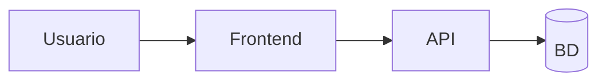

# 2 · TRD — Technical Requirements Document

> [!resumen]
> **Cómo** se construye lo que pide el [[1 - PRD]]: stack, arquitectura, integraciones, seguridad y restricciones. Cada decisión lleva su alternativa descartada.

## 1. Stack elegido
| Capa | Elección | Alternativa descartada | Por qué |
|---|---|---|---|
| Librerías de UI (obligatorio si hay interfaz: mínimo 1 o 2, regla 2026-11-13) |  | Escribir los componentes a mano |  |
| Frontend |  |  |  |
| Backend / API |  |  |  |
| Base de datos |  |  |  |
| Auth |  |  |  |
| Hosting / despliegue |  |  |  |

### 1.1 Ficha por librería (verificada, no de memoria)
Antes de fijar cada librería: `grep -i "<lib>" ~/.claude/rules/librerias.md`, docs vigentes con context7 y datos de npm. Si context7 no responde, declararlo.
| Librería | Versión | Último release | Mantenimiento | Peso (kB gzip) | Licencia | Node 22 / React 19 | Fuente | Trampas conocidas |
|---|---|---|---|---|---|---|---|---|

### 1.2 Presupuesto de dependencias
| Límite | Máximo | Previsto |
|---|---|---|
| Motores de animación (el que pida el nivel de dinamismo de la identidad) | 1 |  |
| Imágenes: formatos y peso (WebP/AVIF, SVG optimizado; sin generación de imagen en el producto salvo que el PRD lo pida) | — |  |
| Librerías de UI base | 1 + registries |  |
| JS inicial (kB gzip) | 200 |  |
| Dependencias directas | 25 |  |

Si lo previsto supera el máximo, justificarlo aquí o recortar.

## 2. Arquitectura

## 3. Integraciones y servicios externos
| Servicio | Para qué | Coste | Límites / cuotas | Plan B |
|---|---|---|---|---|

## 4. Seguridad y datos
- Autenticación y roles (trazan a los roles del PRD):
- Datos personales / RGPD:
- Secretos: nunca en el repo (`.env` + gestor).

## 5. Rendimiento y escalado
- Carga esperada, límites, persistencia (nada de memoria volátil en serverless).

## 6. Entornos y CI
- Local / staging / producción. Build y type-check antes de cada commit.

## 7. Trazabilidad PRD → técnica
| Requisito PRD | Solución técnica |
|---|---|
| RF-01 |  |

## 8. Riesgos técnicos
> [!riesgo]
> -

---
Anterior: [[1 - PRD]] · Siguiente: [[3 - UI-UX Design]]
