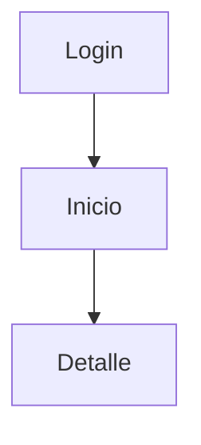
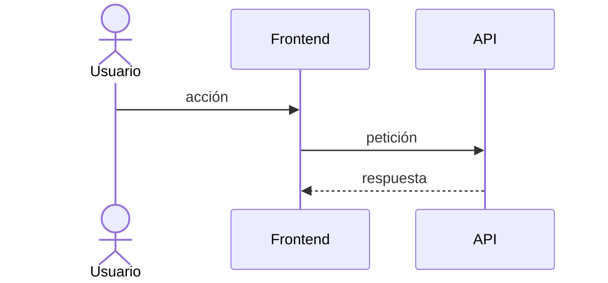

# 4 · AppFlow

> [!resumen]
> Cómo se mueve el usuario entre las pantallas de [[3 - UI-UX Design]]: navegación, flujos por rol, estados y errores. Sirve de contrato entre UI y backend.

## 1. Mapa de navegación

## 2. Flujos principales (uno por historia clave)
### Flujo 1 — <nombre> (US-01)

- Camino feliz:
- Alternativas y errores (red caída, validación, sin permisos):

## 3. Permisos por rol
| Pantalla / acción | Rol A | Rol B | Anónimo |
|---|---|---|---|

## 4. Estados globales
Carga inicial, sesión caducada, offline, vacío, error 500.

## 5. Cliente simulado
Antes de aprobar, un agente por rol recorre cada flujo e informa dónde se atascaría, qué no entiende y qué dato le falta.
- Prompt base: "Eres <rol> (<perfil: edad, nivel digital, dispositivo>). Recorre el flujo X solo con lo que ve en pantalla. Di en cada paso qué esperas, qué te confunde y dónde abandonarías."
| Rol simulado | Flujo | Atascos detectados | Cambio aplicado |
|---|---|---|---|

## 6. Ciclo completo a validar
- [ ] Crear → refrescar → editar → refrescar → borrar → refrescar

---
Anterior: [[3 - UI-UX Design]] · Siguiente: [[5 - Backend Schema]]
