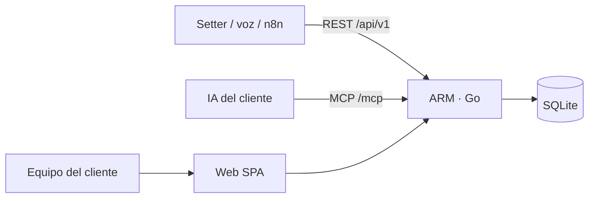

# ARM (Agentic Relation Manager)

> [!resumen] En cristiano
> Un CRM pensado para agentes. El Setter de WhatsApp (Mila), un futuro agente de voz y las automatizaciones **escriben** los leads por API; el cliente y su equipo solo entran a ver leads nuevos y cualificados. Si tiene demasiados, conecta ARM a Claude o ChatGPT por MCP y pregunta en lenguaje normal. Una instancia por cliente (un binario en Go + SQLite). Estado: 6 documentos aprobados, base de datos probada, identidad y logo aprobados, repo con scaffold y **sin código de aplicación**.

## Documentos
[[1 - PRD]] · [[Ficha de Investigacion]] · [[2 - TRD]] · [[3 - UI-UX Design]] · [[4 - AppFlow]] · [[5 - Backend Schema]] · [[6 - Plan de Implementacion]]

## Resumen técnico
- **Vía**: micro SaaS, owner NeoZeler, una instancia por cliente. Sin Paso 0 (decisión de Haytham). Sustituye a [[04_Archive/Panel de Leads]] (archivado).
- **Stack**: Go (chi, go-sdk MCP v1.8.0, `modernc.org/sqlite`), SPA Vite + React + Tailwind 4 + shadcn + magicui embebida con `go:embed`, Docker + Caddy, script `arm-alta`.
- **Modelo**: leads, mensajes, análisis, citas, notas, eventos, claves API con alcances. Cualificado = vista `leads_cualificados`. Idempotencia por `(origen, external_id)`.
- **Identidad**: «libro de registro» con margen de firmas; azul acero `#2F5F78` (del lazo del logo) + latón para agentes; Newsreader + Onest + IBM Plex Mono. Logo: lazo de Möbius triangular sobre cuadrado negro (`assets/`).

## Despliegue (2026-11-17)
> [!resumen] En cristiano
> ARM ya corre en el servidor Zorin, pero solo se alcanza desde dentro de ese servidor. Aún no hay web, ni HTTPS, ni copia diaria, ni datos reales.

- **Dónde**: Zorin `ssh@192.168.0.101` (la IP cambió desde `192.168.0.100`; alias `zorin` y fichas actualizados). Binario Linux compilado en local (sin CGO) en `~/Proyectos/arm-prod/` (`arm`, `data/arm.db`, `env`).
- **Servicio**: `arm.service` (systemd de usuario, linger activo, reinicio si falla) en `127.0.0.1:8200`; el CRM sigue en el 8100. Control: `zorin 'systemctl --user status arm'`.
- **Clave**: agente `setter-mila` (`leads:read`, `leads:write`, `citas:write`, `notas:write`) en `~/Proyectos/arm-prod/clave-setter.txt`, permisos 600, fuera de todo repo.
- **Verificado**: `/healthz` = `ok`; la API da 401 sin clave y 200 con ella.
- **Pendiente**: que n8n llegue a ARM (hoy solo `127.0.0.1`), importar las tablas viejas con `cmd/importar-setter` (T-08, commit `a4bcd1e`; solo hay 2 leads reales), HTTPS y copia diaria (T-14), actualizar el binario a mano al cambiar el código.

## Riesgos abiertos
> [!riesgo]
> - T-07: Claude.ai y ChatGPT pueden exigir OAuth (clave estática puede no valer). Plan B: Claude Desktop/Code o OAuth del SDK.
> - T-01: Go local 1.22.2 frente a go-sdk; comprobar.
> - Patrón de «CRM abandonado»: v1 limitada a fases 0-5 con un cliente real (el Setter).
> - RGPD: por MCP los datos salen a OpenAI/Anthropic; texto de leads = riesgo de inyección de prompt.

## Siguiente
T-08: exportar los 73 mensajes de n8n, importar y cambiar el workflow Setter para escribir en ARM (necesita permiso: Mila está en producción). Después T-09 y T-10. Pendiente además: SVG plano del logo, lockup «ARM por NeoZeler», Paleta de Componentes y cliente simulado del AppFlow.

