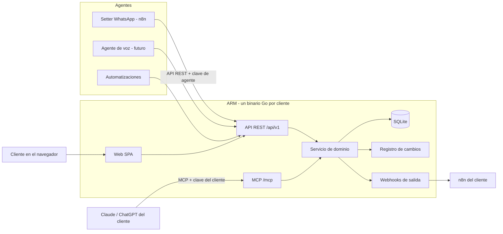

# 2 · TRD — ARM

> [!resumen] En cristiano
> Un solo programa en Go por cliente: guarda los datos en un archivo SQLite, ofrece una API para los agentes, un servidor MCP para Claude o ChatGPT, y sirve la web. Cada acceso usa una clave con permisos limitados. Se instala en el VPS de cada cliente detrás de Caddy.

Cómo se construye lo que pide el [[1 - PRD]].

## 1. Stack elegido
| Capa | Elección | Alternativa descartada | Por qué |
|---|---|---|---|
| Librerías de UI (mínimo 1 o 2) | shadcn + magicui (+ 21st si la Paleta lo pide) | Escribir los componentes a mano | Regla 2026-11-13/15; se concreta en la Paleta de Componentes |
| Frontend | Vite + React + Tailwind v4, SPA embebida en el binario (`go:embed`) | Next 16 con servidor Node | Sin SEO ni SSR; un solo proceso por cliente |
| Backend / API | Go + `net/http` + `chi`; OpenAPI (Huma si encaja) | FastAPI | Regla Go 2026-11-12; binario único |
| MCP | `modelcontextprotocol/go-sdk` v1.8.0 sobre Streamable HTTP, mismo proceso que la API | MCP como proceso aparte en Node | Reutiliza el mismo servicio de dominio; una sola auth |
| Base de datos | SQLite (`modernc.org/sqlite`, sin CGO), WAL, `foreign_keys=ON` | PostgreSQL / Supabase | Una instancia por cliente; copia con `VACUUM INTO`; sin coste |
| Auth web | Usuario y contraseña (hash Argon2id) + cookie de sesión `HttpOnly` | Magic link por correo | Sin depender de un servidor de correo en v1 |
| Auth API / MCP | Claves de API (`arm_live_…`), guardadas con hash, con alcance y fecha de caducidad opcional | OAuth 2.1 completo | v1 simple; OAuth queda como riesgo (§8) |
| Hosting / despliegue | Docker + Caddy en el VPS del cliente; alta por script Go | Vercel | Datos de leads en servidor propio; ya probado en Panel de Leads |

### 1.1 Ficha por librería (verificada el 2026-11-17)
| Librería | Versión | Último release | Mantenimiento | Peso | Licencia | Compatibilidad | Fuente | Trampas |
|---|---|---|---|---|---|---|---|---|
| `modelcontextprotocol/go-sdk` | v1.8.0 | 2026-09-04 | oficial | n/a (Go) | por verificar | Go local 1.22.2: **por comprobar** | proxy.golang.org, context7 | `RequireBearerToken` comprueba caducidad y alcances; el token llega al handler en `req.Extra.TokenInfo` |
| `modernc.org/sqlite` | v1.62.0 | 2026-11-07 | activo | n/a | BSD-3 (verificar) | arm64 probado en Grid64 | proxy.golang.org | `foreign_keys` por conexión |
| `go-chi/chi` | v5.5.0 | 2026-10-14 | activo | n/a | MIT | — | proxy.golang.org | — |
| `danielgtaylor/huma/v2` | v2.40.0 | 2026-10-27 | activo | n/a | MIT | encaje con `chi` por verificar | proxy.golang.org | spike |
| Vite | 8.3.8 | 2026-11-16 | activo | build | MIT | Node 22 | npm | Node 18 del sistema rompe: usar el de fnm |
| Tailwind | 4.3.5 | 2026-11-17 | activo | — | MIT | — | npm | `librerias.md` (PostCSS) |
| shadcn (CLI) | 4.23.0 | 2026-10-27 | activo | por componente | MIT | React 19 | npm | `base-nova`: `render={…}` en vez de `asChild` |
| `@tanstack/react-query` | 5.108.0 | 2026-11-17 | activo | por medir | MIT | React 19 | npm | — |
| `@dnd-kit/core` | 6.3.1 | 2024-12-05 | casi un año sin release | por medir | MIT | por verificar | npm | decidir si se usa o se hace con drag nativo |

### 1.2 Presupuesto de dependencias
| Límite | Máximo | Previsto |
|---|---|---|
| Motores de animación | 1 | 1 (el que pida la identidad) |
| Imágenes | WebP/AVIF, SVG optimizado | solo logo del cliente |
| Librerías de UI base | 1 + registries | shadcn + magicui |
| JS inicial (kB gzip) | 200 | por medir |
| Dependencias directas (npm) | 25 | ~12 |
| Dependencias directas (Go) | — | 4: chi, sqlite, go-sdk, huma (opcional) |

## 2. Arquitectura

Regla: API, MCP y web llaman al **mismo servicio de dominio**, así el cualificado, el registro de cambios y los permisos viven en un solo sitio.

## 3. Integraciones y servicios externos
| Servicio | Para qué | Coste | Límites / cuotas | Plan B |
|---|---|---|---|---|
| n8n del cliente | Llama a la API de ARM; recibe webhooks | ya incluido | — | Llamadas directas desde el agente |
| Caddy | HTTPS automático | 0 | límites de Let's Encrypt | nginx + certbot |
| Claude / ChatGPT del cliente | Consumen el MCP | pago del propio cliente | el conector debe ver ARM desde internet | Claude Code o Claude Desktop con clave estática |
| Correo (aviso US-10, Could) | Avisar de lead cualificado | por fijar | — | Webhook a n8n |

## 4. Seguridad y datos
- **Roles** (trazan al PRD §2): `operador` (Haytham), `cliente` (web), `agente` (API), `cliente-ia` (MCP). Una clave tiene alcances: `leads:read`, `leads:write`, `citas:write`, `notas:write`, `claves:admin`.
- **Claves**: se muestran una vez, se guardan solo con hash (SHA-256 + sal o similar), con prefijo visible para identificarlas, revocables y con último uso registrado. Nunca en el repo.
- **MCP**: clave del cliente de solo lectura por defecto; la escritura (cambiar etapa, añadir nota) es un alcance aparte y se activa a propósito. Las herramientas de escritura no borran nada.
- **Inyección de instrucciones**: el texto de un lead (mensajes de WhatsApp) llega a una IA externa por MCP; las respuestas de las herramientas marcan el texto del lead como dato, y no existe herramienta que envíe mensajes ni borre.
- **RGPD**: aviso explícito al activar el MCP (los datos salen a OpenAI/Anthropic); registro de cambios; borrado y exportación de un lead a petición; contrato de encargado de tratamiento (fuera de alcance técnico, pendiente de revisar con asesoría).
- **Aislamiento**: una instancia y un archivo SQLite por cliente; no hay `cliente_id` compartido que filtrar mal.
- **Secretos**: `.env` con `chmod 600`; nada en el repo.

## 5. Rendimiento y escalado
- Carga esperada: cientos a pocos miles de leads por cliente y decenas de peticiones por minuto de los agentes. SQLite con WAL sobra.
- Limitación de peticiones por clave; paginación obligatoria en listados y en MCP (máx. 50 por llamada) para no volcar toda la base a una IA.
- Idempotencia: `PUT /leads/by-external/{origen}/{id}`; reintentos seguros.
- Persistencia: archivo en volumen de Docker; copia diaria con `VACUUM INTO`.

## 6. Entornos y CI
- Local (`go run` + `vite dev`), producción en el VPS del cliente. Sin staging en v1.
- Antes de cada commit: `go vet`, `go test ./...`, `tsc --noEmit` y build limpios.
- Pruebas: servicio de dominio (cualificado, permisos, idempotencia) con SQLite en memoria; contrato de la API contra el OpenAPI; una prueba de MCP con el cliente del SDK.

## 7. Trazabilidad PRD → técnica
| Requisito PRD | Solución técnica |
|---|---|
| RF-01 modelo propio | Esquema SQLite en [[5 - Backend Schema]] |
| RF-02 API REST + claves | `/api/v1` en `chi`, middleware de claves con alcance, OpenAPI |
| RF-03 MCP | `go-sdk` en `/mcp`, herramientas `buscar_leads`, `ver_lead`, `listar_cualificados`, `cambiar_etapa`, `anadir_nota` |
| RF-04 cualificado | Función única en el servicio de dominio, recalculada al escribir análisis o cita |
| RF-05 etapas | Columna `etapa` con lista cerrada (`CHECK`) |
| RF-06 registro de cambios | Tabla `eventos` escrita por el servicio en cada cambio |
| RF-07 web | SPA React; sesión por cookie |
| RF-08 marca blanca | Tabla `ajustes` (nombre, logo, color) leída por la SPA |
| RF-09 alta de instancia | Comando Go `arm-alta` que crea volumen, `.env`, usuario y claves |
| RF-10 webhooks | Tabla `webhooks` y envío con reintento |

## 8. Riesgos técnicos
> [!riesgo]
> - **OAuth del MCP**: Claude.ai y ChatGPT piden OAuth o conexión sin autenticar para conectores remotos personalizados; una clave estática puede no valer ahí. Verificar con los clientes reales antes de prometerlo (spike). Plan B: Claude Desktop o Claude Code con clave estática, o implementar OAuth con el `auth` del SDK.
> - **Versión de Go**: el entorno local tiene Go 1.22.2; comprobar si `go-sdk` v1.8.0 lo compila antes de fijar versiones.
> - **Huma + chi**: comprobar que encajan; si no, OpenAPI a mano.
> - **MCP y escritura**: una IA con permiso de escritura puede cambiar etapas por error. Por defecto lectura; con escritura, todo queda en `eventos` y es reversible.
> - **Migración del Setter**: cambiar de escribir en tablas de n8n a la API de ARM sin perder datos; hace falta script de importación y periodo en paralelo.
> - **ARM vs NeoZeler HQ**: si comparten modelo de datos, riesgo de acoplar un producto de cliente con el sistema interno. Mantener separados en v1.

---
Anterior: [[1 - PRD]] · Siguiente: [[3 - UI-UX Design]]

## Resultado del spike T-01 (2026-11-17)
- Go local 1.22.2; `go.mod` pide **Go 1.26.0** (lo exige `modernc.org/sqlite` v1.62.0). Con `GOTOOLCHAIN=auto` (por defecto) Go descarga solo el 1.26.11 y compila sin tocar el Go del sistema. En el servidor y en Docker usar imagen `golang:1.26`.
- Versiones fijadas y compiladas: `go-sdk` v1.8.0, `modernc.org/sqlite` v1.62.0, `chi` v5.5.0.
- Probado: SQLite con `foreign_keys=1` y WAL en cada conexión; servidor MCP con herramienta `ping` llamada por el cliente del SDK sobre HTTP. `go build`, `go vet` y `go test` en verde.
- **No probado**: Huma (OpenAPI). Queda para T-05.
