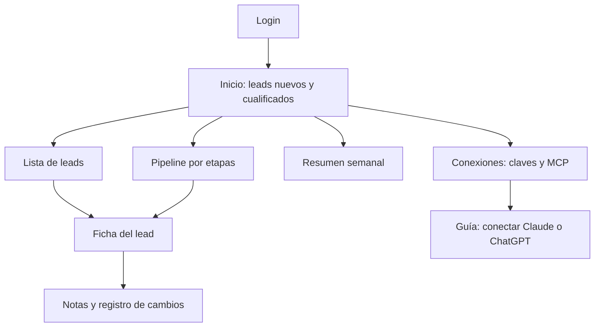
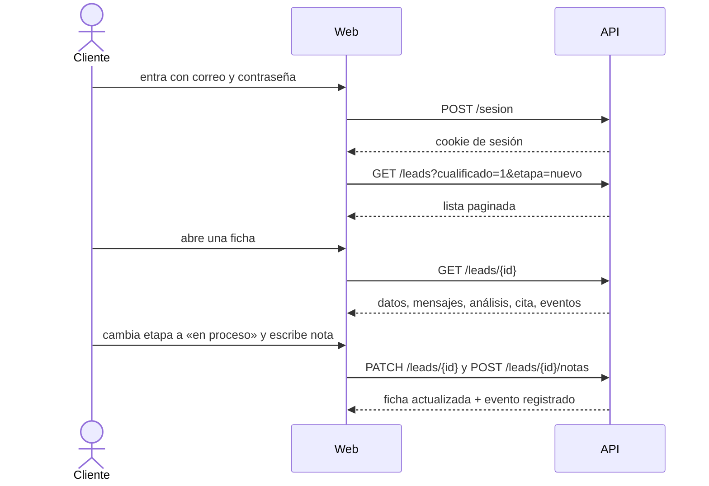
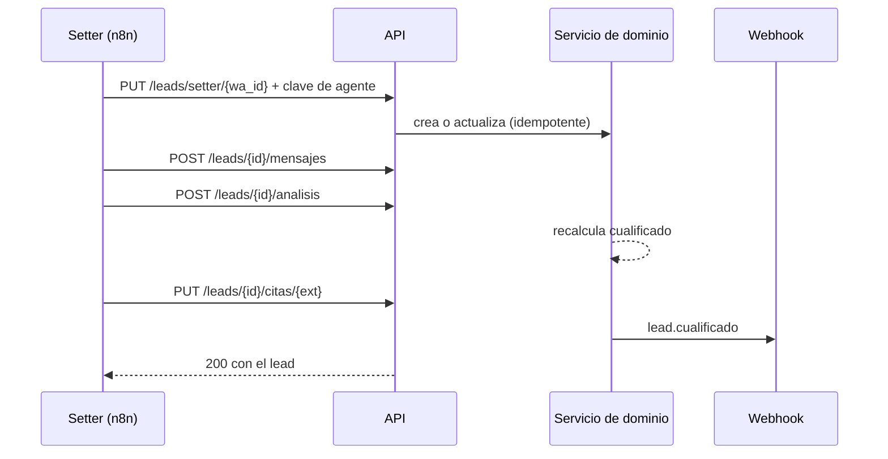
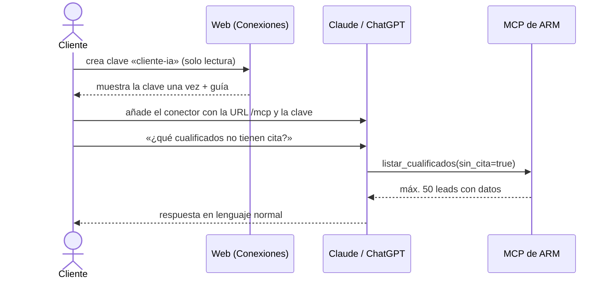

# 4 · AppFlow — ARM

> [!resumen] En cristiano
> Cómo se mueve cada persona o agente por ARM: el cliente entra y ve sus leads; el agente escribe por API; la IA del cliente lee por MCP. Incluye quién puede qué y qué pasa cuando algo falla.

Contrato entre [[3 - UI-UX Design]] y [[5 - Backend Schema]].

## 1. Mapa de navegación

## 2. Flujos principales
### Flujo 1 — El cliente ve a quién llamar hoy (US-01, US-02, US-04)

- Camino feliz: lista → ficha → etapa/nota → lista refrescada.
- Alternativas y errores: sesión caducada → login y vuelta a la misma ficha; red caída → aviso y reintento; lead cambiado por un agente mientras se edita → `409` y se recarga la ficha.

### Flujo 2 — Un agente rellena ARM (US-03, US-05)

- Camino feliz: el lead aparece cualificado sin que nadie toque nada.
- Errores: clave caducada o revocada `401`; sin alcance `403`; reintento de la misma llamada no duplica; datos mal formados `422`; límite por clave `429` (el agente espera y reintenta).

### Flujo 3 — El cliente pregunta a su IA por MCP (US-06)

- Errores: clave de solo lectura que intenta escribir → herramienta no disponible; clave revocada → la IA recibe `401` y se lo dice al usuario.

### Flujo 3b — Pantallas secundarias (US-08, US-09, US-10, US-11)
- **US-08 Pipeline**: la vista por etapas arrastra una ficha a otra columna; hace `PATCH /leads/{id}` con la etapa nueva y vuelve a la columna si da error.
- **US-09 Registro de cambios**: en la ficha, pestaña «Historial» con `GET /leads/{id}/eventos` (quién, cuándo, qué; agentes marcados con su nombre).
- **US-10 Avisos**: al cualificarse un lead se dispara el webhook `lead.cualificado`; n8n manda el WhatsApp o correo con enlace a la ficha.
- **US-11 Resumen semanal**: pantalla Resumen con entrados, cualificados y con cita de la semana.

### Flujo 4 — El operador da de alta un cliente (US-07, US-05)
`arm-alta <cliente>` crea volumen, `.env`, base con migración, usuario del cliente, clave de agente para el Setter y marca; imprime las claves una vez.

## 3. Permisos por rol
| Pantalla / acción | Operador | Cliente (web) | Agente (clave) | Cliente-IA (clave) | Anónimo |
|---|---|---|---|---|---|
| Ver lista y ficha | sí | sí | `leads:read` | `leads:read` | no |
| Crear/actualizar lead, mensajes, análisis | sí | no | `leads:write` | no | no |
| Citas | sí | no | `citas:write` | no | no |
| Cambiar etapa | sí | sí | `leads:write` | solo si se le da `leads:write` | no |
| Notas | sí | sí | `notas:write` | solo si se le da `notas:write` | no |
| Crear y revocar claves | sí | sí (sus claves de IA) | no | no | no |
| Ajustes y marca | sí | no | no | no | no |

## 4. Estados globales
Carga inicial con esqueleto; sesión caducada → login y vuelta; sin leads → pantalla vacía con explicación (y cómo conectar el Setter); sin conexión → aviso y reintento; error 500 → mensaje con identificador para soporte.

## 5. Cliente simulado
Pendiente: antes de aprobar, un agente por rol (recepcionista de clínica, dueño con muchos leads, Haytham como operador) recorre los flujos 1, 3 y 4.
| Rol simulado | Flujo | Atascos detectados | Cambio aplicado |
|---|---|---|---|
| (pendiente) | | | |

## 6. Ciclo completo a validar
- [ ] Crear lead por API → verlo en web → cambiar etapa → refrescar → borrar → refrescar, en producción

---
Anterior: [[3 - UI-UX Design]] · Siguiente: [[5 - Backend Schema]]
