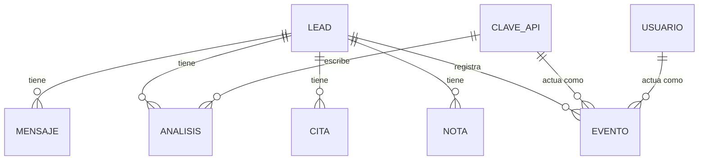

# 5 · Backend Schema — ARM

> [!resumen] En cristiano
> Las tablas donde ARM guarda todo: leads, mensajes, análisis, citas, notas, quién cambió qué, y las claves de acceso. Es SQLite (un archivo por cliente). Un lead cuenta como «cualificado» si tiene una cita o un análisis con algo rellenado; eso lo calcula una vista, no se teclea.

Modelo de datos y API que sostienen los flujos de [[4 - AppFlow]]. Base de datos nueva (no hay esquema remoto que verificar).

## 1. Diagrama entidad-relación


## 2. SQL ejecutable
Los bloques `sql` se concatenan en la migración y los `sql seed` en la semilla con `schema_to_migration.py`. Toda FK lleva `ON DELETE`. SQLite: `PRAGMA foreign_keys=ON` en cada conexión (lo pone la aplicación). Fechas en texto ISO 8601 UTC.
```sql
create table ajustes (
  clave text primary key,
  valor text not null
) strict;
create table usuarios (
  id text primary key,
  email text not null unique,
  nombre text not null,
  hash_clave text not null,
  rol text not null check (rol in ('operador','cliente')),
  created_at text not null default (strftime('%Y-%m-%dT%H:%M:%fZ','now'))
) strict;
create table claves_api (
  id text primary key,
  nombre text not null,
  tipo text not null check (tipo in ('agente','cliente-ia','operador')),
  prefijo text not null unique,
  hash_clave text not null,
  alcances text not null,
  caduca_en text,
  ultimo_uso text,
  revocada_en text,
  created_at text not null default (strftime('%Y-%m-%dT%H:%M:%fZ','now'))
) strict;
create table leads (
  id text primary key,
  origen text not null,
  external_id text,
  nombre text,
  telefono text,
  email text,
  empresa text,
  sector text,
  necesidad text,
  etapa text not null default 'nuevo'
    check (etapa in ('nuevo','en_proceso','cualificado','agendado','ganado','descartado')),
  created_at text not null default (strftime('%Y-%m-%dT%H:%M:%fZ','now')),
  updated_at text not null default (strftime('%Y-%m-%dT%H:%M:%fZ','now')),
  unique (origen, external_id)
) strict;
create index leads_telefono on leads (telefono);
create index leads_etapa on leads (etapa, updated_at);
create table mensajes (
  id text primary key,
  lead_id text not null references leads(id) on delete cascade,
  direccion text not null check (direccion in ('entrante','saliente')),
  canal text not null default 'whatsapp',
  texto text not null,
  enviado_en text not null,
  external_id text,
  unique (lead_id, external_id)
) strict;
create index mensajes_lead on mensajes (lead_id, enviado_en);
create table analisis (
  id text primary key,
  lead_id text not null references leads(id) on delete cascade,
  tipo_negocio text,
  problema text,
  servicio_interes text,
  resumen text,
  clave_id text references claves_api(id) on delete set null,
  created_at text not null default (strftime('%Y-%m-%dT%H:%M:%fZ','now'))
) strict;
create index analisis_lead on analisis (lead_id, created_at);
create table citas (
  id text primary key,
  lead_id text not null references leads(id) on delete cascade,
  inicio text not null,
  fin text,
  estado text not null default 'agendada' check (estado in ('agendada','cancelada','hecha')),
  external_id text,
  created_at text not null default (strftime('%Y-%m-%dT%H:%M:%fZ','now')),
  unique (lead_id, external_id)
) strict;
create index citas_lead on citas (lead_id, inicio);
create table notas (
  id text primary key,
  lead_id text not null references leads(id) on delete cascade,
  texto text not null,
  autor_tipo text not null check (autor_tipo in ('usuario','clave')),
  autor_id text not null,
  created_at text not null default (strftime('%Y-%m-%dT%H:%M:%fZ','now'))
) strict;
create index notas_lead on notas (lead_id, created_at);
create table eventos (
  id text primary key,
  lead_id text references leads(id) on delete cascade,
  tipo text not null,
  detalle text,
  usuario_id text references usuarios(id) on delete set null,
  clave_id text references claves_api(id) on delete set null,
  created_at text not null default (strftime('%Y-%m-%dT%H:%M:%fZ','now'))
) strict;
create index eventos_lead on eventos (lead_id, created_at);
create table webhooks (
  id text primary key,
  url text not null,
  evento text not null check (evento in ('lead.cualificado','cita.creada')),
  secreto text not null,
  activo integer not null default 1 check (activo in (0,1))
) strict;
create view leads_cualificados as
  select l.*
  from leads l
  where l.etapa <> 'descartado'
    and (
      exists (select 1 from citas c where c.lead_id = l.id and c.estado <> 'cancelada')
      or exists (
        select 1 from analisis a
        where a.lead_id = l.id
          and (coalesce(trim(a.tipo_negocio),'') <> ''
            or coalesce(trim(a.problema),'') <> ''
            or coalesce(trim(a.servicio_interes),'') <> '')
      )
    );
```
```sql seed
insert into ajustes (clave, valor) values ('marca_nombre', 'Clínica Dental Demo'), ('marca_color', '#0f766e');
insert into leads (id, origen, external_id, nombre, telefono, sector, necesidad, etapa) values
 ('l1','setter','wa-111','Marta Ruiz','600111111','clinica dental','implantes','agendado'),
 ('l2','setter','wa-222','Carlos Peña','600222222','clinica dental','ortodoncia invisible','cualificado'),
 ('l3','setter','wa-333','Lucía Gómez','600333333','clinica dental','limpieza','nuevo'),
 ('l4','setter','wa-444','Pablo Sanz','600444444','clinica dental','blanqueamiento','en_proceso'),
 ('l5','setter','wa-555','Elena Mora','600555555','clinica dental','implantes','descartado');
insert into mensajes (id, lead_id, direccion, texto, enviado_en, external_id) values
 ('m1','l1','entrante','Hola, quiero información sobre implantes','2026-11-16T09:00:00Z','a1'),
 ('m2','l1','saliente','Claro, ¿te va bien el jueves a las 17:00?','2026-11-16T09:01:00Z','a2'),
 ('m3','l3','entrante','Buenas, ¿cuánto cuesta una limpieza?','2026-11-17T07:30:00Z','a3');
insert into analisis (id, lead_id, tipo_negocio, problema, servicio_interes, resumen) values
 ('a1','l1',null,'pierde una muela','implantes','Quiere implante; disponible por la tarde'),
 ('a2','l2',null,'dientes torcidos','ortodoncia invisible','Pide presupuesto, sin cita aún');
insert into citas (id, lead_id, inicio, estado, external_id) values
 ('c1','l1','2026-11-19T17:00:00Z','agendada','cal-1');
```
Generar: `python3 ~/Proyectos/flujo-software/tools/schema_to_migration.py "<este archivo>" ~/Proyectos/arm/db`

## 2.1 Documentación de tablas
| Tabla | Para qué | Claves y borrado |
|---|---|---|
| `leads` | Persona interesada. `(origen, external_id)` único = idempotencia por agente | Raíz; borrarla borra mensajes, análisis, citas, notas y eventos (`CASCADE`) |
| `mensajes` | Conversación; `(lead_id, external_id)` único evita duplicar al reintentar | `CASCADE` desde `leads` |
| `analisis` | Lo que el Setter entiende; el último por fecha manda | `CASCADE`; `clave_id` → `SET NULL` si se borra la clave |
| `citas` | Citas; una `agendada` o `hecha` cualifica | `CASCADE` |
| `notas` | Notas del cliente o de agentes | `CASCADE` |
| `eventos` | Registro de cambios (quién, cuándo, qué) | `CASCADE` con el lead; `usuario_id`/`clave_id` → `SET NULL` |
| `claves_api` | Claves hasheadas con alcances (JSON en `alcances`) | Se revocan (`revocada_en`), no se borran |
| `usuarios` | Acceso web (operador, cliente) | — |
| `webhooks` | Salidas a n8n | — |
| `ajustes` | Marca blanca (nombre, logo, color) | — |

- **Índices**: por teléfono (cruce con el Setter), por etapa+fecha (listas) y por lead en tablas hijas.
- **Teléfono**: se normaliza al entrar a 9 dígitos, sin prefijo 34 ni `@s.whatsapp.net` (lección del Setter).

## 3. Seguridad de datos
- Una base por cliente: no hay `cliente_id` que filtrar; el aislamiento es el archivo.
- Claves y contraseñas solo como hash; la clave completa se muestra una vez al crearla.
- Permisos por alcance en la capa de servicio (traza a [[4 - AppFlow]] §3): `leads:read`, `leads:write`, `citas:write`, `notas:write`, `claves:admin`.
- Archivos: solo el logo del cliente, en el volumen de Docker. Copia diaria con `VACUUM INTO`.

## 4. API / endpoints
Prefijo `/api/v1`. Todas con `Authorization: Bearer arm_…` o cookie de sesión (web).
| Método | Ruta | Alcance | Entrada | Salida | Errores |
|---|---|---|---|---|---|
| PUT | `/leads/{origen}/{external_id}` | `leads:write` | datos del lead | lead | 400, 401, 403 |
| GET | `/leads` | `leads:read` | filtros `etapa`, `cualificado`, `q`, `desde`, `pagina` (máx. 50) | lista | 401, 403 |
| GET | `/leads/{id}` | `leads:read` | — | ficha completa | 404 |
| PATCH | `/leads/{id}` | `leads:write` | `etapa` y campos | lead | 400, 404, 409 |
| POST | `/leads/{id}/mensajes` | `leads:write` | mensaje con `external_id` | mensaje (idempotente) | 400, 404 |
| POST | `/leads/{id}/analisis` | `leads:write` | campos del análisis | análisis | 400, 404 |
| PUT | `/leads/{id}/citas/{external_id}` | `citas:write` | inicio, fin, estado | cita | 400, 404 |
| POST | `/leads/{id}/notas` | `notas:write` | texto | nota | 400, 404 |
| GET | `/leads/{id}/eventos` | `leads:read` | — | registro | 404 |
| POST | `/claves` | `claves:admin` | nombre, tipo, alcances | clave (se muestra una vez) | 400 |
| DELETE | `/claves/{id}` | `claves:admin` | — | revocada | 404 |
| POST | `/webhooks` | `claves:admin` | url, evento | webhook | 400 |
| POST | `/mcp` | alcance de la clave | protocolo MCP | herramientas | 401 |

Errores comunes: `401` clave ausente o caducada, `403` falta alcance, `429` límite por clave, `422` datos no válidos.

## 5. Migraciones
- Una migración inicial `init` y la semilla de demo (solo en instancias de prueba). Reversibilidad: se restaura la copia diaria; no hay `down` en v1.
- Instancias nuevas ejecutan la migración desde `arm-alta`.

## 6. Cálculos y reglas de negocio
- **Cualificado** = vista `leads_cualificados`: no descartado y (tiene cita no cancelada **o** su análisis tiene `tipo_negocio`, `problema` o `servicio_interes` con texto).
  Ejemplo con la semilla: `l1` (cita + análisis) y `l2` (solo análisis) son cualificados; `l3` y `l4` no; `l5` está descartado y no cuenta.
- **Etapa** `agendado` se pone sola al existir una cita `agendada`; `cualificado` se propone al cumplirse la regla y no baja a `nuevo`. El resto lo cambia una persona o una clave con `leads:write`.
- Cada cambio de etapa, análisis, cita o nota escribe un `evento` con el autor.

---
Anterior: [[4 - AppFlow]] · Siguiente: [[6 - Plan de Implementacion]]
