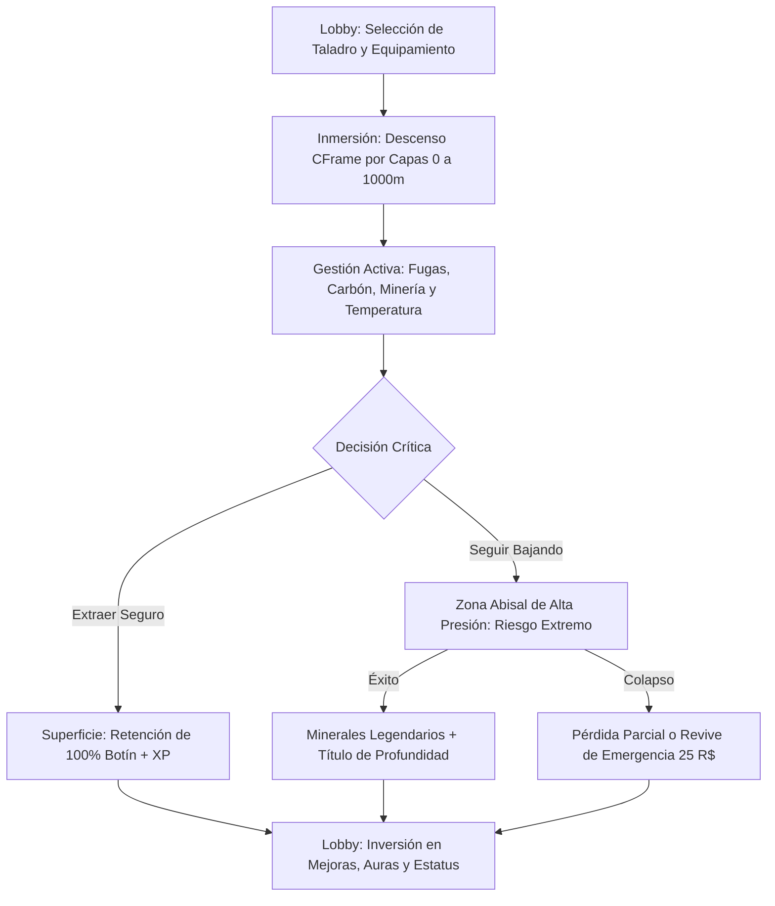
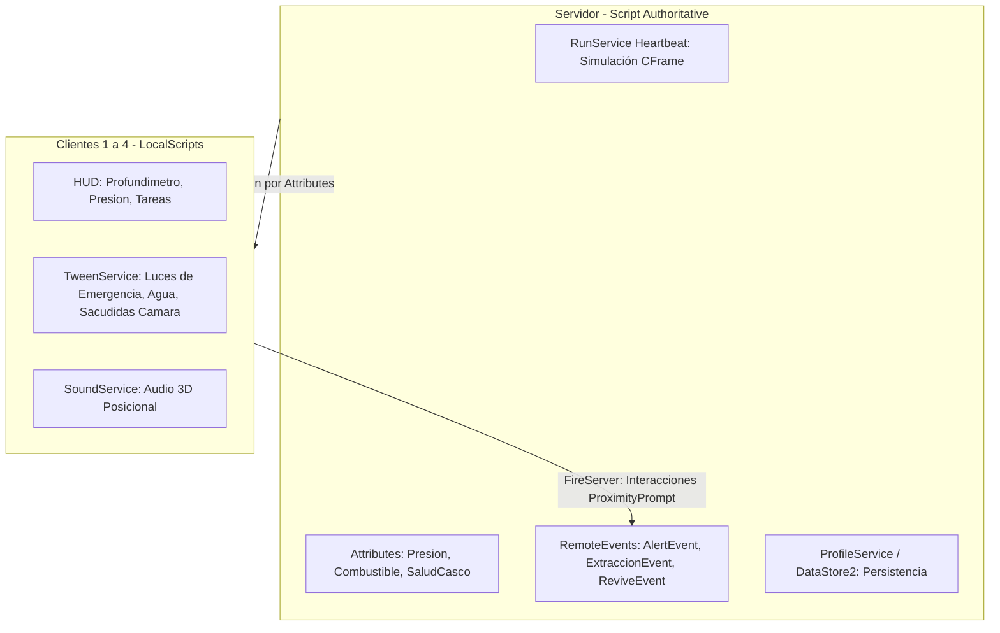

# Abisal Drill — Game Design Document & Ficha Técnica

> [!resumen]
> **Abisal Drill** es una experiencia multijugador cooperativa (1 a 4 jugadores) para Roblox que combina mecánicas de *Co-op Tycoon en tiempo real* con la tensión de un *Roguelite de extracción y descenso*. Los jugadores tripulan una perforadora submarina modular que desciende hacia simas abisales, reparando fugas, manteniendo la presión y extrayendo minerales antes de que el casco colapse. Diseñado desde la base bajo los 5 pilares de psicología del jugador de Roblox y optimizado para móvil/consola/PC.

---

## 1. Resumen Ejecutivo y Core Loop

### 1.1 El Gancho (Hook)
*"Tu equipo, un taladro submarino a 5.000 metros de profundidad y 30 segundos de oxígeno si la bomba falla. Llega más hondo que nadie y exhibe los minerales legendarios en el lobby."*

### 1.2 Bucle Central de Juego (Core Loop)



### 1.3 Regla de los Primeros 45 Segundos (Onboarding Fricción Cero)
- **0 a 10s**: Spawn directo en la pasarela del taladro; cuenta atrás de 5 segundos con aviso auditivo.
- **10 a 25s**: El taladro arranca su descenso. El profundímetro empieza a marcar metros inmediatamente (Pilar 1).
- **25 a 45s**: Primera micro-tarea sencilla guiada por un contorno brillante (ej. colocar un lingote de carbón en la caldera con `ProximityPrompt`). La velocidad del taladro aumenta visiblemente con un efecto sonoro de recompensa inmediata.

---

## 2. Aplicación de los 5 Pilares Psicológicos

| Pilar | Mecánica Concreta | Impacto Psicológico / Retención |
|---|---|---|
| **Pilar 1: Progreso Constante** | Profundímetro digital en pantalla, contador de cristales en tiempo real y barras de XP por cada tarea física (reparar, alimentar, taladrar). | Chute dopaminérgico cada 10-15 segundos. Cada acción tiene feedback numérico y sonoro instantáneo. |
| **Pilar 2: Presumir y Estatus Social** | Auras luminiscentes de presión (visibles en el lobby), placas con el récord de profundidad sobre el avatar y skins holográficas del taladro. | Deseo de exhibir logros difíciles frente a otros jugadores en el servidor central. |
| **Pilar 3: FOMO y Urgencia Diaria** | "Falla Geológica del Día" (mutador con recompensas 2x que expira cada 24h), tienda de cosméticos rotativa y racha de inmersiones diarias. | Formación del hábito de conexión diaria para no perder multiplicadores exclusivos. |
| **Pilar 4: Maestría y Sentirse Inteligente** | Sinergias de roles (ingeniero optimiza combustible, buzo extrae más rápido) y predicción de eventos por sonido antes de que ocurran. | Sensación de destreza y control técnico al salvar una inmersión al borde del colapso. |
| **Pilar 5: Experiencia Social y Comunidad** | Rescate mutuo con desfibrilador, salas de inmersión públicas/privadas y banco de recursos compartido durante la expedición. | Vínculo cooperativo sin toxicidad; el éxito de uno es el progreso de todos. |

---

## 3. Arquitectura Técnica en Roblox Studio

### 3.1 Diagrama de Replicación Cliente-Servidor



### 3.2 Solución de Riesgos Técnicos

1. **Física de Red (Lag-Free Movement)**:
   - El modelo del submarino no utiliza física rígida (`AssemblyLinearVelocity` / `BodyMover`). Permanece en una coordenada fija o se traslada exclusivamente mediante interpolación `CFrame` en el servidor a velocidad constante.
   - El movimiento visual del agua y las paredes rocosas utiliza texturas en movimiento (`Texture.OffsetStudsU/V`) y chunks modulares que se reciclan (`PartPooling`).
2. **Escalabilidad de 1 a 4 Jugadores**:
   - Algoritmo de cadencia de eventos:
   ```lua
   local cadenciaAverias = math.max(6, 18 - (#jugadoresConectados * 3))
   ```
   - Si `jugadoresConectados == 1` o `2`, se despliega automáticamente el **Dron Nautilus-Mini**, una entidad autónoma que repara automáticamente fugas secundarias si el jugador lo abastece con baterías.

---

## 4. Modelo de Monetización Ético

| Producto / Pase | Precio (R$) | Tipo | Justificación Psicológica |
|---|---|---|---|
| **Kit de Presurización de Emergencia (Revive)** | 25 R$ | Consumible por impulso | Salva la inmersión in extremis en cotas profundas; precio accesible de bajo rechazo. |
| **Aura de Presión Abisal (Cosmético Lobby)** | 149 R$ | Cosmético permanente | Estética y estatus puro (Pilar 2); proyecta un halo de bioluminiscencia en la espalda. |
| **Radiobaliza de Expedición (Server Booster)** | 99 R$ | Beneficio compartido | Otorga +25% de valor en minerales a **todos** los tripulantes de la sesión (presión social positiva). |
| **Skin de Taladro: "Kraken Mech"** | 299 R$ | Cosmético compartido | Modifica el aspecto exterior e interior del taladro para toda la tripulación durante la partida. |
| **Ranura de Inventario Extra de Cristales** | 75 R$ | Utilidad F2P-friendly | Permite almacenar 3 minerales adicionales por inmersión sin alterar la velocidad ni la salud. |

---

## 5. Inventario de Modelos 3D y Prompts Técnicos (Regla 9)

En cumplimiento de la **Regla 9** ([GEMINI.md](file:///home/haytham/Documentos/vault/GEMINI.md#L19)), los modelos 3D que requieren generación externa están modularizados en notas individuales dentro de `01_Projects/Abisal Drill/Prompts 3D/`:

| Asset | Archivo de Especificación | Archivos Generados (99_Assets) | Estado |
|---|---|---|---|
| **Taladro Submarino** | [[01_Projects/Abisal Drill/Prompts 3D/Taladro Submarino Industrial\|Taladro Submarino Industrial]] | `drill_pod.glb` / `.obj` (2,8 MB) | Completado |
| **Válvula de Emergencia** | [[01_Projects/Abisal Drill/Prompts 3D/Consola de Emergencia y Valvula\|Consola de Emergencia y Válvula]] | `pressure_relief_station.glb` / `.obj` | Completado |
| **Cristal Abisal** | [[01_Projects/Abisal Drill/Prompts 3D/Cristal Abisal Bioluminiscente\|Cristal Abisal Bioluminiscente]] | `abyssal_crystal_cluster.glb` (3,9 MB) / `.obj` | Completado |
| **Dron de Apoyo** | [[01_Projects/Abisal Drill/Prompts 3D/Dron Autonomo Nautilus-Mini\|Dron Autónomo Nautilus-Mini]] | `repair-drone.glb` / `.obj` | Completado |

---

## 6. Hoja de Ruta de Desarrollo (Roadmap)

> [!resumen]
> Plan de producción detallado y atómico disponible en: [[01_Projects/Abisal Drill/Plan de Desarrollo|Plan Maestro de Desarrollo — Abisal Drill]].

1. **Fase 1 (Dopamina Inmediata & Descenso CFrame)**: Generación procedural de túnel en scroll, spawner de cristales y averías con feedback sonoro (Pilares 1 y 4).
2. **Fase 2 (Escalabilidad & Cooperación)**: IA del Dron Nautilus-Mini para juego solitario/dúo, minería activa y palanca de evacuación (Pilar 5).
3. **Fase 3 (Persistencia & FOMO Diario)**: Base de datos con `ProfileService`, tienda en el lobby de superficie y mutadores diarios (Pilares 1 y 3).
4. **Fase 4 (Monetización & Estatus Social)**: Kits de emergencia (25 R$), auras bioluminiscentes en lobby y títulos flotantes por profundidad récord (Pilar 2).
5. **Fase 5 (Atmósfera Audiovisual & QA Multiplataforma)**: Niebla volumétrica abisal, audio 3D posicional y optimización para móvil a 60 FPS.

