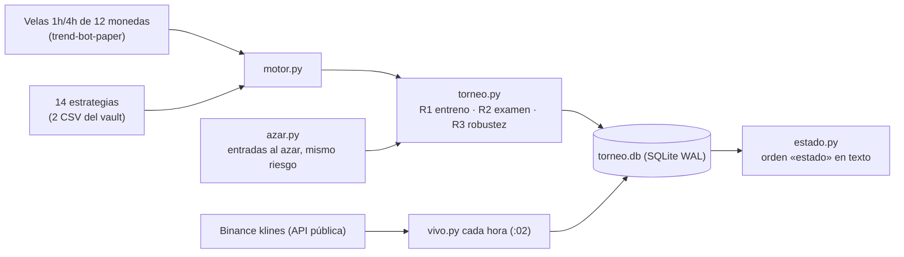

> [!resumen] En cristiano
> Es un torneo entre 14 estrategias de trading hechas con reglas fijas, sin IA, que se juega en el servidor. Primero pelean contra el pasado (años de velas de 12 monedas) y van cayendo en tres rondas; las que aguantan siguen en vivo con dinero ficticio. Resultado: ninguna le gana al azar de forma convincente, así que lo que corre en vivo son aspirantes, no campeonas.
> **Actualización 2026-10-24:** el panel web, la ventana de la pantalla del servidor y la herramienta de correo **se retiraron** (ya no hacían falta y gastaban unos 980 MB de RAM). El estado del torneo se mira ahora con `python -m battle_royale estado`. El torneo no cambió.

Proyecto de Haytham (no de NeoZeler). Diseño: [[01_Projects/Battle Royale/1 - PRD]]. Código y README: `~/Proyectos/battle-royale/` en el servidor Zorin (`ssh@192.168.0.100`).

## Arquitectura

## Resultado del pasado (2026-10-22)

27 luchadores. R1 deja 13, R2 deja 5 (umbral de azar p ≤ 0,0038), R3 deja 3.

| Luchador | t (examen) | Media por operación | p contra el azar | Estado |
|---|---|---|---|---|
| donchian@1h | 1,97 | +0,089 % | 0,009 | vivo (aspirante) |
| donchian@4h | 1,88 | +0,192 % | 0,27 | vivo (aspirante) |
| squeeze_volumen@4h | 1,75 | +0,157 % | 0,048 | vivo (aspirante) |
| ruptura_vwap_ma@4h | 1,82 | +0,052 % | 1,5e-6 | cayó en R3: pierde con el doble de comisión |

Veredicto: **ninguna estrategia supera al azar y aguanta las tres rondas.** `ruptura_vwap_ma@4h` es la única que le gana claramente al azar en el examen, pero su ventaja desaparece con el doble de comisión. Coincide con las pruebas anteriores de Haytham (las reglas simples no superan al azar una vez pagados los costes).

## Operación

- Estado en texto: `cd ~/Proyectos/battle-royale && PYTHONPATH=src venv/bin/python -m battle_royale estado` (`--literal` para el torneo literal). Salida idéntica antes y después de retirar el panel.
- Vivo: `battle-royale-vivo.timer`, minuto 02 de cada hora (en el momento de retirar el panel estaba **deshabilitado**; el veredicto final a los 30 días contaba desde 2026-10-22). Revisar si se quiere que siga corriendo.
- Pruebas: 144 (`venv/bin/python -m pytest -q`). Comandos y límites conocidos: README del repositorio.

## Panel retirado (2026-10-24)

Se quitaron el panel web (puerto 8090), el colector, la ventana de la pantalla del servidor, la herramienta de correo y sus 28 pruebas y scripts de parches. Lo único que el torneo necesitaba de aquel código, la función `combate` de la orden `estado`, pasó a `estado.py`.
**Copia completa y comprobada:** `~/backups/panel-2026-10-24.tgz` (más las dos plantillas de correo en `~/backups/panel-plantillas-correo-2026-10-24.json`). Las candidatas, el correo y Gmail los lleva ahora el CRM: [[01_Projects/Neozeler CRM]].

## Decisiones y límites

- Costes 0,1 % + 0,05 % por lado, solo largos en spot, riesgo 1 % por operación, capital repartido entre 12 monedas.
- 8 estrategias de los CSV quedan fuera por falta de datos (5 min, libro de órdenes).
- `banda_valor` y `rejilla` son versiones simplificadas.
- Sin commit en git todavía (repositorio inicializado en el servidor, sin remoto): la copia del Panel es lo único que conserva lo retirado.

