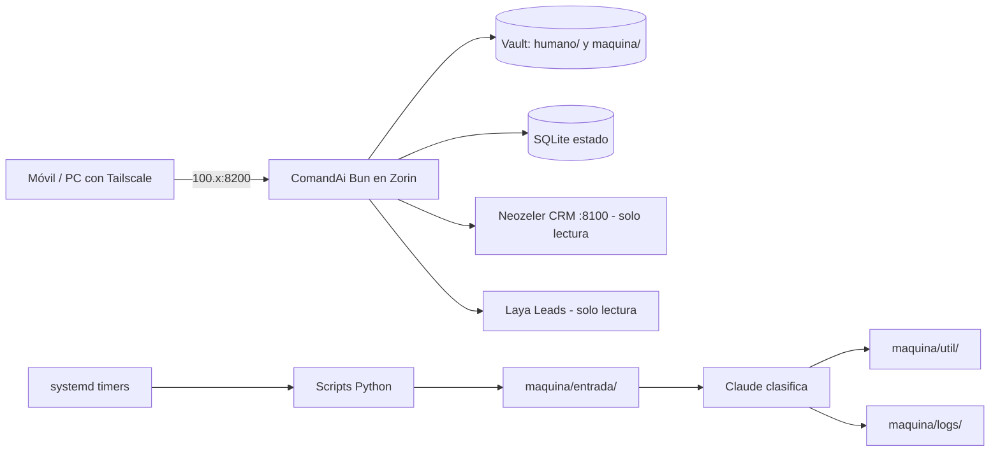

# 2 · TRD — ComandAi

> [!resumen] En cristiano
> Un programa pequeño en Bun (el mismo motor que el Neozeler CRM) que lee carpetas de tu vault y las enseña como web. Sin base de datos pesada ni framework: las tareas y novedades son archivos Markdown, y los scripts Python solo bajan datos. Arranca solo en el Zorin y solo se abre desde tu red privada Tailscale. Meta: bajo 150 MB de RAM (el panel anterior gastaba ~980 MB y se retiró).

## 1. Stack elegido
| Capa | Elección | Alternativa descartada | Por qué |
|---|---|---|---|
| Servidor + web | Bun + TypeScript, `Bun.serve`, HTML renderizado en servidor | Next.js | Poca RAM; mismo stack que el CRM; sin build pesado |
| Interactividad | JS mínimo propio (marcar tarea, cambiar sección) | React/htmx | Menos peso; solo 3 interacciones en v1 |
| Datos | Archivos Markdown en el vault + `bun:sqlite` solo para estado (tareas hechas, última ejecución) | Postgres | Nada que escalar; v1 un usuario |
| Scripts de datos | Python 3 estándar (`urllib`, `xml`, `json`); sin dependencias | Scrapy / n8n | Ya está `python3` en el Zorin; 0 instalación |
| Clasificación IA | Claude Code en modo no interactivo sobre `maquina/entrada/` (manual o programado, v1: manual) | API de pago propia | Sin coste ni claves nuevas |
| Programación | `systemd --user` timers | cron | Reinicia solo y deja logs |
| Acceso | Tailscale: el servidor escucha solo en la IP `100.x` de Tailscale | Puerto abierto / Cloudflare Tunnel | Nunca expuesto a internet |
| Auth | Ninguna extra: solo accesible por Tailscale (v1) | PIN | Un usuario; se reevalúa si se comparte |

### 1.1 Ficha por librería
Dependencias de runtime: **cero** salvo Bun. Versiones de Bun y Tailscale se verifican al instalar (context7 no respondió esta sesión: `CONNECTION_CLOSED`; se usará la doc oficial por WebFetch).
| Librería | Versión | Fuente | Trampas |
|---|---|---|---|
| Bun | por fijar al instalar en Zorin | bun.sh | Mantener la misma versión que el CRM |
| Tailscale | por fijar | tailscale.com/kb | Instalar en Zorin, PC y móvil con la misma cuenta; requiere `sudo` |

### 1.2 Presupuesto
| Límite | Máximo | Previsto |
|---|---|---|
| Motores de animación | 1 | 0 o 1 (CSS) |
| JS inicial (kB gzip) | 200 | < 30 |
| Dependencias directas | 25 | 0 |
| RAM del servicio | — | < 150 MB |

## 2. Arquitectura

## 3. Estructura de carpetas (RF-01)
Por área (empezando por `02_Areas/NeoZeler/Comercial/` y `00_Meta/Panel/`):
- `humano/`: lo que dices o decides tú, tal cual.
- `maquina/entrada/`: datos crudos de scripts. `maquina/util/`: lo que la IA marcó útil. `maquina/logs/`: qué hizo la IA y cuándo.
Cambia solo carpetas **nuevas**; no se reorganiza PARA.

## 4. Integraciones
| Servicio | Para qué | Coste | Límites | Plan B |
|---|---|---|---|---|
| Neozeler CRM `:8100` | Leads/embudo | 0 | Solo lectura, local | Leer su SQLite directamente |
| Laya Leads | Leads de Málaga | 0 | Solo lectura | Leer su salida JSON |
| RSS/APIs públicas de IA | Novedades | 0 | Solo fuentes públicas | Quitar la fuente que falle |

## 5. Seguridad y datos
- Escucha solo en la IP de Tailscale, nunca `0.0.0.0`. Sin secretos en el repo; `.env` con `chmod 600`.
- Rutas del vault validadas (no salir de la carpeta configurada).

## 6. Entornos
Local en este PC para desarrollar (puerto 8200), producción en Zorin. Type-check (`bun build`/`tsc --noEmit`) antes de cada commit.

## 7. Trazabilidad
| Requisito | Solución |
|---|---|
| RF-01 | §3 carpetas |
| RF-02 | Python + systemd timers |
| RF-03 / RF-04 | Claude clasifica y escribe `util/` y `logs/` |
| RF-05 | Bun SSR + diseño en UI-UX |
| RF-06 | Lecturas del CRM y Laya Leads |
| RF-07 | systemd unit + bind a IP Tailscale |

## 8. Riesgos técnicos
> [!riesgo]
> - Instalar Tailscale pide `sudo` en el Zorin: lo haces tú.
> - Si la IP de Tailscale cambia o el servicio arranca antes que Tailscale, no escucha: la unit debe esperar a `tailscaled`.
> - Clasificación IA en v1 es manual; automatizarla es v2.

---
Anterior: [[1 - PRD]] · Siguiente: [[3 - UI-UX Design]]
