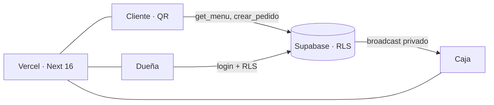

# Comanda Viva

> [!resumen] En cristiano
> Una app para restaurantes pequeños: cada mesa tiene un QR que abre un menú bonito solo con lo que hay; cada pedido resta ingredientes del inventario; lo que se acaba desaparece y lo que queda poco muestra «Quedan N». La caja recibe las comandas sola y la dueña ve sus números. Primera instalación: **Monika Viva**, para Desayunos de Monika (Alhaurín el Grande). Proyecto **personal de Haytham**, no de NeoZeler. Estado: los 6 documentos están aprobados y la base de datos probada; **no hay código de aplicación** ni nada en la nube.

## Documentos
[[1 - PRD]] · [[Ficha de Investigacion]] · [[2 - TRD]] · [[3 - UI-UX Design]] · [[Paleta de Componentes]] · [[4 - AppFlow]] · [[5 - Backend Schema]] · [[6 - Plan de Implementacion]] · [[Guia - Skills y reglas por fase]]

## Resumen técnico
- **Vía**: web-cliente (con backend real, por eso TRD, AppFlow y Schema activos).
- **Stack**: Next 16, React 19, Tailwind 4, Supabase (Postgres, Auth, Realtime, Storage), Zod, Motion, Bklit para gráficas.
- **Corazón**: `crear_pedido` descuenta stock todo o nada con bloqueo ordenado por id; `v_disponibilidad` calcula raciones; anónimo sin `select` en ninguna tabla.
- **Marca blanca**: nombre, logo y colores en `restaurantes.tema`; replicable a otros restaurantes con una fila nueva.
- **Identidad**: «carta recién hecha que lo demuestra con yemas» (crema, café, guindilla, yema; Fraunces + Figtree; nivel de dinamismo 2 en el menú y 1 en caja y admin).
- **Verificado**: 20 pruebas en PGlite (RLS, descuento atómico, anular/deshacer, cobro, aislamiento entre locales). **No verificado**: concurrencia real y política de `realtime.messages`.

## Puertas abiertas
1. **Hosting y coste**: Vercel + Supabase sin verificar; crear staging pide permiso (T-25, T-26).
2. **Reparto y cobro con la clienta**: sin cerrar.
3. **Imágenes**: logo, fotos de platos, iconos y SVG de estados vacíos, todo «pendiente de decidir» (T-21).
4. **«Pagas al final, en caja»**: confirmar con la clienta.
5. **Doc 5 por ampliar** con `get_pedidos_mesa` (T-07) y las métricas del panel (T-18).
6. **Fiscal**: v1 no es ticket fiscal; revisar VeriFactu antes de enlazar TPV.
7. Futuro: TPV, tickets para cocina y menú como producto para otros restaurantes.

## Guía operativa
Repo: `~/Proyectos/comanda-viva/` (git iniciado sin commits, marcador `.proyecto`, `supabase/` con migración, semilla y pruebas, `README.md`, `resumen.html`, `DESIGN-IDENTITY.md`). Siguiente paso: T-01 del plan (scaffold con Node 22: `PATH=$HOME/.local/share/fnm/node-versions/v22.23.3/installation/bin:$PATH`). Probar la base: `node supabase/tests/schema.test.mjs` (necesita `@electric-sql/pglite` en `node_modules`).
