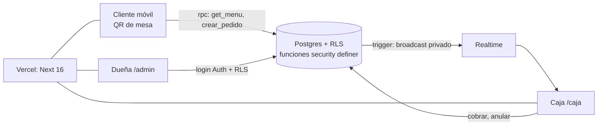

# 2 · TRD — Technical Requirements Document

> [!resumen] En cristiano
> **Cómo** se construye [[1 - PRD]]. Una web (Next) y una base de datos en la nube (Supabase). El truco central: cuando un cliente pide, **la propia base de datos** comprueba el stock y lo gasta en un solo paso, así dos mesas nunca se llevan la última ración. El cliente no toca tablas, solo llama a una "ventanilla" (función) que hace las comprobaciones. Caja se entera al instante por un aviso en directo. **Coste mensual real y hosting: decisión abierta para Haytham (§3).**

## 1. Stack elegido
| Capa | Elección | Alternativa descartada | Por qué |
|---|---|---|---|
| Frontend | Next 16 + React 19 + Tailwind 4 (App Router) | Vite + React SPA | Ya dominado (reto-30, topleads); SSR/ISR da menú rápido en 4G; rutas `/m/[token]`, `/caja`, `/admin` en un solo repo |
| Backend / API | Funciones SQL (`security definer`) llamadas con `supabase.rpc` + Server Actions solo para admin | API REST propia en Node | La lógica crítica (descontar stock) debe vivir **dentro de la transacción**; un servidor intermedio añadiría carreras y más código |
| Base de datos | Postgres en Supabase, importes en céntimos enteros, cantidades en unidad base entera (g/ml/ud) | Firebase/Firestore | Transacciones, `FOR UPDATE`, vistas de agregación y RLS; Firestore complica la disponibilidad compartida entre platos |
| Auth | Supabase Auth, email + contraseña para la dueña; cliente **sin login** (token de mesa) | Magic link por correo | El correo integrado envía ~2/hora (`librerias.md`); contraseña evita bloquear a la dueña. Magic link queda como extra con SMTP propio |
| Tiempo real | Caja: Supabase Realtime **broadcast privado** disparado por trigger. Menú cliente: *polling* cada 3 s solo con pestaña visible | `postgres_changes` público para todos | Broadcast con autorización RLS es lo que recomienda la doc actual; el cliente anónimo no suscribe a tablas |
| Hosting | Vercel (Next) + Supabase Cloud | Autoalojar en Zorin (Docker + túnel) | Un restaurante no puede depender de un PC doméstico. **Coste y plan: abierto (§3)** |
| Estilos / UI | Tailwind 4 + shadcn + registries de la Paleta de Componentes | CSS propio | Estándar del vault |
| Animación | Motion (`motion` 14.x), único motor | GSAP | Contador de raciones y layout del menú en React; GSAP sería segundo motor |
| Validación | Zod en el borde (formularios admin) y en SQL (`check`, límites) | Valibot | Misma validación en dos capas: nunca confiar en el cliente |
| QR | `qrcode` (servidor, SVG/PNG imprimible A6) | `qrcode.react` | El QR se genera una vez para imprimir; no hace falta en el cliente |

### 1.1 Ficha por librería (verificada con `npm view` el 2026-11-04; docs con context7)
| Librería | Versión | Último release | Mantenimiento | Peso (kB gzip) | Licencia | Node 22 / React 19 | Fuente | Trampas conocidas |
|---|---|---|---|---|---|---|---|---|
| next | 16.4.5 | 2026-11-03 | Activo | medir en build | MIT | Sí | npm, `librerias.md` | `cacheComponents` obliga a `<Suspense>` con `cookies()`; `middleware` → `proxy.ts`; `--yes` reactiva flags |
| react | 19.3.1 | 2026-10-31 | Activo | medir | MIT | — | npm | React Compiler lint con `set-state-in-effect` |
| @supabase/supabase-js | 2.119.0 | 2026-11-04 | Activo | medir | MIT | Sí | npm, context7 | — |
| @supabase/ssr | 0.12.7 | 2026-09-08 | Activo | medir | MIT | Sí | npm, context7 | `getAll/setAll`; llamar `auth.getClaims()` en el proxy |
| tailwindcss | 4.3.4 | 2026-11-02 | Activo | CSS, no JS | MIT | Sí | npm | Sin `@tailwindcss/postcss` el CSS sale sin procesar |
| motion | 14.9.1 | 2026-11-04 | Activo | medir (importar solo `LazyMotion`/`m`) | MIT | Sí | npm | Respetar `prefers-reduced-motion` |
| zod | 4.6.7 | 2026-10-12 | Activo | medir | MIT | Sí | npm | — |
| qrcode | 1.5.4 | 2025-11-13 | Estable, release lento | 0 en cliente (solo servidor) | MIT | Sí | npm | — |
| @bklit (stat-card-area-01, bar-chart, area-chart, sparkline) + d3-shape + @number-flow/react | registry shadcn (ver `shadcn view`) | — | Activo (registry) | medir; **solo `/admin`, carga diferida** | MIT | Sí (`motion`) | `Paleta de Componentes.md` | Sustituye a Recharts (decisión 2026-11-04): comparte `motion`, un solo motor. Bklit Studio es propietario, no reutilizar |
| vaul (vía `@shadcn/drawer`) | por fijar al instalar | — | — | medir | MIT | Sí | Paleta | Hoja inferior de detalle de plato |
| @electric-sql/pglite | 0.5.15 | 2026-11-03 | Activo | solo dev | Apache-2.0 | Sí | npm, `librerias.md` | `reset role` tras cada error esperado |

> [!riesgo] Node
> El `node` por defecto de esta máquina es **v18.19.1**; Next 16 y las pruebas piden Node ≥20 (se usa Node 22 vía nvm). Fijar `.nvmrc` y `engines` en el repo.

### 1.2 Presupuesto de dependencias
| Límite | Máximo | Previsto |
|---|---|---|
| Motores de animación | 1 | 1 (Motion) |
| Imágenes: WebP/AVIF, SVG optimizado | — | Fotos de platos en WebP vía `next/image`, ≤80 kB cada una; sin IA generativa en el producto |
| Librerías de UI base | 1 + registries | shadcn + los de la Paleta |
| JS inicial **menú cliente** (kB gzip) | 200 | ≤150 (objetivo más duro: 4G de local); `/admin` carga gráficas aparte |
| Dependencias directas | 25 | ~18 (con `d3-shape`, `@number-flow/react`, `vaul`, radix) |

## 2. Arquitectura

**Descuento de stock (corazón del sistema)**, función `crear_pedido(p_token text, p_lineas jsonb)`:
1. Valida token → mesa → restaurante; abre o reutiliza la cuenta abierta de la mesa.
2. Límites: ≤20 líneas, cantidad 1–10 por línea, ≤5 pedidos/min por mesa, nota ≤140 caracteres.
3. Calcula consumo total por ingrediente (suma por receta) y hace `select … for update` sobre esos ingredientes **ordenados por id** (evita bloqueos cruzados).
4. Si algún ingrediente no alcanza: no escribe nada y devuelve la lista de platos sin stock.
5. Si alcanza: resta stock, inserta `pedido` + `lineas`, inserta `movimientos_stock` (tipo `venta`), todo en la misma transacción.
6. Trigger sobre `pedidos` emite broadcast a `caja:<restaurante_id>`.

**Disponibilidad**: vista `v_disponibilidad(plato_id, raciones)` = `min(floor(stock / cant_por_racion))` sobre la receta. Plato sin receta → `raciones = null` (sin control, visible salvo desactivado a mano). «Quedan N» solo si `N ≤ umbral` del restaurante.

**Marca blanca**: todas las tablas llevan `restaurante_id`; nombre, logo y colores en `restaurantes.tema` (jsonb). Una sola instalación sirve a Monika Viva y a futuros clientes.

## 3. Integraciones y servicios externos
| Servicio | Para qué | Coste | Límites / cuotas | Plan B |
|---|---|---|---|---|
| Supabase | BD, Auth, Realtime | *Verificar planes en su web*; el plan gratuito pausa por inactividad y no ofrece copias diarias, por lo que producción real pide plan de pago | Conexiones Realtime y mensajes por plan | Postgres autoalojado en Zorin |
| Vercel | Hospedar Next | *Verificar*: el plan Hobby es no comercial, uso comercial pide plan de pago | Funciones y ancho de banda por plan | Autoalojar Next en Zorin (Docker) con túnel |
| Dominio | URL del QR (se imprime, no debe cambiar) | ~10-15 €/año (a confirmar) | — | Subdominio de NeoZeler |
| SMTP propio *(opcional)* | Correos de Auth fiables | Según proveedor | — | Contraseña sin correo |

> [!riesgo] Decisión abierta (Haytham)
> Coste fijo mensual (Supabase + Vercel de pago) frente a lo que se cobre a la clienta. No creo ningún proyecto de nube sin tu permiso: puede costar.

## 4. Seguridad y datos
- **Roles** (trazan al PRD §2): `anon` (cliente) solo puede ejecutar `get_menu` y `crear_pedido`; **sin `select` en ninguna tabla**. `authenticated` con fila en `miembros(user_id, restaurante_id, rol)`: `owner` (todo) y `caja` (comandas y cobros, sin finanzas ni inventario de costes; previsto, hoy la dueña es ambas).
- **RLS** en todas las tablas por `restaurante_id` + membresía; funciones `security definer` con `set search_path = ''` y comprobaciones propias.
- **Token de mesa**: 128 bits aleatorios, regenerable por la dueña (invalida QR viejo). El QR codifica `/m/<token>`.
- **Anti-abuso**: límites dentro de la función (arriba), anulación de caja con reposición de stock, y opción `restaurantes.requiere_confirmacion` (por defecto apagada): el stock se reserva igual, pero la comanda aparece como «por aceptar»; rechazar la repone.
- **RGPD**: cliente anónimo, sin cookies de seguimiento ni analítica. Las notas libres pueden contener datos de salud (alergias): máximo 140 caracteres, solo visibles para el personal, borrado automático de notas a los 90 días. Alérgenos de los 14 de la UE visibles en el menú (obligación del local).
- **Secretos**: `service_role` solo en servidor, nunca en el repo ni en `NEXT_PUBLIC_*`; `.env` ignorado, `.env.example` con `!.env.example`.
- **Auditoría**: `movimientos_stock` y anulaciones guardan usuario y motivo.

## 5. Rendimiento y escalado
- Carga: un local, ~20-40 mesas simultáneas como máximo, <500 pedidos/día. Muy por debajo de cualquier límite.
- Menú: ISR/caché para platos y fotos; solo `get_menu` (disponibilidad) se pide cada 3 s con la pestaña visible (y al volver a primer plano).
- Persistencia: todo en Postgres; nada de memoria volátil en serverless.
- Caja: si el broadcast cae, *polling* cada 5 s con aviso visible «sin conexión en vivo».

## 6. Entornos y CI
- Local (Node 22, PGlite para probar migraciones y RLS) · staging (proyecto Supabase aparte, **pendiente de permiso**) · producción.
- Antes de cada commit: `tsc --noEmit`, lint, tests de SQL (PGlite) y build limpio.
- Pruebas de concurrencia reales (dos conexiones pidiendo la última ración) contra Postgres real: PGlite con `pglite-socket` no garantiza el comportamiento de bloqueos de producción, hay que verificarlo en staging.
- Migraciones con `schema_to_migration.py` (toda FK con `ON DELETE`).

## 7. Trazabilidad PRD → técnica
| Requisito PRD | Solución técnica |
|---|---|
| RF-01 QR por mesa | `mesas.token` aleatorio, ruta `/m/[token]`, `qrcode` en `/admin/mesas` |
| RF-02, RF-03 disponibilidad | Vista `v_disponibilidad` sobre `recetas` e `ingredientes`; ingredientes compartidos restan a todos |
| RF-04 «Quedan N» | `restaurantes.umbral_quedan` + comparación en `get_menu` |
| RF-05 descuento atómico | `crear_pedido` con `for update` ordenado, una transacción |
| RF-06 nota por plato | `lineas.nota` (≤140), Zod + `check` |
| RF-07 cuenta por mesa | Tabla `cuentas` (una abierta por mesa, índice único parcial) |
| RF-08 tiempo real en caja | Trigger → `realtime.broadcast_changes` en canal privado + RLS en `realtime.messages`; plan B polling |
| RF-09 anular repone | Función `anular_linea` con movimiento inverso y motivo; opción `no_reponer` (plato ya cocinado) que anula sin movimiento inverso, con motivo |
| RF-10 histórico de stock | Tabla `movimientos_stock` (entrada, venta, merma, ajuste de recuento, anulación). Cobrar cierra la cuenta; un pedido posterior de la mesa abre una cuenta nueva y se marca para avisar a caja. Plantilla de desayunos: semilla opcional por restaurante, no obligatoria |
| RF-11 panel financiero | Vistas/RPC de agregación (ventas, ticket medio, horas punta, ranking, margen) |
| RF-12 menú gestionable | CRUD admin con RLS; fotos en Supabase Storage |
| RF-13 marca blanca | `restaurantes.tema` jsonb + tokens CSS en runtime |
| US-20 acceso | Auth + `miembros` + RLS |

## 8. Riesgos técnicos
> [!riesgo]
> - **Carrera de stock**: si `for update` no se ordena o se omite, aparecen ventas sin stock o interbloqueos. Mitigación: orden por id y prueba concurrente real.
> - **Recetas incompletas**: disponibilidad falsa. Mitigación: plato sin receta marcado «sin control» en admin y en el panel.
> - **Fuga por `security definer`**: una función mal escrita salta RLS. Mitigación: `search_path` vacío, revisión con `supabase-postgres-best-practices` y `get_advisors`.
> - **Polling del menú**: 40 mesas × 1 petición/3 s es trivial, pero se corta si la pestaña está oculta. Mitigación: pausar en segundo plano.
> - **Alarma sonora de caja**: los navegadores bloquean sonido sin gesto previo. Mitigación: botón «Activar sonido» al abrir caja.
> - **Coste/plan de nube** sin decidir (§3) y Node 18 por defecto en la máquina.
> - **Cumplimiento fiscal**: v1 no es sistema de facturación; revisar normativa antes del TPV.

---
Anterior: [[1 - PRD]] · Siguiente: [[3 - UI-UX Design]]
