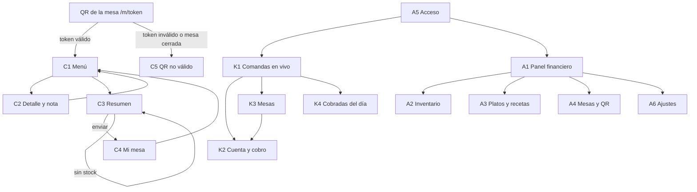
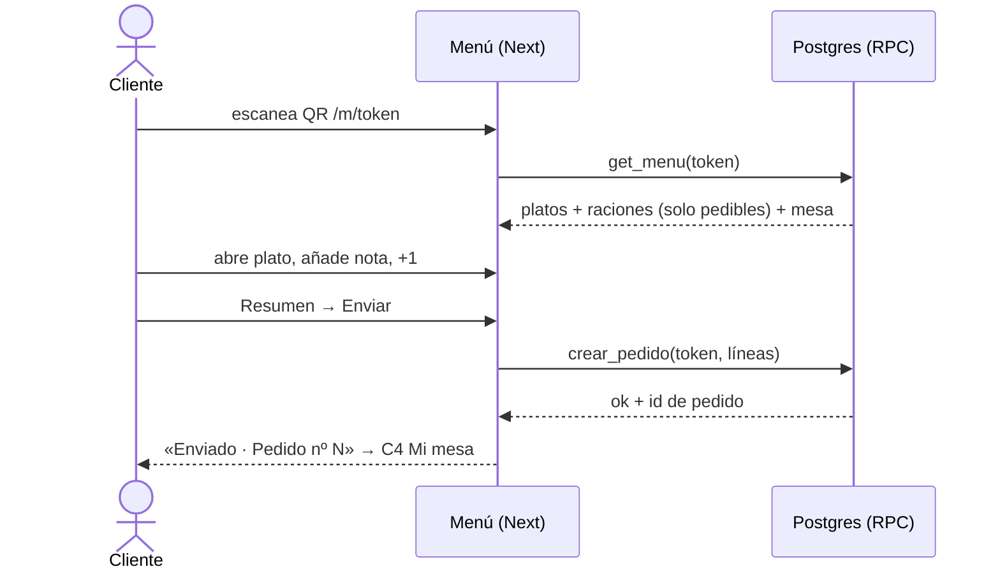
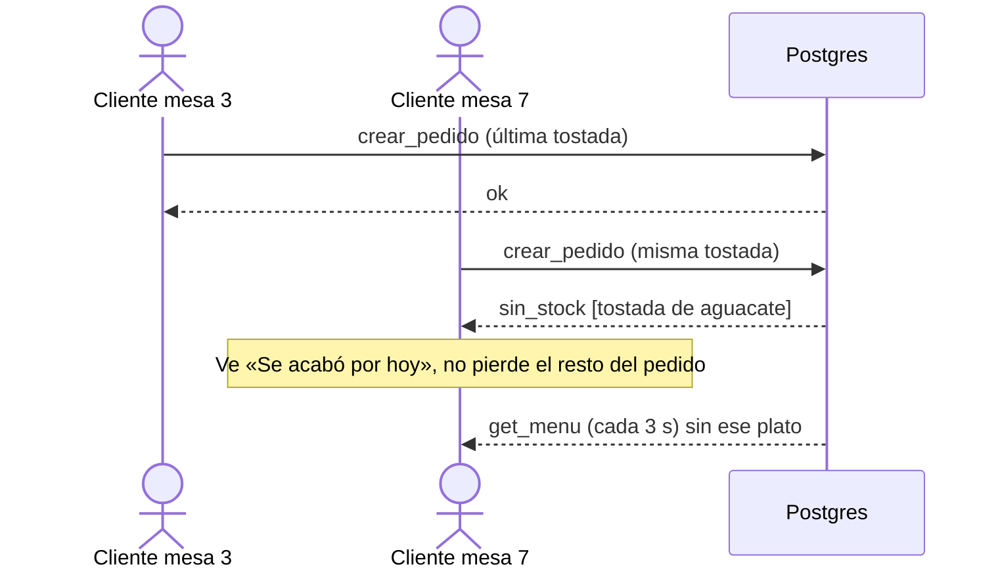
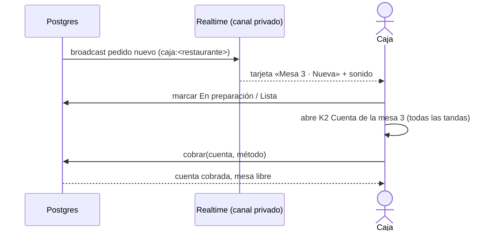
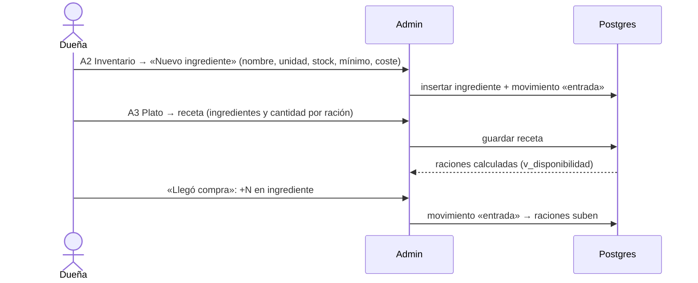

# 4 · AppFlow

> [!resumen] En cristiano
> Cómo se mueve cada persona por la app: el cliente escanea y pide, caja recibe y cobra, la dueña carga el inventario y mira los números. Incluye qué pasa cuando algo se agota justo al pedir. Contrato entre pantallas ([[3 - UI-UX Design]]) y base de datos ([[2 - TRD]]).

## 1. Mapa de navegación

## 2. Flujos principales
### Flujo 1 — Cliente pide desde su mesa (US-01, US-02, US-03, US-04, US-05)

- **Camino feliz**: QR → menú → plato → nota (opcional) → resumen → enviar → pantalla «Enviado · Pedido nº N» con estado visible y persistente en C4 (recibido / servido / anulado).
- C3 lleva fija la línea «Pagas al final, en caja» (**por confirmar con la clienta**).
- **Alternativas y errores**:
  - Red caída al enviar: el pedido **no** se pierde del carrito; botón «Reintentar»; no se envía dos veces (clave de idempotencia por pedido).
  - QR no válido o mesa cerrada: C5 con «Pide a quien te atienda» y el teléfono del local (sin detalles técnicos).
  - Carga lenta: texto primero, fotos diferidas; «Cargando…» y botón «Reintentar» si tarda más de 5 s.
  - Nota demasiado larga (>140): contador y bloqueo suave.
  - Muchas líneas (>20) o demasiados pedidos seguidos: mensaje amable «Espera un momento y vuelve a enviar».

### Flujo 2 — Se agota algo mientras el cliente decide (US-02, RF-05)

- **Camino feliz**: la mesa 7 recibe la lista de platos sin stock, el resto del carrito se conserva y se le ofrece «Cambiar por…» con 2 alternativas de la misma categoría.
- **Errores**: si **todo** el carrito se agotó, vuelve a C1 con aviso; nunca error técnico.
- **Regla de la lista viva**: un plato que se agota mientras el cliente lo mira **no desaparece bajo su dedo**: se queda gris con «Se acabó»; la lista se refresca (y lo quita) solo al volver a C1.

### Flujo 3 — Caja recibe y cobra (US-13, US-14, US-15)

- **Camino feliz**: comanda nueva → preparación → lista → mesa pide la cuenta → cobro (efectivo/tarjeta/otro) → mesa libre.
- **Alternativas y errores**: sin conexión en vivo: banda «Sin conexión en vivo, actualizando cada 5 s» (polling); sonido bloqueado: botón «Activar sonido»; cobrar con comandas aún sin servir: confirmación previa **que lista las líneas pendientes**.
- **Hora punta (simulación de caja)**:
  - K1 ordena por antigüedad (la más vieja arriba); cada comanda lleva punto parpadeante «sin ver» hasta abrirla.
  - Sin cocina en v1: «En preparación» es opcional; el botón «Servida» salta directo a Lista.
  - K2: «Dividir en partes iguales» (solo cálculo en pantalla, no guarda nada), campo «Entrega» que calcula el cambio y «Mover a mesa X» si el cliente se cambia de sitio.
  - Al cobrar, la cuenta se cierra. Si esa mesa pide otra vez, se abre cuenta nueva con aviso rojo «Pidió después de cobrar».
  - Sin conexión no se puede cobrar: banda «Sin conexión: apunta el cobro en papel y regístralo al volver». No hay cola local en v1.

### Flujo 4 — Caja corrige o anula (US-16)
- Pulsa una línea → «Anular» → 3 botones grandes de motivo (error · cliente se arrepiente · no sale) → la línea se tacha, el stock se repone y el cliente ve el aviso en C4. Casilla «Ya estaba cocinado: no devolver al stock».
- Toast «Deshacer» durante 10 s tras anular (dedos mojados, toque erróneo).
- **Errores**: anular una línea de una cuenta ya cobrada: bloqueado (solo la dueña, con motivo).

### Flujo 5 — La dueña carga inventario y recetas (US-21, US-06, US-07, US-08, US-09, US-10, US-11, US-12)

- **Camino feliz**: ingrediente → receta → ve «salen 12 raciones» → el menú ya lo muestra.
- **Arranque sin 40 altas a mano (simulación de dueña)**: el primer acceso ofrece una **plantilla de desayunos** (ingredientes y recetas típicas con cantidades sugeridas, todo editable); no se carga nada sin que lo acepte.
- **Unidades en lenguaje de cocina**: cada ingrediente propone su unidad (huevo = ud, leche = ml); «unidad de compra» con conversión («caja de 30 huevos = 30 ud»); en la receta, medidas caseras («1 cucharada», «2 rebanadas») que se guardan en la unidad base.
- **Plato oculto explicado**: en A3, «Oculto: faltan huevos» con botón «Añadir stock».
- **Recuento**: pantalla que muestra lo esperado, la dueña pone lo contado y se guarda la diferencia como movimiento «ajuste».
- **Merma**: botón «Tiré / Se estropeó» con motivo de un toque (movimiento «merma»).
- **Errores**: receta con cantidad 0 o negativa: bloqueada; plato sin receta: etiqueta «Sin control de stock»; stock bajo mínimo: aviso en A2 y A1.

### Flujo 6 — La dueña mira cómo va el negocio (US-17, US-18)
- A1 abre en «Hoy»: ventas, comandas, ticket medio; selector Hoy/7 días/Mes; ranking de platos; margen si hay costes cargados.
- **Errores**: sin ventas en el rango («Aún no hay ventas hoy»), sin costes («Carga costes para ver el margen»).
- **Lenguaje sencillo**: nada de «ticket medio» ni «margen» a secas: «Cada mesa gasta 14 € de media», «De cada 100 € te quedan 62 € después de ingredientes».
- **Cerrar el día**: resumen al final de K4 (ventas por forma de pago, avisos de stock); no bloquea nada.

### Flujo 7 — Mesas, menú y QR (US-19)
- A4: crear mesa → se genera token → «Imprimir QR» (A6, con nombre de mesa). «Regenerar QR» invalida el anterior con confirmación («los QR impresos dejarán de funcionar»).
- A3: crear/editar plato (nombre, precio, categoría, alérgenos, foto), activar/desactivar a mano.

## 3. Permisos por rol
Acceso de la dueña y de caja (US-20): A5 con email y contraseña; sin sesión no se ve nada de K1–K4 ni A1–A6.

| Pantalla / acción | Dueña | Caja (futuro) | Cliente anónimo |
|---|---|---|---|
| C1–C4 Menú y pedido de **su** mesa | — | — | Sí (solo con token) |
| K1–K4 Comandas, cuenta, cobro, anular | Sí | Sí | No |
| A1 Panel financiero | Sí | No | No |
| A2 Inventario, A3 Platos y recetas | Sí | Solo lectura de disponibilidad | No |
| A4 Mesas y QR, A6 Ajustes | Sí | No | No |
| Anular tras cobrar | Sí (con motivo) | No | No |
| Leer tablas directamente | Según RLS | Según RLS | **Nunca** (solo `get_menu`, `crear_pedido`) |

## 4. Estados globales
- **Carga inicial**: esqueleto de tarjetas pastel (nunca contenedor vacío).
- **Sin conexión (cliente)**: banda «Sin conexión», carrito conservado, enviar deshabilitado.
- **Sin conexión en vivo (caja)**: banda + polling 5 s.
- **Sesión caducada**: A5 con aviso y regreso a la pantalla en la que estaba.
- **Vacío**: cada pantalla con su ilustración SVG propia y una acción.
- **Error 500**: «Algo ha fallado de nuestro lado. Inténtalo de nuevo» + reintentar; el cliente no ve detalles técnicos.

## 5. Cliente simulado
Antes de aprobar, un agente por rol recorre los flujos y dice dónde se atascaría.
- Prompt base: «Eres <rol> (<perfil>). Recorre el flujo X solo con lo que ves descrito. Di en cada paso qué esperas, qué te confunde y dónde abandonarías.»
| Rol simulado | Flujo | Atascos detectados | Cambio aplicado |
|---|---|---|---|
| Comensal (móvil, prisa) | 1, 2 | Sin confirmación clara tras enviar; platos que desaparecen bajo el dedo; «quedan» solo en yemas; texto pequeño o girado; foto pesada; no sabe cuándo paga; C5 sin salida; nota sin contador | Pantalla «Enviado nº N» con estado; plato gris «Se acabó» hasta volver a C1; texto «Quedan N» siempre; mínimo 18 px y sin giro en texto crítico (UI-UX §6); fotos diferidas; línea «Pagas al final» (por confirmar); C5 con teléfono; contador desde el primer carácter |
| Caja (hora punta, tablet) | 3, 4 | No distingue comanda nueva entre varias; preparación sin cocina; cliente pide tras cobrar; dividir, mover, cambio; anular sin deshacer ni motivo rápido; stock repuesto de lo cocinado; sin conexión al cobrar | Orden por antigüedad + «sin ver»; «Servida» directo; cuenta nueva con aviso rojo; dividir en partes iguales, entrega/cambio, mover a mesa; deshacer 10 s, 3 motivos, casilla «ya cocinado»; pendientes listados al cobrar; sin cola offline (papel) |
| Dueña (52 años, sin inventario previo) | 5, 6, 7 | Alta de ~40 ingredientes abandona; no sabe pesar; unidades confusas; plato oculto sin explicación; inventario no cuadra; merma sin camino; panel con jerga | Plantilla de desayunos; medidas caseras y unidad de compra; «Oculto: faltan huevos»; Recuento; Merma; frases sencillas; resumen de cierre en K4 |

### Fuera de v1 (declarado)
Propina, ticket impreso, dividir por líneas o por persona, botón «Pedir la cuenta» del cliente, variantes de plato (pan integral, sin huevo), cola de cobro sin conexión.

> [!resumen] Cascada aplicada (aprobada por Haytham 2026-11-04)
> - **PRD**: declarar las variantes de plato y «Pedir la cuenta» como fuera de alcance; añadir plantilla de desayunos, recuento y merma si no están ya en US-11/US-12.
> - **TRD**: movimientos de stock de tipo `ajuste` y `merma`; cuenta nueva tras cobrar.
> - **Identidad (UI-UX §2/§7)**: las pegatinas giradas pasan a ser solo decorativas; el texto crítico («Quedan N», «Se acabó», precio) va recto. No toco nada de esto sin tu visto bueno.

## 6. Ciclo completo a validar
- [ ] Crear plato y receta → refrescar → editar cantidad → refrescar → desactivar/borrar → refrescar
- [ ] Pedir → ver en caja → anular línea (stock repone) → refrescar → cobrar → refrescar
- [ ] Dos pedidos simultáneos por la última ración (concurrencia, en Postgres real)

---
Anterior: [[3 - UI-UX Design]] · Siguiente: [[5 - Backend Schema]]
