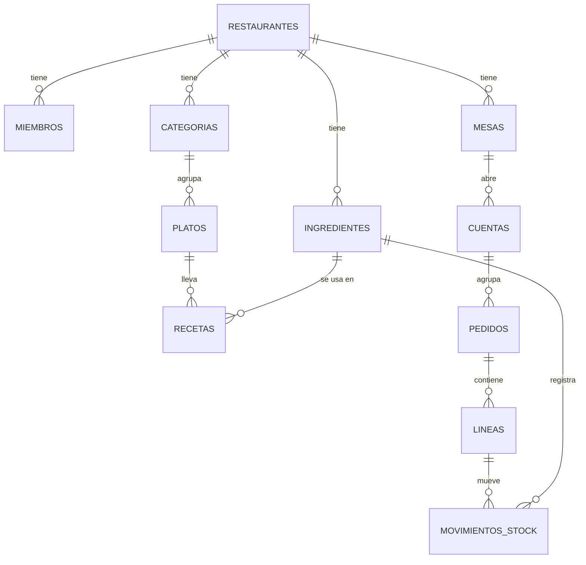

# 5 · Backend Schema

> [!resumen] En cristiano
> Aquí está la base de datos entera de Comanda Viva: qué se guarda (platos, ingredientes, mesas, pedidos, cuentas), quién puede ver qué y las pocas «funciones» que hacen el trabajo delicado (pedir, anular, cobrar). El cliente del QR **no puede leer ninguna tabla**: solo pedir el menú y enviar un pedido. El descuento de stock es de todo o nada: si dos mesas piden la última ración, una la consigue y la otra recibe aviso. No hay proyecto Supabase creado: esto se prueba en local y no cuesta nada.

Modelo de datos y API que sostienen los flujos de [[4 - AppFlow]] y la arquitectura de [[2 - TRD]]. Cantidades en **unidades base** enteras (g/ml/ud) e importes en **céntimos enteros**. Toda tabla lleva `restaurante_id` (marca blanca, RF-13).

## 1. Diagrama entidad-relación


## 2. SQL ejecutable
Los bloques ```` ```sql ```` se concatenan en la migración y los ```` ```sql seed ```` en la semilla con `schema_to_migration.py`. Toda FK lleva `ON DELETE`.

**Tablas**
```sql
create table restaurantes (
  id uuid primary key default gen_random_uuid(),
  nombre text not null check (length(btrim(nombre)) between 1 and 80),
  tema jsonb not null default '{}'::jsonb,
  telefono text,
  umbral_quedan int not null default 5 check (umbral_quedan between 1 and 50),
  requiere_confirmacion boolean not null default false,
  created_at timestamptz not null default now()
);

create table miembros (
  user_id uuid not null references auth.users(id) on delete cascade,
  restaurante_id uuid not null references restaurantes(id) on delete cascade,
  rol text not null check (rol in ('owner', 'caja')),
  primary key (user_id, restaurante_id)
);

create table categorias (
  id uuid primary key default gen_random_uuid(),
  restaurante_id uuid not null references restaurantes(id) on delete cascade,
  nombre text not null check (length(btrim(nombre)) between 1 and 60),
  orden int not null default 0,
  color_idx int not null default 1 check (color_idx between 1 and 4),
  unique (restaurante_id, nombre)
);

create table mesas (
  id uuid primary key default gen_random_uuid(),
  restaurante_id uuid not null references restaurantes(id) on delete cascade,
  nombre text not null check (length(btrim(nombre)) between 1 and 40),
  token text not null unique
    default replace(gen_random_uuid()::text || gen_random_uuid()::text, '-', ''),
  activa boolean not null default true,
  created_at timestamptz not null default now(),
  unique (restaurante_id, nombre)
);

create table platos (
  id uuid primary key default gen_random_uuid(),
  restaurante_id uuid not null references restaurantes(id) on delete cascade,
  categoria_id uuid not null references categorias(id) on delete restrict,
  nombre text not null check (length(btrim(nombre)) between 1 and 80),
  descripcion text,
  precio_cents int not null check (precio_cents >= 0),
  alergenos text[] not null default '{}',
  foto_path text,
  activo boolean not null default true,
  orden int not null default 0,
  created_at timestamptz not null default now(),
  unique (id, restaurante_id),
  unique (restaurante_id, nombre)
);

create table ingredientes (
  id uuid primary key default gen_random_uuid(),
  restaurante_id uuid not null references restaurantes(id) on delete cascade,
  nombre text not null check (length(btrim(nombre)) between 1 and 80),
  unidad text not null check (unidad in ('g', 'ml', 'ud')),
  stock int not null default 0 check (stock >= 0),
  minimo int not null default 0 check (minimo >= 0),
  coste_cents_por_unidad numeric(12, 4) check (coste_cents_por_unidad >= 0),
  unidad_compra text,
  factor_compra int not null default 1 check (factor_compra > 0),
  created_at timestamptz not null default now(),
  unique (id, restaurante_id),
  unique (restaurante_id, nombre)
);

create table recetas (
  plato_id uuid not null,
  ingrediente_id uuid not null,
  restaurante_id uuid not null,
  cantidad int not null check (cantidad > 0),
  primary key (plato_id, ingrediente_id),
  foreign key (plato_id, restaurante_id) references platos(id, restaurante_id) on delete cascade,
  foreign key (ingrediente_id, restaurante_id) references ingredientes(id, restaurante_id) on delete restrict
);

create table cuentas (
  id uuid primary key default gen_random_uuid(),
  restaurante_id uuid not null references restaurantes(id) on delete cascade,
  mesa_id uuid references mesas(id) on delete set null,
  mesa_nombre text not null,
  estado text not null default 'abierta' check (estado in ('abierta', 'cobrada')),
  metodo text check (metodo in ('efectivo', 'tarjeta', 'otro')),
  total_cents int check (total_cents >= 0),
  entrega_cents int check (entrega_cents >= 0),
  aviso_tras_cobro boolean not null default false,
  abierta_at timestamptz not null default now(),
  cobrada_at timestamptz,
  cobrada_por uuid references auth.users(id) on delete set null,
  check ((estado = 'cobrada') = (cobrada_at is not null))
);
create unique index cuentas_una_abierta_por_mesa on cuentas (mesa_id) where estado = 'abierta';
create index cuentas_rest_estado on cuentas (restaurante_id, estado, cobrada_at desc);

create table pedidos (
  id uuid primary key default gen_random_uuid(),
  numero bigint generated always as identity,
  restaurante_id uuid not null references restaurantes(id) on delete cascade,
  cuenta_id uuid not null references cuentas(id) on delete cascade,
  mesa_id uuid references mesas(id) on delete set null,
  clave text,
  estado text not null default 'nuevo'
    check (estado in ('por_aceptar', 'nuevo', 'preparacion', 'lista', 'rechazado')),
  visto_at timestamptz,
  created_at timestamptz not null default now()
);
create unique index pedidos_clave_unica on pedidos (mesa_id, clave) where clave is not null;
create index pedidos_rest_fecha on pedidos (restaurante_id, created_at desc);
create index pedidos_mesa_fecha on pedidos (mesa_id, created_at desc);
create index pedidos_cuenta on pedidos (cuenta_id);

create table lineas (
  id uuid primary key default gen_random_uuid(),
  pedido_id uuid not null references pedidos(id) on delete cascade,
  restaurante_id uuid not null references restaurantes(id) on delete cascade,
  plato_id uuid references platos(id) on delete set null,
  nombre text not null,
  precio_cents int not null check (precio_cents >= 0),
  cantidad int not null check (cantidad between 1 and 10),
  nota text check (length(nota) <= 140),
  anulada boolean not null default false,
  anulada_motivo text,
  anulada_at timestamptz,
  anulada_por uuid references auth.users(id) on delete set null,
  no_repuesto boolean not null default false,
  created_at timestamptz not null default now()
);
create index lineas_pedido on lineas (pedido_id);

create table movimientos_stock (
  id bigint generated always as identity primary key,
  restaurante_id uuid not null references restaurantes(id) on delete cascade,
  ingrediente_id uuid not null references ingredientes(id) on delete cascade,
  tipo text not null check (tipo in ('entrada', 'venta', 'merma', 'ajuste', 'anulacion')),
  delta int not null check (delta <> 0),
  motivo text,
  user_id uuid references auth.users(id) on delete set null,
  pedido_id uuid references pedidos(id) on delete set null,
  linea_id uuid references lineas(id) on delete set null,
  created_at timestamptz not null default now()
);
create index movimientos_ingrediente on movimientos_stock (ingrediente_id, created_at desc);
create index movimientos_linea on movimientos_stock (linea_id);

create table plantilla_ingredientes (
  nombre text primary key,
  unidad text not null check (unidad in ('g', 'ml', 'ud')),
  minimo int not null default 0,
  unidad_compra text,
  factor_compra int not null default 1 check (factor_compra > 0)
);

create table plantilla_platos (
  nombre text primary key,
  categoria text not null,
  precio_cents int not null check (precio_cents >= 0),
  receta jsonb not null
);
```

**Vista de disponibilidad y ayudante de rol**
```sql
create view v_disponibilidad with (security_invoker = true) as
select p.id as plato_id,
       p.restaurante_id,
       min(floor(i.stock::numeric / r.cantidad))::int as raciones
from platos p
left join recetas r on r.plato_id = p.id
left join ingredientes i on i.id = r.ingrediente_id
group by p.id, p.restaurante_id;

create function rol_en(p_rest uuid) returns text
language sql stable security definer set search_path = '' as $$
  select m.rol from public.miembros m
  where m.user_id = auth.uid() and m.restaurante_id = p_rest
$$;
```

**Cliente anónimo: `get_menu` y `crear_pedido`**
```sql
create function get_menu(p_token text) returns jsonb
language plpgsql stable security definer set search_path = '' as $$
declare m record;
begin
  select me.nombre as mesa, re.id as rid, re.nombre, re.tema, re.telefono, re.umbral_quedan
    into m
  from public.mesas me join public.restaurantes re on re.id = me.restaurante_id
  where me.token = p_token and me.activa;
  if not found then
    return jsonb_build_object('ok', false, 'error', 'token_invalido');
  end if;
  return jsonb_build_object(
    'ok', true,
    'restaurante', jsonb_build_object('nombre', m.nombre, 'tema', m.tema,
                                      'telefono', m.telefono, 'umbral', m.umbral_quedan),
    'mesa', m.mesa,
    'categorias', coalesce((
      select jsonb_agg(jsonb_build_object(
        'id', c.id, 'nombre', c.nombre, 'color', c.color_idx,
        'platos', coalesce((
          select jsonb_agg(jsonb_build_object(
            'id', p.id, 'nombre', p.nombre, 'descripcion', p.descripcion,
            'precio_cents', p.precio_cents, 'alergenos', p.alergenos, 'foto', p.foto_path,
            'controlado', d.raciones is not null,
            'quedan', case when d.raciones is not null and d.raciones <= m.umbral_quedan
                           then d.raciones end
          ) order by p.orden, p.nombre)
          from public.platos p
          join public.v_disponibilidad d on d.plato_id = p.id
          where p.categoria_id = c.id and p.activo and (d.raciones is null or d.raciones > 0)
        ), '[]'::jsonb)
      ) order by c.orden, c.nombre)
      from public.categorias c where c.restaurante_id = m.rid
    ), '[]'::jsonb)
  );
end $$;

create function crear_pedido(p_token text, p_lineas jsonb, p_clave text default null)
returns jsonb
language plpgsql security definer set search_path = '' as $$
declare
  m record;
  l record;
  v_cuenta uuid;
  v_pedido uuid;
  v_linea uuid;
  v_numero bigint;
  v_falta uuid[];
  v_aviso boolean := false;
begin
  select me.id, me.restaurante_id, re.requiere_confirmacion into m
  from public.mesas me join public.restaurantes re on re.id = me.restaurante_id
  where me.token = p_token and me.activa;
  if not found then
    return jsonb_build_object('ok', false, 'error', 'token_invalido');
  end if;

  if p_clave is not null then
    select p.id, p.numero into v_pedido, v_numero
    from public.pedidos p where p.mesa_id = m.id and p.clave = p_clave;
    if found then
      return jsonb_build_object('ok', true, 'repetido', true, 'pedido_id', v_pedido, 'numero', v_numero);
    end if;
  end if;

  begin
    if jsonb_typeof(p_lineas) <> 'array' or jsonb_array_length(p_lineas) not between 1 and 20
       or exists (
         select 1 from jsonb_to_recordset(p_lineas) as t(plato_id uuid, cantidad int, nota text)
         where t.plato_id is null or t.cantidad is null or t.cantidad not between 1 and 10
            or length(coalesce(t.nota, '')) > 140
       ) then
      return jsonb_build_object('ok', false, 'error', 'lineas_invalidas');
    end if;
  exception when others then
    return jsonb_build_object('ok', false, 'error', 'lineas_invalidas');
  end;

  if (select count(*) from public.pedidos p
      where p.mesa_id = m.id and p.created_at > now() - interval '1 minute') >= 5 then
    return jsonb_build_object('ok', false, 'error', 'demasiados_pedidos');
  end if;

  select array_agg(distinct t.plato_id) into v_falta
  from jsonb_to_recordset(p_lineas) as t(plato_id uuid, cantidad int, nota text)
  left join public.platos p
    on p.id = t.plato_id and p.restaurante_id = m.restaurante_id and p.activo
  where p.id is null;
  if v_falta is not null then
    return jsonb_build_object('ok', false, 'error', 'plato_no_disponible', 'platos', to_jsonb(v_falta));
  end if;

  perform 1 from public.ingredientes i
  where i.id in (
    select r.ingrediente_id from public.recetas r
    join jsonb_to_recordset(p_lineas) as t(plato_id uuid, cantidad int, nota text)
      on t.plato_id = r.plato_id)
  order by i.id for update;

  with x as (
    select t.plato_id, sum(t.cantidad) as cantidad
    from jsonb_to_recordset(p_lineas) as t(plato_id uuid, cantidad int, nota text)
    group by t.plato_id
  ), need as (
    select r.ingrediente_id, sum(r.cantidad::bigint * x.cantidad) as n
    from public.recetas r join x on x.plato_id = r.plato_id
    group by r.ingrediente_id
  ), short as (
    select need.ingrediente_id from need
    join public.ingredientes i on i.id = need.ingrediente_id
    where i.stock < need.n
  )
  select array_agg(distinct r.plato_id) into v_falta
  from public.recetas r
  join x on x.plato_id = r.plato_id
  join short s on s.ingrediente_id = r.ingrediente_id;
  if v_falta is not null then
    return jsonb_build_object('ok', false, 'error', 'sin_stock', 'platos', to_jsonb(v_falta));
  end if;

  select c.id into v_cuenta from public.cuentas c where c.mesa_id = m.id and c.estado = 'abierta';
  if not found then
    v_aviso := exists (
      select 1 from public.cuentas c
      where c.mesa_id = m.id and c.estado = 'cobrada' and c.cobrada_at > now() - interval '30 minutes');
    begin
      insert into public.cuentas (restaurante_id, mesa_id, mesa_nombre, aviso_tras_cobro)
      select m.restaurante_id, me.id, me.nombre, v_aviso from public.mesas me where me.id = m.id
      returning id into v_cuenta;
    exception when unique_violation then
      select c.id into v_cuenta from public.cuentas c where c.mesa_id = m.id and c.estado = 'abierta';
    end;
  end if;

  insert into public.pedidos (restaurante_id, cuenta_id, mesa_id, clave, estado)
  values (m.restaurante_id, v_cuenta, m.id, p_clave,
          case when m.requiere_confirmacion then 'por_aceptar' else 'nuevo' end)
  returning id, numero into v_pedido, v_numero;

  for l in select * from jsonb_to_recordset(p_lineas) as t(plato_id uuid, cantidad int, nota text) loop
    insert into public.lineas (pedido_id, restaurante_id, plato_id, nombre, precio_cents, cantidad, nota)
    select v_pedido, m.restaurante_id, p.id, p.nombre, p.precio_cents, l.cantidad,
           nullif(btrim(l.nota), '')
    from public.platos p where p.id = l.plato_id
    returning id into v_linea;

    insert into public.movimientos_stock (restaurante_id, ingrediente_id, tipo, delta, pedido_id, linea_id)
    select m.restaurante_id, r.ingrediente_id, 'venta', -(r.cantidad * l.cantidad), v_pedido, v_linea
    from public.recetas r where r.plato_id = l.plato_id;
  end loop;

  update public.ingredientes i set stock = i.stock - c.n
  from (select ms.ingrediente_id, sum(-ms.delta)::int as n
        from public.movimientos_stock ms where ms.pedido_id = v_pedido group by ms.ingrediente_id) c
  where i.id = c.ingrediente_id;

  return jsonb_build_object('ok', true, 'pedido_id', v_pedido, 'numero', v_numero,
                            'cuenta_id', v_cuenta, 'aviso_tras_cobro', v_aviso);
end $$;
```

**Caja y dueña (solo autenticados con rol)**
```sql
create function anular_linea_int(p_linea uuid, p_motivo text, p_reponer boolean, p_user uuid)
returns void
language plpgsql security definer set search_path = '' as $$
declare v_rest uuid;
begin
  select l.restaurante_id into v_rest from public.lineas l where l.id = p_linea for update;
  perform 1 from public.ingredientes i
  where i.id in (select ms.ingrediente_id from public.movimientos_stock ms
                 where ms.linea_id = p_linea and ms.tipo = 'venta')
  order by i.id for update;

  update public.lineas set anulada = true, anulada_motivo = p_motivo, anulada_at = now(),
         anulada_por = p_user, no_repuesto = not p_reponer
  where id = p_linea;

  if p_reponer then
    insert into public.movimientos_stock (restaurante_id, ingrediente_id, tipo, delta, motivo, user_id, pedido_id, linea_id)
    select ms.restaurante_id, ms.ingrediente_id, 'anulacion', -ms.delta, p_motivo, p_user, ms.pedido_id, ms.linea_id
    from public.movimientos_stock ms where ms.linea_id = p_linea and ms.tipo = 'venta';

    update public.ingredientes i set stock = i.stock + c.n
    from (select ms.ingrediente_id, sum(-ms.delta)::int as n
          from public.movimientos_stock ms
          where ms.linea_id = p_linea and ms.tipo = 'venta' group by ms.ingrediente_id) c
    where i.id = c.ingrediente_id;
  end if;
end $$;

create function anular_linea(p_linea uuid, p_motivo text, p_reponer boolean default true)
returns jsonb
language plpgsql security definer set search_path = '' as $$
declare l record; v_rol text;
begin
  select li.restaurante_id, li.anulada, c.id as cuenta_id, c.estado
    into l
  from public.lineas li
  join public.pedidos pe on pe.id = li.pedido_id
  join public.cuentas c on c.id = pe.cuenta_id
  where li.id = p_linea;
  if not found then return jsonb_build_object('ok', false, 'error', 'no_existe'); end if;
  v_rol := public.rol_en(l.restaurante_id);
  if v_rol is null then return jsonb_build_object('ok', false, 'error', 'no_autorizado'); end if;
  if p_motivo is null or length(btrim(p_motivo)) not between 1 and 140 then
    return jsonb_build_object('ok', false, 'error', 'motivo_requerido');
  end if;
  if l.anulada then return jsonb_build_object('ok', false, 'error', 'ya_anulada'); end if;
  if l.estado = 'cobrada' and v_rol <> 'owner' then
    return jsonb_build_object('ok', false, 'error', 'cuenta_cobrada');
  end if;
  perform public.anular_linea_int(p_linea, btrim(p_motivo), p_reponer, auth.uid());
  if l.estado = 'cobrada' then
    update public.cuentas c set total_cents = (
      select coalesce(sum(li.precio_cents * li.cantidad), 0)::int
      from public.lineas li join public.pedidos pe on pe.id = li.pedido_id
      where pe.cuenta_id = c.id and not li.anulada)
    where c.id = l.cuenta_id;
  end if;
  return jsonb_build_object('ok', true);
end $$;

create function deshacer_anulacion(p_linea uuid) returns jsonb
language plpgsql security definer set search_path = '' as $$
declare l record;
begin
  select li.restaurante_id, li.anulada, li.anulada_at, li.anulada_por, li.no_repuesto, c.estado
    into l
  from public.lineas li
  join public.pedidos pe on pe.id = li.pedido_id
  join public.cuentas c on c.id = pe.cuenta_id
  where li.id = p_linea for update of li;
  if not found then return jsonb_build_object('ok', false, 'error', 'no_existe'); end if;
  if public.rol_en(l.restaurante_id) is null then
    return jsonb_build_object('ok', false, 'error', 'no_autorizado');
  end if;
  if not l.anulada or l.anulada_at < now() - interval '10 seconds'
     or l.anulada_por is distinct from auth.uid() or l.estado = 'cobrada' then
    return jsonb_build_object('ok', false, 'error', 'no_se_puede_deshacer');
  end if;

  if not l.no_repuesto then
    perform 1 from public.ingredientes i
    where i.id in (select ms.ingrediente_id from public.movimientos_stock ms
                   where ms.linea_id = p_linea and ms.tipo = 'anulacion' and ms.created_at = l.anulada_at)
    order by i.id for update;
    if exists (
      select 1 from public.movimientos_stock ms
      join public.ingredientes i on i.id = ms.ingrediente_id
      where ms.linea_id = p_linea and ms.tipo = 'anulacion' and ms.created_at = l.anulada_at
        and i.stock < ms.delta) then
      return jsonb_build_object('ok', false, 'error', 'sin_stock');
    end if;
    insert into public.movimientos_stock (restaurante_id, ingrediente_id, tipo, delta, motivo, user_id, pedido_id, linea_id)
    select ms.restaurante_id, ms.ingrediente_id, 'venta', -ms.delta, 'deshacer anulación', auth.uid(), ms.pedido_id, ms.linea_id
    from public.movimientos_stock ms
    where ms.linea_id = p_linea and ms.tipo = 'anulacion' and ms.created_at = l.anulada_at;
    update public.ingredientes i set stock = i.stock - c.n
    from (select ms.ingrediente_id, sum(ms.delta)::int as n
          from public.movimientos_stock ms
          where ms.linea_id = p_linea and ms.tipo = 'anulacion' and ms.created_at = l.anulada_at
          group by ms.ingrediente_id) c
    where i.id = c.ingrediente_id;
  end if;
  update public.lineas set anulada = false, anulada_motivo = null, anulada_at = null,
         anulada_por = null, no_repuesto = false where id = p_linea;
  return jsonb_build_object('ok', true);
end $$;

create function marcar_pedido(p_pedido uuid, p_estado text default null) returns jsonb
language plpgsql security definer set search_path = '' as $$
declare pe record; li record;
begin
  select p.restaurante_id, p.estado into pe from public.pedidos p where p.id = p_pedido for update;
  if not found then return jsonb_build_object('ok', false, 'error', 'no_existe'); end if;
  if public.rol_en(pe.restaurante_id) is null then
    return jsonb_build_object('ok', false, 'error', 'no_autorizado');
  end if;
  if p_estado is not null and p_estado not in ('nuevo', 'preparacion', 'lista', 'rechazado') then
    return jsonb_build_object('ok', false, 'error', 'estado_invalido');
  end if;
  if p_estado = 'rechazado' then
    if pe.estado <> 'por_aceptar' then
      return jsonb_build_object('ok', false, 'error', 'solo_por_aceptar');
    end if;
    for li in select id from public.lineas where pedido_id = p_pedido and not anulada loop
      perform public.anular_linea_int(li.id, 'pedido rechazado', true, auth.uid());
    end loop;
  end if;
  update public.pedidos set visto_at = coalesce(visto_at, now()),
         estado = coalesce(p_estado, estado) where id = p_pedido;
  return jsonb_build_object('ok', true);
end $$;

create function cobrar_cuenta(p_cuenta uuid, p_metodo text, p_entrega_cents int default null)
returns jsonb
language plpgsql security definer set search_path = '' as $$
declare c record; v_total int;
begin
  select cu.restaurante_id, cu.estado into c from public.cuentas cu where cu.id = p_cuenta for update;
  if not found then return jsonb_build_object('ok', false, 'error', 'no_existe'); end if;
  if public.rol_en(c.restaurante_id) is null then
    return jsonb_build_object('ok', false, 'error', 'no_autorizado');
  end if;
  if c.estado <> 'abierta' then return jsonb_build_object('ok', false, 'error', 'ya_cobrada'); end if;
  if p_metodo not in ('efectivo', 'tarjeta', 'otro') then
    return jsonb_build_object('ok', false, 'error', 'metodo_invalido');
  end if;
  select coalesce(sum(li.precio_cents * li.cantidad), 0)::int into v_total
  from public.lineas li join public.pedidos pe on pe.id = li.pedido_id
  where pe.cuenta_id = p_cuenta and not li.anulada and pe.estado <> 'rechazado';
  if v_total = 0 then return jsonb_build_object('ok', false, 'error', 'cuenta_vacia'); end if;
  if p_metodo = 'efectivo' and p_entrega_cents is not null and p_entrega_cents < v_total then
    return jsonb_build_object('ok', false, 'error', 'entrega_insuficiente');
  end if;
  update public.cuentas set estado = 'cobrada', metodo = p_metodo, total_cents = v_total,
         entrega_cents = p_entrega_cents, cobrada_at = now(), cobrada_por = auth.uid()
  where id = p_cuenta;
  return jsonb_build_object('ok', true, 'total_cents', v_total,
    'cambio_cents', case when p_entrega_cents is null then null else p_entrega_cents - v_total end);
end $$;

create function mover_cuenta(p_cuenta uuid, p_mesa uuid) returns jsonb
language plpgsql security definer set search_path = '' as $$
declare c record; v_nombre text;
begin
  select cu.restaurante_id, cu.estado into c from public.cuentas cu where cu.id = p_cuenta for update;
  if not found then return jsonb_build_object('ok', false, 'error', 'no_existe'); end if;
  if public.rol_en(c.restaurante_id) is null then
    return jsonb_build_object('ok', false, 'error', 'no_autorizado');
  end if;
  if c.estado <> 'abierta' then return jsonb_build_object('ok', false, 'error', 'ya_cobrada'); end if;
  select me.nombre into v_nombre from public.mesas me
  where me.id = p_mesa and me.restaurante_id = c.restaurante_id and me.activa;
  if not found then return jsonb_build_object('ok', false, 'error', 'mesa_invalida'); end if;
  if exists (select 1 from public.cuentas cu where cu.mesa_id = p_mesa and cu.estado = 'abierta') then
    return jsonb_build_object('ok', false, 'error', 'mesa_ocupada');
  end if;
  update public.cuentas set mesa_id = p_mesa, mesa_nombre = v_nombre where id = p_cuenta;
  update public.pedidos set mesa_id = p_mesa where cuenta_id = p_cuenta;
  return jsonb_build_object('ok', true);
end $$;
```

**Dueña: inventario, recuento y plantilla**
```sql
create function ajustar_stock(p_ingrediente uuid, p_tipo text, p_cantidad int, p_motivo text default null)
returns jsonb
language plpgsql security definer set search_path = '' as $$
declare i record; v_delta int;
begin
  select ig.restaurante_id, ig.stock into i from public.ingredientes ig where ig.id = p_ingrediente for update;
  if not found then return jsonb_build_object('ok', false, 'error', 'no_existe'); end if;
  if public.rol_en(i.restaurante_id) is distinct from 'owner' then
    return jsonb_build_object('ok', false, 'error', 'no_autorizado');
  end if;
  if p_tipo not in ('entrada', 'merma') or p_cantidad is null or p_cantidad <= 0 then
    return jsonb_build_object('ok', false, 'error', 'datos_invalidos');
  end if;
  if p_tipo = 'merma' and (p_motivo is null or btrim(p_motivo) = '') then
    return jsonb_build_object('ok', false, 'error', 'motivo_requerido');
  end if;
  v_delta := case when p_tipo = 'entrada' then p_cantidad else -p_cantidad end;
  if i.stock + v_delta < 0 then return jsonb_build_object('ok', false, 'error', 'stock_negativo'); end if;
  insert into public.movimientos_stock (restaurante_id, ingrediente_id, tipo, delta, motivo, user_id)
  values (i.restaurante_id, p_ingrediente, p_tipo, v_delta,
          coalesce(nullif(btrim(p_motivo), ''), 'compra'), auth.uid());
  update public.ingredientes set stock = stock + v_delta where id = p_ingrediente;
  return jsonb_build_object('ok', true, 'stock', i.stock + v_delta);
end $$;

create function recuento_stock(p_ingrediente uuid, p_contado int) returns jsonb
language plpgsql security definer set search_path = '' as $$
declare i record; v_delta int;
begin
  select ig.restaurante_id, ig.stock into i from public.ingredientes ig where ig.id = p_ingrediente for update;
  if not found then return jsonb_build_object('ok', false, 'error', 'no_existe'); end if;
  if public.rol_en(i.restaurante_id) is distinct from 'owner' then
    return jsonb_build_object('ok', false, 'error', 'no_autorizado');
  end if;
  if p_contado is null or p_contado < 0 then
    return jsonb_build_object('ok', false, 'error', 'datos_invalidos');
  end if;
  v_delta := p_contado - i.stock;
  if v_delta <> 0 then
    insert into public.movimientos_stock (restaurante_id, ingrediente_id, tipo, delta, motivo, user_id)
    values (i.restaurante_id, p_ingrediente, 'ajuste', v_delta, 'recuento', auth.uid());
    update public.ingredientes set stock = p_contado where id = p_ingrediente;
  end if;
  return jsonb_build_object('ok', true, 'diferencia', v_delta, 'esperado', i.stock);
end $$;

create function aplicar_plantilla_desayunos(p_restaurante uuid) returns jsonb
language plpgsql security definer set search_path = '' as $$
declare t record; r jsonb; v_cat uuid; v_plato uuid; v_ing uuid; n_ing int; n_pla int := 0;
begin
  if public.rol_en(p_restaurante) is distinct from 'owner' then
    return jsonb_build_object('ok', false, 'error', 'no_autorizado');
  end if;
  insert into public.ingredientes (restaurante_id, nombre, unidad, minimo, unidad_compra, factor_compra)
  select p_restaurante, pi.nombre, pi.unidad, pi.minimo, pi.unidad_compra, pi.factor_compra
  from public.plantilla_ingredientes pi
  on conflict (restaurante_id, nombre) do nothing;
  get diagnostics n_ing = row_count;

  for t in select * from public.plantilla_platos loop
    insert into public.categorias (restaurante_id, nombre, orden, color_idx)
    values (p_restaurante, t.categoria, (select count(*) from public.categorias where restaurante_id = p_restaurante),
            1 + (select count(*) from public.categorias where restaurante_id = p_restaurante)::int % 4)
    on conflict (restaurante_id, nombre) do nothing;
    select c.id into v_cat from public.categorias c where c.restaurante_id = p_restaurante and c.nombre = t.categoria;
    insert into public.platos (restaurante_id, categoria_id, nombre, precio_cents)
    values (p_restaurante, v_cat, t.nombre, t.precio_cents)
    on conflict (restaurante_id, nombre) do nothing
    returning id into v_plato;
    if v_plato is not null then
      n_pla := n_pla + 1;
      for r in select * from jsonb_array_elements(t.receta) loop
        select ig.id into v_ing from public.ingredientes ig
        where ig.restaurante_id = p_restaurante and ig.nombre = r ->> 'ingrediente';
        if v_ing is not null then
          insert into public.recetas (plato_id, ingrediente_id, restaurante_id, cantidad)
          values (v_plato, v_ing, p_restaurante, (r ->> 'cantidad')::int)
          on conflict do nothing;
        end if;
      end loop;
    end if;
    v_plato := null;
  end loop;
  return jsonb_build_object('ok', true, 'ingredientes', n_ing, 'platos', n_pla);
end $$;

create function purgar_notas() returns int
language plpgsql security definer set search_path = '' as $$
declare n int;
begin
  update public.lineas set nota = null
  where nota is not null and created_at < now() - interval '90 days';
  get diagnostics n = row_count;
  return n;
end $$;
```

**Tiempo real**
```sql
create function tg_broadcast_caja() returns trigger
language plpgsql security definer set search_path = '' as $$
begin
  perform realtime.broadcast_changes('caja:' || coalesce(new.restaurante_id, old.restaurante_id)::text,
    tg_op, tg_op, tg_table_name, tg_table_schema, new, old);
  return null;
end $$;

create trigger pedidos_broadcast after insert or update on pedidos
  for each row execute function tg_broadcast_caja();
create trigger cuentas_broadcast after insert or update on cuentas
  for each row execute function tg_broadcast_caja();

do $$
begin
  if to_regclass('realtime.messages') is not null then
    execute $p$create policy caja_recibe on realtime.messages for select to authenticated
      using (realtime.topic() ~ '^caja:[0-9a-f-]{36}$'
             and public.rol_en(split_part(realtime.topic(), ':', 2)::uuid) in ('owner', 'caja'))$p$;
  end if;
end $$;
```

**Seguridad: RLS y permisos**
```sql
alter table restaurantes enable row level security;
alter table miembros enable row level security;
alter table categorias enable row level security;
alter table mesas enable row level security;
alter table platos enable row level security;
alter table ingredientes enable row level security;
alter table recetas enable row level security;
alter table cuentas enable row level security;
alter table pedidos enable row level security;
alter table lineas enable row level security;
alter table movimientos_stock enable row level security;
alter table plantilla_ingredientes enable row level security;
alter table plantilla_platos enable row level security;

create policy restaurantes_ver on restaurantes for select to authenticated
  using (rol_en(id) is not null);
create policy restaurantes_editar on restaurantes for update to authenticated
  using (rol_en(id) = 'owner') with check (rol_en(id) = 'owner');
create policy miembros_ver on miembros for select to authenticated
  using (user_id = auth.uid());

create policy categorias_owner on categorias for all to authenticated
  using (rol_en(restaurante_id) = 'owner') with check (rol_en(restaurante_id) = 'owner');
create policy categorias_ver on categorias for select to authenticated
  using (rol_en(restaurante_id) in ('owner', 'caja'));
create policy mesas_owner on mesas for all to authenticated
  using (rol_en(restaurante_id) = 'owner') with check (rol_en(restaurante_id) = 'owner');
create policy mesas_ver on mesas for select to authenticated
  using (rol_en(restaurante_id) in ('owner', 'caja'));
create policy platos_owner on platos for all to authenticated
  using (rol_en(restaurante_id) = 'owner') with check (rol_en(restaurante_id) = 'owner');
create policy platos_ver on platos for select to authenticated
  using (rol_en(restaurante_id) in ('owner', 'caja'));
create policy ingredientes_owner on ingredientes for all to authenticated
  using (rol_en(restaurante_id) = 'owner') with check (rol_en(restaurante_id) = 'owner');
create policy ingredientes_ver on ingredientes for select to authenticated
  using (rol_en(restaurante_id) in ('owner', 'caja'));
create policy recetas_owner on recetas for all to authenticated
  using (rol_en(restaurante_id) = 'owner') with check (rol_en(restaurante_id) = 'owner');
create policy recetas_ver on recetas for select to authenticated
  using (rol_en(restaurante_id) in ('owner', 'caja'));

create policy cuentas_ver on cuentas for select to authenticated
  using (rol_en(restaurante_id) in ('owner', 'caja'));
create policy pedidos_ver on pedidos for select to authenticated
  using (rol_en(restaurante_id) in ('owner', 'caja'));
create policy lineas_ver on lineas for select to authenticated
  using (rol_en(restaurante_id) in ('owner', 'caja'));
create policy movimientos_ver on movimientos_stock for select to authenticated
  using (rol_en(restaurante_id) = 'owner');
create policy plantilla_ing_ver on plantilla_ingredientes for select to authenticated using (true);
create policy plantilla_pla_ver on plantilla_platos for select to authenticated using (true);

-- Defensa en profundidad: el anónimo no toca tablas; las tablas operativas solo se escriben por funciones.
revoke all on all tables in schema public from anon;
revoke insert, update, delete on cuentas, pedidos, lineas, movimientos_stock from authenticated;
revoke execute on all functions in schema public from public, anon;
grant execute on function get_menu(text), crear_pedido(text, jsonb, text), get_pedidos_mesa(text) to anon, authenticated;
grant execute on function rol_en(uuid), anular_linea(uuid, text, boolean), deshacer_anulacion(uuid),
  marcar_pedido(uuid, text), cobrar_cuenta(uuid, text, int), mover_cuenta(uuid, uuid),
  ajustar_stock(uuid, text, int, text), recuento_stock(uuid, int),
  aplicar_plantilla_desayunos(uuid) to authenticated;
revoke execute on function anular_linea_int(uuid, text, boolean, uuid), tg_broadcast_caja(),
  purgar_notas() from authenticated;
grant execute on function purgar_notas() to service_role;
```

**Plantilla de desayunos (datos de la app, van en la migración, no en la semilla de pruebas)**
```sql
insert into plantilla_ingredientes (nombre, unidad, minimo, unidad_compra, factor_compra) values
  ('Pan de tostada', 'ud', 10, 'bolsa de 20', 20),
  ('Huevo', 'ud', 12, 'docena', 12),
  ('Aguacate', 'ud', 4, null, 1),
  ('Tomate triturado', 'g', 500, 'bote de 400 g', 400),
  ('Aceite de oliva', 'ml', 300, 'botella de 1000 ml', 1000),
  ('Leche', 'ml', 2000, 'brik de 1000 ml', 1000),
  ('Café en grano', 'g', 500, 'paquete de 1000 g', 1000),
  ('Jamón serrano', 'g', 300, 'sobre de 100 g', 100),
  ('Naranja', 'ud', 10, null, 1);

insert into plantilla_platos (nombre, categoria, precio_cents, receta) values
  ('Tostada con tomate', 'Tostadas', 250, '[{"ingrediente":"Pan de tostada","cantidad":2},{"ingrediente":"Tomate triturado","cantidad":60},{"ingrediente":"Aceite de oliva","cantidad":10}]'),
  ('Tostada con jamón', 'Tostadas', 350, '[{"ingrediente":"Pan de tostada","cantidad":2},{"ingrediente":"Tomate triturado","cantidad":40},{"ingrediente":"Jamón serrano","cantidad":40},{"ingrediente":"Aceite de oliva","cantidad":10}]'),
  ('Tostada de aguacate y huevo', 'Tostadas', 550, '[{"ingrediente":"Pan de tostada","cantidad":2},{"ingrediente":"Aguacate","cantidad":1},{"ingrediente":"Huevo","cantidad":1},{"ingrediente":"Aceite de oliva","cantidad":5}]'),
  ('Huevos revueltos', 'Huevos', 450, '[{"ingrediente":"Huevo","cantidad":3},{"ingrediente":"Pan de tostada","cantidad":1},{"ingrediente":"Aceite de oliva","cantidad":5}]'),
  ('Café con leche', 'Bebidas', 180, '[{"ingrediente":"Café en grano","cantidad":8},{"ingrediente":"Leche","cantidad":150}]'),
  ('Zumo de naranja', 'Bebidas', 300, '[{"ingrediente":"Naranja","cantidad":3}]');
```

Semilla de pruebas (solo desarrollo y pruebas, nunca producción):
```sql seed
insert into restaurantes (id, nombre, telefono, tema) values
  ('00000000-0000-0000-0000-0000000000a1', 'Desayunos de Monika', '+34 600 000 000',
   '{"nombre_marca":"Monika Viva","acento":"#C8322E"}'),
  ('00000000-0000-0000-0000-0000000000b2', 'Local de prueba B', null, '{}');

insert into mesas (restaurante_id, nombre, token) values
  ('00000000-0000-0000-0000-0000000000a1', 'Mesa 1', 'tok-a1-mesa-01'),
  ('00000000-0000-0000-0000-0000000000a1', 'Mesa 2', 'tok-a1-mesa-02'),
  ('00000000-0000-0000-0000-0000000000a1', 'Mesa 3', 'tok-a1-mesa-03'),
  ('00000000-0000-0000-0000-0000000000b2', 'Mesa 1', 'tok-b2-mesa-01');
```

## 2.1 Documentación de tablas
| Tabla | Para qué | Claves foráneas (ON DELETE y por qué) | Índices |
|---|---|---|---|
| `restaurantes` | Un local; `tema` (jsonb) lleva nombre de marca, logo y colores (RF-13); `umbral_quedan`, `requiere_confirmacion` | — | PK |
| `miembros` | Quién entra a qué local y con qué rol (`owner`, `caja`) | `user_id → auth.users` **CASCADE** (si se borra el usuario, desaparece su acceso); `restaurante_id` **CASCADE** | PK `(user_id, restaurante_id)` |
| `categorias` | Agrupan platos; `color_idx` 1-4 elige el pastel | `restaurante_id` **CASCADE** | único `(restaurante, nombre)` |
| `mesas` | Una por mesa física; `token` de 244 bits aleatorios; regenerar = nuevo token | `restaurante_id` **CASCADE** | único `token`, único `(restaurante, nombre)` |
| `platos` | Carta; `activo` = interruptor manual | `restaurante_id` **CASCADE**; `categoria_id` **RESTRICT** (no se borra una categoría con platos; el botón explica por qué) | único `(id, restaurante)` (para FK compuesta), único `(restaurante, nombre)` |
| `ingredientes` | Inventario; `stock` en unidad base; `unidad_compra`+`factor_compra` («caja de 30 = 30 ud») | `restaurante_id` **CASCADE** | único `(restaurante, nombre)` |
| `recetas` | Cantidad por ración de cada ingrediente en un plato | FK compuesta `(plato, restaurante)` **CASCADE** (receta muere con el plato) y `(ingrediente, restaurante)` **RESTRICT** (no se borra un ingrediente en uso); la compuesta impide mezclar locales | PK `(plato, ingrediente)` |
| `cuentas` | Todo lo que debe una mesa hasta cobrar (RF-07); `aviso_tras_cobro` = pidió <30 min después de cobrar | `restaurante_id` **CASCADE**; `mesa_id` **SET NULL** (la cuenta histórica sobrevive al borrar la mesa; `mesa_nombre` es copia); `cobrada_por` **SET NULL** | índice único parcial: **una cuenta abierta por mesa**; `(restaurante, estado, cobrada_at)` |
| `pedidos` | Una tanda; `numero` visible al cliente; `clave` evita duplicados al reintentar | `cuenta_id` **CASCADE**; `mesa_id` **SET NULL**; `restaurante_id` **CASCADE** | único parcial `(mesa, clave)`; `(restaurante, created_at)`; `(mesa, created_at)` (límite por minuto) |
| `lineas` | Plato pedido con copia de nombre y precio, nota ≤140, anulación | `pedido_id` **CASCADE**; `plato_id` **SET NULL** (se puede borrar un plato sin perder historial); `anulada_por` **SET NULL** | `(pedido)` |
| `movimientos_stock` | Histórico inmutable (RF-10): entrada, venta, merma, ajuste, anulación | `ingrediente_id` **CASCADE** (solo se puede borrar un ingrediente sin recetas); `pedido_id`, `linea_id`, `user_id` **SET NULL** | `(ingrediente, created_at)`, `(linea)` |
| `plantilla_*` | Plantilla de desayunos para no cargar ~40 ingredientes a mano | — | PK por nombre |

Límite conocido: `platos.categoria_id` no verifica que la categoría sea del mismo local (solo `owner` de ese local puede escribirlo y `get_menu` filtra por local). Si en el futuro hay personal con permisos de edición, pasar a FK compuesta.

## 3. Seguridad de datos
- **Cliente anónimo** (`anon`): sin ningún privilegio de tabla; solo `execute` sobre `get_menu`, `crear_pedido` y `get_pedidos_mesa` (T-07, migración `20261104200000_get_pedidos_mesa.sql`). Traza a AppFlow §3 («Leer tablas directamente: Nunca»).
- **RLS por rol** (traza a AppFlow §3): `owner` todo su local; `caja` lee categorías, mesas, platos, ingredientes, recetas, cuentas, pedidos y líneas; **no** lee `movimientos_stock` ni escribe nada directo. Cuentas, pedidos, líneas y movimientos **solo se escriben por funciones** (`revoke insert, update, delete` a `authenticated`).
- **Funciones `security definer`** con `set search_path = ''` y todo cualificado `public.`; comprueban el rol con `rol_en()` y devuelven `{ok:false,error}` en vez de lanzar. `anular_linea_int` y `tg_broadcast_caja` no son invocables por usuarios; `purgar_notas` solo por `service_role`.
- **Vista** `v_disponibilidad` con `security_invoker = true`: cada rol ve lo que su RLS le permite.
- **Notas (RGPD)**: ≤140 caracteres, solo visibles al personal, `purgar_notas()` las borra a los 90 días (programar con `pg_cron` o una tarea de Vercel con `service_role`).
- **Tiempo real**: canal privado `caja:<restaurante_id>`, la política sobre `realtime.messages` exige rol `owner` o `caja` de ese local.
- **Almacenamiento**: fotos en Supabase Storage (bucket `platos`, público de lectura, escritura solo `owner`), nada en disco efímero; ruta guardada en `platos.foto_path`. El bucket se crea en el proyecto Supabase, no en SQL.
- **Secretos**: `service_role` solo en servidor; nunca en el repo.

## 4. API / endpoints
Todo es RPC de Postgres (PostgREST); las rutas de Next solo envuelven y validan con Zod.

| Método | Ruta / RPC | Rol | Entrada | Salida | Errores |
|---|---|---|---|---|---|
| RPC | `get_menu(p_token)` | anónimo | token de la mesa | restaurante, mesa, categorías con platos pedibles y `quedan` | `token_invalido` |
| RPC | `crear_pedido(p_token, p_lineas, p_clave)` | anónimo | líneas `[{plato_id, cantidad 1-10, nota ≤140}]` (≤20), clave de idempotencia | `pedido_id`, `numero`, `cuenta_id`, `aviso_tras_cobro`, `repetido` | `token_invalido`, `lineas_invalidas`, `demasiados_pedidos`, `plato_no_disponible`, `sin_stock` (+ `platos`) |
| RPC | `get_pedidos_mesa(p_token)` | anónimo | token de la mesa | mesa, `cuenta_id`, `total_cents` (sin anuladas) y pedidos de la cuenta abierta con estado y líneas (nombre, cantidad, precio, nota, anulada, motivo) | `token_invalido` |
| RPC | `marcar_pedido(p_pedido, p_estado)` | caja, owner | estado o solo «visto» | ok | `no_autorizado`, `estado_invalido`, `solo_por_aceptar` |
| RPC | `anular_linea(p_linea, p_motivo, p_reponer)` | caja, owner (tras cobrar: owner) | motivo 1-140; `p_reponer=false` = ya cocinado | ok | `motivo_requerido`, `ya_anulada`, `cuenta_cobrada`, `no_autorizado` |
| RPC | `deshacer_anulacion(p_linea)` | quien anuló, ≤10 s | línea | ok | `no_se_puede_deshacer`, `sin_stock` |
| RPC | `cobrar_cuenta(p_cuenta, p_metodo, p_entrega_cents)` | caja, owner | método y entrega opcional | `total_cents`, `cambio_cents` | `ya_cobrada`, `cuenta_vacia`, `entrega_insuficiente`, `metodo_invalido` |
| RPC | `mover_cuenta(p_cuenta, p_mesa)` | caja, owner | mesa destino | ok | `mesa_ocupada`, `mesa_invalida`, `ya_cobrada` |
| RPC | `ajustar_stock(p_ingrediente, p_tipo, p_cantidad, p_motivo)` | owner | `entrada` o `merma` (+ motivo en merma) | stock nuevo | `stock_negativo`, `motivo_requerido`, `datos_invalidos` |
| RPC | `recuento_stock(p_ingrediente, p_contado)` | owner | cantidad contada | `diferencia`, `esperado` | `datos_invalidos` |
| RPC | `aplicar_plantilla_desayunos(p_restaurante)` | owner | local | nº de ingredientes y platos nuevos | `no_autorizado` |
| Tabla (RLS) | CRUD de `categorias`, `platos`, `ingredientes`, `recetas`, `mesas`, `restaurantes` (update) | owner | filas | filas | RLS |
| Vista | `v_disponibilidad` | owner, caja | — | `raciones` por plato | — |

## 5. Migraciones
- Una migración inicial `init` con todo lo anterior (tablas → vista y ayudante → funciones → tiempo real → RLS/permisos → plantilla) y `seed.sql` solo para local.
- Orden crítico: `revoke execute … from public, anon` va **después** de crear las funciones y antes de los `grant` finales.
- Marca blanca: un restaurante nuevo = una fila en `restaurantes` + `miembros` + `aplicar_plantilla_desayunos`; sin tocar código.
- Reversibilidad: pre-lanzamiento sin datos reales, la reversión es recrear la base. Con datos reales, cada cambio posterior va en migración propia y aditiva.
- **Verificado 2026-11-04** en PGlite (`~/Proyectos/comanda-viva/supabase/tests/schema.test.mjs`, 20 pruebas verdes): RLS en todas las tablas, anónimo sin acceso a tablas, descuento todo-o-nada con ingrediente compartido, idempotencia, límites, anular/deshacer, cobro y cambio, cuenta nueva tras cobrar, aislamiento entre locales, ciclo crear → borrar con historial. **No cubierto**: concurrencia real de dos conexiones (PGlite tiene una sola).
- Pendiente (necesita tu permiso, cuesta dinero o toca la nube): crear el proyecto Supabase de staging y probar la concurrencia en Postgres real.

## 6. Cálculos y reglas de negocio
- **Raciones** de un plato = `min(floor(stock / cantidad_por_ración))` sobre su receta. Ejemplo: tostada de aguacate y huevo lleva 2 pan, 1 aguacate, 1 huevo, 5 ml aceite; con stock 7 pan, 2 aguacates, 30 huevos, 100 ml → `min(3, 2, 30, 20)` = **2 raciones**. Sin receta: sin control (`null`, sigue visible).
- **«Quedan N»** solo si `raciones ≤ umbral_quedan` (por defecto 5). Con 2 se muestra «Quedan 2»; con 8 no se muestra número.
- **Descuento atómico**: pedir 2 tostadas de aguacate y huevo consume 4 pan, 2 aguacate, 2 huevo, 10 ml aceite en una sola transacción; si falta cualquiera de los ingredientes, no se descuenta nada y se devuelven los platos sin stock.
- **Ingrediente compartido** (RF-03): el huevo se usa en 3 platos; 5 huevos = 5 raciones de tostada de aguacate pero solo 1 de huevos revueltos (3 por ración), y pedir 1 ración de huevos revueltos deja 2 para todos los platos.
- **Cuenta** = suma de `precio_cents × cantidad` de líneas no anuladas y no rechazadas. Ejemplo: 2 × 550 + 1 × 180 = **1.280 céntimos (12,80 €)**; con 1.500 de entrega, cambio **220 céntimos (2,20 €)**.
- **Anular** repone exactamente lo que descontó esa línea (movimientos inversos), con `p_reponer = false` no repone. **Deshacer** dentro de 10 s vuelve a descontar si hay stock.
- **Cuenta tras cobrar**: cobrar cierra la cuenta; el siguiente pedido de la mesa abre otra y marca `aviso_tras_cobro` si han pasado menos de 30 minutos.
- **Límites**: ≤20 líneas por pedido, 1-10 por línea, ≤5 pedidos por minuto y mesa, nota ≤140.
- **Importes** en céntimos enteros; **coste y margen** (A1): margen = ventas − Σ consumo de ingredientes × `coste_cents_por_unidad`; sin costes cargados no se muestra.

---
Anterior: [[4 - AppFlow]] · Siguiente: [[6 - Plan de Implementacion]]
