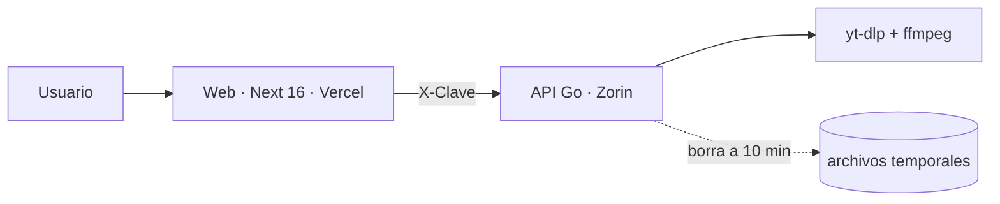

# Conversor MP3 Fácil

> [!resumen] En cristiano
> Una web oscura y tranquila para pasar una canción o vídeo de YouTube a MP3 o MP4 en 3 pasos: buscar o pegar el enlace, convertir, descargar. Sin anuncios ni trampas, con clave de acceso. La web vive en Vercel y la conversión la hace el servidor Zorin. **Estado (2026-11-19):** el rediseño B2 está hecho, medido, commiteado (`d6b69b1`), **desplegado** (API en Zorin con borrado a 10 min y web en Vercel `--prod`) y **verificado en producción** con la clave real: MP3, MP4 480p, recorte y ZIP. Retro completa (9 retoques). Proyecto cerrado.

## Documentos
[[1 - PRD]] · [[Ficha de Investigacion]] · [[Paleta de Componentes]] · [[6 - Plan de Implementacion]] · [[Retro]] · [[1 - PRD (borrador B2) - archivado]]

## Resumen técnico
- **Vía**: micro-saas (herramienta personal con clave, sin cobro).
- **Stack**: API Go (stdlib) + yt-dlp + ffmpeg en Zorin (`127.0.0.1:8799`, Tailscale Funnel); web Next.js 16, React 19, Tailwind v4, shadcn/ui, motion (sin Magic UI); Vercel.
- **Funciones**: MP3 192 kbps y MP4 480/720p, recorte de tramo, ZIP, búsqueda tipo comando (`/`, ⏎), cola. Límites: 10 conv/h y 60 búsquedas/h por IP, MP3 ≤ 3 h, MP4 ≤ 2 h.
- **Identidad B2**: «mesa de mezclas en penumbra» (carbón + esmeralda, vidrio fino, Geist). Cuerpo 16 px, mínimo 14 px, botones ≥ 48 px, solo tema oscuro.
- **Medido (build de producción)**: axe 0 violaciones a 375/768/1280; Lighthouse A11y 100, BP 100, Perf 95/90/100, SEO 60 (`noindex` intencional); `impeccable detect` y `slop-gate` en 0; foco 10,14:1 y 9,05:1.

## Puertas abiertas
1. ~~Desplegar B2~~ hecho 2026-11-19 (copia del binario anterior: `/usr/local/bin/conversor-api.bak-20261119` en Zorin).
2. ~~Producción sin verificar~~ hecho: MP3 457 KB, MP4 480p 629 KB, recorte 2-8 s = 6,02 s, ZIP con ambos, borrado a 10 min (404 a los 13 min), 401 sin clave, 422 con Spotify, CORS correcto, axe 0 en producción. Sin probar: interfaz en navegador real con la clave.
3. **Cola/historial** (US-11): existe en el código, fuera del PRD; decidir quedarse, quitar o reescribir.
4. **Deuda P2**: salidas con ease-out, resaltado de fila 1,2 s, animación de `height`/`width`, 2 `rgb()` fijos, componentes `ui/` sin usar, estados con datos reales sin medir.
5. **Perf móvil/tablet 90-95** por TBT del runtime de React (varía entre corridas).
6. **Retro** completa; falta la medición a 2-4 semanas de publicar.
7. Bug de `mcp diseno` en «movimiento» pendiente.

## Guía operativa
Repo `~/Proyectos/conversor-mp3-facil/` (`api/`, `web/`, `README.md`, `resumen.html`, `DESIGN-IDENTITY.md`, `web/DESIGN.md` editado a mano). Web: `cd web && fnm exec --using=22 -- npx next build && … next start -p 3000`. API: `cd api && go test ./... && go build`. Despliegue y variables: README. `--prod` solo con permiso.
