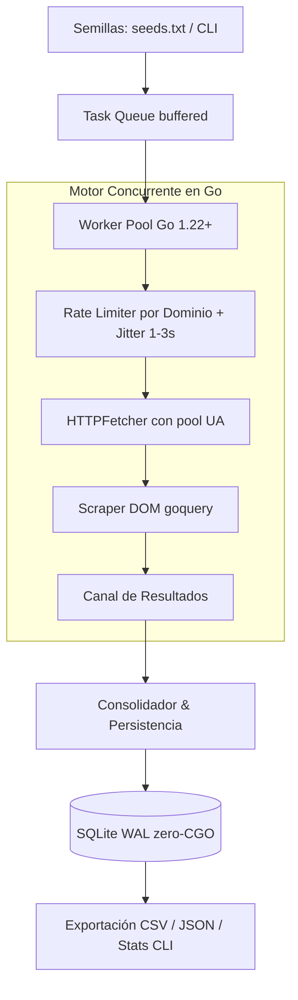

> [!resumen] En cristiano
> Un robot en Go que recorre en paralelo las webs de agencias de inteligencia artificial y automatización en España. Descarga sus páginas a toda velocidad, descubre qué herramientas usan (Make, n8n, OpenAI, etc.), qué servicios venden, sus teléfonos, correos y tarifas públicas, guardándolo todo en una base de datos local SQLite y exportándolo a Excel/CSV para alimentar las estrategias comerciales de NeoZeler.

**Estado: Completado (V1 Operativa)** · 2026-11-08 · Repo: `~/Proyectos/crawler-agencias-ia/`

## Qué es
Motor de rastreo concurrente y extracción semántica especializado en el ecosistema de agencias de IA, automatización y desarrollo custom en España. Diseñado para realizar inteligencia de mercado automatizada: auditar oferta de servicios, tech stack, precios públicos, garantías y vías de contacto.

## Arquitectura del Pipeline


## Esquema de Datos Extraído
1. **Identificación**: Nombre comercial, Razón Social, CIF/NIF español (`B12345678`), Dominio normalizado.
2. **Ubicación**: Sede principal detectada (Madrid, Barcelona, Valencia, Málaga, Sevilla...) y ciudades operativas.
3. **Servicios**: Agentes IA Autónomos, RAG & Bases de Conocimiento, Automatización n8n/Make, Integración CRM/ERP, Voz & Telefonía IA, Consultoría y Software a Medida.
4. **Stack Tecnológico**: n8n, Make, Zapier, OpenAI, Anthropic Claude, LangChain, LlamaIndex, Ollama, Supabase, Pinecone, Webflow, Next.js, etc.
5. **Precios y Modelos**: Retainers mensuales, tarifas fijas por proyecto, tarifas por hora y montos detectados.
6. **Lead Magnets**: Auditorías gratuitas, sesiones estratégicas 30 min, calculadoras de ROI.
7. **Contactos**: Emails corporativos, teléfonos españoles (+34, 900), enlaces Calendly/SavvyCal y redes sociales.

## Guía Operativa
```bash
cd ~/Proyectos/crawler-agencias-ia

# Compilar
go build -o bin/crawler cmd/crawler/main.go

# Rastreo masivo
./bin/crawler crawl -seeds data/seeds.txt -concurrency 5 -depth 2

# Análisis estadístico
./bin/crawler stats

# Exportar para CRM
./bin/crawler export -format csv -out agencias_competencia.csv
```


## Mejoras 2026-11-09
Ahora el robot entra en servicios, precios, casos, contacto y aviso legal (no solo la portada), lee `robots.txt` y `sitemap.xml`, limpia emails/teléfonos/precios, reintenta ante fallos, anota por qué una semilla no dio datos (`seed_failures`) y guarda historial de cambios (`agency_history`). Prueba con 14 agencias: de ~1 a 5-15 páginas por agencia, emails sin basura. Pendiente: webs con JavaScript necesitan `chromium` instalado; directorios (Clutch, GoodFirms) dan 403. Para repetir todo: `./bin/crawler crawl -recrawl` (copia previa en `data/agencias.antes-2026-11-09.db`). Detalle en el README del repo.
