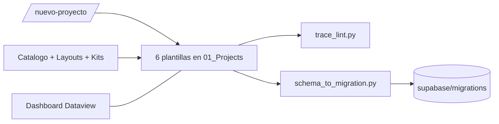

> [!resumen]
> Sistema interno para empezar proyectos de software a medida con 6 documentos en orden (PRD → TRD → UI/UX → AppFlow → Backend Schema → Plan) y herramientas que detectan huecos antes de programar.

## Piezas
| Pieza | Dónde |
|---|---|
| Plantillas y guía | `00_Meta/Plantillas/Proyecto Software/` · [[00 - Flujo de Software]] |
| Skill orquestadora | `~/.claude/skills/nuevo-proyecto/` (`/nuevo-proyecto`, visible en sesión nueva) |
| Herramientas | `~/Proyectos/flujo-software/tools/` (`trace_lint.py`, `schema_to_migration.py`) |
| Recursos | [[Catalogo de Componentes]] · [[Biblioteca de Layouts]] · [[Starter Kits NeoZeler]] |
| Control | [[Dashboard - Proyectos de Software]] |

## Arquitectura

## Estado
- Herramientas probadas con 8 pruebas unitarias (OK).
- Catálogo con 9 filas procedentes de `librerias.md`; Starter Kits es **solo inventario de candidatos**, nada extraído.
- Sin probar aún en un proyecto real: usar `/nuevo-proyecto` con el siguiente proyecto y ajustar.

## Uso
Ver `~/Proyectos/flujo-software/README.md`. Repo local con `git init`, sin primer commit todavía.

