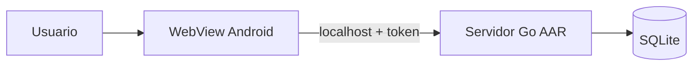

# Grid64

> [!resumen] En cristiano
> App de móvil (Android) para organizar una meta grande en un cuadro 9×9 (método Harada): 1 meta, 8 pilares, 64 acciones. Todo vive en el móvil, sin cuenta ni internet. Proyecto personal de Haytham, vía micro-saas. Documentos aprobados el 2026-11-08; sin código. Siguiente paso: spike de Android (T-01).

- Documentos: [[1 - PRD]] · [[2 - TRD]] · [[3 - UI-UX Design]] · [[Ficha de Investigacion]] · [[6 - Plan de Implementacion]] (AppFlow y Schema no-aplica).
- Stack: Go + SQLite (`modernc.org/sqlite`) + WebView Android con Alpine/Tailwind; `gomobile bind`.
- Identidad: «tablero de Go» (jade sobre obsidiana cálida), ver [[Registro de Identidades Visuales]].
- Relacionado: [[Mandalá 9×9 de equipo, web]] (uso interno de plantillas).

## Puertas abiertas
- Spike: ¿`modernc.org/sqlite` corre en android/arm64? Plan B en TRD §8.
- Toolchain Android (JDK, SDK, NDK) sin instalar.
- Defaults asumidos del PRD §8 sin confirmar.
