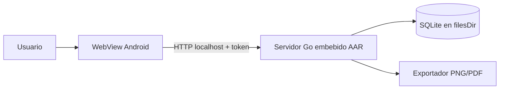

# 2 · TRD — Grid64

> [!resumen] En cristiano
> La app son dos piezas: un «cerebro» escrito en Go que guarda todo en un archivo SQLite dentro del móvil, y una «ventana» (WebView de Android) que muestra la pantalla web y habla con el cerebro por localhost. Sin internet ni servidores. **Riesgo principal:** hay que comprobar con una prueba pequeña que el SQLite de Go funciona dentro de Android antes de construir nada más.

## 1. Stack elegido
| Capa | Elección | Alternativa descartada | Por qué |
|---|---|---|---|
| Frontend | HTML5 + Tailwind (build) + Alpine.js, servido por Go (`embed`) | HTMX puro; React | Interacciones táctiles (swipe, sheet) piden estado cliente; Alpine pesa ~15 kB. HTMX solo para fragmentos si conviene |
| Backend | Go 1.22, `net/http` en `127.0.0.1:<puerto aleatorio>`, empaquetado con `gomobile bind` (AAR) | Wails (sin Android estable); Go puro con Fyne/Gio | La petición lo nombra, pero Wails no cubre Android. gomobile + WebView reutiliza el frontend web |
| Shell Android | Actividad Kotlin mínima con `WebView` que arranca el AAR y carga `http://127.0.0.1:<puerto>` con token de sesión | Capacitor/Cordova | Menos capas; el cerebro ya es Go |
| Base de datos | SQLite con `modernc.org/sqlite` (sin CGO) | `mattn/go-sqlite3` (CGO) | Requisito del spec. **Spike T-01 obligatorio** en android/arm64 |
| Auth | Ninguna (usuario único); token aleatorio por arranque entre WebView y Go | Cuentas | Local-first |
| Despliegue | APK debug/release firmado localmente, instalación directa | Play Store | Fuera de alcance v1 |

### 1.1 Ficha por librería
Pendiente de verificar en la fase de investigación (`librerias.md` → context7 → registro oficial). Candidatas: `modernc.org/sqlite`, `golang.org/x/mobile`, Alpine.js, Tailwind CSS. Ningún dato se da por bueno de memoria.
| Librería | Versión | Último release | Mantenimiento | Peso | Licencia | Fuente | Trampas |
|---|---|---|---|---|---|---|---|
| modernc.org/sqlite | por fijar | por verificar | por verificar | n/a | BSD-3 (verificar) | pendiente | soporte android/arm64 sin comprobar |

### 1.2 Presupuesto de dependencias
| Límite | Máximo | Previsto |
|---|---|---|
| Motores de animación | 1 | 0 (CSS + Web Animations) |
| JS inicial (kB gzip) | 200 | < 40 (Alpine + app) |
| Dependencias directas Go | 25 | 2-3 (sqlite, mobile, goldmark para Markdown) |

## 2. Arquitectura

### 2.1 Modelo de datos (resumen; esquema final en SQL al aprobar)
Entidades del spec, con ajustes necesarios para cubrir lo pedido:
- `projects`: id, title, target_date, status, progress_percentage (derivado, se guarda en caché), color_theme, created_at.
- `core_goals`: id, project_id (único, ON DELETE CASCADE), title, description.
- `pillars`: id, core_goal_id (CASCADE), idx 1-8 (UNIQUE por meta), title, color_hex, progress.
- `actions`: id, pillar_id (CASCADE), idx 1-8 (UNIQUE por pilar), title, is_completed, is_daily_priority, notes, updated_at. **Añadidos**: `due_date`, `completed_at` (para racha) y `daily_date` (día de la prioridad; máx. 5 por día).
- `ideas`: id, title, content, project_id (opcional, ON DELETE SET NULL), status inbox|linked|archived, created_at. **Añadidos**: `tags` y `linked_to_type`/`linked_to_id` (destino de la conversión).
- Reglas: 1 meta por mandala, exactamente 8 pilares y 64 acciones creados de golpe en transacción.

## 3. Integraciones y servicios externos
Ninguna. Coste 0. Plan B n/a.

## 4. Seguridad y datos
- Sin cuentas ni roles (un usuario).
- Servidor solo en `127.0.0.1`, puerto aleatorio, token por arranque en cabecera/cookie; rechazar cualquier otro origen. Sin permiso INTERNET en el manifiesto de release.
- Datos en el almacenamiento privado de la app; copia de seguridad = exportar el `.db` (RF-09). RGPD: datos solo en el dispositivo.
- Secretos: ninguno; firma del APK con keystore fuera del repo (`.gitignore`).

## 5. Rendimiento y escalado
- Volumen minúsculo (cientos de filas). SQLite en modo WAL, transacciones por operación. Arranque en frío medido en el móvil real.

## 6. Entornos y CI
- Local: `go test ./...`, servidor de escritorio con la misma UI en navegador (acelera el diseño). Android: Gradle + AAR vía gomobile.
- Build y tests limpios antes de cada commit. Sin CI externo en v1.

## 7. Trazabilidad PRD → técnica
| Requisito PRD | Solución técnica |
|---|---|
| RF-01, RF-02 | `pkg/services` + transacción que crea 1+8+64; progreso recalculado en SQL |
| RF-03 a RF-05 | `frontend/src` Alpine; rutas Go que devuelven JSON/HTML |
| RF-06, RF-07 | `services/convert.go` (idea→meta/pilar/acción) en transacción |
| RF-08 | `pkg/database` SQLite WAL, sin red |
| RF-09 | endpoint de exportar/importar `.db` por el selector de archivos de Android |
| US-13 | exportador PNG/PDF en cliente (canvas) o Go; decidir en Plan |

## 8. Riesgos técnicos
> [!riesgo]
> - `modernc.org/sqlite` + gomobile en android/arm64: no verificado. Plan B: `mattn/go-sqlite3` con CGO (NDK), o SQLite nativo de Android expuesto al WebView.
> - WebView con servidor localhost: tráfico en claro a 127.0.0.1 exige `networkSecurityConfig`; el puerto aleatorio y el token evitan que otra app lo use.
> - Fragmentación de WebView por versión de Android: probar en el móvil objetivo.
> - Peso del toolchain (SDK, NDK, JDK) y tiempo de primera compilación.

---
Anterior: [[1 - PRD]] · Siguiente: [[3 - UI-UX Design]]

> [!riesgo] Hallazgos del spike T-01 (2026-11-08)
> - `modernc.org/sqlite` v1.62.0 **compila y enlaza** para android/arm64 con `gomobile bind` (AAR 7,9 MB); el test de escritorio pasa. **Probado en un Galaxy S23 (SM-S911B): 3 aperturas con `force-stop` entre medias, el contador de SQLite pasó de 1 a 3 sin pérdida; sin fallos en logcat.**
> - El PRD pedía «sin permiso INTERNET», pero un servidor localhost y la WebView necesitan `INTERNET` en Android. El spike lo declara y limita el tráfico claro a `127.0.0.1` con `networkSecurityConfig`; el token por arranque evita que otra app lo use. Ajustar PRD §6 al aprobar.
> - Go: `gomobile` exige Go ≥ 1.26 (`go.mod` fija `toolchain go1.26.10`).

> [!resumen] Desviación en fase 3 (2026-11-08)
> Sin Tailwind ni Node: CSS propio con tokens y Alpine 3.17.5 local, fuentes Figtree y Martian Mono en `frontend/fonts` (licencia OFL). Todo va dentro del binario con `embed`; menos piezas y cero dependencias de build. Notas en Markdown de momento como texto plano (goldmark pendiente).
