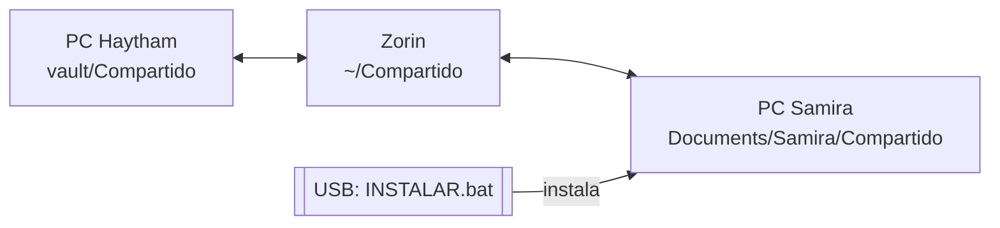

> [!resumen] En cristiano
> Un USB que deja el ordenador Windows de Samira (CEO de NeoZeler) listo con su propio vault, su Claude Code adaptado a ventas, marketing y contenido, y la carpeta `Compartido` sincronizada con el vault de Haytham. Se instala con doble clic en `INSTALAR.bat`.

## Qué hace
- **Vault** `Documents\Samira` con carpetas PARA simplificadas, plantillas y `CLAUDE.md` en lenguaje llano.
- **Harness**: mismo ahorro de tokens que el de Haytham (Sonnet + esfuerzo medio, autocompact 200K, token-optimizer, ponytail, superpowers, reglas de lectura acotada) pero con skills de ventas/marketing/contenido y una skill `crear-herramienta` pensada para no técnicos.
- **MCPs**: `vault` (base vectorial local + notas), `compartido`, `diseno`, `marketing`, `context7`, `sequential-thinking`.
- **Guía**: carpeta `08_Guia_Claude` con 8 notas para que use Claude Code sin ayuda.
- **Sync**: Syncthing con Zorin en medio; carpeta `vault-compartido` ↔ `Compartido/` de cada vault.

## Arquitectura

## Módulos y guía
Detalle completo en `~/Proyectos/samira-kit/README.md`. Instalar: enchufar el USB en su PC, doble clic `INSTALAR.bat`, `/login` en «Claude - Samira». Comprobar sync: crear una nota en `Compartido/` y verla en el otro vault.

## Estado
Probado: MCP `vault` (búsqueda, escritura sin pisar, rechazo de rutas fuera), instalador en simulacro, Zorin con su dispositivo añadido. **Sin probar en Windows real**: winget, Syncthing, `claude mcp add`.

## Hooks y mod (2026-11-17)
Incluye 4 hooks en Go (guard-destructive, guard-read-grande, recordar-errores, verificar-cierre) y el mod `model-router`. Detalle en el README del repo. Pendiente: copiar al USB y probar en Windows.
