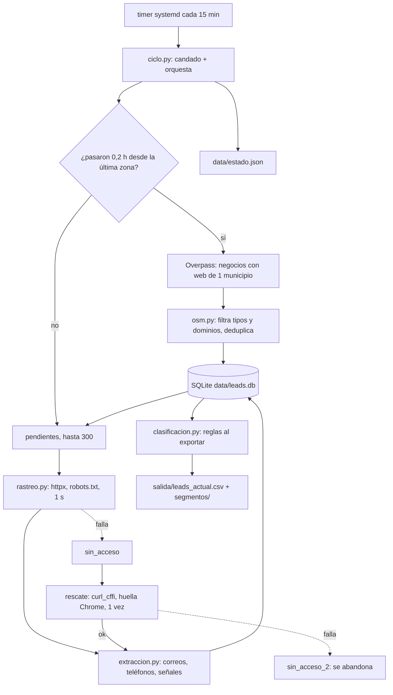

# Laya Leads: cómo funciona por dentro

> [!resumen] En cristiano
> Laya Leads es una **cadena de montaje de 6 pasos** que corre sola en el servidor Zorin cada 15 minutos. (1) Pide a OpenStreetMap la lista de negocios con web de un municipio de Málaga. (2) Los guarda en una base de datos pequeña. (3) Visita cada web con educación (respeta `robots.txt`, 1 segundo de pausa). (4) Lee la web como lo haría una persona: busca correo, teléfono, y pistas de si la web es vieja o si el negocio tiene dinero. (5) Les pone nota con reglas fijas (nada de IA) y los reparte en A, B, C o D. (6) Escribe unos CSV listos para llamar o mandar correo. **Laya (la IA) se probó y no pasó el examen, así que no decide nada.** Ficha de resumen y resultados: [[01_Projects/Laya Leads]]. Esta nota es el detalle técnico.

## 1. Vista general

Repositorio: `~/Proyectos/laya-leads/` en el servidor (`ssh@192.168.0.100`), git local sin remoto, un solo commit (`9d3ed44`). Python con `httpx`, `curl_cffi`, `selectolax` y SQLite. Unas 1.100 líneas de código en `src/laya_leads/`.



## 2. Módulos (`src/laya_leads/`)

| Archivo | Líneas | Qué hace |
|---|---|---|
| `osm.py` | 102 | Lee el JSON de Overpass, descarta tipos y dominios inútiles, deduplica por dominio. |
| `rastreo.py` | 139 | Descarga educada de webs. Clase `Rastreador`. |
| `extraccion.py` | 161 | Saca correos, teléfonos, plantilla y señales de la web; calcula la puntuación de antigüedad. |
| `clasificacion.py` | 170 | Todo el cerebro por reglas: pyme, facturación, necesidad, capacidad de pago, tier, oferta. |
| `cli.py` | 263 | Órdenes (`preparar`, `rastrear`, `rescatar`, `juzgar`, `exportar`), esquema SQLite, escritura de CSV. |
| `ciclo.py` | 123 | Orden `ciclo`: candado, zona nueva, rastreo, rescate, exportación y `estado.json`. |
| `juez.py` | 118 | Laya, opcional y experimental: 4 preguntas tipadas. No entra en la clasificación. |

Fuera del paquete: `evaluar_laya.py` y `CRITERIO_LAYA.md` (la prueba de Laya), `distribucion.py` (repartos para calibrar umbrales), `muestra.py`, `resumen.py`, `stats_osm.py`, `tests/test_clasificacion.py`, `docs/overpass.md`.

## 3. Paso a paso

### 3.1 Descubrir negocios: OpenStreetMap (`ciclo.py` + `osm.py`)

- Consulta **Overpass** por municipio: `area["name"=zona]["boundary"="administrative"]["admin_level"="8"]` y `nwr["website"]` dentro. Solo trae lo que ya tiene campo `website` en OSM.
- 33 zonas fijas en la tupla `ZONAS` (Málaga, Marbella, Fuengirola… hasta Almogía), de mayor a menor mercado. Málaga capital se marca como hecha desde el principio (venía de la primera tanda).
- Espejos probados en orden: `overpass.kumi.systems`, luego `overpass-api.de`. Hasta 4 rondas con espera creciente (30, 60, 90, 120 s). User-Agent propio obligatorio (sin él el servidor principal responde 406).
- Cortesía: **una zona por ciclo como mucho**, y solo si pasó `--horas-entre-zonas` desde la última consulta. Cada JSON queda guardado en `data/osm_<zona>.json`.
- Filtro (`cargar_empresas`):
  - Exige web válida (`website` o `contact:website`, normalizada con esquema `https://`).
  - Descarta tipos que no son cliente: colegios, ayuntamientos, hospitales, iglesias, parques, fundaciones, museos…
  - Descarta dominios que no son negocio local: redes sociales, administración (`gob.es`, `juntadeandalucia.es`), grandes cadenas (Mercadona, Zara, IKEA, Meliá…).
  - **Deduplica por dominio** (la clave primaria de la base): si dos negocios comparten web, se queda el primero.
- El tipo OSM se guarda como `clave=valor` (`amenity=restaurant`); se mira en orden `shop, amenity, craft, office, tourism, healthcare, leisure`.

### 3.2 Guardar: SQLite `data/leads.db`

Dos tablas `STRICT`:

- `empresas`: `dominio` (clave), `nombre`, `tipo`, `web`, `email_osm`, `telefono_osm`, `direccion`; estado `rastreo` (`pendiente` → `ok` | `sin_acceso` → `sin_acceso_2`); resultados `emails`, `telefonos` (JSON), `empleados`, `texto` (1.500 caracteres de la portada), `senales` (JSON), `puntuacion_web`, `rastreado_en`; y columnas de Laya (`laya`, `laya_ms`, `juzgado_en`).
- `zonas`: `nombre`, `consultada_en`, `empresas_nuevas`.

Todo es reanudable: cada fase solo mira filas en su estado de entrada. `INSERT OR IGNORE` hace que repetir una consulta no duplique nada.

### 3.3 Visitar las webs (`rastreo.py`)

- Identificación honesta: `NeoZelerLeadsBot/0.1 (+https://neozeler.com; contacto: …)` y `Accept-Language: es-ES`.
- **Respeta `robots.txt`** (cacheado por dominio). Si lo prohíbe, la web no se visita y queda `sin_acceso`. Si no hay `robots.txt` válido (o devuelve HTML), se considera permitido.
- Pausa de 1 s antes de cada web y entre páginas; timeout 12 s; lectura en trozos de 64 KB con **tope de 800 KB** por página; solo respuestas HTML.
- `verify=False` a propósito: un certificado caducado o roto sigue contando, es una señal (`sin_https`), no un error.
- Por web: **portada + hasta 2 páginas extra** del mismo dominio cuyo enlace contenga `contact, contacto, nosotros, quienes, about, equipo, empresa, aviso-legal`. Páginas con estado ≥ 400 se ignoran.
- Una instancia de `Rastreador` por web y por hilo (no es segura entre hilos). Hilos: 3 en el ciclo, 4 a mano.
- **Rescate (2.ª pasada)**: las `sin_acceso` se reintentan **una sola vez** con `curl_cffi` imitando la huella TLS de Chrome (mismo User-Agent y mismo `robots.txt`). Si falla otra vez pasan a `sin_acceso_2` y no se tocan más. Aporta poco (≈7 %): no ejecuta JavaScript ni resuelve CAPTCHAs.

### 3.4 Leer la web (`extraccion.py`)

Tres tipos de dato, todo con expresiones regulares y `selectolax` (motor `lexbor`):

1. **Contacto**
   - Correos: regex, también `[at]`, `(at)` y `&#64;`. Descarta imágenes/archivos (`.png`, `.js`…) y dominios de relleno (`example.`, `sentry`, `wixpress`, `tudominio`…). Ordena primero los típicos de empresa (`info`, `contacto`, `hola`, `reservas`, `ventas`…).
   - Teléfonos: móviles y fijos españoles (6-9 + 8 dígitos, con o sin `+34`), normalizados a 9 dígitos y deduplicados.
2. **Tamaño**: busca frases tipo «más de 20 empleados / somos 12 profesionales / equipo de 8 técnicos». Acepta 1-2000 y descarta años (1900-2100). Casi nunca aparece: `None` es lo normal.
3. **Señales de la web** (`senales_web`, versión `v: 2`):
   - Antigüedad: `https`, `movil` (meta viewport), `etiquetas_obsoletas` (`<font>`, `<center>`, `<marquee>`…), `flash`, `anio_copyright`, `jquery_antiguo` (<3), `lenta` (>3 s), `sin_meta_descripcion`, `constructor` (wix, jimdo, webnode, wordpress, shopify, prestashop…).
   - Conversión y dinero: `tienda_online` (WooCommerce, carrito, Shopify…), `reservas` (reservar, TheFork, OpenTable, Calendly…), `pixel_ads` (Google Ads, Facebook Pixel), `analytics`, `whatsapp`, `formulario`, `redes` (cuántas), `precios` (≥3 precios con €), `sedes_pista` (sucursales, franquicias, delegaciones…).

**Puntuación de antigüedad `puntuacion_web` (0-100, suma con tope):** sin HTTPS +25 · sin viewport móvil +25 · ≥3 etiquetas obsoletas +15 · Flash +15 · copyright ≤2019 +15 (≤2022 +8) · jQuery antiguo +5 · lenta +5 · sin meta descripción +5 · constructor básico (Jimdo, Webnode, Webador, GoDaddy) +5.

### 3.5 Clasificar (`clasificacion.py`)

**No se guarda en la base: se calcula cada vez que se exporta**, a partir de lo guardado. Así se pueden cambiar reglas y recalcular sin volver a visitar webs.

1. **Sector y plantilla típica** (tabla `SECTORES`, por prefijo del tipo OSM): hostelería (6 pers., 45 k€/empleado), alojamiento (12, 55 k€), belleza (3, 35 k€), salud (6, 65 k€), servicios profesionales (5, 70 k€), deporte (6, 50 k€), oficios y talleres (4, 60 k€), comercio (3, 90 k€), otros (4, 60 k€).
2. **Tamaño**: si la web dice cuántos son, se usa (`fuente = web`); si no, la plantilla típica del sector (12 si hay varias sedes). Micro <10, pequeña <50, mediana <250, grande ≥250.
3. **Facturación estimada** = plantilla × facturación por empleado, rango ×0,65 a ×1,35. Son **supuestos propios**, no datos oficiales.
4. **Necesidad** = `puntuacion_web` + huecos de conversión (máx. 20): sin formulario +5, sin WhatsApp +3, sector con reservas sin reservas +7, comercio sin tienda +5. Un dato desconocido no suma. Nivel: `web_antigua` ≥60, `renovar` 35-59, `mejorable` 15-34, `correcta` <15.
5. **Capacidad de pago (0-100)**: base 10 · tienda online +25 · reservas +10 · píxel de anuncios +15 (solo analítica +5) · varias sedes o ≥3 teléfonos +10 · pequeña/mediana +15 si lo dice la web, +8 si es supuesto · facturación máx. ≥1 M€ +10 (≥400 k€ +5) · ≥3 redes +5 · precios visibles +5.
6. **Prioridad** = raíz cuadrada de (necesidad × capacidad). Es una media geométrica: exige las dos cosas a la vez, una web malísima de un negocio sin dinero no sube.
7. **Tier**: `D` si es no objetivo (tamaño grande, o nombre con ayuntamiento, colegio, fundación, asociación, cofradía, parroquia, junta de Andalucía…); si no, `A` ≥35, `B` ≥25, resto `C`. Umbrales calibrados el 2026-10-22 con 876 webs.
8. **Oferta** (primera regla que encaje): tienda con web vieja → rediseño de tienda con pago rápido · sector con reservas sin reservas → web nueva con reservas (o añadirlas) · sin móvil o sin HTTPS → web móvil y segura · nivel renovar/mejorable → mejora de captación (formulario, WhatsApp, posicionamiento local) · resto → posicionamiento local o automatización.
9. **Calidad de contacto**: `alta` (correo del propio dominio), `media` (correo de otro dominio), `baja` (solo teléfono), `sin_contacto`. Si la web no da contacto se usa el de OSM.
10. **Fiabilidad**: `alta` si el rastreo trae señales `v: 2`; `baja` si es un rastreo antiguo sin conversión ni capacidad de pago (`rastrear --refrescar` lo arregla).

### 3.6 Exportar (`cli.py → exportar`)

- Lee solo filas `rastreo='ok'`, clasifica, marca `duplicado=si` si el mismo correo sale en varias empresas y ordena por tier y prioridad.
- Escribe `salida/leads_actual.csv` (UTF-8 con BOM para Excel) con columnas como `tier`, `prioridad`, `oferta`, `facturacion_estimada`, `problemas`, `email`, `calidad_contacto`, `fuente_dato`, `fecha_dato`, `senales`.
- Tres segmentos en `salida/segmentos/`:
  - `a_llamar_ya.csv`: tier A con teléfono.
  - `correo_frio.csv`: tier A o B, contacto alta o media, sin duplicar, y que no estén ya en «a llamar».
  - `descartar.csv`: tier D o web ya correcta.
- `leads_malaga.csv` es la primera tanda congelada; no se regenera.

### 3.7 Modo automático (`ciclo.py` + systemd de usuario)

- `laya-leads.timer`: `OnBootSec=10min`, `OnUnitInactiveSec=15min`, `Persistent=true`.
- `laya-leads.service`: `ciclo --horas-entre-zonas 0.2`, `Nice=10`, `UMask=0077`, tope 3 h.
- Un ciclo = (1) candado `fcntl` en `data/ciclo.lock` (si ya hay uno, sale sin hacer nada) → (2) zona nueva si toca → (3) hasta **300** webs pendientes con 3 hilos → (4) hasta **60** rescates con 2 hilos → (5) exportar → (6) `data/estado.json` con cuentas y zonas hechas.
- Con el tiempo entre zonas en 0,2 h y el timer cada 15 min, el ritmo real es **una zona por ciclo**.

### 3.8 Laya (juez opcional, no activo)

`juez.py` hace 4 preguntas tipadas por empresa (`sector`, `tamano`, `web_anticuada`, `necesita_web`) a un modelo local, con umbral de confianza 0,70 (por debajo → `revisar_a_mano`). Cargar el modelo cuesta ~2 GB de RAM y ~7 s por empresa. Se probó con criterio fijado **antes** de medir (`CRITERIO_LAYA.md`, 100 empresas elegidas por hash del dominio): **NO PASA** (sector 66 % frente a 43 % de base, pero OSM ya lo da gratis; web anticuada 76 % frente a 81 % de decir siempre «no»). El CSV usa solo reglas. Las columnas `laya_*` salen vacías salvo que se ejecute `juzgar`.

## 4. Estado medido (2026-11-07)

| Dato | Valor |
|---|---|
| Zonas consultadas | 33 de 33 (cobertura completa de la lista) |
| Webs leídas (`ok`) / abandonadas (`sin_acceso_2`) | 1.879 / 303 |
| Reparto de tiers (1.879 filas) | A 106 · B 319 · C 1.417 · D 37 |
| Pyme / no objetivo | 1.842 / 37 |
| Tamaño | micro 1.454 · pequeña 378 · mediana 18 · grande 29 |
| Nivel de web | correcta 1.104 · mejorable 558 · renovar 173 · web_antigua 44 |
| Contacto | alta 896 · media 414 · baja 348 · sin contacto 221 |
| Fiabilidad de las señales | alta 1.867 · baja 12 |
| Segmentos | a_llamar_ya 91 · correo_frio 224 · descartar 1.116 |
| Tamaño en disco | `data/` 9,4 MB · `salida/` 4,1 MB |

Con las 33 zonas hechas, los ciclos ya no encuentran nada pendiente: solo reexportan y actualizan `estado.json`. Para seguir creciendo hay que **añadir más municipios a `ZONAS`** (o abrir otras provincias).

> [!resumen] Diferencias con la ficha resumen
> La ficha [[01_Projects/Laya Leads]] dice «cada 2 h» y 1.262 empresas (cifras del 2026-10-22). Hoy el timer corre **cada 15 min** con 0,2 h entre zonas y la base ya tiene 2.182 filas con rastreo terminado. No se ha tocado esa ficha.

## 5. Límites y riesgos

> [!riesgo] Lo que hay que tener presente
> - **Legal**: contactar en frío a correos de empresa exige revisar RGPD/LSSI (interés legítimo B2B, decir de dónde sale el dato, baja fácil). El CSV lleva `fuente_dato` y `fecha_dato`.
> - **Cobertura**: solo salen negocios que ya tienen web escrita en OpenStreetMap. Los que no la tienen en OSM no existen para Laya Leads.
> - **Provincia**: la consulta es por nombre de municipio; puede coger un homónimo de otra provincia. Revisar zonas nuevas.
> - **Cifras de dinero**: facturación y capacidad de pago son estimaciones por sector, sin datos reales. Calibrar con las primeras llamadas.
> - **Falsos positivos**: `tienda_online` y `reservas` se detectan por palabras en el HTML (un enlace `/cart` basta).
> - **Webs sin acceso**: JavaScript puro, CAPTCHA o bloqueo quedan fuera (303 abandonadas).
> - **Datos de terceros**: `data/` y `salida/` no se versionan ni se copian al vault.
> - Copias `*.bak` de `cli.py`, `extraccion.py` y `rastreo.py` siguen en `src/`: limpiar cuando se confirme que no hacen falta.

## 6. Guía operativa

```bash
cd ~/Proyectos/laya-leads && export PYTHONPATH=src
venv/bin/python -m laya_leads ciclo                      # un ciclo a mano
venv/bin/python -m laya_leads rastrear --refrescar       # releer webs con señales antiguas
venv/bin/python -m laya_leads rescatar --limite 400      # 2.ª pasada de las bloqueadas
venv/bin/python -m laya_leads exportar                   # CSV completo + segmentos
venv/bin/python distribucion.py salida/leads_actual.csv  # repartos para calibrar umbrales
venv/bin/python -m pytest tests                          # pruebas de la clasificación
```

Controlar el timer: `XDG_RUNTIME_DIR=/run/user/$(id -u) systemctl --user list-timers laya-leads.timer`. Parar: `systemctl --user disable --now laya-leads.timer`. Registro: `journalctl --user -u laya-leads.service -n 30`.

## 7. Relacionado

- [[01_Projects/Laya Leads]] (ficha resumen)
- [[04_Archive/TopLeads]] (micro SaaS que nace de este motor)
- [[00_Meta/Sesiones/2026-10-22 - Laya Leads (scraper de webs de Málaga)]]
- [[00_Meta/Sesiones/2026-10-22 - Laya Leads clasificacion y ciclo automatico]]

