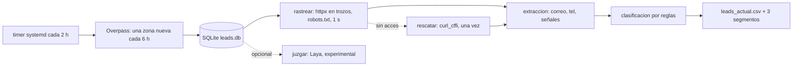

# Laya Leads

> [!resumen] En cristiano
> Un programa en el servidor Zorin que **busca solo, cada 2 horas, negocios de la provincia de Málaga con web**, visita cada una con educación, saca su correo y teléfono, y les pone nota: si es pyme, cuánto factura más o menos, cuánto necesita una web nueva, cuánto dinero parece tener y qué venderle. Con eso reparte los negocios en A (llamar ya), B, C y D (descartar). **Laya (la IA) se probó y no sirvió**, así que decide el código con reglas. **Decisión que te toca:** revisar los CSV de `salida/segmentos/` y decidir a quién contactar (antes, mirar el RGPD). Las cifras de facturación son aproximaciones por sector, no datos oficiales.

Proyecto de **Haytham para NeoZeler** (captación). Código: `~/Proyectos/laya-leads/` en el servidor (`ssh@192.168.0.100`). README completo allí.

## Resultado (2026-10-22)

| Dato | Cifra |
|---|---|
| Empresas en la base (Málaga capital + Marbella) | 1.262 |
| Webs leídas con señales completas / sin acceso | 876 / 134 (Marbella, 252 nuevas, en rastreo) |
| Reparto sobre 876 webs | A 58 · B 161 · C 639 · D 18 |
| Segmentos | a_llamar_ya 51 · correo_frio 119 · descartar 503 |
| Contacto con correo del propio dominio | 418 de 876 |
| Rescate con curl_cffi de las bloqueadas | 10 de 144 (7 %) |
| RAM del rastreo | pico 34 MB por proceso; 145 MB con 4 hilos |

Archivos (en el servidor; no se copian al vault por contener datos de terceros): `salida/leads_actual.csv` (lo regenera el ciclo), `salida/segmentos/`, `data/estado.json`. El CSV de la primera tanda, `leads_malaga.csv`, se conserva sin tocar.

## Arquitectura



## Clasificación (por reglas, se calcula al exportar)

- **Pyme:** micro (<10), pequeña (<50), mediana (<250); grande o nombre público (ayuntamiento, colegio, fundación…) = descartar. Sin dato en la web, se usa la plantilla típica del sector.
- **Facturación aproximada:** plantilla × facturación por empleado del sector, rango ±35 %. Supuestos propios: calibrar con casos reales.
- **Necesidad de web:** `web_antigua` (≥60), `renovar` (35-59), `mejorable` (15-34), `correcta`. Suma la antigüedad (sin HTTPS +25, sin móvil +25, etiquetas obsoletas, Flash, copyright viejo…) y hasta 20 por faltarle formulario, WhatsApp, reservas o tienda.
- **Capacidad de pago (0-100):** tienda online, anuncios, reservas, varias sedes, tamaño, facturación alta, redes, precios visibles.
- **Prioridad** = raíz(necesidad × capacidad). **Tier:** A ≥ 35, B ≥ 25, C resto, D no objetivo (calibrado con 876 webs).
- **Oferta:** frase de qué venderle (tienda rediseñada, web con reservas, web móvil y segura, mejora de captación).
- **Contacto:** alta (correo del dominio), media, baja (solo teléfono), sin contacto; marca correos duplicados.

## Modo automático

Timer de usuario `laya-leads.timer` → `laya_leads ciclo` cada 2 h: una zona nueva (33 municipios de la provincia en `ciclo.py`, como mucho cada 6 h), hasta 300 webs pendientes, hasta 60 rescates y exportación. Candado contra ciclos solapados. Parar: `XDG_RUNTIME_DIR=/run/user/1001 systemctl --user disable --now laya-leads.timer`. Registro: `journalctl --user -u laya-leads.service -n 30`.

## Laya: prueba y veredicto

Criterio fijado **antes** de medir (`CRITERIO_LAYA.md`), 100 empresas: sector 66 % frente a OSM (base 43 %, cumple pero OSM ya lo da gratis); web anticuada 76 % frente a 81 % de contestar siempre «no» (no cumple); 18 % de respuestas con confianza ≥ 0,7; 7 s por empresa. **NO PASA.** Coincide con [[01_Projects/Laya Trader]] y [[01_Projects/Mercados Laya/1 - PRD]]: Laya sin entrenar no sirve para decidir. Referencias de Jev (jevrake, jev-scrape-lab) se interpretaron como Laya por regla de Haytham; aportaron el patrón de «pregunta por texto, umbral de confianza y cola de revisión».

## Guía operativa

```bash
cd ~/Proyectos/laya-leads && export PYTHONPATH=src
venv/bin/python -m laya_leads ciclo                    # un ciclo a mano
venv/bin/python -m laya_leads rastrear --refrescar     # releer webs con señales antiguas
venv/bin/python -m laya_leads exportar                 # CSV completo + segmentos
venv/bin/python distribucion.py salida/leads_actual.csv  # repartos para calibrar umbrales
```

## Límites y riesgos

> [!riesgo] Legal y calidad
> Contacto en frío a correos de empresa: revisar RGPD/LSSI (interés legítimo B2B, decir de dónde sale el dato, baja fácil). El CSV lleva `fuente_dato` y `fecha_dato`. Los empleados casi nunca salen en la web (de ahí el supuesto del sector). `tienda_online` y `reservas` se detectan por palabras y dan falsos positivos. La consulta por municipio no filtra provincia: revisar que cada zona sea de Málaga. El rescate con curl_cffi aporta poco (7 %); no ejecuta JavaScript ni resuelve CAPTCHAs, y respeta `robots.txt`. Scrapling se descartó: pesa cientos de MB por navegador.

## Siguientes pasos posibles

Revisar a mano ~30 webs A para validar la clasificación y recalibrar; sustituir los supuestos de facturación por datos reales de las primeras llamadas; ampliar a otras provincias; enriquecer con empleados desde registros públicos.

## Relacionado

- [[00_Meta/Sesiones/2026-10-22 - Laya Leads clasificacion y ciclo automatico]]


**Actualización (2026-10-23, 01:30):** intervalo entre zonas bajado de 6 h a **1 h** (`--horas-entre-zonas 1` en `~/.config/systemd/user/laya-leads.service`, copia en `.service.bak`). El timer sigue cada 2 h, así que el ritmo real es **una zona por ciclo (cada 2 h)**: las 31 zonas pendientes tardarán ~2,6 días en vez de ~8. Para una zona por hora habría que bajar también `OnUnitInactiveSec` del timer. Overpass se consulta con cortesía: si responde 429/502 el ciclo reintenta con espera creciente.

**Actualización (2026-10-23, 01:25):** el temporizador pasa de cada 2 h a **cada hora** (`OnUnitInactiveSec=1h` en `~/.config/systemd/user/laya-leads.timer`, copia en `.timer.bak`). Con `--horas-entre-zonas 1` el ritmo es una zona por hora: las 31 zonas pendientes tardan ~1,3 días. Constantes del panel (`HORAS_ENTRE_ZONAS`, `HORAS_ENTRE_CICLOS` en `sistema.py`) deben coincidir con la unidad y el temporizador. En el panel, la pestaña Candidatas lista las 261 candidatas A/B (sin duplicados) con desplazamiento y ficha al pulsar.
