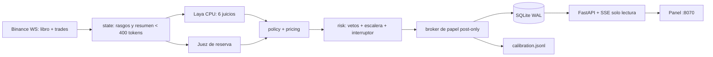

# Laya Trader

> [!resumen] En cristiano
> Bot que **practica con dinero de mentira** en BTC, ETH y SOL de Binance. Réplica del bot `buberlo/jev-trader` (gist de drillan) cambiando Jev por **Laya**: el código mide el mercado y escribe un resumen corto, Laya contesta 6 preguntas cortas, otro programa decide con frenos de seguridad que Laya no puede saltarse, y todo se apunta. Corre en el servidor Zorin con un **panel web en lenguaje normal** (`http://192.168.0.100:8070`, solo lectura, solo en la red de casa). Es un **experimento con criterio de cierre congelado**: si Laya no supera al juez de reserva (reglas fijas) y no gana neto, se cierra. Proyecto personal de Haytham, no de NeoZeler. Sustituye a [[01_Projects/Scalper Memecoins]] (abandonado) y no usa nada del [[01_Projects/Bot de Tendencia]].

## Documentos (flujo de 6, todos aprobados 2026-10-22)
1. [[01_Projects/Laya Trader/1 - PRD|PRD]] · 2. [[01_Projects/Laya Trader/2 - TRD|TRD]] · 3. [[01_Projects/Laya Trader/3 - UI-UX Design|UI/UX]] · 4. [[01_Projects/Laya Trader/4 - AppFlow|AppFlow]] · 5. [[01_Projects/Laya Trader/5 - Backend Schema|Backend Schema]] · 6. [[01_Projects/Laya Trader/6 - Plan de Implementacion|Plan de Implementación]]

## Arquitectura

Dos carteras con los mismos datos: **Laya** vs **juez de reserva**.

## Criterio de cierre (congelado, no se cambia tras medir)
Regla 1: Brier y log loss de `direction` de Laya mejores que los del juez de reserva (IC90 sin cruzar 0, ≥ 300 juicios). Regla 2: media neta por operación con límite inferior del IC90 > 0 en las dos mitades y sin las 3 mejores (≥ 300 operaciones, ≥ 7 días). Si falla cualquiera con muestra suficiente: se cierra.

## Estado y riesgos
Construcción: T-00 y T-02 (medir la latencia de Laya con 6 preguntas) en curso el 2026-10-22. Riesgo principal: Laya sin entrenar no leyó bien las cifras en pruebas anteriores ([[01_Projects/Scalper Memecoins]], [[01_Projects/Mercados Laya/1 - PRD]]). Con comisión de 0,10 % por lado y medio spread de 10,5 bps se esperan pocas ejecuciones.

## Registro de construcción
| Fecha | Tarea | Resultado |
|---|---|---|
| 2026-10-22 | T-00 repo y entorno en Zorin | `~/Proyectos/laya-trader/`, git `1a30e4f`, venv con 53 paquetes fijados (`requirements.lock`), `pytest`/`ruff`/`mypy` en verde |
| 2026-10-22 | T-02 medir Laya con las 6 preguntas | Carga + primera respuesta ~15 s; RAM 2.065 MB; **6 preguntas: p50 2.959 ms, p95 3.034 ms (límite del plan: 1.800 ms) → NO cumple**; 1 pregunta ~430-480 ms (no mejora por lotes); resumen de ~106 tokens (muy por debajo de 400). Aviso del propio modelo: el checkpoint trae temperaturas inválidas y su confianza es "no calibrada"; en las 5 pruebas las probabilidades salieron casi planas (confianza 0,004; respuesta más probable 0,30-0,38) |

| 2026-10-22 | T-03 feed de Binance | Libro local sincronizado (procedimiento oficial), reconexión probada con servidor local que corta la conexión, grabación y repetición del feed. **10 min reales de BTC/ETH/SOL**: 24.901 registros, 0 errores de lectura, 0 huecos de secuencia en vivo, edad máxima del dato 243-934 ms; BTC y ETH necesitaron 1 reintento al arrancar (la foto salió más vieja que el flujo; es normal). 29 pruebas, `ruff` y `mypy` en verde. Commit `28ea166` |
| 2026-10-22 | T-04 y T-05 rasgos, resumen y jueces | 30 estados reales (BTC/ETH/SOL, minutos 5 a 10 de la grabación): resumen de 106-108 tokens (límite 400), 6 respuestas válidas en los 30 casos. Latencia de Laya: primera llamada 7,5 s (cold), el resto p50 2,97 s y p95 3,01 s → hace falta `warm_up()` al arrancar; cabe en el turno de 4 s. **Laya y el juez de reserva casi no coinciden**: régimen 7/30, dirección 8/30, flujo tóxico 14/30, iliquidez 23/30, entorno 23/30, inventario 15/30. Laya dice «stressed» o «choppy» en 29 de 30 casos aunque el spread sea ~0 bps, y su confianza en dirección va de 0,35 a 0,44 (casi plana). Resumen completo en `scripts/informe_juicio_real.json` del repo |
| 2026-10-22 | T-06 política y precios | Política de §6.3 con Kelly normalizado por número de clases (`kelly_hat = (c − 1/3)/(2/3)`, aprobado por Haytham antes de medir; igual en las dos carteras), tamaño por moneda y precios Avellaneda-Stoikov (ejemplo del documento exacto: 84.502,71 / 84.680,37). Con la confianza típica de Laya (0,44) ahora sale tamaño 0,0125 en vez de cero. 107 pruebas, `ruff` y `mypy` en verde |
| 2026-10-22 | T-07 y T-08 riesgo, escalera y ejecución de papel | Guardián con los 6 vetos y el interruptor que no se desactiva solo; escalera de 5 escalones; broker de papel con cola estimada, relleno solo cuando una operación real pasa por nuestro precio, comisión 0,10 % y cierre contra el libro real; resultado a 900 s con ganancia neta. 140 pruebas, `ruff` y `mypy` en verde |
| 2026-10-22 | T-01, T-09 y T-10 base, motor y veredicto | Base SQLite con migración probada; motor por turnos con las dos carteras; comandos `laya-trader paper` (en vivo o repitiendo una grabación) y `laya-trader calibrate`. **Repetición de los 10 min reales con el juez de pruebas: 149 turnos, 298 decisiones, 1.788 juicios, 30 órdenes, 0 ejecuciones (esperado con ±10,5 bps), 11 veredictos; dos repeticiones idénticas**. Feed sintético de 25 min: con ejecuciones y resultados, caja = capital ± ejecuciones guardadas. 184 pruebas, `ruff` y `mypy` en verde. Commit `111607e` |
| 2026-10-22 | T-11 y T-12 API y base visual del panel | API de solo lectura (salud, veredicto, dinero, monedas, calibración, seguridad, decisiones, detalle y canal en vivo) y cáscara del panel con tokens del UI/UX, IBM Plex autoalojada, `lightweight-charts` 5.2.1 vendorizado (62 KB gzip, huella sha512 verificada), navegación por URL, tema claro/oscuro, ayuda «¿Cómo leo esto?» y los seis estados globales. Comprobado en el navegador: sin desplazamiento horizontal a 375 px en las 5 rutas, objetivos táctiles ≥ 44 px, contraste AA (el azul de enlaces y botones se oscureció/aclaró aparte del azul de las series). Un fallo real que las pruebas no vieron: la conexión de cada petición se abría en un hilo y se usaba en otro; corregido con prueba de regresión. 205 pruebas. Panel temporal en `http://192.168.0.100:8070` sobre la base de la repetición (T-19 lo sustituirá por un servicio) |
| 2026-10-22 | T-13 y T-14 pantallas «¿Sirve Laya?» y «Monedas» | Sello de veredicto, cifras con frase llana, curva de dinero de mentira (Laya sólida, programa de reglas discontinuo, etiquetas directas y tabla alternativa), tabla de últimas decisiones; pantalla de monedas con precio, flechas de compra y venta clicables, seis preguntas con la respuesta y la seguridad de cada juez, libro de órdenes y lo último decidido. Revisadas en el navegador: sin desplazamiento horizontal a 375 px, claro y oscuro. Se encontró y corrigió un error del generador sintético de pruebas (libro cruzado). Para verlas con datos hay un panel de demostración en `http://192.168.0.100:8071` (datos inventados con `scripts/generar_demo.py`); el de `:8070` usa la repetición real. 205 pruebas. Commit `ff2e8a8` |
| 2026-10-22 | T-15, T-16 y T-17 pantallas «¿Acierta?», «Seguridad» y «Decisiones» | Las cinco pantallas del panel ya están completas. Calibración con curva de fiabilidad, seguridad con nivel de prudencia, frenos, aviso del interruptor y rapidez de Laya, y registro con filtros y detalle auditable. Comprobado en el navegador: sin desplazamiento horizontal a 375 px en todas, botones ≥ 44 px, sin estados de error con datos. Un cambio de API: filtro `veto` en `/api/decisions`. 206 pruebas. Commit `b736ec2` |
| 2026-10-22 | T-18 y T-19 pulido y despliegue | Barrido de contraste y accesibilidad en las 5 pantallas. **El bot corre en vivo desde las 16:13 (hora de Madrid)** como servicios de usuario de systemd (`laya-trader`, `laya-panel`, copia diaria `laya-backup.timer` a las 04:00), con permisos 600 y el panel solo en `http://192.168.0.100:8070`. Memoria del bot ~2,2 GB. Un reinicio ya no parte el experimento (el veredicto suma las puestas en marcha iguales). Pruebas en producción: reinicio del servicio sin caer el panel, y congelado del bot 30 s con frenos, escalón 3, conexión caída y recuperada y vuelta a normal. Commits `fbdbd72` y `634844c`. **Primera decisión posible: 2026-10-29 16:13.** |
| 2026-10-22 | Corrección de la regla 1 | A la hora de arrancar el panel mostró «Laya no sirve: se cierra» con 0 operaciones: con una sola hora de datos el intervalo por bloques no existía y el código lo contaba como «no cumple» (Laya iba mejor: Brier 0,699 contra 0,788). Ahora hacen falta ≥ 12 horas distintas; el panel dice «444 juicios resueltos, pero solo 1 de 12 horas de datos necesarias». 3 pruebas de regresión, 213 en total. Commits `ae971ac` y siguiente. El experimento no se reinició (el veredicto suma las puestas en marcha) |
| 2026-10-22 | Capital en directo | Primera pantalla con «Capital ahora» (Laya, programa de reglas y la referencia «comprar y mantener») que se actualiza cada 2 s con el precio de las monedas, precios de BTC/ETH/SOL con su variación desde el principio y la curva con una tercera línea punteada. Migración 002 (`benchmark_point`), ruta `/api/capital`, 218 pruebas. Commit `c80fc6a`. Laya y el programa de reglas siguen en 10.000 USDT mientras no tengan monedas; la referencia sí se mueve |
| 2026-10-22 | Repetición con Laya real | Los mismos 10 min grabados con Laya de verdad (149 turnos, 447 s): la cartera de Laya hizo **4 propuestas de compra** y la de reserva **17**; 145 y 132 turnos en espera. Motivos de Laya: calentando 75, régimen de estrés 27, «ningún lado permitido» 26 (Laya contesta casi siempre `inventory_pressure = high` aunque no tenga inventario, y la regla congelada de §6.3 punto 5 solo deja vender; sin inventario no hay nada que vender), confianza baja 14. Sello: «todavía no se sabe». Conclusión: con las reglas congeladas Laya operará muy poco; no se cambia nada (regla de no ajustar tras ver resultados) |
| 2026-10-22 | Plazo de decisión | Turnos de 4 s por moneda (~12 s por moneda), aprobado por Haytham antes de medir; ajustados PRD RF-02, TRD, AppFlow y Backend Schema |

Consecuencia (T-02): con una sola copia de Laya, tres monedas con 6 preguntas cada una tardan ~9 s en serie. Cambio propuesto (pendiente de aprobación de Haytham): decisión por moneda en turnos, un turno de 4 s por moneda (~12 s por moneda en total).

## Guía operativa
README del repo: `~/Proyectos/laya-trader/README.md` (se escribe en T-21).


## Parada del experimento (2026-10-22)

> [!riesgo] Experimento interrumpido
> El 2026-10-22 (tarde), Haytham pidió parar los procesos de sus proyectos en el servidor Zorin. Se pararon `laya-trader.service` (bot), `laya-panel.service` (panel) y `laya-backup.timer` (copia diaria). El experimento de 7 días (empezó el 2026-10-22 a las 16:13; primera decisión posible el 2026-10-29 16:13) **queda cortado**: los días parados no cuentan. Al reanudar, decidir si se repite la ventana de 7 días completa o se alarga la fecha de decisión según los días medidos; fijarlo por escrito antes de volver a mirar resultados.

Los tres servicios siguen **activados** (no desactivados): si el servidor se reinicia, arrancan solos.

Para reanudar, en el servidor (`ssh@192.168.0.100`):

```bash
XDG_RUNTIME_DIR=/run/user/$(id -u) systemctl --user start laya-trader.service laya-panel.service laya-backup.timer
XDG_RUNTIME_DIR=/run/user/$(id -u) systemctl --user is-active laya-trader.service laya-panel.service laya-backup.timer
```

Panel de nuevo en `http://192.168.0.100:8070`. Los datos anteriores siguen en `~/Proyectos/laya-trader/data/laya.db`.
