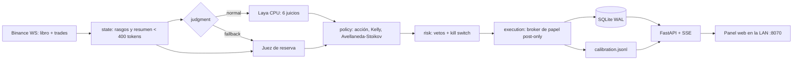

# 2 · TRD — Laya Trader

> [!resumen] En cristiano
> Todo corre en el servidor Zorin, nada en tu PC. Un solo programa en Python lee el mercado de Binance, le pasa un resumen a Laya, aplica reglas y frenos, simula las órdenes y lo guarda. Otro proceso pequeño sirve un **panel web moderno** en la red de casa con gráficos (curvas de dinero, precios con marcas de compra/venta, fiabilidad de Laya). Los gráficos usan la librería que ya dejamos anotada (`lightweight-charts`). Decisión que te toca: aprobar este TRD. Cuatro cosas son decisión propia porque el repo original no las publica (§8).

## 1. Stack elegido
| Capa | Elección | Alternativa descartada | Por qué |
|---|---|---|---|
| Motor | Python 3.12 asíncrono (`asyncio`), un proceso | Node/TypeScript como el jev-trader de Monad | El servidor no tiene Node; Laya es Python; el repo de referencia (buberlo) es Python |
| Juez | `laya` 0.4.12 en CPU, checkpoint `typed-decisions` ya en caché | Llamada a API externa | Medido: ~2 GB RAM, sin coste; ya descargado en Zorin |
| Juez de reserva | Reglas fijas en código (réplica del `fallback judge`) | Regresión entrenada | Es lo que trae el original; cero datos de entrenamiento |
| Datos | WebSocket público de Binance spot (libro `depth` + `aggTrade`) | Hyperliquid, Kraken | Elegido por Haytham; gratis y sin claves |
| Almacén | SQLite (modo WAL) para el panel + `calibration.jsonl` (como el original) | PostgreSQL / Supabase | Un solo equipo, datos pequeños; sin servicios externos |
| API del panel | FastAPI + SSE, solo lectura | Flask, WebSocket propio | SSE basta para empujar datos |
| Frontend | HTML + CSS + JS sin compilar, servido por FastAPI | React/Next.js | El servidor no tiene Node; evita un paso de build |
| Gráficos | `lightweight-charts` 5.2.1 vendorizado | Chart.js, `bklit-ui` | Anotado en librerías (2026-10-21): el servidor no tiene Node, se copia el `.js`. `bklit-ui` exige React |
| Hosting | Servidor Zorin, `systemd` (servicios de **usuario** con `linger`, desde 2026-10-22: el servidor no deja escribir en `/etc/systemd`), red local | Docker | Menos piezas; mismo patrón que los otros proyectos del servidor |

### 1.1 Ficha por librería (verificada el 2026-10-22 en PyPI y npm, no de memoria)
| Librería | Versión | Último release | Licencia | Fuente | Trampas conocidas |
|---|---|---|---|---|---|
| laya | 0.4.12 | pin heredado | Apache-2.0 | PyPI; `librerias.md` | CPU: torch con `--index-url https://download.pytorch.org/whl/cpu`; ~2 GB RAM; p50 ~595 ms por 3 preguntas |
| torch | 2.14.1+cpu | pin heredado | BSD | PyTorch | La rueda por defecto trae CUDA: no usarla |
| fastapi | 0.159.1 | 2026-10-21 | MIT | PyPI | — |
| uvicorn | 0.54.0 | 2026-09-25 | BSD-3 | PyPI | — |
| websockets | 17.3 | 2026-10-19 | BSD-3 | PyPI | Reconexión propia con retroceso |
| numpy | 2.5.4 | pin heredado | BSD | PyPI | — |
| lightweight-charts | 5.2.1 | 2026-08-12 | Apache-2.0 | npm (tarball vendorizado) | Sin Node: bajar el `.js` y guardarlo en `static/vendor/`; incluir licencia |

Sin `uv` en el servidor (comprobado): se usa `python3 -m venv` + `pip install -r requirements.txt` con versiones fijas (distinto del `uv` del original; mismo resultado).

### 1.2 Presupuesto de dependencias
| Límite | Máximo | Previsto |
|---|---|---|
| Motores de animación | 1 | 0 (CSS) |
| Librerías de UI base | 1 + registries | 0 (CSS propio con tokens) |
| JS inicial (kB gzip) | 200 | ~60 (lightweight-charts) + ~10 propio |
| Dependencias directas | 25 | 7 de ejecución + 3 de desarrollo (pytest, ruff, mypy) |

## 2. Arquitectura

- **Dos carriles con los mismos datos**: cada bloque calcula los juicios de Laya y los del juez de reserva; cada carril tiene su cartera de papel propia (así el PRD compara justo).
- **Módulos** (réplica de `buberlo/jev-trader`): `state/`, `judgment/`, `policy/`, `pricing/`, `risk/`, `execution/`, `loop/`, `calibration/`, más `panel/` (propio).
- **Bloque = turno de una moneda**: configurable; por defecto **4 s por moneda** (`block_seconds=4`). Las tres monedas van por turnos con una sola copia de Laya: ciclo de ~12 s, cada moneda se decide cada ~12 s. Motivo (T-02, 2026-10-22): seis preguntas tardan p50 2,96 s y p95 3,03 s; con 4 s hay margen. Fuera de plazo → no cotizar (escalera). Cambio aprobado por Haytham el 2026-10-22 antes de medir nada (antes: 2 s).
- **Escalera de reserva**: sano y confiado = normal; sano y poco confiado = tamaño reducido; plazo vencido = no cotizar; Laya caída = juez de reserva; límite duro roto = interruptor, cerrar todo y parar.

## 3. Integraciones y servicios externos
| Servicio | Para qué | Coste | Límites | Plan B |
|---|---|---|---|---|
| Binance WS/REST público | Libro, trades, sincronización inicial del libro | 0 | Reconexión cada 24 h; límite de peso REST | Reconectar con retroceso; si cae >30 s, no cotizar |
| Hugging Face | Descarga única del checkpoint (ya en caché) | 0 | — | Caché local en `~/.cache/huggingface` |

## 4. Seguridad y datos
- Sin claves ni cuentas: solo datos públicos y papel. No hay datos personales.
- Panel de solo lectura, escucha en la IP de la LAN (`192.168.0.100:8070`), puerto 22 sin tocar; sin acciones de escritura en la API.
- `.env.example` sin valores reales; `.env` fuera de git.
- Servidor tratado como equipo dedicado (regla global): confirmar antes de borrar o reiniciar servicios.

## 5. Rendimiento y escalado
- 3 monedas por turnos de 4 s → una decisión cada 4 s (~0,25 por segundo), 6 preguntas cada una, con la CPU casi siempre ocupada por Laya; RAM total ~2,5 GB (hay ~5,4 GB libres, medido hoy); disco ~2 GB entre `venv` y logs; 143 GB libres.
- Persistencia en disco (SQLite + JSONL), nada solo en memoria. Rotación del JSONL por día.

## 6. Entornos y CI
- Desarrollo y producción en Zorin (`~/Proyectos/laya-trader/`); pruebas con `pytest` y un feed grabado, `ruff`, `mypy` antes de cada commit. Repo git local sin remoto.
- Modo `paper --seed N` repetible, como el original.

## 7. Trazabilidad PRD → técnica
| Requisito PRD | Solución técnica |
|---|---|
| US-01, RF-01 | `state/feed.py`: WS depth+aggTrade, REST de arranque, reconexión |
| US-02 | `state/features.py`: precio medio, microprecio, spread, desequilibrio, volatilidad realizada, inventario, caída, cola |
| US-03 | `state/snapshot.py`: texto denso < 400 tokens (medido con el tokenizador de Laya) |
| US-04, RF-03 | `judgment/`: batería de 6 preguntas (`laya.Router`), juez de reserva |
| US-05 | `policy/` (Kelly fraccional) y `pricing/` (Avellaneda-Stoikov) |
| US-06, US-07 | `risk/` y `loop/ladder.py` |
| US-08 | `execution/paper.py`: órdenes post-only, comisión 0,1 %, deslizamiento |
| US-09, RF-04 | `calibration/`: JSONL, Brier, log loss, ECE, curva de fiabilidad, Platt, veredicto del cierre |
| US-10 | Semilla en config y en el feed grabado |
| US-11 | `panel/`: FastAPI + SSE + estáticos |
| RF-02 | `loop/`: turno por moneda configurable (4 s por defecto) |

## 8. Riesgos técnicos y decisiones propias
> [!riesgo]
> - **Decisiones propias (el README original no las publica)**: (1) respuestas posibles de cada juicio, (2) campos exactos del resumen, (3) umbrales de la política, (4) límites de los vetos. Se fijan en `5 - Backend Schema`/`6 - Plan` y se congelan antes de medir.
> - Laya tarda ~3 s por decisión (T-02): el turno de 4 s deja poco margen si la CPU se comparte con otros procesos del servidor; vigilar el veto `late_judgment` y la latencia p95 en P4.
> - Spot de Binance no permite corto: el inventario solo es largo o cero; Avellaneda-Stoikov se usa con inventario ≥ 0.
> - Binance puede bloquear por región: hoy el ping y el libro responden 200 desde Zorin.
> - Cambiar el criterio de cierre tras ver datos invalida el experimento.

---
Anterior: [[1 - PRD]] · Siguiente: [[3 - UI-UX Design]]
