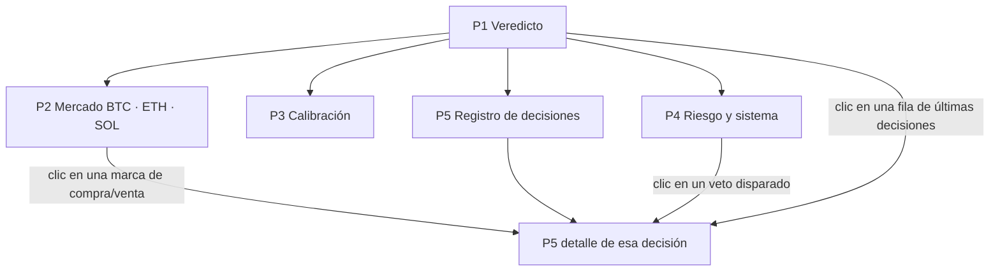
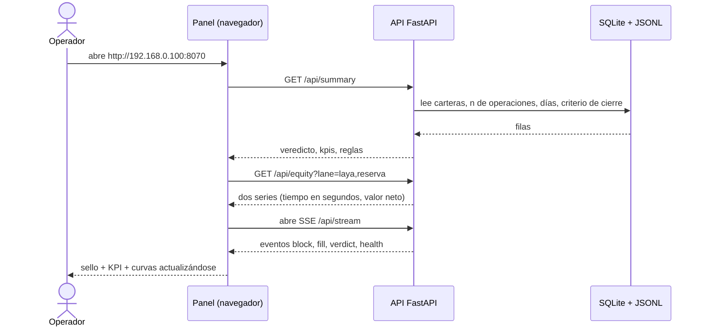
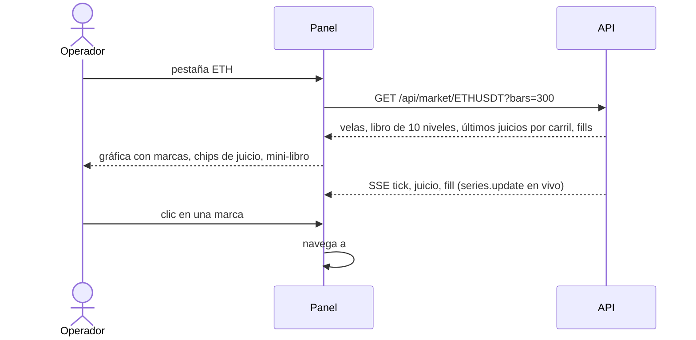
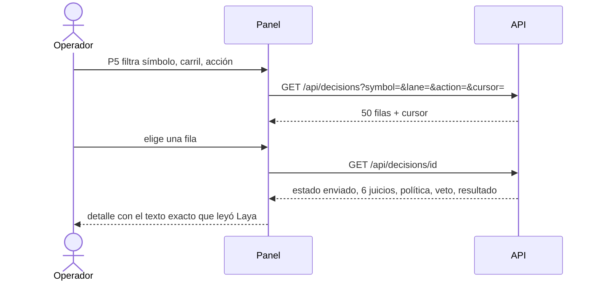

# 4 · AppFlow — Laya Trader

> [!resumen] En cristiano
> Cómo te mueves por el panel y qué le pide cada pantalla al servidor. No hay usuario ni contraseña: el panel solo se ve desde tu red de casa y no tiene ningún botón que cambie nada. El bot trabaja solo; tú miras, comparas y decides si se cierra el experimento. Decisión que te toca: aprobar este flujo.

## 1. Mapa de navegación

Navegación fija: carril lateral (escritorio) o barra inferior (móvil). El estado de la pantalla (símbolo, filtros, decisión elegida) vive en la URL (`#/mercado/BTC`, `#/registro?id=…`) para poder compartir y refrescar sin perder el sitio.

## 2. Flujos principales
### Flujo 1 — Abrir el panel y leer el veredicto (US-11, US-09)

- Camino feliz: sello NO CONCLUYENTE con «n/300 operaciones · d/7 días»; las curvas suben o bajan en vivo.
- Alternativas y errores: **sin datos aún** → sello gris «sin datos» y texto «Esperando el primer bloque»; **SSE cortado** → punto ámbar «reconectando» y reintento con retroceso (1, 2, 4… hasta 30 s), cifras marcadas «de hace N s»; **API caída** → tarjeta de error con la hora del último dato bueno y botón «Reintentar»; **sello PASA/CIERRE** → se muestra con las dos reglas, su ✓/✗ y la fecha en que se cumplió (el panel no apaga el bot: el cierre lo decide Haytham).

### Flujo 2 — Seguir una moneda en vivo (US-01, US-02, US-04, US-08)

- Camino feliz: marcas azules (Laya) y naranjas (reserva) sobre el precio; chips con la respuesta y la confianza.
- Alternativas: **feed de Binance caído** → banner «datos parados desde HH:MM:SS», gráfica en gris, el bot deja de cotizar (escalera); **sin operaciones** → «aún sin ejecuciones, el bot espera señal»; **moneda sin datos** → pestaña con «sin libro sincronizado».

### Flujo 3 — Auditar una decisión (US-03, US-05, US-07, US-09)

- Alternativas: **sin resultados con ese filtro** → «ninguna decisión coincide» + botón «Quitar filtros»; **decisión pendiente de resultado** → «resultado a los 15 min (faltan N)»; **id inexistente en la URL** → «esa decisión no existe (¿se rotó el registro?)».

### Flujo 4 — Ver cómo frenó el sistema (US-06, US-07)
```mermaid
sequenceDiagram
  participant L as Bucle del bot
  participant K as risk y escalera
  participant A as API
  actor O as Operador
  L->>K: comprueba límites cada bloque
  K-->>L: peldaño (normal, poca confianza, fuera de plazo, Laya caída, interruptor)
  L->>A: guarda peldaño y veto
  A-->>O: P4 semáforo + escalera; evento SSE
```
- El panel **no** puede reactivar el bot: tras un interruptor de emergencia, solo se reinicia por SSH (TRD §4). P4 lo dice y da el comando.

## 3. Permisos por rol
| Pantalla / acción | Operador (LAN) | Fuera de la LAN |
|---|---|---|
| P1-P5 (lectura) | Sí | No llega (puerto solo en la LAN) |
| Cambiar parámetros, parar o reiniciar el bot | **No existe en el panel** (solo por SSH) | No |
| Conmutador claro/oscuro | Sí (se guarda en el navegador) | — |

## 4. Estados globales (catálogo único; toda pantalla usa estos nombres)
| Estado | Cuándo | Qué se ve |
|---|---|---|
| Cargando | primera carga de una pantalla | esqueletos de tarjeta, no pantalla en blanco |
| Vacío | bot recién arrancado o filtro sin resultados | texto + ilustración + acción («Quitar filtros») |
| Reconectando | se corta el canal en vivo | punto ámbar + «datos de hace N s» |
| Error de conexión | no responde la API o falla la red del navegador | tarjeta con la hora del último dato bueno + «Reintentar»; el resto sigue usable |
| Datos parados | el bot está vivo pero Binance no envía datos | banner «sin datos desde HH:MM:SS», gráfica en gris |
| Error 500 | fallo interno de la API | código corto y hora |
Servidor reiniciado: el panel reconecta solo y relee `/api/summary`. Todas las pantallas (P1-P5) deben diseñar estos seis estados.

### 4.1 Glosario único (mismas palabras en UI, API y registro)
| Palabra en pantalla | Significa (frase llana visible, no solo tooltip) | No usar |
|---|---|---|
| Laya | el modelo de IA que contesta las 6 preguntas | — |
| Juez de reserva | el programa de reglas fijas con el que se compara a Laya | «reserva», «carril» |
| Cartera | el dinero de mentira de cada juez | «lane», «carril» |
| Interruptor de emergencia | frena todo y cierra posiciones | «kill switch» |
| Escalera de reserva | los 5 niveles de prudencia del bot | «peldaño», «ladder» |
| Veto | regla de riesgo que impide una orden | — |
| Ejecución | una orden simulada que se cumple | «fill» |
| Bloque | cada turno de decisión de una moneda (4 s; cada moneda se decide cada ~12 s) | «tick» |
| Brier / log loss / ECE | «cuánto se equivoca en sus porcentajes» (menor es mejor) | sin traducir |
| Spread | diferencia entre el mejor precio de compra y de venta | sin traducir |

## 5. Contrato de la API (solo lectura)
| Método y ruta | Devuelve | Pantalla |
|---|---|---|
| `GET /api/health` | feed, Laya, SQLite, último bloque, versión | cabecera, P4 |
| `GET /api/summary` | veredicto, 4 KPI, reglas del cierre | P1 |
| `GET /api/equity?lane=` | serie de dinero neto acumulado | P1 |
| `GET /api/market/{symbol}` | velas, libro, juicios recientes, fills | P2 |
| `GET /api/calibration` | Brier, log loss, ECE, curva por juicio y carril, n | P3 |
| `GET /api/risk` | vetos usados/permitidos, peldaño actual, latencia de Laya | P4 |
| `GET /api/decisions` y `/{id}` | lista paginada por cursor / detalle | P5 |
| `GET /api/stream` (SSE) | eventos `block`, `fill`, `verdict`, `health` | todas |

Reglas: todo `GET`; tiempos en segundos UTC; dinero y precios como texto decimal (sin flotantes en el JSON); errores con `{código, mensaje}`.

## 6. Cliente simulado
Prompt base: «Eres Haytham, que dirige una agencia de IA y no hace trading de oficio (nivel digital medio, usa el panel desde un portátil y a veces el móvil). Recorre el flujo X solo con lo que ves en las pantallas descritas. Di en cada paso qué esperas, qué te confunde y dónde abandonarías.»
| Rol simulado | Flujo | Atascos detectados | Cambio aplicado |
|---|---|---|---|
| Haytham simulado (agente, 2026-10-22) | 1-4 | 14 hallazgos (4 altos): jerga sin traducir, sello sin «qué falta», choque de estados, choque de nombres; medios: enlaces sin elemento en la UI (curva P3, veto P4), faltan estados, semáforos sin leyenda, «neto» sin decir comisiones | Aplicado en el AppFlow: glosario único (§4.1), catálogo de estados (§4), enlace P3→P5 quitado, tabla de resultados. **Aplicado también en el UI/UX (2026-10-22, tras pedir Haytham un panel intuitivo y en lenguaje normal; ver UI/UX §1 y §4.2):** frase llana visible bajo cada término, línea «te faltan X operaciones y Y días» bajo el sello, veto clicable en P4, leyenda de semáforo, estados de P2/P3/P5, alcance del selector de periodo, mini-libro simplificado en móvil, «neto de comisiones» en cada KPI. Descartado: el comando SSH en móvil (se muestra como texto copiable) y la IP (se añade marcador en el README) |

## 7. Ciclo completo a validar (US-10: ejecuciones repetibles con semilla)
El panel no crea ni borra datos. Ciclo equivalente de solo lectura:
- [ ] Arrancar el bot → ver el primer bloque en P1 → refrescar (F5): vuelve igual → reiniciar el servicio (`systemctl restart`) → el panel reconecta solo → cortar el feed → banner de datos parados → restaurar → el banner desaparece y las curvas no duplican puntos.

---
Anterior: [[3 - UI-UX Design]] · Siguiente: [[5 - Backend Schema]]
