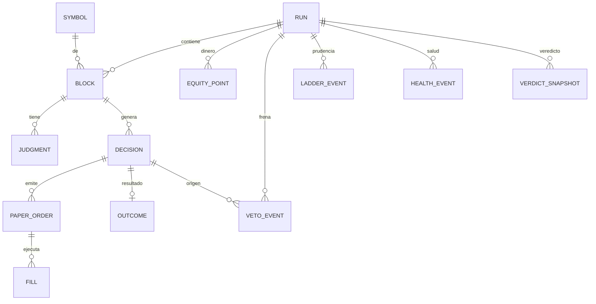

# 5 · Backend Schema — Laya Trader

> [!resumen] En cristiano
> Aquí se fija **dónde se guarda cada cosa** y **las reglas exactas del bot** (las que el repo original no publicaba). Todo va a una base de datos pequeña (SQLite) en el servidor. Un solo programa escribe; el panel solo lee. Las reglas de abajo (qué contesta Laya, cuándo compra, cuándo frena) quedan **congeladas antes de medir**: si se cambian después de ver resultados, el experimento no vale. Decisión que te toca: aprobar este esquema y estas reglas.

> [!riesgo] Cobertura de pruebas
> El SQL de abajo se ejecutó y probó con SQLite 3.45 (misma familia que el servidor): 13 tablas, restricciones, claves foráneas y borrado en cascada comprobados. `schema_to_migration.py` es para Postgres/Supabase y **no aplica** aquí (no hay Supabase en este proyecto); se sustituye por migraciones SQL numeradas y `PRAGMA user_version`.

## 1. Diagrama entidad-relación


## 2. SQL ejecutable (archivo `migrations/001_init.sql`)
Dinero y precios se guardan como números reales de papel; la API los devuelve como texto decimal (AppFlow §5). Tiempos: `ts_ms` en milisegundos UTC (datos de mercado), `ts_s` en segundos UTC (curvas). Toda clave foránea lleva `ON DELETE` explícito. El motor abre la base con `PRAGMA foreign_keys=ON`.
```sql
create table run (
  id integer primary key,
  started_at integer not null,
  ended_at integer,
  mode text not null default 'paper' check (mode in ('paper')),
  seed integer not null,
  block_seconds real not null check (block_seconds > 0),
  capital_usdt real not null check (capital_usdt > 0),
  config_json text not null,
  code_rev text not null
) strict;

create table symbol (
  symbol text primary key,
  base text not null,
  quote text not null,
  tick_size real not null check (tick_size > 0),
  step_size real not null check (step_size > 0)
) strict;

create table block (
  id integer primary key,
  run_id integer not null references run(id) on delete cascade,
  symbol text not null references symbol(symbol) on delete restrict,
  ts_ms integer not null,
  best_bid real not null,
  best_ask real not null,
  mid real not null,
  microprice real not null,
  spread_bps real not null,
  imbalance real not null check (imbalance between -1 and 1),
  vol_1m_bps real not null,
  ret_1m_bps real not null,
  ret_5m_bps real not null,
  trade_flow_10s real not null check (trade_flow_10s between -1 and 1),
  feed_age_ms integer not null,
  snapshot_text text not null,
  snapshot_tokens integer not null check (snapshot_tokens between 1 and 400),
  unique (run_id, symbol, ts_ms)
) strict;
create index block_symbol_ts on block(symbol, ts_ms);

create table judgment (
  id integer primary key,
  block_id integer not null references block(id) on delete cascade,
  lane text not null check (lane in ('laya','reserva')),
  question text not null check (question in ('regime','direction','toxic_flow','liquidity_stressed','quote_environment','inventory_pressure')),
  answer text not null,
  confidence real not null check (confidence between 0 and 1),
  probs_json text not null,
  source text not null check (source in ('laya','fallback')),
  latency_ms integer not null check (latency_ms >= 0),
  unique (block_id, lane, question)
) strict;

create table decision (
  id integer primary key,
  block_id integer not null references block(id) on delete cascade,
  lane text not null check (lane in ('laya','reserva')),
  action text not null check (action in ('quote_both','quote_bid','quote_ask','hold','flatten')),
  size_frac real not null check (size_frac between 0 and 1),
  bid_px real,
  ask_px real,
  ladder_step integer not null check (ladder_step between 0 and 4),
  veto_code text check (veto_code in ('daily_loss','max_inventory','wide_spread','stale_feed','late_judgment','kill_switch')),
  reason text not null,
  unique (block_id, lane)
) strict;
create index decision_lane on decision(lane, id);

create table paper_order (
  id integer primary key,
  decision_id integer not null references decision(id) on delete cascade,
  side text not null check (side in ('buy','sell')),
  px real not null check (px > 0),
  qty real not null check (qty > 0),
  status text not null check (status in ('open','filled','cancelled')),
  placed_ms integer not null,
  closed_ms integer
) strict;

create table fill (
  id integer primary key,
  order_id integer not null references paper_order(id) on delete cascade,
  ts_ms integer not null,
  px real not null check (px > 0),
  qty real not null check (qty > 0),
  fee_usdt real not null check (fee_usdt >= 0)
) strict;

create table outcome (
  decision_id integer primary key references decision(id) on delete cascade,
  horizon_s integer not null check (horizon_s > 0),
  resolved_ms integer not null,
  mid_after real not null,
  ret_bps real not null,
  net_pnl_usdt real not null
) strict;

create table equity_point (
  run_id integer not null references run(id) on delete cascade,
  lane text not null check (lane in ('laya','reserva')),
  ts_s integer not null,
  cash_usdt real not null,
  inventory_usdt real not null,
  equity_usdt real not null,
  fees_paid_usdt real not null,
  primary key (run_id, lane, ts_s)
) strict, without rowid;

create table veto_event (
  id integer primary key,
  run_id integer not null references run(id) on delete cascade,
  decision_id integer references decision(id) on delete set null,
  ts_ms integer not null,
  code text not null check (code in ('daily_loss','max_inventory','wide_spread','stale_feed','late_judgment','kill_switch')),
  used real not null,
  allowed real not null
) strict;

create table ladder_event (
  id integer primary key,
  run_id integer not null references run(id) on delete cascade,
  ts_ms integer not null,
  step integer not null check (step between 0 and 4),
  reason text not null
) strict;

create table health_event (
  id integer primary key,
  run_id integer not null references run(id) on delete cascade,
  ts_ms integer not null,
  component text not null check (component in ('feed','laya','db','panel')),
  state text not null check (state in ('ok','degraded','down')),
  detail text not null
) strict;

create table verdict_snapshot (
  id integer primary key,
  run_id integer not null references run(id) on delete cascade,
  ts_s integer not null,
  n_trades integer not null,
  days_measured real not null,
  rule_calibration text not null check (rule_calibration in ('pass','fail','pending')),
  rule_profit text not null check (rule_profit in ('pass','fail','pending')),
  status text not null check (status in ('todavia_no_se_sabe','laya_sirve','laya_no_sirve')),
  detail_json text not null
) strict;
create index verdict_run_ts on verdict_snapshot(run_id, ts_s);
```
Semilla de arranque real: solo las tres monedas. Los datos de prueba (un bloque con 2 juicios, 2 decisiones, 1 orden, 1 ejecución y 1 resultado) viven en `tests/seed.sql` y nunca se cargan en producción.
```sql seed
insert into symbol values ('BTCUSDT','BTC','USDT',0.01,0.00001),('ETHUSDT','ETH','USDT',0.01,0.0001),('SOLUSDT','SOL','USDT',0.01,0.001);
```

## 2.1 Documentación de tablas
| Tabla | Para qué | Quién escribe | Quién lee |
|---|---|---|---|
| `run` | una puesta en marcha del bot (semilla, configuración, versión del código) | motor | panel |
| `symbol` | las 3 monedas y sus pasos mínimos | arranque | motor, panel |
| `block` | el resumen exacto que se le pasó a Laya cada ciclo (rasgos + texto de menos de 400 tokens) | motor | panel (P2, P5) |
| `judgment` | las 6 respuestas de cada juez en cada bloque, con confianza y tiempo de respuesta | motor | panel (P2, P3, P5) |
| `decision` | qué hizo la política con esas respuestas, por juez (`laya` o `reserva`), con escalón de prudencia y veto | motor | panel |
| `paper_order`, `fill` | órdenes simuladas y sus ejecuciones, con comisión | motor | panel |
| `outcome` | qué pasó 15 min después de cada decisión (sirve para calibrar) | motor | panel (P3) |
| `equity_point` | dinero neto de cada cartera cada 10 s | motor | panel (P1) |
| `veto_event`, `ladder_event`, `health_event` | cuándo y por qué frenó el bot, en qué escalón estaba, y si Binance/Laya/la base estaban sanos | motor | panel (P4) |
| `verdict_snapshot` | el sello calculado cada minuto con sus dos reglas | motor | panel (P1) |

- Claves foráneas: todo lo que cuelga de `run`, `block` o `decision` es **CASCADE** (borrar una puesta en marcha limpia todo, probado); `block→symbol` es **RESTRICT** (no se borra una moneda con datos); `veto_event→decision` es **SET NULL** (el veto se conserva aunque se purguen decisiones).
- Índices: `block(symbol, ts_ms)` para P2, `decision(lane, id)` para la paginación por cursor de P5, `verdict_snapshot(run_id, ts_s)` para el último sello.
- Escritor único: el motor. El panel abre `file:laya.db?mode=ro`. WAL activado. Purga: `block` y `judgment` de más de 30 días se archivan a JSONL comprimido antes de borrarse (no antes).

## 3. Seguridad de datos
- Sin datos personales ni claves. Archivo de la base y `calibration.jsonl` con permisos `600`, en `~/Proyectos/laya-trader/data/` (fuera de git).
- Sin RLS ni roles: un solo rol (operador) en la red local, solo lectura (AppFlow §3).
- Copia de seguridad diaria del `.db` con `sqlite3 .backup` a `data/backup/` (7 días).

## 4. API / endpoints
Contrato completo en `4 - AppFlow` §5 (todo `GET`, solo lectura). Parámetros y errores:
| Método | Ruta | Entrada | Salida | Errores |
|---|---|---|---|---|
| GET | `/api/health` | — | estado de feed, Laya, base, último bloque | 503 si la base no abre |
| GET | `/api/summary` | — | último `verdict_snapshot` + 4 KPI + regla 1 y 2 con lo que falta | 404 si no hay `run` |
| GET | `/api/equity` | `lane` (csv), `from_s`, `to_s` | puntos `equity_point` (máx. 2.000, reducidos por intervalo) | 400 si `lane` no válido |
| GET | `/api/market/{symbol}` | `bars` (≤1.000) | velas de 1 min, libro de 10 niveles, últimos juicios, ejecuciones | 404 si el símbolo no existe |
| GET | `/api/calibration` | `lane`, `question` | Brier, log loss, ECE, 10 tramos de fiabilidad, n | 200 con `suficiente:false` si n es bajo |
| GET | `/api/risk` | — | usado/permitido por veto, escalón actual, histograma de latencia | — |
| GET | `/api/decisions` | `symbol`, `lane`, `action`, `cursor`, `limit≤100` | filas + `next_cursor` | 400 filtro inválido |
| GET | `/api/decisions/{id}` | — | decisión + bloque + juicios + órdenes + resultado + veto | 404 |
| GET | `/api/stream` | — | SSE `block`, `fill`, `verdict`, `health` | reconexión con `Last-Event-ID` |

Errores siempre `{código, mensaje}` con texto en lenguaje llano.

### 4.1 Archivo de calibración `data/calibration.jsonl` (formato del original)
Una línea por juicio con resultado resuelto: `{"ts_ms":1761100002000,"run":1,"symbol":"BTCUSDT","lane":"laya","question":"direction","answer":"up","confidence":0.61,"probs":{"up":0.61,"flat":0.30,"down":0.09},"outcome":"up","horizon_s":900}`. Una línea por bloque con `kind:"decision"` guarda el triple `(estado, decisión, resultado)` completo. Rotación diaria.

## 5. Migraciones
- `migrations/001_init.sql` (arriba). Versión en `PRAGMA user_version`; el motor se niega a arrancar si la versión de la base es mayor que la que conoce.
- Reversibilidad: no hay `down`; antes de cada migración futura se hace `.backup`. Los datos de papel son prescindibles pero se conservan hasta el cierre del experimento.

## 6. Cálculos y reglas de negocio — CONGELADO antes de medir
Estas son las **decisiones propias** del TRD §8 (el README original no las publica). Cualquier cambio posterior obliga a empezar un nuevo `run` y se anota aquí con fecha.

**6.1 Las 6 preguntas a Laya y sus respuestas posibles**
| Pregunta | Tipo en Laya | Respuestas |
|---|---|---|
| `regime` | choice | `calm` · `trending` · `choppy` · `stressed` |
| `direction` | choice | `up` · `flat` · `down` (horizonte 15 min) |
| `toxic_flow` | noul (sí/no) | `yes` · `no` |
| `liquidity_stressed` | noul | `yes` · `no` |
| `quote_environment` | choice | `both_sides` · `bid_only` · `ask_only` · `none` |
| `inventory_pressure` | choice | `low` · `balanced` · `high` |

El juez de reserva contesta las mismas con reglas fijas: `regime=stressed` si `vol_1m_bps>8` o `spread_bps>25`, `trending` si `|ret_5m_bps|>10`, `choppy` si `vol_1m_bps>4`, si no `calm`; `direction=up` si `imbalance>0,25` y `trade_flow_10s>0,2`, `down` si ambos son contrarios, si no `flat`; `toxic_flow=yes` si `|trade_flow_10s|>0,6`; `liquidity_stressed=yes` si `spread_bps>25` o profundidad top-5 menor de 50.000 USDT; `quote_environment`: `up` y `flat` → `both_sides`, `down` → `ask_only`, `stressed` → `none`; `inventory_pressure` según inventario/tope (`<0,3` low, `<0,7` balanced, si no high). Confianza fija 0,5.

**6.2 Resumen de estado (menos de 400 tokens, máximo 380 medidos con el tokenizador de Laya)**
Campos en este orden, una línea cada uno: símbolo · mid · microprecio−mid (bps) · spread (bps) · desequilibrio top-5 · flujo de operaciones 10 s · volatilidad 1 min (bps) · retorno 1 y 5 min (bps) · profundidad top-5 compra/venta (USDT) · inventario (% del tope) · caída desde el máximo (%) · edad de los datos (ms). Si pasa de 380 tokens se recorta el flujo y la caída, nunca el mid ni el spread.
*Aclaraciones de implementación (2026-10-22, T-04/T-05; no cambian ningún umbral):* (a) «volatilidad 1 min» = raíz de la suma de cuadrados de los retornos logarítmicos de muestras de 1 s en los últimos 60 s, escalada a un minuto, en puntos básicos; (b) los retornos de 1 y 5 min comparan con la muestra de 1 s más reciente anterior a la ventana; mientras no hay historia (primeros 5 min tras arrancar) valen 0 y la moneda no opera; (c) la `confianza` de cada juicio es la probabilidad de la respuesta elegida (para sí/no, el mayor de p y 1−p), no el campo `confidence` crudo del checkpoint, que el propio modelo avisa de no calibrado; (d) los tokens se leen de lo que mide Laya (`usage.state_tokens`), no de una estimación; (e) la primera llamada a Laya tras cargar tarda ~7,5 s: se hace una llamada de calentamiento al arrancar.

**6.3 Política (decide el código, nunca Laya)**
1. Si hay veto o la escalera ≥ 3: `hold` (o `flatten` si el veto es `daily_loss` o `kill_switch`).
2. Solo se cotiza si `toxic_flow=no`, `liquidity_stressed=no` y `regime≠stressed`.
3. Confianza mínima del juicio `direction` de 0,55 para tamaño completo; entre 0,40 y 0,55 tamaño al **50 %** (escalera 1); por debajo, `hold`.
4. `direction=up` → `quote_both`; `flat` → `quote_both` con tamaño al 50 %; `down` → `quote_ask` si hay inventario, si no `hold`. `quote_environment` solo puede **restringir** (si dice `none`, `hold`).
5. `inventory_pressure=high` → solo `quote_ask`.
6. Tamaño: `size_frac = min(0,25 × kelly_hat, 1)` con `kelly_hat = max(0, (confianza − 1/3) / (2/3))`, aplicado sobre el tope por símbolo y multiplicado por 0,5 si la confianza está entre 0,40 y 0,55 y otro 0,5 si la dirección es `flat` (los dos pasos 3 y 4 de arriba).
   > *Aclaración de implementación (T-06):* como en spot no se puede vender sin inventario, si el inventario es 0 el lado de venta se elimina; así `up` con cartera vacía queda registrado como `quote_bid` (y no como `quote_both`) para que el registro diga lo que de verdad se coloca.
   > **Cambio aprobado por Haytham el 2026-10-22, antes de medir nada.** Antes decía `kelly_hat = max(0, 2·confianza − 1)`: con tres respuestas posibles (`up`/`flat`/`down`) esa fórmula da tamaño cero para cualquier confianza menor de 0,5, y Laya (confianza observada 0,35-0,44 en 30 casos reales) nunca habría operado, lo que habría hecho trampa al experimento. La fórmula nueva normaliza por el número de clases de `direction` (3). Se aplica **igual a las dos carteras** (la del juez de reserva usa confianza fija 0,5 → `kelly_hat` = 0,25). Los umbrales 0,55 y 0,40 no cambian.

**6.4 Precios (Avellaneda-Stoikov simplificado, en puntos básicos)**
`reserva_bps = −γ · q · σ_bps` y `medio_spread_bps = max(10,5 ; 0,5·γ·σ_bps + (1/γ)·ln(1 + γ/k))`, con γ = 0,5, k = 1,5, `q` = inventario/tope (0 a 1) y `σ_bps` = volatilidad de 1 min. Compra a `mid + reserva − medio_spread`, venta a `mid + reserva + medio_spread`, ajustadas al `tick_size` y sin cruzar el libro (post-only).
Ejemplo: `σ=4 bps`, `q=0,5` → `reserva = −0,5·0,5·4 = −1 bps`; `0,5·0,5·4 + 2·ln(1,333) = 1,0 + 0,575 = 1,575 bps` → manda el mínimo de **10,5 bps** (cubre la comisión de 10 bps por lado). Con mid 84.600: compra a `84.600 × (1 − 0,00115) = 84.502,7` y venta a `84.600 × (1 + 0,00095) = 84.680,4`.
> [!riesgo]
> Con comisión de 0,10 % por lado y un medio spread de 10,5 bps, las órdenes quedan lejos del mercado y se ejecutarán poco. Es lo esperado y honesto: el experimento mide si Laya gana **neto**, no si cotiza mucho.

**6.5 Vetos duros e interruptor (límites en código, no delegables)**
| Código | Regla | Efecto |
|---|---|---|
| `daily_loss` | pérdida del día > 2 % del capital (10.000 USDT virtuales) | cerrar posiciones y parar hasta las 00:00 UTC |
| `max_inventory` | > 10 % del capital por moneda o > 25 % entre las tres | solo `quote_ask` |
| `wide_spread` | spread > 25 bps | `hold` |
| `stale_feed` | datos con más de 5 s | `hold` y escalón 3 |
| `late_judgment` | Laya tarda más que el turno (4 s; antes 2 s, cambiado el 2026-10-22 antes de medir) | `hold` y escalón 2; 3 retrasos seguidos → juez de reserva 60 s |
| `kill_switch` | caída del 5 % desde el máximo de la cartera | cerrar todo y parar el bot (reinicio manual por SSH) |

**6.6 Ejecución en papel**
Orden post-only a su precio; se ejecuta cuando una operación real de Binance se imprime a ese precio o mejor **y** ya ha pasado el volumen que había por delante en la cola (cola estimada al colocar). Comisión 0,10 % del importe por lado (conservador, sin descuento BNB). Sin deslizamiento (post-only). Cada cartera arranca con 10.000 USDT; ven el mismo mercado pero cada una afecta solo a su propio dinero.

*Aclaraciones de implementación (2026-10-22, T-07/T-08; no cambian ningún límite):* (a) el interruptor se queda activado hasta reiniciar el programa a mano; (b) «Laya caída» (3 retrasos seguidos o fallos de Laya) significa que la **cartera de Laya no opera durante 60 s** (escalón 3); no se sustituye por los juicios del juez de reserva para no mezclar resultados de uno con otro; la cartera de reserva no se ve afectada; (c) `daily_loss` se mide contra el dinero a las 00:00 UTC del día (o al arrancar) y la pérdida del día y el máximo de la cartera se calculan por cartera; (d) la orden de cerrar (`flatten`) recorre el libro real vendiendo contra las ofertas de compra y paga la misma comisión de 0,10 %, sin más deslizamiento; (e) los juicios de una cartera que llegan fuera del plazo del turno (veto `late_judgment`) dejan esa decisión en `hold`.

*Aclaraciones de implementación (2026-10-22, T-09/T-10; no cambian ningún umbral):* (a) cada turno decide **una moneda** (rueda BTC, ETH, SOL) y las dos carteras deciden en el mismo instante con el libro fresco; los juicios se calculan sobre el estado del inicio del turno (unos 3 s antes) para las dos; (b) en repeticiones la latencia de Laya se fija en 3.000 ms (virtual) para que el resultado sea idéntico; en vivo se mide de verdad; (c) el escalón de la escalera (`ladder_event`) se anota solo para la cartera de Laya, el de la reserva queda en `decision.ladder_step`; (d) los vetos se anotan cuando aparecen, no en cada turno mientras sigan activos; (e) para Brier y log loss el juez de reserva se trata como 0,5 en su respuesta y 0,25 en cada una de las otras (su confianza fija repartida); el log loss recorta las probabilidades en 10⁻⁶; (f) una «operación» de la regla 2 es una decisión de la cartera de Laya con al menos una ejecución, y su ganancia neta es la del resultado a 900 s; (g) solo la pregunta `direction` tiene verdad objetiva medible (el signo del retorno a 15 min, con banda plana de ±2 bps); las otras cinco se guardan pero no se evalúan; (h) el interruptor de emergencia cierra todas las posiciones de las dos carteras, anota un `ladder_event` de nivel 4 y el programa sale con código 3 (el `systemd` no debe reiniciarlo solo).

*Aclaraciones de implementación (2026-10-22, T-11/T-12; no cambian ningún umbral):* (a) el libro de órdenes de 10 niveles y la edad de los datos **no** están en la base: el motor escribe cada segundo `data/live.json` (escritura atómica) y el panel lo lee; si falta, el panel muestra «libro sin sincronizar»; (b) las velas de 1 minuto del panel se calculan con los precios medios de los turnos (cada moneda cada ~12 s), no con velas de Binance; (c) los semáforos de «Seguridad» se calculan en vivo desde la base con la cartera de Laya (inventario total contra 25 %, no por moneda); (d) el canal en vivo (`/api/stream`) consulta la base cada segundo y numera sus eventos con la hora, así que `Last-Event-ID` reanuda sin repetir; (e) el panel nunca escribe: cada petición abre su propia conexión `mode=ro`.

*Aclaración de implementación (2026-10-22, T-19; no cambia ningún umbral):* un reinicio del programa (apagón, mantenimiento) abre una puesta en marcha (`run`) nueva pero **no empieza otro experimento**: el veredicto, la calibración, las cifras de la primera pantalla y el registro de decisiones suman todas las puestas en marcha con la misma configuración y el mismo capital. Cambiar cualquiera de las reglas congeladas cambia la configuración y sí empieza un experimento nuevo. Las curvas de dinero y los frenos muestran solo la puesta en marcha actual (la cartera de papel vuelve a 10.000 USDT tras cada reinicio). «Días medidos» cuenta el tiempo entre el primer y el último turno, con las paradas dentro. **El experimento real empezó el 2026-10-22 a las 16:13 (hora de Madrid); la decisión de «Laya sirve / no sirve» no puede darse antes del 2026-10-29 a las 16:13.**

*Corrección de implementación (2026-10-22 17:10, 55 minutos después de arrancar; no cambia ningún umbral):* la regla 1 solo se evalúa cuando los juicios resueltos cubren **al menos 12 horas distintas**. Con menos, el intervalo del bootstrap por bloques de 1 h no está definido (con 1 bloque el programa lo daba por «no cumple» y el panel mostró «Laya no sirve» a la hora de arrancar, aunque Laya tenía Brier 0,699 contra 0,788 del programa de reglas). Ahora queda «aún sin muestra suficiente».

*Añadido (2026-10-22 17:50, no cambia ninguna regla):* el panel muestra el **capital de ahora mismo** de cada cartera con los precios de este instante (el motor lo escribe cada segundo en `live.json`) y una **referencia «comprar y mantener»** (el capital repartido a partes iguales entre BTC, ETH y SOL al empezar cada puesta en marcha, sin tocar nada), guardada cada 5 s en la tabla nueva `benchmark_point` (migración `002_benchmark.sql`). Las carteras de Laya y del programa de reglas solo se mueven con el precio cuando tienen monedas; sin posiciones su capital queda fijo en 10.000 USDT. Ruta nueva `GET /api/capital`; `/api/equity` admite `lane=hold`.

**6.7 Resultado de cada decisión**
`outcome` a los 900 s: `ret_bps = (mid_after/mid − 1)·10⁴` y `net_pnl_usdt` = suma de ejecuciones de esa decisión valoradas al `mid_after`, menos comisiones. Un juicio de `direction` acierta si el signo de `ret_bps` coincide con `up`/`down` (con `|ret_bps|<2` cuenta como `flat`).

**6.8 Criterio de cierre (igual que PRD §3, calculado cada minuto)**
- Regla 1 (Laya aporta señal): Brier y log loss de `direction` de Laya menores que los del juez de reserva en los mismos bloques, con IC90 por bootstrap (2.000 remuestreos, bloques de 1 h) que no incluya 0; necesita ≥ 300 juicios resueltos.
- Regla 2 (rentabilidad neta): media de `net_pnl_usdt` por operación de la cartera de Laya con límite inferior del IC90 > 0 en las dos mitades temporales y también sin las 3 mejores operaciones; necesita ≥ 300 operaciones y ≥ 7 días.
- `status`: `todavia_no_se_sabe` mientras falte muestra; `laya_sirve` si pasa ambas; `laya_no_sirve` si, con muestra suficiente, falla cualquiera.
- Ejemplo: 88 operaciones en 2,1 días → «Te faltan 212 operaciones y 4,9 días».

---
Anterior: [[4 - AppFlow]] · Siguiente: [[6 - Plan de Implementacion]]
