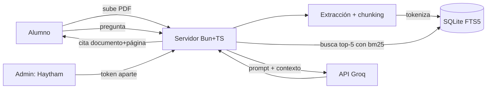

# Los Apuntes de Liyo

> [!resumen] En cristiano
> Chat tipo ChatGPT para alumnos de grado medio de informática, que solo responde con apuntes reales que la propia comunidad sube (PDF por asignatura/módulo). Por dentro **no** usa una base de datos vectorial: busca con tokenización tradicional (quitar acentos/mayúsculas) y un índice invertido (SQLite FTS5, como el índice de un libro), y solo le pasa a la IA (**API de Groq**) los 3-5 trozos exactos que encontró — así no inventa respuestas y siempre dice de qué apunte y página sale cada cosa. Proyecto **personal de Haytham**, no de NeoZeler.

## Documentos (flujo de 6; PRD, TRD, UI/UX, AppFlow y Backend Schema aprobados 2026-10-27; Plan en borrador)
1. [[01_Projects/Los Apuntes de Liyo/1 - PRD|PRD]] · 2. [[01_Projects/Los Apuntes de Liyo/2 - TRD|TRD]] · 3. [[01_Projects/Los Apuntes de Liyo/3 - UI-UX Design|UI/UX]] · 4. [[01_Projects/Los Apuntes de Liyo/4 - AppFlow|AppFlow]] · 5. [[01_Projects/Los Apuntes de Liyo/5 - Backend Schema|Backend Schema]] · 6. [[01_Projects/Los Apuntes de Liyo/6 - Plan de Implementacion|Plan de Implementación]]

## Arquitectura

## Identidad visual
«Luz de lámpara» (opción D, elegida 2026-10-27): azul noche con ámbar cálido; todo en penumbra y solo la cita real que responde la duda se ilumina, con su página como marcapáginas. Space Grotesk + Work Sans. Detalle en el UI/UX §2, registrada en [[Registro de Identidades Visuales]]. Las versiones anteriores («papel y rotulador» y «Cuaderno de verdad») se descartaron.

### Rediseño 2026-10-28 (pendiente de desplegar al servidor real)
Haytham lo vio «muy cutre» (pantalla de entrada pequeña y vacía, módulos y chat en pestañas). Se rehízo el front completo (misma API, mismo backend) en `~/Proyectos/los-apuntes-de-liyo/public/` (copia local del repo del servidor, sin commit aún; versión de pruebas en `192.168.0.100:8121`, base de datos aparte):
- **Estructura**: barra lateral de módulos · chat central con caja fija abajo · panel de apuntes a la derecha; en pantallas medianas y móviles los laterales pasan a cajones. Entrada a dos columnas con una muestra de respuesta. Admin con contador grande de denuncias.
- **Visual**: se mantiene azul noche + ámbar, pero la cita pasa a ser una **hoja de papel cálido iluminada** (subrayado ámbar, marcapáginas con la página, botón «Ver apunte» que resalta el documento en el panel). Tokens nuevos en `tokens.css`.
- **Comprobado**: 320/375/800/1360 px sin desbordes, ciclo entrada → módulo → pregunta con cita → cajón de apuntes → admin con denuncia. Groq real sin probar (clave falsa en pruebas; se ve el error amable).

## Decisiones clave
- Comunidad abierta: cualquier alumno sube apuntes sin revisión previa; mitigación con denuncia + borrado rápido por el admin (riesgo real, avisado en el PRD).
- Rol admin separado del de alumno (ruta `/admin` con token propio), corregido tras el cliente simulado del AppFlow — antes el acceso de alumno (solo nombre+centro) no distinguía quién era admin.
- Sin base vectorial ni servicio de búsqueda aparte: todo en un único archivo SQLite, pensado para poca RAM (stack verificado: Bun ~25-33 MB en el servidor Zorin).

## Estado y pendientes
- Esquema SQL validado de verdad (ejecutado con `sqlite3`, no solo escrito): FTS5/BM25, `UNIQUE` de denuncias, cascada de borrado — todo OK.
- `pdf-parse` 2.4.5 (Apache-2.0) y `unpdf` 1.9.1 (MIT) verificados en npm; elegido `unpdf` (texto por página probado).
- Pendiente de decidir: si se abre el acceso fuera de la red de Haytham para alumnado de otros centros (la idea original pedía "de todos lados"; v1 queda dentro del servidor Zorin).
- Código: Fases 0, 1 y 2 hechas (API completa: entrada, módulos, subida de PDF con `unpdf`, búsqueda FTS5/BM25, Groq en streaming, denuncias y admin). `bun test` pasa el ciclo completo crear→subir→preguntar con cita→denunciar→borrar (Groq simulado). Fase 3 hecha en parte: interfaz de alumno y admin con la identidad D (T-12, T-14, T-15; T-13 maquetada y vista en navegador de escritorio y móvil). Siguiente: estados de carga/error y a11y (T-16, T-17), probar Groq real y despliegue (T-18). Falta probar con Groq real (clave) y calibrar el umbral de búsqueda.
