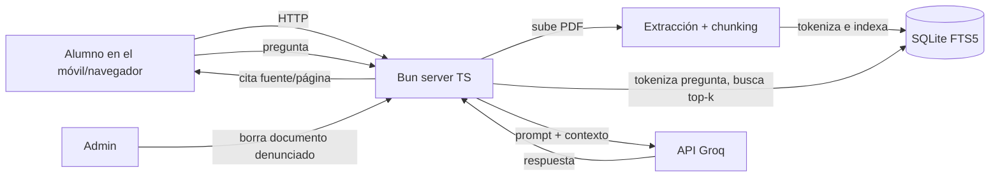

# 2 · TRD — Technical Requirements Document

> [!resumen]
> **Cómo** se construye lo que pide el [[1 - PRD]]: stack, arquitectura, integraciones, seguridad y restricciones. Cada decisión lleva su alternativa descartada.

> [!riesgo]
> `context7` no conectó esta sesión (`ENOENT npx`) y el registro de npm no respondió (`ETIMEDOUT`, sin red desde este entorno). Los datos de Groq vienen de `console.groq.com/docs/models` (WebFetch, verificado hoy). Las versiones de npm marcadas como **pendiente de verificar** hay que confirmarlas con `npm view` antes de instalar nada en el repo real.

## 1. Stack elegido
| Capa | Elección | Alternativa descartada | Por qué |
|---|---|---|---|
| Frontend | HTML servido por el backend + JS mínimo (fetch + `EventSource`/stream para el chat), sin framework | React/Next | Público con móviles modestos y servidor con poca RAM (feedback-web-poca-ram); un chat con historial y subida de PDF no necesita un framework SPA |
| Backend / API | **Bun + TypeScript** | Node + Express, FastAPI (Python) | Patrón ya medido en `neozeler-crm`: Bun ~25 MB en reposo / 33 MB con carga vs. Node 63-89 MB; corre en el mismo servidor Zorin que ya usan otros proyectos de Haytham |
| Búsqueda tradicional (tokenización + índice invertido) | **SQLite FTS5** vía `bun:sqlite` (incluido en Bun, sin dependencia npm) | Meilisearch/Typesense (servicio aparte), rank-bm25 en memoria (Python) | FTS5 ya implementa BM25 y tokenizador `unicode61` con `remove_diacritics=2` (quita acentos); un único archivo `.db`, cero servidores extra, coherente con "poca RAM" |
| Extracción de PDF | `pdf-parse` (npm, **pendiente de verificar** versión/licencia — sin acceso a npm hoy) | `pdfplumber`/`PyMuPDF` (Python) | Mantener todo el stack en un único lenguaje (TypeScript) en vez de mezclar un proceso Python solo para esto |
| IA generativa | **API de Groq**, modelo `openai/gpt-oss-20b` (chat completions, compatible OpenAI) vía `fetch` nativo de Bun, sin SDK | `groq-sdk` (npm, no se pudo verificar hoy), Llama 3.1 8B | 1000 tokens/seg, $0.075/$0.30 por 1M tokens, capa gratis 250K TPM / 1K RPM (verificado en docs de Groq, 2026-10-27); `fetch` nativo evita una dependencia más que no se pudo auditar hoy |
| Base de datos | SQLite (el mismo archivo que FTS5, con `PRAGMA foreign_keys=ON` en cada conexión) | Postgres/Supabase | Un solo alumno-admin gestionando el catálogo, bajo volumen, sin necesidad de un servidor de BD aparte |
| Auth | Sesión simple: nombre + centro + cookie `HttpOnly`/`SameSite=Strict` con token aleatorio, sin contraseña | OAuth / login con email | El PRD (RNF) pide solo poder atribuir y moderar subidas, no una cuenta "seria"; menos superficie de ataque y de mantenimiento |
| Hosting / despliegue | Servidor Zorin de Haytham (`zorin-ssh`), servicio de usuario `systemd`, puerto propio | VPS/cloud de pago | Ya hay infraestructura y patrón (`neozeler-crm`, `battle-royale-vivo`) corriendo ahí sin coste adicional |

### 1.1 Ficha por librería (verificada, no de memoria)
| Librería | Versión | Último release | Mantenimiento | Peso (kB gzip) | Licencia | Node 22 / React 19 | Fuente | Trampas conocidas |
|---|---|---|---|---|---|---|---|---|
| `bun:sqlite` | la que traiga Bun instalado en el servidor (≥1.4.4, ya en uso) | — | Built-in de Bun, mantenido por Oven | 0 (nativo) | MIT (Bun) | N/A (no es Node) | `librerias.md` (uso previo en `neozeler-crm`) | `strict: true`, `PRAGMA foreign_keys=ON` por conexión ([[librerias.md]]) |
| `pdf-parse` | **pendiente** — npm no respondió hoy (`ETIMEDOUT`) | pendiente | pendiente | pendiente | MIT (a confirmar) | pendiente | sin verificar | Verificar antes de instalar: puede traer un PDF de ejemplo como "test" que Bun intenta cargar al importar — revisar el paquete |
| Groq API (`api.groq.com/openai/v1`) | API HTTP, sin SDK | — | Servicio activo | — | Términos de servicio de Groq | — | WebFetch a `console.groq.com/docs/models`, 2026-10-27 | Rate limit gratis 1.000 RPM / 250K TPM: vigilar si crece el nº de alumnos simultáneos |

### 1.2 Presupuesto de dependencias
| Límite | Máximo | Previsto |
|---|---|---|
| Motores de animación | 1 | 0 (sin animación en v1; UI funcional primero) |
| Imágenes | — | logo + 1-2 ilustraciones, pendientes de identidad visual en el UI/UX |
| Librerías de UI base | 1 + registries | 0 (HTML + CSS propio, sin framework de componentes en v1) |
| JS inicial (kB gzip) | 200 | < 20 (fetch + stream del chat, sin bundler) |
| Dependencias directas | 25 | 1-2 (`pdf-parse` y poco más) |

## 2. Arquitectura

## 3. Integraciones y servicios externos
| Servicio | Para qué | Coste | Límites / cuotas | Plan B |
|---|---|---|---|---|
| API de Groq | Redactar la respuesta final a partir del contexto recuperado | Capa gratis hasta 250K TPM / 1K RPM; de pago $0.075 input / $0.30 output por 1M tokens (modelo `gpt-oss-20b`) | Rate limit por minuto; si se supera, 429 | Cola simple en el servidor (reintento con backoff) y aviso de "inténtalo en unos segundos" en el chat |

## 4. Seguridad y datos
- Autenticación y roles: cookie de sesión simple (nombre + centro) para Alumno; el rol Admin es Haytham, acceso por un token de admin fijo en `.env` del servidor (no en el repo).
- Datos personales / RGPD: solo nombre y centro, sin email ni datos sensibles — minimizar lo que se guarda. Avisar en la UI de que el contenido subido es público dentro de la plataforma.
- Secretos: `GROQ_API_KEY` y el token de admin en `.env` del servidor Zorin, nunca en el repo; `.gitignore` desde el primer commit.

## 5. Rendimiento y escalado
- Carga esperada: decenas-cientos de alumnos concurrentes en pico de examen, no miles; SQLite aguanta ese volumen de lectura sin problema.
- Persistencia: todo en el archivo SQLite del servidor (PDFs originales + índice FTS5 + metadatos), con copia de seguridad periódica (`backup()` de SQLite, igual que en `laya-trader`).
- Nada de memoria volátil: cada subida y cada chunk queda en el `.db` antes de responder al alumno.

## 6. Entornos y CI
- Local (desarrollo con Bun) → servidor Zorin (único entorno de producción real, como el resto de proyectos de Haytham ahí).
- `bun --bun tsc --noEmit` antes de cada commit (patrón ya usado en `neozeler-crm`).

## 7. Trazabilidad PRD → técnica
| Requisito PRD | Solución técnica |
|---|---|
| RF-01 (ingesta y chunking) | `pdf-parse` + función de chunking en bloques de 300-500 palabras con metadata (módulo, archivo, página) |
| RF-02 (tokenización e indexado) | tabla SQLite FTS5 con tokenizador `unicode61 remove_diacritics=2` |
| RF-03 (recuperación) | consulta FTS5 con `MATCH` filtrada por módulo, orden por `bm25()` |
| RF-04 (prompt a Groq) | `fetch` a `api.groq.com/openai/v1/chat/completions` con los chunks top-k como contexto del sistema |
| RF-05 (sin contexto → decirlo) | si la consulta FTS5 no devuelve filas por encima de un umbral, el backend no llama a Groq y responde con un mensaje fijo |
| RF-06 (módulos/asignaturas) | tabla `modulos`, FK `ON DELETE CASCADE` desde documentos y chunks |
| RF-07 (subida sin aprobación previa) | endpoint de subida público para alumnos con sesión, sin paso de moderación antes de indexar |
| RF-08 (panel admin, denuncia y borrado) | tabla `denuncias` + endpoint de admin que borra documento y sus chunks (cascada) |

## 8. Riesgos técnicos
> [!riesgo]
> - `pdf-parse` no se pudo verificar hoy (sin red/npm): antes de instalarlo en el repo real, correr `npm view pdf-parse version time.modified license` y registrar el resultado en `librerias.md`.
> - Groq con capa gratis: si varios alumnos preguntan a la vez en examen, el límite de 1.000 RPM puede saturarse — vigilar desde el primer despliegue.
> - SQLite FTS5 con `unicode61` no quita stop words (el, de, la…) automáticamente; se decide **no** mantener una lista de stop words en v1 porque BM25 ya penaliza los términos muy frecuentes por IDF — revisar si en la práctica degrada la relevancia.

---
Anterior: [[1 - PRD]] · Siguiente: [[3 - UI-UX Design]]
