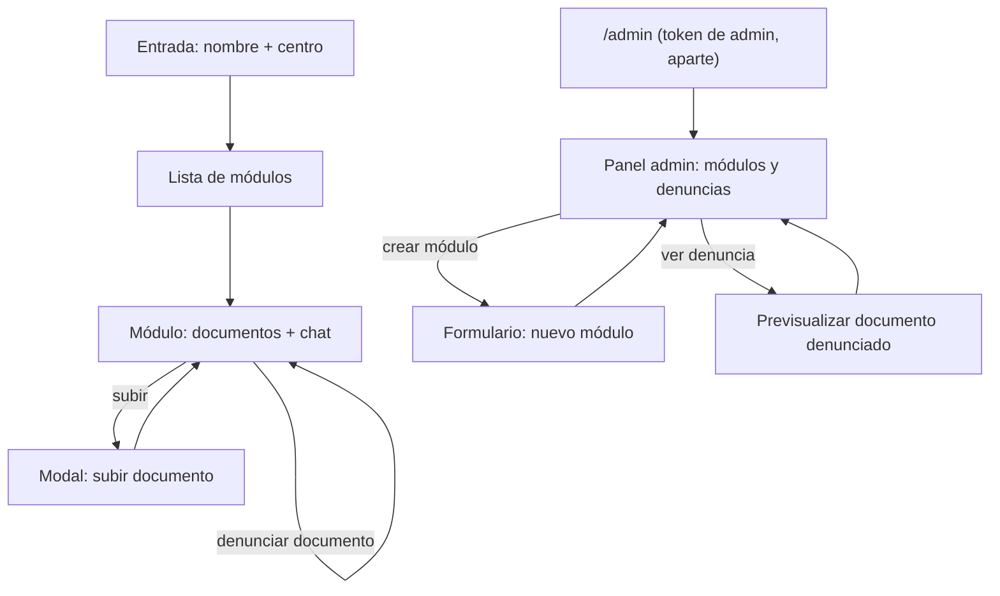
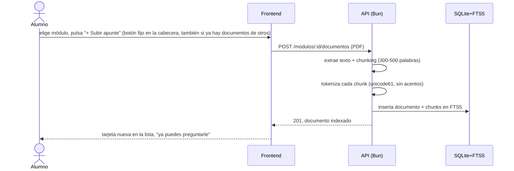
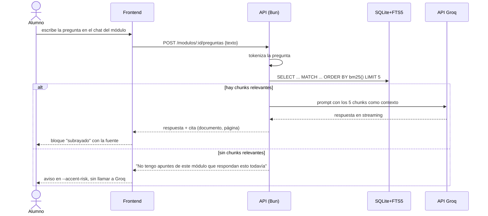
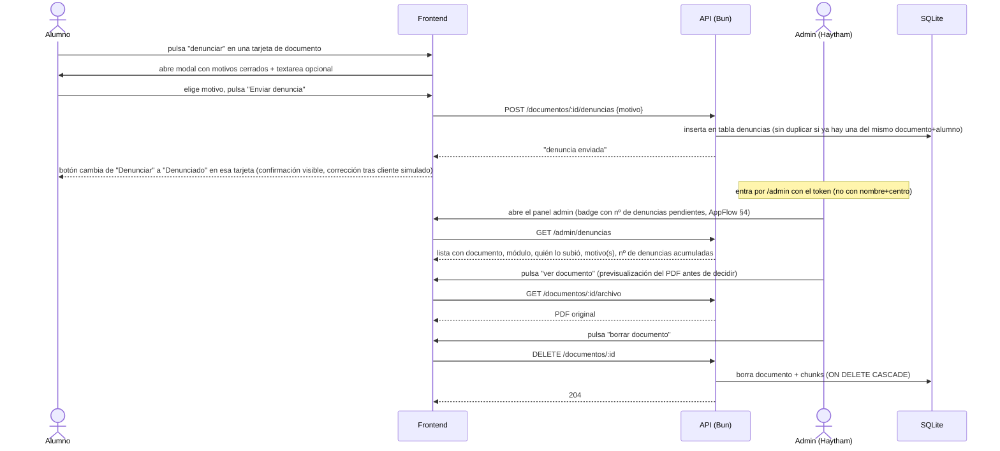
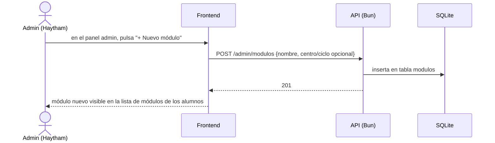

# 4 · AppFlow

> [!resumen]
> Cómo se mueve el usuario entre las pantallas de [[3 - UI-UX Design]]: navegación, flujos por rol, estados y errores. Sirve de contrato entre UI y backend.

## 1. Mapa de navegación

**Corrección tras cliente simulado (admin, atasco #7):** el panel admin **no** se entra con nombre+centro como el alumno — vive en una ruta aparte (`/admin`) que pide el token de admin del `.env` (TRD §4). Nadie puede "entrar como admin" escribiendo "Haytham" en el campo de nombre del alumno.

## 2. Flujos principales (uno por historia clave)

### Flujo 1 — Subir un documento al módulo (US-01, US-04)

- **US-04 (ver qué hay ya subido):** al elegir el módulo, `GET /modulos/:id/documentos` pinta la lista de tarjetas (nombre, quién lo subió, fecha, nº de páginas) antes de que el alumno suba nada, para no repetir apuntes y saber qué cubre la base.
- Camino feliz: el PDF se lee bien, se fragmenta y queda indexado en segundos; el alumno ve la tarjeta y una confirmación.
- Alternativas y errores: PDF escaneado sin texto seleccionable → error claro "no pude leer texto de este PDF, prueba con uno que no sea una foto escaneada"; archivo no es PDF → rechazar en el propio input (`accept=".pdf"`) y en el servidor; archivo muy grande → límite de tamaño con aviso antes de subir.
- **Corrección tras cliente simulado (alumno, atasco 1):** el único botón de subida documentado antes era el del estado vacío ("Sube el primer apunte"); un alumno que entra a un módulo con apuntes de otros no encontraba dónde subir el suyo. Se añade un botón "+ Subir apunte" fijo en la cabecera del panel de documentos, visible siempre, con o sin documentos.

### Flujo 2 — Preguntar y recibir respuesta con cita (US-02, US-03)

- Camino feliz: respuesta en streaming en pocos segundos, con documento y página citados.
- Alternativas y errores: Groq devuelve 429 (rate limit) → reintento con backoff y mensaje "mucha gente preguntando a la vez, prueba en unos segundos"; el módulo elegido no existe o está vacío → el frontend ya lo impide (no se puede abrir el chat de un módulo recién creado sin documentos, se ve el estado vacío en su lugar).

### Flujo 3 — Denunciar y borrar un documento (US-06)

- Camino feliz: el documento desaparece de las respuestas futuras en cuanto se borra.
- Alternativas y errores: denunciar dos veces el mismo documento (mismo alumno) → no duplica fila, solo suma un contador visible en el panel; borrar un documento que ya no existe (doble clic) → 404 silencioso, no rompe el panel; documento denunciado sin texto legible (PDF corrupto) → el admin puede borrar igual aunque la previsualización falle.
- **Corrección tras cliente simulado (admin, atascos #4-#6, #8):** la fila de denuncia ahora muestra quién subió el documento (necesario para un problema de copyright real), hay un botón de previsualización antes de borrar, el contador de denuncias repetidas es visible, y el panel admin lleva un badge con el nº de denuncias pendientes para que Haytham no tenga que entrar "por si acaso" (AppFlow §4).
- **Corrección tras cliente simulado (alumno, atasco 2):** antes "denunciar" era un solo botón sin forma de explicar el motivo (grave para algo como "esto es el examen de mi profesor") y sin confirmación visible después. Ahora el botón abre un modal con motivos cerrados + texto libre opcional, y tras enviarla la propia tarjeta cambia a "Denunciado" (§3 Flujo 3 arriba).

### Flujo 4 — Crear un módulo nuevo (US-05)

- Camino feliz: Haytham crea los 3 primeros módulos en menos de un minuto cada uno.
- Alternativas y errores: nombre de módulo duplicado → aviso, no se crea otro igual.
- **Corrección tras cliente simulado (admin, atascos #1-#3):** este flujo y su pantalla no existían documentados antes (solo se decía que el admin "puede" crear módulos). Pantalla añadida en [[3 - UI-UX Design]] §3-§4; campos del formulario: nombre (obligatorio) y centro/ciclo (opcional, texto libre, no es una entidad propia en v1).

## 3. Permisos por rol
| Pantalla / acción | Alumno | Admin (Haytham) | Anónimo (sin entrar nombre+centro) |
|---|---|---|---|
| Ver lista de módulos | ✅ | ✅ | ❌ (redirige a Entrada) |
| Subir documento | ✅ (con sesión) | ✅ | ❌ |
| Preguntar en el chat | ✅ (con sesión) | ✅ | ❌ |
| Denunciar documento | ✅ (con sesión) | ✅ | ❌ |
| Borrar documento denunciado | ❌ | ✅ | ❌ |
| Crear/renombrar/archivar módulo | ❌ | ✅ | ❌ |
| Ver quién subió un documento / previsualizarlo | ❌ | ✅ | ❌ |
| Entrar al panel (`/admin`) | ❌ (ni con nombre "Haytham") | ✅ (solo con el token de `.env`) | ❌ |

## 4. Estados globales
- Carga inicial: esqueleto de tarjetas (skeleton) mientras llega la lista de módulos/documentos.
- Sesión caducada (cookie expirada): vuelve a Entrada con el nombre ya recordado en el campo (no hay que reescribirlo).
- Offline / servidor caído: aviso fijo arriba "Sin conexión con el servidor" y el chat deshabilitado (no se pierden preguntas a medio escribir, quedan en el input).
- Vacío: cubierto por pantalla (lista de módulos, documentos de un módulo, denuncias).
- Error 500 / Groq caído: el chat sigue permitiendo ver documentos y preguntas anteriores; solo la pregunta nueva falla con aviso claro, nunca una pantalla blanca.
- Panel admin: badge con el nº de denuncias pendientes visible en cuanto entra, sin tener que abrir la lista (corrección tras cliente simulado, atasco #8). Fuera de alcance de v1 (queda para una fase posterior, no bloquea este documento): notificación push/email al admin y un contador de gasto de la API de Groq dentro de la app — el gasto se vigila por ahora desde el panel de uso de Groq, fuera de esta app.

## 5. Cliente simulado
Antes de aprobar, un agente por rol recorre cada flujo e informa dónde se atascaría, qué no entiende y qué dato le falta.
- Prompt base: "Eres <rol> (<perfil: edad, nivel digital, dispositivo>). Recorre el flujo X solo con lo que ve en pantalla. Di en cada paso qué esperas, qué te confunde y dónde abandonarías."

| Rol simulado | Flujo | Atascos detectados | Cambio aplicado |
|---|---|---|---|
| Admin (Haytham, usuario avanzado) | Crear primeros 3 módulos | No había pantalla ni botón documentado para crear un módulo, solo se decía que "podía" hacerlo (§1, §2 permisos vs. pantallas) | Añadido Flujo 4 y pantalla "Crear módulo" |
| Admin (Haytham, usuario avanzado) | Denunciar y borrar documento con copyright | No se veía quién subió el documento (necesario para un problema legal), no había previsualización antes de borrar, el contador de denuncias repetidas no era visible, sin aviso de denuncia nueva salvo entrar manualmente | Flujo 3 corregido: autor visible, previsualización, contador, badge de pendientes |
| Admin (Haytham, usuario avanzado) | Entrada al panel | El acceso de alumno (nombre+centro) no distinguía admin — riesgo real: escribir "Haytham" como nombre podría dar permisos de admin | Añadida ruta `/admin` aparte con token, separada del acceso de alumno |
| Admin (Haytham, usuario avanzado) | (fuera de estos 2 documentos) | Sin forma de ver el gasto de la API de Groq desde la app | No se añade a v1: se vigila desde el panel de uso de Groq, fuera de esta app (riesgo ya anotado en TRD §8) |
| Alumno (17 años, nivel digital medio, móvil Android gama media) | Subir PDF a módulo con apuntes de otros | No había botón de subida visible salvo en el estado vacío ("Sube el primer apunte"); abandonaría buscando un "+" que no existía | Botón "+ Subir apunte" fijo en la cabecera, siempre visible |
| Alumno (17 años, nivel digital medio, móvil Android gama media) | Preguntar duda de examen | Si no hay coincidencia exacta, el aviso "no tengo apuntes" no deja claro si falta el apunte o si la pregunta está mal formulada (la búsqueda es por coincidencia de términos, no semántica) | Texto del aviso ampliado para sugerir reformular la pregunta |
| Alumno (17 años, nivel digital medio, móvil Android gama media) | Denunciar documento con contenido de examen copiado | Un solo botón "denunciar" sin ningún sitio para explicar el motivo, y sin confirmación de que se había enviado — abandonaría dudando si funcionó | Modal con motivos cerrados + texto opcional, y confirmación visible en la propia tarjeta ("Denunciado") |

## 6. Ciclo completo a validar
- [ ] Crear módulo (admin) → refrescar lista → subir documento (alumno) → refrescar → preguntar y recibir cita → denunciar documento → refrescar panel admin → borrar documento → refrescar chat (ya no cita ese documento)

---
Anterior: [[3 - UI-UX Design]] · Siguiente: [[5 - Backend Schema]]
