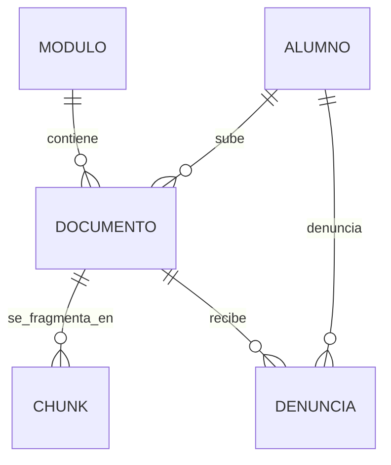

# 5 · Backend Schema

> [!resumen]
> Modelo de datos y API que sostienen los flujos de [[4 - AppFlow]]. Sin BD remota (SQLite local en el servidor Zorin, ver [[2 - TRD]] §1) — no aplica verificar esquema remoto.

## 1. Diagrama entidad-relación


## 2. SQL ejecutable
Nota: SQLite (no Postgres) — sin `uuid`/`gen_random_uuid()`/`timestamptz`; se usa `INTEGER PRIMARY KEY AUTOINCREMENT` y `TEXT` con `datetime('now')`. `schema_to_migration.py` está pensado para Supabase/Postgres: aquí la migración se aplica directamente con `bun:sqlite` al arrancar el servidor (`db.exec(...)` dentro de un `executescript`, patrón ya usado en `laya-leads`/`neozeler-crm`). `PRAGMA foreign_keys=ON` en cada conexión (trampa ya registrada en `librerias.md`).

```sql
PRAGMA foreign_keys = ON;

create table if not exists modulo (
  id integer primary key autoincrement,
  nombre text not null unique,
  centro_ciclo text,
  archivado integer not null default 0,
  created_at text not null default (datetime('now'))
);

create table if not exists alumno (
  id integer primary key autoincrement,
  nombre text not null,
  centro text not null,
  token_sesion text not null unique,
  created_at text not null default (datetime('now'))
);

create table if not exists documento (
  id integer primary key autoincrement,
  modulo_id integer not null references modulo(id) on delete cascade,
  subido_por integer not null references alumno(id) on delete set null,
  nombre_archivo text not null,
  ruta_archivo text not null,
  num_paginas integer not null,
  created_at text not null default (datetime('now'))
);

create table if not exists chunk (
  id integer primary key autoincrement,
  documento_id integer not null references documento(id) on delete cascade,
  pagina integer not null,
  texto text not null,
  orden integer not null
);

-- Índice invertido con tokenización tradicional (unicode61, quita acentos).
-- Tabla "externa" (content='chunk') para no duplicar el texto: FTS5 solo guarda el índice.
create virtual table if not exists chunk_fts using fts5(
  texto,
  content='chunk',
  content_rowid='id',
  tokenize='unicode61 remove_diacritics 2'
);

-- Mantener chunk_fts sincronizada con chunk (altas, bajas y cambios).
create trigger if not exists chunk_ai after insert on chunk begin
  insert into chunk_fts(rowid, texto) values (new.id, new.texto);
end;
create trigger if not exists chunk_ad after delete on chunk begin
  insert into chunk_fts(chunk_fts, rowid, texto) values ('delete', old.id, old.texto);
end;
create trigger if not exists chunk_au after update on chunk begin
  insert into chunk_fts(chunk_fts, rowid, texto) values ('delete', old.id, old.texto);
  insert into chunk_fts(rowid, texto) values (new.id, new.texto);
end;

create table if not exists denuncia (
  id integer primary key autoincrement,
  documento_id integer not null references documento(id) on delete cascade,
  alumno_id integer not null references alumno(id) on delete cascade,
  motivo text not null,
  created_at text not null default (datetime('now')),
  unique (documento_id, alumno_id)
);

create index if not exists idx_documento_modulo on documento(modulo_id);
create index if not exists idx_chunk_documento on chunk(documento_id);
create index if not exists idx_denuncia_documento on denuncia(documento_id);
```
```sql seed
insert into modulo (nombre, centro_ciclo) values
  ('Programación', 'DAM / Grado Medio Informática'),
  ('Montaje y Mantenimiento de Equipos', 'Grado Medio Informática'),
  ('Redes Locales', 'Grado Medio Informática');

insert into alumno (nombre, centro, token_sesion) values
  ('Alumno de prueba', 'IES de prueba', 'seed-token-0001');
```

## 2.1 Documentación de tablas

### `modulo`
| Columna | Tipo | Nulo | Default | Notas |
|---|---|---|---|---|
| id | integer | no | autoincrement | PK |
| nombre | text | no |  | único, lo que se cae en "crear módulo" (AppFlow Flujo 4) |
| centro_ciclo | text | sí |  | texto libre, no es entidad propia en v1 |
| archivado | integer | no | 0 | 1 = oculto para alumnos, no se borra |
| created_at | text | no | `datetime('now')` |  |

### `alumno`
| Columna | Tipo | Nulo | Default | Notas |
|---|---|---|---|---|
| id | integer | no | autoincrement | PK |
| nombre | text | no |  | lo que escribe en Entrada |
| centro | text | no |  |  |
| token_sesion | text | no |  | valor aleatorio generado al entrar, va en la cookie `HttpOnly`/`SameSite=Strict` (TRD §4) |
| created_at | text | no | `datetime('now')` |  |

- No hay tabla de "admin": el rol admin **no** es una fila de `alumno`, se autentica con un token fijo en `.env` del servidor contra la ruta `/admin` (TRD §4, AppFlow §1 corrección tras cliente simulado). Evita el riesgo real que detectó el cliente simulado: nadie se vuelve admin escribiendo "Haytham" como nombre.

### `documento`
| Columna | Tipo | Nulo | Default | Notas |
|---|---|---|---|---|
| id | integer | no | autoincrement | PK |
| modulo_id | integer | no |  | FK → `modulo.id` |
| subido_por | integer | no |  | FK → `alumno.id`, visible en el panel admin (corrección tras cliente simulado, atasco #4) |
| nombre_archivo | text | no |  |  |
| ruta_archivo | text | no |  | ruta en disco del servidor, para la previsualización (atasco #5) |
| num_paginas | integer | no |  |  |
| created_at | text | no | `datetime('now')` |  |

- **FK**: `modulo_id` → `ON DELETE CASCADE` (si se archiva/borra un módulo, sus documentos no quedan huérfanos); `subido_por` → `ON DELETE SET NULL` (si algún día se borra un alumno, el documento no desaparece — sigue citándose, solo pierde la atribución).
- Índices: `idx_documento_modulo`.

### `chunk` + `chunk_fts`
| Columna | Tipo | Nulo | Default | Notas |
|---|---|---|---|---|
| id | integer | no | autoincrement | PK, mismo `rowid` que usa `chunk_fts` |
| documento_id | integer | no |  | FK → `documento.id` |
| pagina | integer | no |  | para citar "documento, página X" (RF-04) |
| texto | text | no |  | el fragmento de 300-500 palabras (RF-01) |
| orden | integer | no |  | posición dentro del documento |

- **FK**: `documento_id` → `ON DELETE CASCADE`.
- `chunk_fts` es una tabla FTS5 externa (`content='chunk'`): no duplica el texto en disco, solo el índice invertido tokenizado. Los triggers la mantienen sincronizada en cada alta/baja/cambio de `chunk` — así un `DELETE FROM documento` en cascada también limpia el índice sin código adicional en el backend.
- Búsqueda: `SELECT chunk.*, bm25(chunk_fts) AS score FROM chunk_fts JOIN chunk ON chunk.id = chunk_fts.rowid WHERE chunk_fts MATCH ? AND chunk.documento_id IN (SELECT id FROM documento WHERE modulo_id = ?) ORDER BY score LIMIT 5;`

### `denuncia`
| Columna | Tipo | Nulo | Default | Notas |
|---|---|---|---|---|
| id | integer | no | autoincrement | PK |
| documento_id | integer | no |  | FK → `documento.id` |
| alumno_id | integer | no |  | FK → `alumno.id`, quién denuncia |
| motivo | text | no |  |  |
| created_at | text | no | `datetime('now')` |  |

- **FK**: `documento_id` → `ON DELETE CASCADE`; `alumno_id` → `ON DELETE CASCADE`.
- `unique (documento_id, alumno_id)`: un mismo alumno no duplica denuncia sobre el mismo documento (AppFlow Flujo 3) — el **número de denuncias acumuladas** que ve el admin es `COUNT(*) GROUP BY documento_id`, no una columna propia.

## 3. Seguridad de datos
- No hay RLS (no es Postgres/Supabase): el control de acceso vive en el backend Bun — toda ruta de alumno exige cookie de sesión válida; toda ruta `/admin/*` exige el token de `.env`, comparado con `crypto.timingSafeEqual` (no `===`, para evitar timing attacks).
- Almacenamiento de ficheros: los PDF originales se guardan en disco del servidor Zorin (no hay Storage tipo Supabase en este stack), en una carpeta fuera del repo, con copia de seguridad periódica junto al `.db` (TRD §5).
- Dato personal mínimo: solo `nombre` y `centro` del alumno (ya acotado en el PRD, RNF); sin email ni contraseña.

## 4. API / endpoints
| Método | Ruta | Rol | Entrada | Salida | Errores |
|---|---|---|---|---|---|
| POST | `/entrada` | Alumno | `{nombre, centro}` | cookie de sesión | 400 si falta nombre |
| GET | `/modulos` | Alumno | — | lista de módulos con nº documentos | 401 sin sesión |
| GET | `/modulos/:id/documentos` | Alumno | — | lista de documentos del módulo | 401 · 404 |
| POST | `/modulos/:id/documentos` | Alumno | PDF (multipart) | documento creado | 400 (PDF no legible) · 413 (muy grande) |
| POST | `/modulos/:id/preguntas` | Alumno | `{texto}` | stream con respuesta + cita, o aviso sin contexto | 429 (rate limit Groq) · 401 |
| POST | `/documentos/:id/denuncias` | Alumno | `{motivo}` | 201, o 200 si ya existía la suya | 401 · 404 |
| POST | `/admin/login` | — | `{token}` | cookie de admin | 401 si el token no coincide |
| GET | `/admin/modulos` | Admin | — | lista de módulos | 401 |
| POST | `/admin/modulos` | Admin | `{nombre, centro_ciclo?}` | módulo creado | 409 (nombre duplicado) |
| GET | `/admin/denuncias` | Admin | — | fila con documento, módulo, autor, motivo(s), nº acumulado | 401 |
| GET | `/documentos/:id/archivo` | Admin | — | PDF original (previsualización) | 401 · 404 |
| DELETE | `/documentos/:id` | Admin | — | 204 | 401 · 404 |

**Validado** (2026-10-27, `sqlite3` 3.37.2 vía Python, mismo motor que `bun:sqlite`): el script completo se ejecuta sin error; probado el ciclo completo crear documento+chunk → buscar con `chunk_fts`/`bm25()` (funciona sin acentos y sin distinguir mayúsculas) → denunciar dos veces el mismo alumno (la `UNIQUE` lo bloquea, `IntegrityError` como se esperaba) → borrar el documento y comprobar que `chunk`, `chunk_fts` (vía triggers) y `denuncia` quedan en 0 filas por el `ON DELETE CASCADE`.

## 5. Migraciones
- Orden: `modulo` y `alumno` primero (sin dependencias) → `documento` → `chunk` + `chunk_fts` + triggers → `denuncia`.
- Semilla: 3 módulos reales del ciclo + 1 alumno de prueba (bloque `sql seed` arriba).
- Reversibilidad: al ser SQLite con `executescript` idempotente (`create table if not exists`), reconstruir es borrar el archivo `.db` y volver a arrancar el servidor; para producción real, copia de `.db` antes de cualquier cambio de esquema (patrón `backup()` de `laya-trader`, TRD §5).

## 6. Cálculos y reglas de negocio
- No hay cálculos numéricos (tarifas, horas) en este proyecto — es consulta y recuperación de texto, no gestión administrativa con fórmulas.
- Regla de "sin contexto suficiente" (RF-05): si la mejor fila que devuelve `chunk_fts`/`bm25()` para la pregunta tiene una puntuación por debajo de un umbral fijo (a calibrar probando con apuntes reales, ejemplo de partida: ningún resultado con 3+ términos de la pregunta coincidiendo), el backend no llama a Groq y responde con el aviso fijo del AppFlow Flujo 2.

---
Anterior: [[4 - AppFlow]] · Siguiente: [[6 - Plan de Implementacion]]
