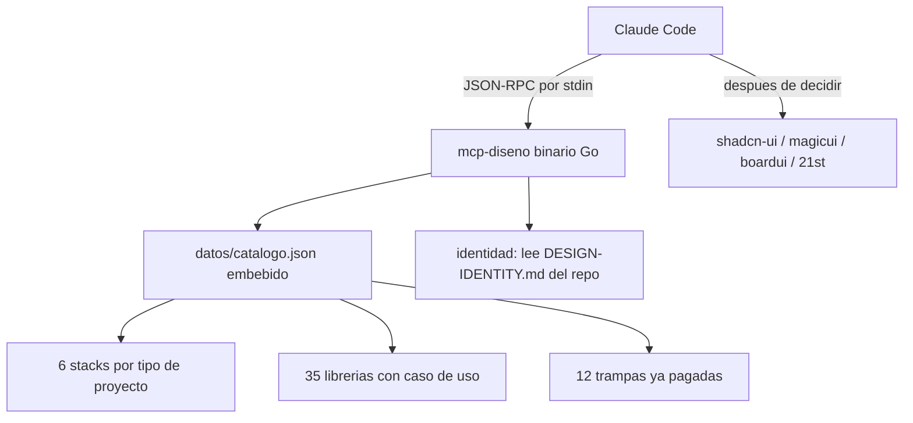

> [!resumen] En cristiano
> Es un ayudante al que Claude le pregunta «¿qué librería uso para esto?» antes de escribir una sola línea de interfaz.
> Guarda en un solo sitio el stack obligatorio, el catálogo de librerías con su caso de uso, las trampas ya pagadas y la puerta de identidad.
> No instala nada ni genera código: solo decide y avisa.
> Antes ese conocimiento estaba repartido en tres archivos largos que había que leer enteros.
> Hecho, probado y registrado el 16 de noviembre de 2026.
> **v2 (20 de noviembre de 2026)**: ahora también mira el proyecto (qué librerías hay puestas, qué choca) y revisa el código buscando las animaciones mal hechas que antes nadie comprobaba.

## Qué es

Servidor MCP propio de **decisión de diseño**, escrito en Go sin dependencias externas. Desde la v2, el catálogo JSON **en disco manda sobre el embebido** (`$MCP_DISENO_CATALOGO` o `datos/catalogo.json` junto al binario): se edita sin recompilar.

Es la **capa de decisión**. La capa de ejecución sigue siendo de otros MCPs: `shadcn-ui`, `shadcn-registries`, `magicui`, `boardui`, `21st`, `mobbin`, Figma, Canva, Bloom.

## Arquitectura



## Herramientas

| Herramienta | Argumentos | Qué devuelve |
|---|---|---|
| `proyecto` | `ruta?` | Qué hay instalado (framework, Tailwind, base, motion, iconos), estado de la Capa 0 (`PRODUCT.md`/`DESIGN.md`), lo que aprobó `DESIGN-IDENTITY.md` y los conflictos (P0 dos bases o dos motores de animación, P1 varias familias de iconos) |
| `auditar` | `ruta?` | Gate determinista de motion: P0 `transition-all` y `ease-in` crudo; P1 duración >300 ms, color a pelo en componentes, `` sin `alt`, animación sin `prefers-reduced-motion`, `.html` sin `package.json`. Con archivo y línea |
| `stack` | `tipo`, `ruta?` | Stack obligatorio del tipo de proyecto: piezas, base recomendada, iconos y reglas. Tipos: `web-cliente`, `landing`, `dashboard`, `micro-saas`, `saas`, `maqueta-estatica` |
| `elegir` | `necesidad`, `ruta?` | Hasta 5 librerías candidatas para una necesidad en lenguaje normal, ordenadas por estado, con sus trampas |
| `catalogo` | `estado?`, `papel?` | Listado filtrable. `estado`: `en-stack`, `fuera-del-stack`, `sin-probar`, `no-usar` |
| `trampas` | `libreria?` | Errores ya pagados con su regla preventiva y la fecha |
| `identidad` | `ruta?` | Puerta de la fase 1: si el repo tiene `DESIGN-IDENTITY.md` aprobado y concreto, y si `DESIGN.md` está exportado |

## Estado y rendimiento

- Compila limpio con Go 1.22. Autotest propio: **25 de 25 comprobaciones en verde** (incluye un repo de prueba con `transition-all`, `ease-in` e identidad completa) (`./mcp-diseno --autotest`, sale con código 1 si falla).
- Probado por stdio: responde `initialize` (protocolo `2025-06-18`), `tools/list`, `tools/call` y `ping`.
- Registrado en el perfil de usuario, disponible en cualquier proyecto.
- Las herramientas aparecen como `mcp__diseno__*` **al reiniciar la sesión**.

## Guía operativa

Registrar (ya hecho):

```bash
claude mcp add diseno --scope user -- /home/haytham/Proyectos/mcp-diseno/mcp-diseno
```

Editar el catálogo y recompilar:

```bash
cd ~/Proyectos/mcp-diseno && go build -o mcp-diseno . && ./mcp-diseno --autotest
```

Todo el conocimiento vive en `datos/catalogo.json`. Desde la v2 **no hay que recompilar**: el binario lee el JSON del disco (`$MCP_DISENO_CATALOGO` o junto al binario) y solo cae al embebido si no lo encuentra.

Auditar un repo de interfaz antes del commit visual:

```bash
printf '%s\n' '{"jsonrpc":"2.0","id":1,"method":"tools/call","params":{"name":"auditar","arguments":{"ruta":"/ruta/al/repo"}}}' | ~/Proyectos/mcp-diseno/mcp-diseno
```

## Cómo encaja con las reglas

- `~/.claude/rules/diseno.md` → punto 0 de la puerta, **gate determinista de motion de la Capa 2** (sustituye a la «opción B» de 2026-11-18) y firmas exactas en «Ejecución por MCP».
- `~/.claude/rules/mcps-seleccion.md` → primera línea de «Diseño y UI»: se pregunta antes que los MCPs que instalan.
- Skill `diseno-central` → primera fila de la tabla de skills; las fases 1 y 2 lo invocan.
- `~/.claude/reference/librerias.md` → sigue siendo el registro largo en prosa, con fechas y proyectos; el catálogo del MCP es su versión consultable.

## Riesgos y límites

- El catálogo es una foto del 16 de noviembre de 2026. Si no se mantiene, envejece y recomienda librerías viejas.
- `elegir` puntúa por palabras clave, no entiende matices: en una necesidad rara puede devolver candidatas flojas.
- Hay dos sitios con el mismo conocimiento (catálogo y `librerias.md`). El archivo largo manda para el relato con fechas y proyectos; el catálogo, para la consulta rápida.

## v2 (2026-11-20)

Tres huecos cerrados:

1. **Era ciego al proyecto.** `stack` y `elegir` recomendaban del catálogo aunque el repo ya tuviera otra base puesta, así que `rules/diseno.md` los había bajado del paso 0. Ahora `proyecto.go` lee `package.json`, `components.json`/`boardui.json` y `DESIGN-IDENTITY.md`, y con `ruta` toda la salida queda supeditada a lo instalado y a la identidad aprobada (que manda sobre el catálogo). Vuelven al paso 0.
2. **Las reglas duras de motion no se comprobaban.** `impeccable detect` no tiene regla para `transition-all` ni `ease-in` (la de ESLint es `no-transition-all`). `auditar.go` las comprueba sobre el código, con archivo y línea. En Go no hay lookahead en `regexp`: `ease-in-out` y `ease-in-expo` se descartan mirando el carácter siguiente a mano.
3. **Bug de `identidad`.** Buscaba una sección «movimiento» cuando la plantilla la llama «Dinamismo», así que una identidad completa daba `PUERTA CERRADA`. Ahora acepta `dinamismo|movimiento|cubic-bezier`, con test de regresión.

**No** se ha enganchado `auditar` al hook `slop-gate`: ese hook sale con código 2 y bloquearía la edición. Queda como oferta pendiente de permiso.

## Siguiente

- Decidir si `auditar` entra en el hook `slop-gate` (bloquearía la edición) o se queda como comprobación manual antes del commit.
- Usarlo en el próximo proyecto de interfaz y apuntar qué preguntas no sabe contestar.
- Pasar a «hecho» las librerías `sin-probar` en cuanto se usen en un proyecto real, con proyecto y fecha.

## Enlaces

- Repo: `~/Proyectos/mcp-diseno/` (`README.md`, `resumen.html`)
- Sesiones: [[2026-11-16 - MCP de diseño propio]] · [[2026-11-20 - MCP de diseño v2 y configuración de diseño a nivel experto]]
- Catálogo largo: `~/.claude/reference/librerias.md`

## Ampliación 3D y stack (2026-11-20)
- Nuevos tipos de `stack`: `web-3d` y `app-3d` (React Three Fiber + drei sobre el stack de 5). Catálogo: 53 librerías (antes 36), 8 stacks, 5 trampas nuevas (R3F en Next, peso móvil, Spline, versión de three, isla Astro).
- Regla de elección: detalle → CSS 3D o COBE; protagonista en React → R3F; diseñador → Spline; juego/XR → Babylon (fuera del stack); contenido con SEO → Astro + isla React.
- `no-usar`: MUI, Ant Design, Chakra, TresJS. Reglas en `~/.claude/rules/diseno.md` («3D en web y apps») y `reference/librerias.md`.
- Stacks `servicios`, `ecommerce` y `tech-ia` con paleta de partida y 7 librerías nuevas sin probar (Supabase, Vercel AI SDK, tRPC, Aceternity, Storefront UI, Medusa/Hydrogen, CMS headless). Colores del análisis sin verificar: la identidad aprobada manda.
