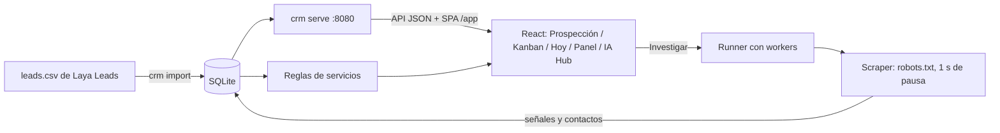

> [!resumen] En cristiano
> Es el CRM que usa Haytham para vender los servicios de NeoZeler. Se carga con la lista de negocios de Laya Leads, y con un botón («Investigar») mira la web de cada negocio y dice qué servicio de IA le podemos vender. Cada negocio lleva una «huella» de 4 cuadraditos de colores: se enciende cada cuadradito que encaja. Corre en tu propio ordenador, sin internet salvo para investigar webs.

**Estado: Completado (Fase 1 / V1)** · 2026-11-08 · Repo: `~/Proyectos/minicrm-go/` (commit `8100096`)

## Qué es
CRM local de prospección rápida para los 4 servicios de IA en Málaga: Webs / Rediseño, Setter, Software a medida y Automatizaciones. **Sustituye a [[01_Projects/Neozeler CRM]] y a la parte CRM de NeoZeler HQ** (decisión de Haytham, 2026-11-07: tiene que ser ágil, sencillo, premium y funcional).

## Relaciones
- **Origen de los datos**: [[01_Projects/Laya Leads]] (CSV de negocios; el real tiene 1879, no 1300). Cómo funciona por dentro: [[01_Projects/Laya Leads - Funcionamiento interno]].
- **Parecido, otro objetivo**: [[04_Archive/TopLeads]] (el mismo Laya Leads convertido en suscripción para freelancers). Este CRM es de uso interno.

## Arquitectura


- Go 1.22, `net/http`, `modernc.org/sqlite` (sin cgo), goquery, y API JSON. Frontend en `web/`: Vite + React + TypeScript + Tailwind + TanStack Query, embebido en el binario con `go:embed` y servido en `/app/` (migrado desde HTMX el 2026-11-08, ver [[01_Projects/Mini CRM Go - Plan de migracion de frontend]]).
- Paquetes en `internal/`: `db`, `importer`, `scraper`, `servicios`, `leads`, `server`.
- Las reglas de los 4 servicios se definen una vez y generan el SQL y la comprobación en Go; un test verifica que coinciden.

## Reglas de servicio
| Servicio | Encaja si |
|---|---|
| Webs / Rediseño | alguna de: sin HTTPS, HTTPS inválido, no móvil, enlaces rotos, constructor barato, tecnología obsoleta |
| Setter | alto ticket B2B **y** sin sistema de reservas |
| Software a medida | área de clientes, catálogo PDF o varias sedes |
| Automatizaciones | al menos 2 de: WhatsApp, Mailchimp, píxel de Facebook, formulario básico |

## Guía operativa
```bash
cd ~/Proyectos/minicrm-go
go run ./cmd/crm import -csv data/leads.csv
go run ./cmd/crm serve -port 8080
go test ./...
```
- Corre aislado en `http://localhost:8080` (solo `127.0.0.1`, sin login).
- La investigación en vivo respeta `robots.txt`, deja 1 s entre peticiones, lee como máximo 800 KB por página y corta a los 90 s. Máx. 4 investigaciones a la vez.
- Tras tocar el frontend: `cd web && npm run build`, luego `go build -o bin/crm ./cmd/crm` (la SPA va dentro del binario; `-templates` ya no existe).
- `data/` (base y CSV) no se sube a git: contiene datos de negocios reales.

## Identidad visual
**Rediseño «Cabina» (2026-11-08)**, sustituye a «tablero de azulejos» (no gustó: sosa y sin dashboard). Modo oscuro, acento lima `#C6F24E`, Geist + Geist Mono, huella 2×2 de azulejos por servicio. Primera pantalla = Dashboard (cifras, embudo, penetración, «Para hoy», mejores oportunidades, actividad). Barra lateral en escritorio y barra inferior en móvil. Detalle en `DESIGN-IDENTITY.md` del repo y [[03_Resources/Registro de Identidades Visuales]]. axe sin violaciones en las 5 vistas.

> [!riesgo] Límites conocidos
> - Solo 3 de 1879 negocios están investigados: casi todas las huellas salen apagadas hasta investigarlos.
> - `sin_reservas` da falsos positivos con motores de reserva propios; el aviso de Flash salta por la cadena `.swf`.
> - Lighthouse sin pasar y el botón «Investigar» sin probar en vivo en la interfaz (solo test de extremo a extremo).
> - `npm audit`: 6 avisos sin tratar (esbuild solo en desarrollo; `@remix-run/router` y `postcss` altos). Arrastrar tarjetas del Kanban con ratón/táctil sin probar (sí con teclado). Sin login ni CSRF: solo `127.0.0.1`.


## Pipelines y rediseño ronda 2 (2026-11-08)
- Varios pipelines: regla (servicio, tier, contacto, multi) + etapa propia por negocio y pipeline; 7 etapas fijas. Sembrados General, Webs, Tier A. Tablas `pipelines` y `pipeline_leads`. Vistas Tablero y Tabla por pipeline.
- IA Hub con tres secciones de color propio: Noticias, Ideas de vídeo (tablero por estado), Ideas de implementación (galería).
- Inspiración de interfaz: vistas e interfaces de Airtable (etiquetas de color, pestañas de vista, tarjetas de resumen).
