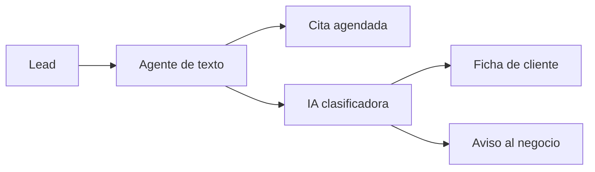

# NeoFlow AI

> [!resumen] En cristiano
> Una web tipo presentación (10 diapositivas) para enseñar al jurado de Impulsa Startup la idea de NeoFlow AI: atención comercial automática para pymes, con foco en clínicas dentales. Un agente de texto habla con el cliente y agenda cita; una segunda IA ordena la conversación, crea la ficha del cliente y avisa al negocio. Estado: landing hecha y funcionando en local; las cifras de la demo y la hoja de ruta son inventadas y hay que cambiarlas por reales.

## Arquitectura


## Módulos de la landing
- `index.html`: diapositivas `#s1`–`#s10` y fondo SVG `#bgfx`.
- `style.css`: tokens, scroll-snap, reveals.
- `app.js`: progreso, partículas, demo de chat (s3), contadores, calculadora.

## Guía operativa
```bash
cd ~/Proyectos/neoflow-pitch && python3 -m http.server 8765   # http://localhost:8765
```
Trampa del fondo SVG: `body` no puede tener `background`; si lo tiene, tapa el SVG (vive solo en `html`).

## Pendiente
- Sustituir datos inventados por reales. (2026-11-14: pitch rehecho a 9 diapositivas; ver sesión del día)
- Transición suave de brillos; repetir axe y Lighthouse.
- Sin despliegue ni remoto.

Sesión: [[2026-11-05 - Landing pitch NeoFlow AI]]

- Guion del pitch: [[01_Projects/NeoFlow AI - Guion del Pitch]]
