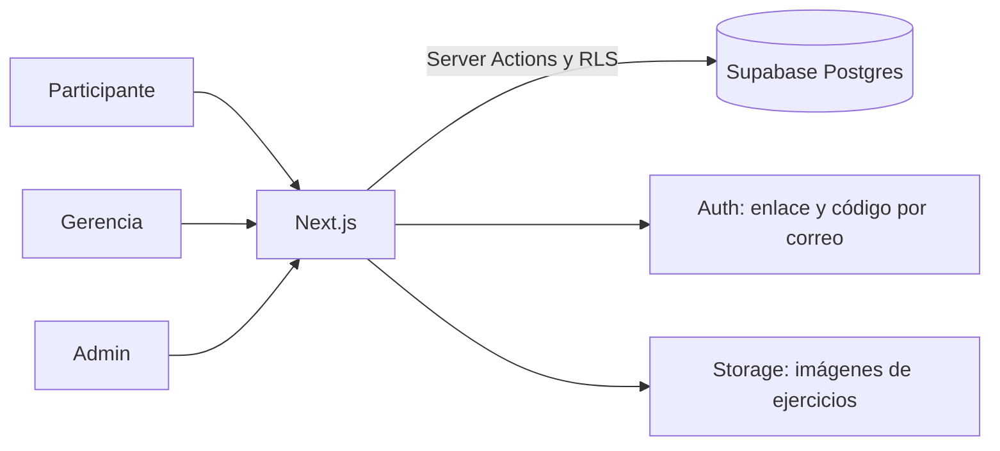

# RETO 30 — App real

> [!resumen]
> Versión real del reto de 30 días de Factory Training: cuentas, progreso en servidor, panel de administración de ejercicios y panel de gerencia. **Proyecto de Haytham y su amigo Pedro.** Arrancó el 2026-10-14 con el flujo de 6 documentos (todos aprobados). **Construcción iniciada el 2026-10-18** (Fase 0 hecha en `~/Proyectos/reto-30`); la demo anterior se eliminó el 2026-10-15 y lo útil se salvó en `99_Assets/reto-30/demo-rescatada/`.

> [!resumen]
> **Alcance de la v1 (2026-10-17)**: ranking por nivel, comodines de racha, reto extra, cronómetro, correo diario, plan Dúo (30 €), premio de 50 € + merchandising y nivel fijo. Detalle y decisiones en [[Cambios de diseno - Ranking, comodines, sorteo y Duo]]. Los seis documentos de abajo ya incluyen estos cambios; **la fecha de inicio aún no está fijada**. El SQL final está probado en local (102 comprobaciones, 2026-10-18); falta aplicarlo a Supabase.

## Documentos (aprobados el 2026-10-14; ampliado el 2026-10-17)
| # | Documento | Contenido clave |
|---|---|---|
| 1 | [[1 - PRD]] | 11 historias, 3 ejercicios por nivel con contenido editable |
| 2 | [[2 - TRD]] | Next.js 16 + Supabase, ficha de 11 librerías y presupuesto de dependencias |
| 3 | [[3 - UI-UX Design]] | Dirección del logo (negro y lima), barra de 30 segmentos, 13 pantallas |
| 4 | [[4 - AppFlow]] | 16 reglas, flujos, permisos y cliente simulado |
| 5 | [[5 - Backend Schema]] | 12 tablas, RLS y funciones; probado en Postgres local (102 comprobaciones) |
| 6 | [[6 - Plan de Implementacion]] | 40 tareas en 7 fases y 7 decisiones previas (D2, D4 y D6 resueltas) |

## Arquitectura

## Reglas que conviene recordar
- **Precio y pago**: 20 € por plaza, en efectivo en Factory Training; la app no gestiona pagos. Un admin activa cada plaza.
- **Sorteo**: premio igual al 25 % del beneficio (decidido el 2026-10-16; unos 118,50 € con 30 personas) entre quienes completen los 30 días sin fallar. La app solo identifica a los elegibles y viene **desactivado**; no se anuncia hasta la consulta legal ([[Borrador - Bases del sorteo]]).
- **Hosting de un mes**: Supabase gratuito (con copia de seguridad semanal a mano y proyecto activo) y Vercel Pro solo el mes del reto.
- **Edad y consentimiento**: mínimo 18 años con casilla; el consentimiento para gerencia se da y se retira en la cuenta.
- **Jornada**: el día siguiente se abre a las 07:00 (hora de Madrid). Saltar un día pone la racha a 0 pero no pierde el progreso.
- **Ejercicios**: tres por nivel al empezar (provisionales); se editan desde `/admin/ejercicios`. Lo ya completado conserva una copia del ejercicio mostrado.
- **Privacidad**: gerencia ve nombres abreviados salvo que el participante dé su consentimiento en la app.
- **Marca**: negro `#0C0D0E`, lima `#CCFF00`, Barlow; sin squircle. La demo anterior, ya eliminada, usaba otro estilo (papel y naranja).

## Estado y siguientes pasos
- [x] Seis documentos redactados y aprobados
- [x] Esquema SQL probado en local

- [x] Resueltas: **D1** organización "Reto 30" creada en Supabase (2026-10-18) · **D2** hosting (Vercel Pro un mes) · **D4** logo (PNG transparente) · **D6** precio (20 € individual y 30 € Dúo)
- [x] **Plan Dúo confirmado** (2026-10-18): forma parte de la v1
- [ ] Aplazada: **D3** correo y dominio (no se hará de momento; bloquea el correo propio y el despliegue final)
- [ ] Pendientes: **D5** datos del titular y revisión legal de los textos · **D7** consulta legal del sorteo
- [x] Fase 0 del Plan (2026-10-18): repo con Next 16.4.1, dependencias del TRD, tokens negro y lima, Barlow autoalojada, logo, favicon y `SegmentBar` con 6 pruebas; build, lint y tipos limpios
- [x] Fase 1 del Plan (2026-10-18): proyecto de desarrollo en Supabase con el esquema y las semillas aplicados y comprobados, `.env.local` (fuera de git), tipos en `src/lib/database.types.ts`. Pendiente solo T-37 (mantener activo el proyecto gratuito)
- [x] Fase 2 del Plan (2026-10-19), salvo T-11: clientes de Supabase y proxy, `/entrar`, `/empezar` con plan Dúo, Server Actions y lógica de jornadas. Falta T-11: configurar el panel de Supabase (plantilla de correo y URLs)
- [x] Fase 3 del Plan (2026-10-19), salvo T-22: portada, panel con comodines, reto del día con cronómetro y reto extra, felicitación, ranking, pareja, insignias, diploma y cuenta; 68 pruebas, recorrido completo probado en el navegador con usuarios temporales. Falta T-22 (imágenes, gastan créditos de generación)
- [x] Fase 4 del Plan (2026-10-19), salvo T-24 y T-49 (aplazadas con D3): participantes con activación de plazas y parejas, sorteo con exportación, ejercicios con imagen y vídeo, retos extra, gerencia y script para crear admin y gerencia; 81 pruebas y recorrido real en el navegador
- [ ] Fase 5 del Plan: pulido y pruebas (T-28 en adelante)
- [x] Plan Dúo (30 € para dos personas): confirmado y ya incluido en el diseño; ver [[Idea - Pase Duo]] (origen)

## Guía de uso
- Código: `~/Proyectos/reto-30` (la demo anterior se eliminó). Material salvado: `99_Assets/reto-30/demo-rescatada/`.
- Skills y reglas por fase (config del 2026-10-16): [[Guia - Skills y reglas por fase]].
- Herramientas del flujo: `~/Proyectos/flujo-software/` (`trace_lint.py`, `schema_to_migration.py`).
- Comprobar trazabilidad: `python3 ~/Proyectos/flujo-software/tools/trace_lint.py "01_Projects/Reto-30/Software"`.
- Contexto: [[Fuentes de Ejercicios y Multimedia Fitness]] (datasets y APIs de ejercicios) y [[Dashboard - Proyectos de Software]].
- Referencia de interfaz: [[Referencia de interfaz - openGym]] (clon en `~/Proyectos/referencias/openGym`, licencia AGPL: solo consulta)
