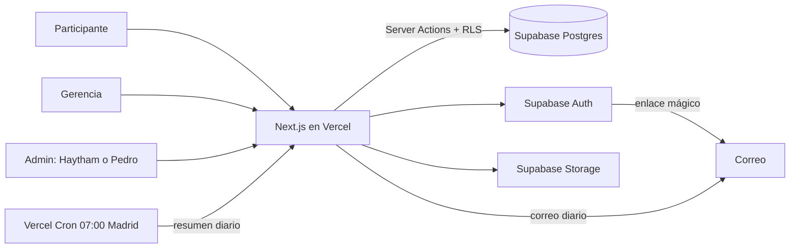

# 2 · TRD — RETO 30 (app real)

> [!resumen]
> **Cómo** se construye lo que pide el [[1 - PRD]]: se construye desde cero un proyecto Next.js + shadcn (la demo anterior se eliminó el 2026-10-15; se salvaron sus 30 retos y las pruebas del esquema) con un backend real con cuentas, progreso en servidor y un panel para editar ejercicios. Cada decisión lleva su alternativa descartada. Datos de librerías consultados en npm el 2026-10-14; **context7 no estaba disponible** (`CONNECTION_CLOSED`), así que la documentación de APIs no está contrastada y debe revisarse al implementar.

> [!resumen]
> **Alcance de la v1 (2026-10-17)**: la parte técnica de [[Cambios de diseno - Ranking, comodines, sorteo y Duo]] va marcada. Resumen: comodines y racha resueltos en el servidor (Postgres), ranking como función SQL, correo diario con una tarea programada de Vercel (Cron) y Resend, cronómetro 100 % en el navegador y vídeo por enlace o Storage. Sin dependencias nuevas de ejecución.

## 1. Stack elegido
| Capa | Elección | Alternativa descartada | Por qué |
|---|---|---|---|
| Frontend | Next.js 16 (App Router) + React 19 + Tailwind 4 | Vite + React SPA | La portada necesita SEO y el resto vive tras login; ya se conoce Next.js de la demo anterior |
| UI base | shadcn (estilo `base-nova`, Base UI) + registries ya probados | MUI, HeroUI | Ya instalado; encaja con Componentry y Skiper UI (ver [[Catalogo de Componentes]]). Sin Space UI ni Arc UI: la marca es angular y no usa squircle |
| Animación | `motion` (único motor) | GSAP, Anime.js | La demo anterior ya lo usaba; no se instala `framer-motion` (mismo motor, duplicado) |
| Iconos | Lucide (único) | Tabler, Phosphor | La demo anterior usaba Lucide y Tabler a la vez: se deja una sola |
| Backend / API | Next.js Route Handlers + Server Actions sobre Supabase | Servidor Express aparte, Convex | Un solo despliegue; sin servicio extra que mantener |
| Base de datos | Supabase Postgres (región UE) con RLS | Firebase, Neon + Clerk | Progreso en servidor con borrado en cascada, roles por RLS y Storage en el mismo sitio |
| Auth | Supabase Auth con enlace mágico por correo (sin contraseña) | Contraseña, Google OAuth | Menos fricción para socios no técnicos; ver riesgo de correo en §8 |
| Ficheros / media | Supabase Storage (bucket público de imágenes de ejercicios) | Cloudflare R2 | Mismo proveedor; no hace falta CDN aparte con 9 ejercicios |
| Validación | Zod | Valibot, validación manual | Esquemas compartidos entre formularios y acciones del servidor |
| Cronómetro | Componente propio con `useReducer`, `performance.now()` y la API Wake Lock para que no se apague la pantalla; sonido corto con la Web Audio API | Librería de temporizadores | Es una máquina de estados pequeña (ejercicio → descanso → listo); no justifica una dependencia. Funciona sin conexión una vez cargado el reto |
| Correo diario | Vercel Cron + Route Handler protegido por secreto + Resend | n8n, Supabase `pg_cron` + Edge Function | Un solo despliegue y el mismo proveedor de correo que los avisos de plaza; los datos salen de una función SQL |
| Vídeo de ejercicio | Enlace de la librería de ejercicios (`video_url`) o fichero propio en Supabase Storage; reproductor `<video>` nativo | Incrustar plataforma de terceros | Sin dependencias; ver riesgos de licencia y de almacenamiento en §8 |
| Hosting | Vercel (plan Pro, ver riesgo §8) | Cloudflare con OpenNext, VPS con Docker | Despliegue nativo de Next; coste y términos pendientes de verificar |
| Pruebas | Vitest (lógica pura) + Playwright (ciclo completo) | Jest, Cypress | Rapidez en la lógica de días y racha; Playwright prueba el ciclo en producción |

### 1.1 Ficha por librería (verificada, no de memoria)
Fuente: `npm view` el 2026-10-14. Peso gzip **sin medir** (se medirá con el primer `next build`). Compatibilidad Node 22 / React 19: "demo" = funcionó en la demo anterior, ya eliminada; "por probar" = no se ha ejecutado aquí.
| Librería | Versión | Último release | Mantenimiento | Peso (kB gzip) | Licencia | Node 22 / React 19 | Fuente | Trampas conocidas |
|---|---|---|---|---|---|---|---|---|
| next | 16.4.1 | 2026-10-14 | Activo | sin medir | MIT | demo (16.3.8) | npm | `AGENTS.md`: esta versión tiene cambios incompatibles; leer `node_modules/next/dist/docs/` antes de escribir código. `PageProps` exige `next typegen` |
| react | 19.3.1 | 2026-10-14 | Activo | sin medir | MIT | demo (19.2.8) | npm | React Compiler: sus reglas de lint fallan en código vendorizado (`eslint-disable` puntual) |
| @supabase/supabase-js | 2.117.3 | 2026-10-12 | Activo | sin medir | MIT | por probar | npm | Verificar el esquema real antes de asumir tablas |
| @supabase/ssr | 0.12.7 | 2026-09-08 | Activo | sin medir | MIT | por probar | npm | Es el paquete vigente; `@supabase/auth-helpers-nextjs` está **deprecado**: no usarlo |
| zod | 4.6.7 | 2026-10-12 | Activo | sin medir | MIT | por probar | npm | — |
| motion | 14.2.0 | 2026-10-13 | Activo | sin medir | MIT | demo | npm | Equivale a `framer-motion`: un único motor |
| @base-ui/react | 1.9.0 | 2026-10-09 | Activo | sin medir | MIT | demo | npm | Base de shadcn `base-nova` |
| @number-flow/react | 0.6.2 | 2026-07-18 | Moderado (3 meses sin release) | sin medir | MIT | demo | npm | Skiper UI `skiper37` es una demo fija: solo sirve de patrón |
| vitest | 5.0.4 | 2026-10-12 | Activo | dev | MIT | por probar | npm | — |
| @playwright/test | 1.64.1 | 2026-10-14 | Activo | dev | Apache-2.0 | por probar | npm | Necesita descargar navegadores (pide permiso al instalar) |
| resend | 6.33.0 | 2026-10-14 | Activo | servidor | MIT | por probar | npm | Necesario para los avisos de alta y de plaza activa **y, además, para el correo diario**; el correo integrado de Supabase no basta (**por verificar** los límites del plan gratuito, §8) |

### 1.2 Presupuesto de dependencias
| Límite | Máximo | Previsto |
|---|---|---|
| Motores de animación | 1 | 1 (`motion`) |
| Librerías de UI base | 1 + registries | 1 (Base UI) + Componentry y Skiper UI (se retiran Space UI y Arc UI por la dirección visual del [[3 - UI-UX Design]]) |
| Librerías de iconos | 1 | 1 (Lucide); se retira Tabler |
| JS inicial (kB gzip) | 200 | sin medir; objetivo medido en el primer build |
| Dependencias directas | 25 | 15 de ejecución (las 15 de la demo anterior (`demo-package.json`) menos `framer-motion`, `@tabler/icons-react` y `@usespaceui/squircle`, más `@supabase/supabase-js`, `@supabase/ssr`, `zod`); **16 con `resend`**, que ahora es necesario. Las tipografías Barlow van autoalojadas, sin paquete |

Si algún registry añade un motor de animación propio, se justifica aquí o se recorta.

## 2. Arquitectura

- El navegador nunca habla con la base de datos con permisos de servicio: solo la clave pública (`anon`) bajo RLS; las escrituras sensibles pasan por Server Actions.
- La **lógica de negocio pura** (qué día toca, desbloqueo, racha, rotación de ejercicios) vive en `src/lib/` sin dependencias de React, para probarla con Vitest. También viven ahí la máquina de estados del cronómetro (`src/lib/timer.ts`) y el cálculo de comodines disponibles (`src/lib/wildcards.ts`); la **fuente de verdad** de racha, comodines, ranking y sorteo es el SQL del [[5 - Backend Schema]]. El cliente solo los muestra.
- **Comodines y racha en el servidor**: un día sin completar se detecta al abrir la app, al completar otro día y en la tarea diaria de las 07:00; esa tarea llama a `settle_all_wildcards()` antes de preparar los correos, de modo que el ranking y el correo siempre reflejan comodines ya gastados.

## 3. Integraciones y servicios externos
| Servicio | Para qué | Coste | Límites / cuotas | Plan B |
|---|---|---|---|---|
| Supabase | BD, Auth, Storage | Plan gratuito o Pro: **por verificar** | El plan gratuito pausa proyectos inactivos y limita el correo de Auth: **por verificar** | Pro, o SMTP propio |
| Vercel | Hosting y despliegue | Hobby es de uso no comercial; Pro de pago: **por verificar** | — | Cloudflare con OpenNext |
| Correo transaccional (Resend o SMTP propio), **obligatorio** | Enlaces y códigos de entrada, aviso de alta al admin, correo "tu plaza está activa" y **correo diario a cada participante activo** | Gratuito con límite: **por verificar** (el plan gratuito de Resend anotado en el Plan, 100 correos al día y 3.000 al mes, cubre unas 30 personas durante 30 días, ~900 correos, pero no mucho más de 100 personas) | Cuota diaria y mensual | SMTP del proveedor de dominio |
| Vercel Cron | Lanza cada día a las 07:00 (hora de Madrid) la ruta que liquida comodines y envía el correo diario | Incluido en Vercel (límites del plan: **por verificar**) | Un cron por día en el plan gratuito; horario en UTC, hay que cubrir el cambio de hora de verano | Llamada diaria manual a la ruta o `pg_cron` |
| Librería de vídeos de ejercicios | Fuente de los vídeos ya hechos ([[Fuentes de Ejercicios y Multimedia Fitness]]) | **Por verificar** según la fuente elegida | Licencia, atribución y si permite enlazar o incrustar | Grabar el vídeo propio |
| Pagos | Ninguno: la cuota se cobra en efectivo en Factory Training y la app no gestiona pagos | — | — | — |

## 4. Seguridad y datos
- Roles `participante`, `gerencia` y `admin` en la tabla `profiles`, con RLS: cada participante solo lee y escribe lo suyo; gerencia lee agregados; solo admin escribe ejercicios (traza a US-08, US-09).
- Gerencia y admin se crean por invitación manual, nunca por registro abierto.
- RGPD: solo nombre y correo; proyecto Supabase en región UE; botón de borrar cuenta con borrado en cascada de todo su progreso.
- **Ranking**: la función `level_ranking` devuelve solo puesto, nombre abreviado (o «Anónimo» si la persona lo oculta), racha, comodines gastados y retos extra, nunca el correo ni el identificador de usuario. Cada participante ve únicamente el ranking de su propio nivel.
- **Pareja del Dúo**: `duo_overview` solo devuelve a un miembro los datos de su pareja (nombre, racha, si ya hizo hoy, comodines que le quedan), nunca su correo.
- **Correo diario**: lo envía el servidor con `service_role` leyendo la lista de `daily_digest_rows()` (no concedida a `authenticated`). Hay baja en `/cuenta` (`set_my_daily_email`) y enlace de baja en cada correo; la ruta del cron exige un secreto en una variable de entorno de Vercel.
- Secretos: `service_role` solo en el servidor y en variables de entorno de Vercel; `.env.example` sin valores; `.env` ignorado por git.

## 5. Rendimiento y escalado
- Carga esperada: 20–30 usuarios simultáneos, 1 acción al día cada uno. Sobra cualquier plan. El ranking calcula la racha de cada participante de un nivel (como mucho unas decenas de filas); no hace falta caché ni vista materializada. El cron diario procesa a todos en una pasada.
- Persistencia solo en BD: **nada de memoria volátil** en las funciones serverless (error recurrente del registro de errores, #38 y #41).
- La Data Cache de Next no se usa sobre lecturas de progreso o de ejercicios editables, para que un cambio del admin se vea al refrescar (#41).
- Objetivo: primera pantalla útil en menos de 2 s en 4G; medir con Lighthouse al cierre de cada fase.

## 6. Entornos y CI
- **Local**: Node 22 de fnm (`PATH="$HOME/.local/share/fnm/node-versions/v22.23.3/installation/bin:$PATH"`); el Node 18 del sistema rompe shadcn.
- **Desarrollo y producción**: dos proyectos Supabase separados; las migraciones salen de [[5 - Backend Schema]] con `schema_to_migration.py`.
- **Antes de cada commit**: `npm run lint` + `tsc --noEmit` + `vitest run` + `next build` limpios. Opcional GitHub Actions con los mismos pasos.
- Repo: se crea de nuevo `~/Proyectos/reto-30` (la demo anterior se eliminó) con `git init` y `.gitignore` antes del primer commit; el trabajo va en la rama `app-real`.

## 7. Trazabilidad PRD → técnica
| Requisito PRD | Solución técnica |
|---|---|
| RF-01 (cuenta y progreso en servidor) | Supabase Auth con enlace mágico + tabla `progress` con RLS por usuario |
| RF-02 (niveles) | Columna `level` en la inscripción, fijada en `join_reto`; sin función de cambio de nivel y sin permiso de escritura directa, así que no puede cambiar |
| RF-03 / RF-05 (calendario, desbloqueo, racha) | Funciones puras en `src/lib/` + Server Action `completeDay` que valida en servidor |
| RF-04 / RF-09 (reto del día, rotación) | Tabla `challenges` (30 días) + tabla `exercises` (3 por nivel) y función de rotación |
| RF-06 (retos especiales e insignias) | Tabla `badges` otorgada al completar los días especiales |
| RF-07 (diploma) | Ruta `/diploma` que comprueba 30 días completados en servidor; imagen generada en cliente |
| RF-08 (ejercicios editables) | Rutas `/admin/ejercicios` protegidas por rol; imágenes en Supabase Storage |
| RF-10 (panel de gerencia) | Vista SQL de solo lectura con agregados + ruta `/gerencia` |
| RF-11 / RF-12 (plaza sin pagos, activación por admin) | Estado `pendiente/activa/cancelada` en la inscripción; activación manual desde `/admin/participantes` con correo al participante |
| RF-13 (sorteo) | `level_threshold`, `reto_best_streak`, `lottery_status_core` y `admin_lottery_candidates` (con la regla «si nadie clasifica, la racha más larga») |
| RF-15 (comodines) | Columna `wildcard` en `progress`; `wildcards_available`, `settle_wildcards` y `settle_all_wildcards` |
| RF-16 (ranking) | Función `level_ranking`; la opción de ocultar el nombre es `profiles.ranking_hidden` |
| RF-17 (reto extra) | Tablas `extra_challenges` y `extra_completions`; función `complete_extra` |
| RF-18 (cronómetro) | Columnas `reps`, `time_limit_seconds` y `rest_seconds` en `exercises`; componente de cliente `ExerciseTimer` |
| RF-19 (correo diario) | Vercel Cron → Route Handler → `settle_all_wildcards()` → `daily_digest_rows()` → Resend; baja con `profiles.daily_email` |
| RF-20 (plan Dúo) | Tablas `duos` y `duo_members`; funciones `create_duo`, `join_duo`, `duo_overview` y `admin_set_duo_status` |
| RF-21 (vídeo) | Columnas `video_url` y `video_source` en `exercises`; bucket `exercise-videos` en Supabase Storage |

## 8. Riesgos técnicos
> [!riesgo]
> - **Correo de Auth**: el correo integrado de Supabase suele tener un límite bajo de envíos; con 30 socios entrando a la vez los enlaces mágicos pueden no llegar. Plan: SMTP propio o Resend antes de abrir la cohorte. **Por verificar** los límites vigentes.
> - **Hosting comercial**: el plan gratuito de Vercel no admite uso comercial y este reto cobra una cuota. Plan: Pro o Cloudflare. **Por verificar** condiciones y precio actuales.
> - **Pausa de proyectos inactivos** en el plan gratuito de Supabase: una pausa en pleno reto sería grave. Plan: Pro durante la cohorte.
> - **Next 16 y React Compiler**: cambios incompatibles y lint estricto; leer las guías en `node_modules/next/dist/docs/` antes de tocar rutas, y usar `eslint-disable` puntual solo en código vendorizado.
> - **Dependencias sin probar** (Supabase, Zod, Vitest, Playwright): probarlas en una rama antes de fijar versiones.
> - **Documentación contrastada**: context7 caído; al implementar, volver a intentar y, si sigue caído, contrastar con la documentación oficial.
> - **Correo diario**: con 30 personas son unos 900 correos al mes; el límite diario del plan gratuito se supera por encima de ~100 participantes. El cron de Vercel va en UTC: programar dos disparos o comprobar la hora de Madrid en la ruta para que el cambio de horario no mueva el aviso. Sin SPF/DKIM verificados el correo diario acaba en spam y el reto pierde una de sus palancas.
> - **Almacenamiento de vídeo**: los vídeos propios pesan; el plan gratuito de Supabase limita el almacenamiento (**por verificar** el tope vigente). Si no cabe, enlazar un vídeo alojado fuera y guardar solo la URL.
> - **Licencia de los vídeos de la librería**: comprobar antes de incrustar. Si no se permite enlazar, usar la imagen del ejercicio y grabar el vídeo propio.
> - **Wake Lock y sonido**: la API Wake Lock no existe en todos los navegadores móviles y el audio exige un gesto previo del usuario; el cronómetro debe seguir funcionando sin ellos (solo vibración y texto).
> - **SQL del esquema sin probar**: las funciones nuevas (comodines, ranking, sorteo por umbrales, Dúo) están escritas pero no ejecutadas; hay que ampliar el arnés de PGlite (T-09) antes de aplicarlas.

---
Anterior: [[1 - PRD]] · Siguiente: [[3 - UI-UX Design]]
