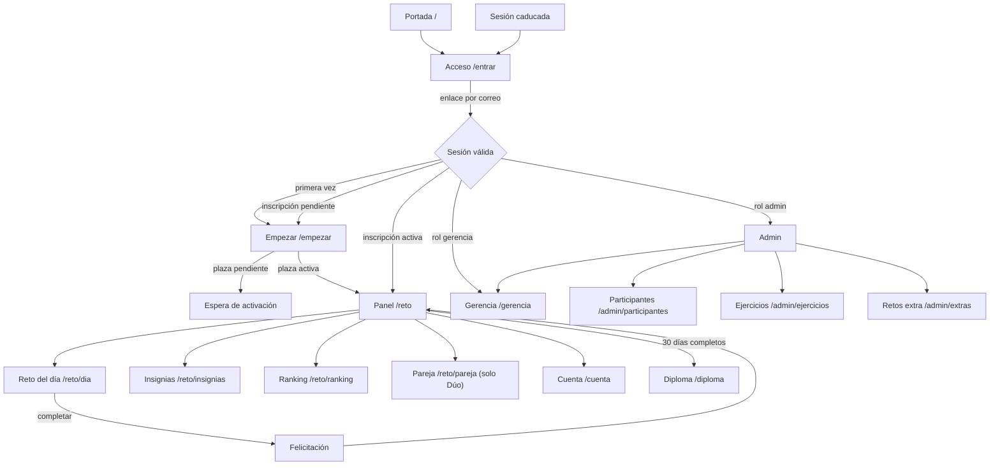
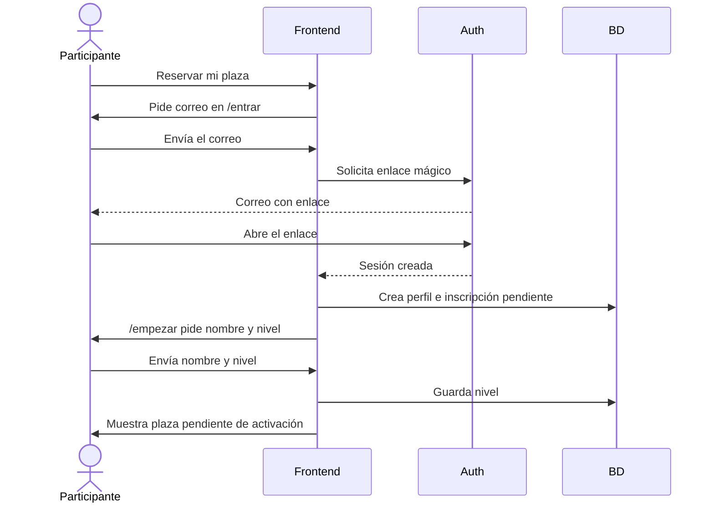
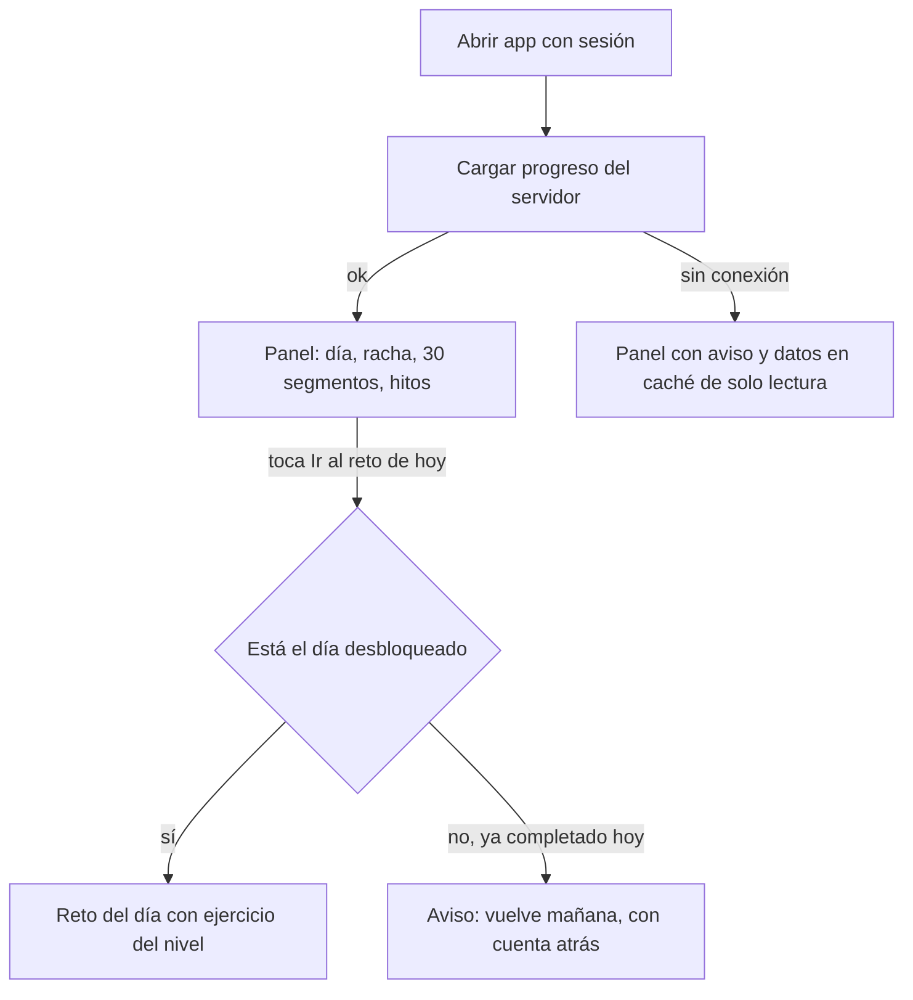
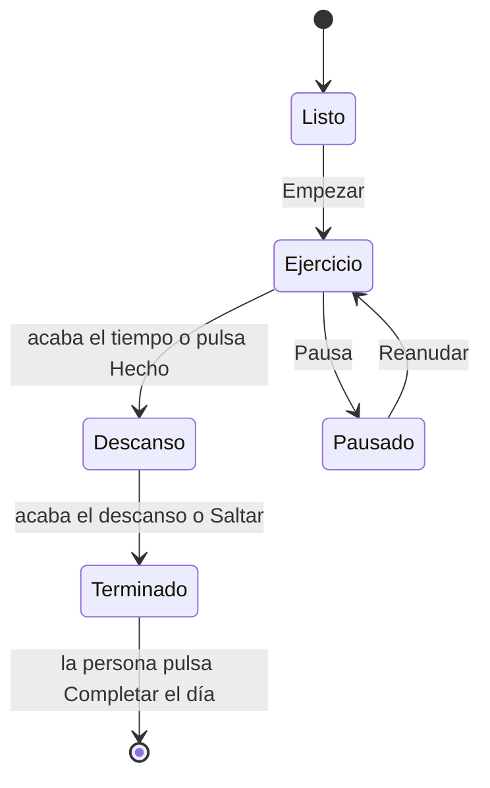
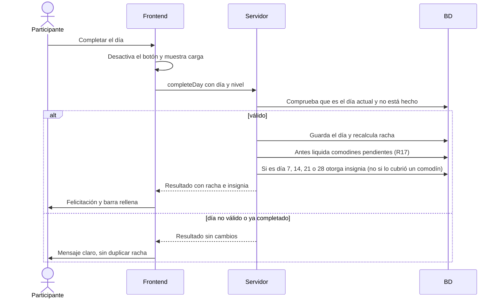
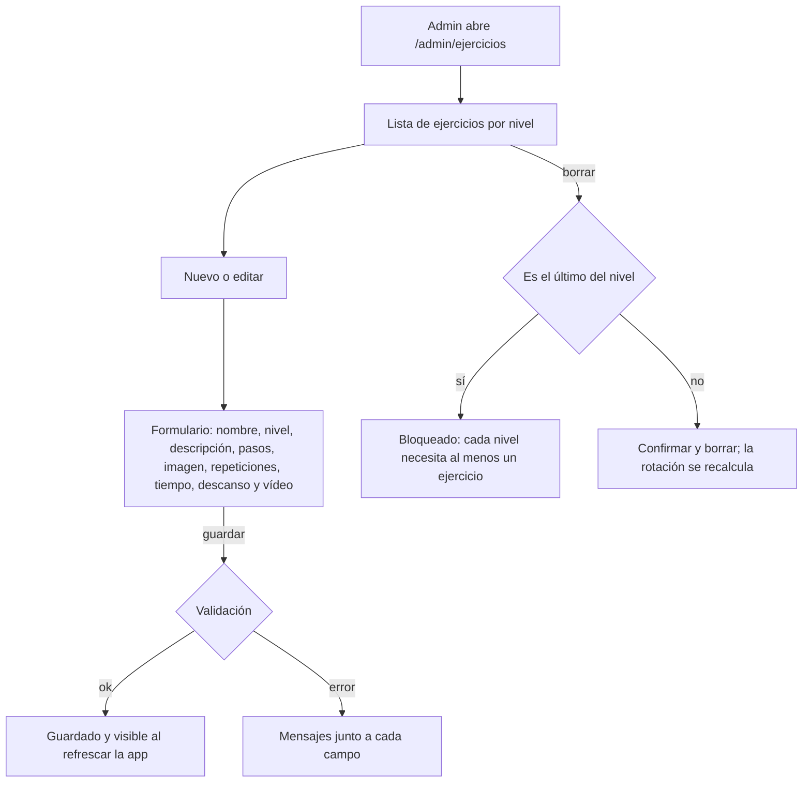

# 4 · AppFlow — RETO 30 (app real)

> [!resumen]
> Cómo se mueve cada rol entre las pantallas de [[3 - UI-UX Design]]: navegación, reglas de comportamiento, flujos por historia, permisos y errores. Es el contrato entre la interfaz y el [[5 - Backend Schema]]. La sección 0 contiene **reglas que el PRD no fijaba y que he decidido yo**: hay que aprobarlas.

> [!resumen]
> **Alcance de la v1 (2026-10-17)**: reglas y flujos nuevos por [[Cambios de diseno - Ranking, comodines, sorteo y Duo]] (R17 a R25; R3, R4, R5, R15 y R16 modificadas). Las reglas nuevas que no dijisteis expresamente van marcadas **(decisión de Claude)** y hay que aprobarlas. Lo que sigue **sin decidir** (merchandising concreto y si el sorteo es en directo o con acta) no bloquea nada.

## 0. Reglas de comportamiento (a aprobar)
| # | Regla | Decisión propuesta | Por qué |
|---|---|---|---|
| R1 | Qué es "el día actual" | El primer día **no completado** del participante, siempre que su fecha de apertura ya haya llegado (ver R2). Solo ese día se puede completar | Mantiene la secuencia y evita saltarse retos |
| R2 | Cuándo se desbloquea el siguiente | El día N+1 se abre el **jornada siguiente** a la que completaste el día N (se abre a las **07:00**, hora de Madrid). Si te saltaste días, el primer día sin completar está disponible **de inmediato** | Impide hacer los 30 días en una noche. Aclara el choque con R1: "hoy" es siempre el primer día sin completar cuyo turno ya ha llegado. Apertura a las 07:00 decidida por Haytham. Una jornada va de 07:00 a 07:00: completar a las 02:00 cuenta para la jornada anterior |
| R3 | Qué es la racha | Jornadas consecutivas (de 07:00 a 07:00) con un día **cumplido**. Un día está cumplido si la persona lo completó o si un **comodín** lo cubrió (R17) | Se entiende a la primera |
| R4 | Qué pasa si falta un día | Si queda un comodín, se gasta solo y el día queda cumplido (R17). Si no queda ninguno, la racha vuelve a 0 y **el progreso no se pierde**: se retoma en el primer día sin completar | Evita abandonar por perder todo; los comodines amortiguan el primer fallo |
| R5 | Cambiar de nivel | **No se puede.** El nivel se elige al empezar (decidido el 2026-10-17) y queda fijo hasta el día 30. Se avisa antes de confirmarlo | Comodines, umbral del sorteo y ranking dependen del nivel; cambiarlo a mitad del reto sería hacer trampa. Sustituye a la regla original que lo permitía (RF-02) |
| R6 | Retos especiales | Días **7, 14, 21 y 28** dan una insignia al completarlos; el día 30 cierra el reto y habilita el diploma | Coincide con las semanas del reto y con la demo |
| R7 | Ejercicio de cada día | Los días de entrenamiento y los especiales toman el ejercicio del nivel por rotación: el n-ésimo día con ejercicio usa el ejercicio `((n − 1) mod total del nivel) + 1`, ordenado por posición | Con 3 ejercicios por nivel el calendario completo funciona (RF-09) |
| R8 | Inscripción | Tras crear la cuenta queda **pendiente**; un admin la pasa a **activa** a mano. Solo las activas acceden al reto | El pago se hace **en efectivo en Factory Training**; la app no gestiona pagos de ningún tipo. El admin activa la plaza cuando el gimnasio confirma el cobro |
| R9 | Quién activa plazas | Admin, desde **`/admin/participantes`** (pantalla nueva, ver §6). `/gerencia` queda de solo lectura | Gerencia no debe ver botones que no puede usar, y el admin necesita su propio menú |
| R10 | Doble pulsación | Completar un día es **idempotente**: pulsar dos veces no duplica la racha | Móvil con conexión lenta |
| R11 | Ejercicio de días ya hechos | Al completar un día se **guarda el ejercicio que se mostró** (copia fija). La rotación (R7) solo se recalcula para días futuros | Si un admin borra o reordena un ejercicio, no cambia lo que ya hizo el participante |
| R12 | Cambios del admin con gente en curso | Antes de borrar, mover de nivel o reordenar un ejercicio se avisa "afecta a N participantes en curso"; el cambio rige **desde el día siguiente** | Evita que el ejercicio de hoy cambie al refrescar |
| R13 | Privacidad hacia gerencia | Por defecto gerencia ve **solo cifras agregadas** y nombre abreviado; el participante acepta en `/empezar` (casilla clara) que gerencia vea su nombre; solo con ese consentimiento se muestra el nombre completo | Datos personales mínimos (PRD §6) |
| R14 | Lenguaje al usuario | Texto llano: "plaza" y no "inscripción", "grupo" y no "cohorte"; sin "caché", "idempotente" ni "enlace mágico" en pantalla (se dice "enlace para entrar") | Hallazgo del cliente simulado |
| R15 | Quién entra en el sorteo (US-11) | Elegible = su **racha más larga** (comodines incluidos) alcanza el umbral de su nivel: **21 días en básico, 26 en medio, 30 en avanzado**, dentro de una fecha límite configurable. Un solo premio y **mismas papeletas** para todos los elegibles. Quien no llega **sigue con el reto y el diploma**. La app **solo identifica a los elegibles**: el sorteo se hace fuera (se anuncia un día y se hace al azar), con bases públicas, y **el dueño de Factory Training avisa al ganador**. El sorteo está **desactivado por defecto**: no se muestra nada ni se anuncia el premio hasta la consulta legal. La racha *más larga* y no la *actual* es **decisión de Claude**: así quien alcanza el umbral y luego falla no lo pierde | Reglas claras y comprobables en servidor; evita gestionar el sorteo dentro de la app y exponerse a un problema legal |
| R16 | Edad mínima y consentimiento retirable (US-01, US-09) | Casilla obligatoria "Soy mayor de 18 años" en `/empezar` (no se guarda la fecha de nacimiento). El consentimiento para gerencia se da en `/empezar` y se puede **dar o retirar en `/cuenta`** con efecto inmediato | RGPD: retirar el consentimiento debe ser tan fácil como darlo; decisión de edad mínima del 2026-10-15 |
| R17 | Comodines (US-12) | **Se ganan** uno por cada 7 días cumplidos en básico y medio (días 7, 14, 21 y 28: 4 en total) y uno por cada 10 en avanzado (días 10, 20 y 30: 3 en total). **Se gastan solos**: cuando acaba una jornada (07:00) sin completar el día siguiente y quedan comodines, se gasta uno, ese día queda cumplido y la racha sigue. Disponibles = ganados − gastados. Un día cubierto con comodín **no da insignia** (R6) ni cuenta como reto extra. Antes del primer día completado y tras el día 30 no se gastan comodines | Decidido el 2026-10-17: «gastar comodín = ese día ya está cumplido». Lo de no dar insignia y no gastarlos antes del primer día es **decisión de Claude** |
| R18 | Ranking por nivel (US-13) | Cada nivel tiene su ranking. Orden: **más racha**, luego **menos comodines gastados** (pesa más), luego **más retos extra cumplidos**. Si siguen empatados, mismo puesto. Fila: nombre de pila + inicial del apellido, racha, comodines gastados y retos extra. El nombre se puede ocultar en `/cuenta` y entonces aparece «Anónimo» con sus cifras. Nunca se ve el correo. Cada persona ve solo el ranking de su nivel | Orden decidido el 2026-10-17. Nombre abreviado y ocultar son **decisión de Claude, aprobada** el 2026-10-17 |
| R19 | Reto extra (US-14) | Hay uno cada 3 días (días 3, 6, 9… 30; 10 en total). Es opcional y no bloquea el día. Se puede marcar «Hecho» desde que se completa ese día hasta el final de esa jornada (07:00). Cuenta para el desempate del ranking. El correo del día avisa. Si el día lo cubrió un comodín no hay reto extra | Decidido: cada 3 días y desempate. La ventana de marcado es **decisión de Claude** |
| R20 | Correo diario (US-16) | A las 07:00 (hora de Madrid) se envía a cada plaza activa con el correo diario activado y que no haya terminado: reto del día, racha, comodines, puesto en el ranking y aviso de reto extra. Antes de enviarlo se liquidan los comodines (R17). Baja desde `/cuenta` y enlace de baja en el correo | Decidido: contenido del correo. Hora 07:00 y baja son **decisión de Claude** (coincide con R2) |
| R21 | Plan Dúo (US-17) | Dos personas, **dos cuentas independientes**: cada una con su nivel, racha, comodines, puesto y papeletas del sorteo. Una crea la pareja y recibe un **código de 6 caracteres**; la otra lo introduce al apuntarse. Los niveles de los dos pueden ser distintos. Se paga una vez (30 €) en efectivo y el admin puede activar a los dos a la vez. La **racha conjunta** cuenta los días seguidos en que ambos tienen el día cumplido y **no cuenta para el sorteo**. Si uno abandona, el otro sigue solo | Decidido: cuentas separadas, ranking separado, pestaña de pareja y racha conjunta. El código de pareja y la regla de abandono son **decisión de Claude** |
| R22 | Cronómetro (US-15) | Cada ejercicio trae repeticiones, tiempo límite y descanso programados por el admin. El cronómetro cuenta el tiempo y el descanso en el navegador. **El día se completa a mano** con «Completar el día»: el cronómetro no registra ni demuestra nada | Decidido: lo programáis vosotros. Marcar a mano es **decisión de Claude, aprobada** el 2026-10-17 |
| R23 | Vídeos (US-18) | Cada ejercicio usa primero el vídeo de la librería de ejercicios; solo si no existe se sube uno propio. Sin vídeo se muestra la imagen o el marco tipográfico | Decidido el 2026-10-17 |
| R24 | Si nadie clasifica | El admin ve a los participantes con la **racha más larga** de todos los niveles; si hay empate, se sortea **al azar entre los empatados** fuera de la app | Decidido el 2026-10-17 |
| R25 | Premio | **50 € + merchandising de Factory Training**, pagado por Haytham y Pedro. Factory Training cobra el 15 % de la facturación total (cualquier plan). Sin fecha de sorteo hasta lanzar la app | Decidido el 2026-10-17 |

### Definiciones de las cifras de gerencia
| Cifra | Significado exacto |
|---|---|
| Inscritos | Personas con cuenta creada |
| Plazas activas | Inscritos con plaza activada por un admin |
| Participan esta semana | Plazas activas que han completado algún día en los **últimos 7 días** |
| Terminaron | Participantes con los 30 días completados |
| Lo han dejado | Plazas activas que llevan más de 7 días sin completar ningún día y no han terminado |
| Pendientes | Inscritos sin plaza activada (solo la ve el admin) |
| En carrera (sorteo) | Plazas activas que aún no alcanzan el umbral de su nivel (21, 26 o 30 días de racha) pero todavía pueden alcanzarlo antes de la fecha límite. Solo existe si el sorteo está activado |
| Elegibles (sorteo) | Participantes cuya racha más larga ya alcanza el umbral de su nivel y antes de la fecha límite. Solo existe si el sorteo está activado |
Cifra principal para gerencia: "N de M participan esta semana (X %)". Es **participación en el reto**, no retención de cuota del gimnasio: eso exige un dato de Factory Training que la app no tiene, y la pantalla lo dice.

## 1. Mapa de navegación

Guardas de ruta (se aplican en el servidor, no solo en el cliente):
- Sin sesión: `/reto`, `/diploma`, `/cuenta`, `/empezar` redirigen a `/entrar`.
- Inscripción pendiente: cualquier ruta del reto redirige a la pantalla de espera dentro de `/empezar`.
- `/admin/*` solo para `admin`; `/gerencia` para `gerencia` y `admin`.
- `/diploma` con menos de 30 días completados muestra el estado bloqueado, no un error.

## 2. Flujos principales (uno por historia clave)
### Flujo 1 — Alta, acceso e inscripción (US-01, US-10)

- Camino feliz: correo → enlace → nombre y nivel → plaza pendiente → (admin activa) → panel.
- Texto de la pantalla tras enviar: "Te hemos enviado un correo. Pulsa el botón que trae para entrar. Mira también en spam." con un botón visible **"No me ha llegado"** (reenviar o cambiar el correo; el reenvío se habilita a los 60 s con contador a la vista).
- **Código de 6 cifras** como alternativa al enlace, para quien lo abre en otro dispositivo. Supabase Auth ofrece código por correo (OTP): **por verificar en la documentación al implementar**.
- Errores: correo mal escrito (mensaje en el campo); enlace caducado o usado ("Pedir otro enlace").
- Enlace abierto en un dispositivo distinto del que lo pidió: la sesión queda en ese dispositivo y se avisa "Has entrado en este dispositivo. ¿Querías entrar en el móvil? Pide otro enlace desde él".
- Plaza **pendiente**: texto "Tu plaza está reservada; el pago se hace en efectivo en Factory Training. Cuando lo hagas, te activan la plaza y te avisamos por correo" y contacto del gimnasio. Al activarla se envía el correo "Tu plaza está activa". Estados de plaza: pendiente · activa · cancelada.
- Edad (R16): casilla obligatoria "Soy mayor de 18 años" en `/empezar`; sin ella no se crea la plaza.
- **Plan (R21)**: tras el nivel, la persona elige **Individual (20 €)** o **Dúo (30 € por pareja)**. En Dúo elige «Crear mi pareja» (se le muestra un código de 6 caracteres para compartir) o «Tengo un código» (lo introduce; errores: «Ese código no existe» o «Ese código ya tiene dos personas»). Cada una queda con su plaza **pendiente**; el admin activa a las dos (a la vez o por separado) cuando Factory Training confirma el cobro único de 30 €. Mientras una de las dos no se ha unido, la otra puede empezar y su pestaña de pareja enseña su código.
- **Nivel (R5)**: antes de confirmar se avisa «El nivel no se puede cambiar una vez empiezas el reto».
- Fin: el participante ve su estado en cualquier momento al volver a entrar.

### Flujo 2 — Elegir el nivel (US-02)
- En `/empezar` primero una pregunta: "¿Cuántas veces haces deporte a la semana?" (0–1, 2–3, 4 o más), que **preselecciona** Básico, Medio o Avanzado; luego se puede cambiar **antes de confirmar**. Cada nivel lleva un ejemplo concreto ("Básico: 10 minutos, sin material"), se explica qué significan los rayos y cuántos comodines da y cuántos días de racha dan acceso al sorteo.
- **Una vez confirmado, el nivel no se cambia** (R5): en `/cuenta` se muestra sin opción de edición.
- Error: fallo al guardar → la plaza no se crea y se muestra el motivo.
- En `/cuenta` se puede **dar o retirar el consentimiento** para que gerencia vea el nombre completo, con efecto inmediato (R16), y **ocultar el nombre en el ranking** (R18) y **dar de baja el correo diario** (R20).

### Flujo 3 — Panel y reto del día (US-03, US-04)

- El reto muestra por qué, ejercicio, cómo y consejo. Si no hay ejercicio cargado para el nivel, se muestra el marco tipográfico con el nombre (nunca un hueco vacío).
- Un día futuro abierto por URL muestra "bloqueado" con la fecha en que se desbloquea.
- Tras completar un día, el panel dice "El día N+1 se abre a las 07:00" con cuenta atrás.
- Si la racha vuelve a 0 por un día perdido, el panel lo explica: "Racha a 0. Tu progreso sigue: vas por el día X de 30". El texto "empieza hoy" solo aparece cuando aún no hay ningún día hecho.
- **Sorteo** (US-11, solo si está activado, R15): el panel muestra "Sigues en carrera para el sorteo: te faltan N días de racha" con enlace a las bases, "Ya cumples la racha del sorteo" cuando la racha más larga alcanza el umbral, y "Fuera del sorteo: sigues con el reto y el diploma" si ya no se puede llegar. Con el sorteo desactivado no aparece nada.
- **Comodines** (R17): el panel muestra los comodines disponibles y gastados. Si se gastó uno al abrir la app, aparece «Se ha gastado un comodín: tu racha sigue» y el día queda marcado como cubierto. Con 0 comodines y un fallo: «Racha a 0. Tu progreso sigue».
- **Ranking** (R18): tarjeta «Tu puesto: N en tu nivel» con enlace a `/reto/ranking`.
- **Pareja** (R21, solo Dúo): tarjeta con el estado de la pareja y enlace a `/reto/pareja`.

### Flujo 3b — Hacer el ejercicio con cronómetro (US-15, US-18, US-14)

- El reto del día muestra el vídeo del ejercicio (R23), el cronómetro con las repeticiones, el tiempo límite y el descanso del ejercicio (R22) y, los días 3, 6, 9… 30, la tarjeta opcional del reto extra (R19).
- El cronómetro funciona en el navegador sin conexión una vez cargado el reto. Avisa con sonido, vibración y texto (no solo sonido) y no apaga la pantalla (Wake Lock, si el navegador lo permite).
- Terminar el cronómetro **no completa** el día: la persona pulsa «Completar el día» (R22). Si no hay tiempo programado para el ejercicio, el cronómetro no aparece.
- Reto extra: pulsar «Hecho» llama a `complete_extra` y solo funciona desde que se completa ese día hasta el final de la jornada (R19); fuera de ventana: «El reto extra de este día ya ha pasado».

### Flujo 4 — Completar el día (US-05, US-06)

- Error de red: el botón vuelve a activarse con "No se pudo guardar, inténtalo otra vez"; si el guardado llegó al servidor pero la respuesta no volvió, al reintentar el servidor responde "ya completado" y la pantalla se corrige (R10).
- El día 30 completado enseña la felicitación final y un acceso al diploma.

### Flujo 5 — Diploma (US-07)
Participante con 30 días → `/diploma` comprueba en servidor los 30 días → **vista previa con el nombre editable** (por si lo escribió mal) → botón "Guardar imagen" (en el móvil se guarda en Fotos) y "Compartir". El día 30 respeta R2 como cualquier otro. Con menos días: estado bloqueado con "te faltan N días". Error al generar la imagen: "No se pudo crear el diploma, inténtalo otra vez". Si la persona es elegible y el sorteo está activado, además se muestra "Entras en el sorteo" con el enlace a las bases (US-11).

### Flujo 5b — Ranking, pareja y correo diario (US-13, US-17, US-16)
- **Ranking** (`/reto/ranking`): lista de mi nivel con la regla de orden a la vista (R18); mi fila resaltada. Si he ocultado mi nombre aparezco como «Anónimo» para los demás pero veo mi fila resaltada.
- **Pareja** (`/reto/pareja`, solo Dúo): racha de la otra persona, si ya ha hecho el reto de hoy, comodines que le quedan y la **racha conjunta** (R21), con la frase «No cuenta para el sorteo». Si la pareja aún no se ha unido, muestra mi código. Si ha abandonado (sin actividad 7 días), lo dice con tono neutro y la racha conjunta queda parada.
- **Correo diario** (R20): lo lanza una tarea programada a las 07:00 (Madrid); primero liquida comodines y luego envía. Contenido: reto del día, racha, comodines, puesto y aviso de reto extra. Enlace de baja en cada correo.

### Flujo 6 — Admin edita ejercicios (US-08)

- Orden de los ejercicios dentro de un nivel editable (determina la rotación, R7).
- **Cronómetro y vídeo**: cada ejercicio lleva repeticiones, tiempo límite (segundos), descanso (segundos) y vídeo (R22, R23). El formulario pide primero el enlace del vídeo de la librería; solo si el ejercicio no existe ahí permite subir uno propio. Sin vídeo, el ejercicio se guarda igual y queda marcado «sin vídeo».
- **Retos extra** (`/admin/extras`): los 10 retos extra (días 3, 6, … 30) se escriben y editan como los ejercicios; un día sin extra cargado no muestra la tarjeta.
- Imagen: JPG, PNG o WebP de hasta 2 MB, con vista previa antes de guardar. Si la subida falla, el ejercicio se guarda **sin imagen**, queda marcado "sin imagen" en la lista y ofrece "Reintentar subida" (no se da por terminado).
- Antes de borrar, mover de nivel o reordenar: diálogo "Esto afecta a N participantes en curso. El cambio vale desde mañana" (R12). Los días ya completados no cambian (R11).
- **Vista previa**: botón "Ver como participante" en el detalle, con selector de nivel y día, para comprobar el resultado sin cuenta de prueba (el admin no completa días).

### Flujo 7 — Gerencia y activación de plazas (US-09, US-10)
**Gerencia** (`/gerencia`, solo lectura): cifra principal "N de M participan esta semana (X %)", más Inscritos, Terminaron y Lo han dejado según las definiciones de §0 y la frase "mide participación en el reto, no la permanencia de socios en el gimnasio". Sin consentimiento del participante solo ve cifras y nombre abreviado (R13); nunca correos.

**Admin** (`/admin/participantes`): lista con filtro por defecto "Pendientes primero", KPI "Pendientes" destacada en lima y la acción "Activar plaza" (también "Cancelar plaza"). Cada alta nueva envía un aviso por correo al admin y cada activación envía el correo "Tu plaza está activa" al participante. El participante accede al reto al recargar la pantalla de espera.

**Sorteo** (US-11): el admin ve en `/admin/participantes` el filtro "Elegibles al sorteo" y un interruptor para **activar el sorteo** con su fecha límite (desactivado por defecto, R15). Gerencia solo ve las cifras "en carrera" y "elegibles", no la lista. La app no extrae al ganador: el admin exporta o copia la lista y el sorteo se hace fuera, conforme a las bases. Si no hay ningún elegible, la lista muestra a los de mayor racha con la etiqueta «Nadie ha clasificado» (R24); los empates se sortean al azar fuera. El dueño de Factory Training avisa al ganador (R15).

**Plan Dúo** (R21): en la ficha de un participante Dúo el admin ve a su pareja y puede «Activar a la pareja entera» o «Cancelar a la pareja entera».

## 3. Permisos por rol
| Pantalla / acción | Participante activo | Participante pendiente | Gerencia | Admin | Anónimo |
|---|---|---|---|---|---|
| Portada, acceso | sí | sí | sí | sí | sí |
| `/empezar` (nombre, nivel) | sí | sí | — | — | no |
| Panel, reto, insignias, diploma, cuenta | sí | no (espera) | no | no | no |
| Completar día | sí | no | no | no | no |
| `/gerencia` (lectura) | no | no | sí | sí | no |
| Activar o cancelar plaza (`/admin/participantes`) | no | no | no | sí | no |
| Ver nombre completo de participantes en `/gerencia` | no | no | solo con consentimiento del participante | sí | no |
| Ver su propio estado en el sorteo (si está activado) | sí | no | — | — | no |
| Ver cifras "en carrera" y "elegibles" | no | no | sí | sí | no |
| Ver la lista de elegibles y activar o desactivar el sorteo | no | no | no | sí | no |
| Dar o retirar el consentimiento para gerencia (`/cuenta`) | sí | sí | — | — | no |
| Ver el ranking de mi nivel (`/reto/ranking`) | sí | no | no | sí (lectura) | no |
| Ocultar mi nombre en el ranking y dar de baja el correo diario (`/cuenta`) | sí | sí | — | — | no |
| Ver la pestaña de pareja (`/reto/pareja`) | sí, solo si es Dúo | no | no | no | no |
| Marcar un reto extra como hecho | sí | no | no | no | no |
| Editar retos extra (`/admin/extras`) | no | no | no | sí | no |
| Activar o cancelar a la pareja entera | no | no | no | sí | no |
| Ver la lista de candidatos al sorteo, también si nadie clasifica | no | no | no | sí | no |
| `/admin/ejercicios` (escritura) | no | no | no | sí | no |
| Borrar mi cuenta | sí | sí | — | — | no |

## 4. Estados globales
- **Carga inicial**: esqueleto de la pantalla (no pantalla en blanco).
- **Sesión caducada**: mensaje y redirección a `/entrar` conservando la ruta de destino.
- **Sin conexión**: aviso fijo; el panel muestra el último estado conocido en solo lectura; completar el día queda deshabilitado con el motivo.
- **Vacío**: cada pantalla tiene el suyo (ver §3 de [[3 - UI-UX Design]]).
- **Error 500**: pantalla con acción de reintentar y contacto de soporte.
- **Día 30 completado**: modo "reto superado" en el panel con acceso al diploma.

## 5. Cliente simulado
Un agente por rol recorre los flujos solo con lo que ve en pantalla e informa dónde se atascaría.
- Prompt base: "Eres <rol> (<perfil: edad, nivel digital, dispositivo>). Recorre el flujo X solo con lo que ve en pantalla. Di en cada paso qué esperas, qué te confunde y dónde abandonarías."
| Rol simulado | Flujo | Atascos detectados | Cambio aplicado |
|---|---|---|---|
| Marta, 48 años, poca soltura digital, iPhone | 1 alta · 2 nivel · 3 panel · 4 completar y racha · 5 diploma | Cobro invisible (cree que ya pagó o que le cobrarán a traición); "enlace mágico" incomprensible y sin salida si no llega; enlace abierto en otro dispositivo sin aviso; plaza pendiente sin aviso de activación; niveles sin criterio; desbloqueo de medianoche sin explicar; racha 0 sin contexto; R1 y R2 se contradecían; diploma sin vista previa; vocabulario técnico | Aplicados: texto de plaza y pago, "No me ha llegado" + código de 6 cifras, aviso de dispositivo, correo de activación, pregunta de frecuencia, mensaje de apertura y de racha, R1/R2 aclaradas, vista previa del diploma, R14. Pendiente de decidir: forma de pago y hora de apertura (§8) |
| Pedro (admin) y la dueña del gimnasio (gerencia) | 6 ejercicios · 7 gerencia y activación | Admin sin aviso de plazas pendientes; activar plaza desde la vista de gerencia mezclaba roles; imagen sin límites ni vista previa; borrar o reordenar cambiaba el ejercicio de hoy de personas en curso; sin forma de comprobar el cambio; "activo" y "finalizado" sin definir; privacidad de socios hacia gerencia | Aplicados: `/admin/participantes` con KPI y avisos, límites e imagen con reintento, copia fija del ejercicio hecho (R11) y diálogo de impacto (R12), "Ver como participante", definiciones de cifras, privacidad por consentimiento (R13). Descartados por exceso de alcance en v1: semáforo de retención y botón de compartir resumen |

## 6. Huecos detectados al escribir este flujo
- **Falta la pantalla 13, `/admin/participantes`** (activar y cancelar plazas) en el [[3 - UI-UX Design]] aprobado. Es una pantalla nueva: **necesito tu permiso para añadirla** (lista + detalle con la tabla de participantes). El menú de admin pasa a tener Participantes y Ejercicios.
- Faltan en el UI/UX los estados "plaza pendiente / cancelada" dentro de `/empezar` y la casilla de consentimiento (R13).
- El correo transaccional (aviso de alta al admin y correo "plaza activa") hace que **Resend o un SMTP propio deje de ser opcional**: afecta al [[2 - TRD]] aprobado (§1.1 lo marca opcional).

**Huecos detectados (resueltos en los otros documentos, 2026-10-17)**: pantallas 14 (ranking), 15 (pareja) y 16 (retos extra) añadidas al [[3 - UI-UX Design]]; correo diario y proveedor de correo obligatorio en el [[2 - TRD]]; tablas y funciones nuevas en el [[5 - Backend Schema]]; tareas T-41 a T-52 en el [[6 - Plan de Implementacion]].

## 7. Ciclo completo a validar
- [ ] Crear: alta con enlace mágico → nombre y nivel → plaza pendiente → activar → completar el día 1
- [ ] Refrescar: racha y día siguen igual tras recargar y desde otro dispositivo
- [ ] Editar: cambiar un ejercicio en admin y verlo en el reto tras refrescar; cambiar de nivel
- [ ] Borrar: borrar mi cuenta elimina perfil, inscripción, progreso e insignias (cascada)
- [ ] Refrescar: tras borrar, el correo ya no accede al progreso anterior
- [ ] Comodines: dejar pasar una jornada con un comodín disponible → el día queda cubierto, la racha sigue y el contador baja; con 0 comodines → racha 0 y progreso intacto; refrescar y comprobar que no se vuelve a gastar
- [ ] Dúo: crear pareja → unirse con el código → activar a las dos → ver la racha del otro → borrar la cuenta de una y comprobar que la otra sigue
- [ ] Ranking: dos personas del mismo nivel con la misma racha se ordenan por menos comodines y luego por más retos extra; ocultar el nombre muestra «Anónimo»
- [ ] Correo diario: llega a las 07:00 con las cifras correctas, la baja funciona y refrescar no reenvía
- [ ] Todo lo anterior en producción, no solo en local

## 8. Decisiones
**Resueltas por Haytham (2026-10-15)**
1. **Sorteo**: la app solo identifica a los elegibles; el sorteo se hace fuera con bases públicas y **tras la consulta legal previa** (R15). Premio igual al 25 % del beneficio (decidido el 2026-10-16, sobre el beneficio y no sobre los ingresos; unos 118,50 € con 30 personas) entre quienes completen los 30 días sin fallar.
2. **Precio**: 20 € por plaza.
3. **Hosting**: Supabase en plan gratuito con copias de seguridad semanales a mano; Vercel Pro solo durante el mes del reto.
4. **Edad mínima**: 18 años, con casilla obligatoria (R16).
5. **Titular legal**: Haytham.

**Alcance de la v1 (2026-10-17)**: el premio pasa a **50 € + merchandising**, pagado por Haytham y Pedro (R25); ya no hay fórmula del beneficio. El sorteo se anuncia un día y se hace al azar; el dueño de Factory Training avisa al ganador. El texto de arriba sobre el 25 % del beneficio queda **sustituido**.

**Abiertas**: merchandising concreto, si el sorteo es en directo o con acta (depende de la consulta legal), fecha límite y fecha del sorteo (no se fijan hasta lanzar la app) y la respuesta de la consulta legal.

**Resueltas por Haytham (2026-10-14)**
1. **Pago**: en efectivo en Factory Training. La app no gestiona ningún pago.
2. **Apertura del día siguiente**: a las 07:00 (hora de Madrid); una jornada va de 07:00 a 07:00.
3. **Cifra "participan esta semana"**: personas que completaron algún día en los últimos 7 días (se renombró para que se entienda; el umbral de 7 días sigue como propuesta).
4. **Consentimiento**: los participantes lo dan en la app con una casilla en `/empezar`.

**Cambios en documentos aprobados que esas decisiones provocaban (aplicados el 2026-10-14 con tu aprobación)**
- [[1 - PRD]]: US-10 y RF-11 hablan de "pagar" y de "pantalla preparada para un pago"; pasarían a "reservar plaza, pago en efectivo en el gimnasio".
- [[3 - UI-UX Design]]: el slot F de la portada muestra "15–20 € (valor por confirmar)" y un botón de reserva; añadir pantalla 13 `/admin/participantes`, los estados de plaza y la casilla de consentimiento.
- [[2 - TRD]]: la fila de Stripe y n8n sobra; el correo transaccional pasa de opcional a obligatorio.

---
Anterior: [[3 - UI-UX Design]] · Siguiente: [[5 - Backend Schema]]
