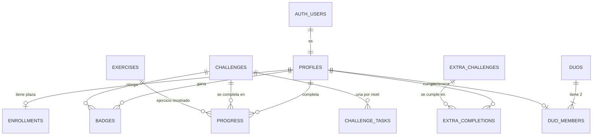

# 5 · Backend Schema — RETO 30 (app real)

> [!resumen]
> Modelo de datos y API que sostienen los flujos del [[4 - AppFlow]], sobre Supabase Postgres ([[2 - TRD]]). **No existe aún ningún proyecto Supabase de Reto 30** (la cuenta tiene "Constructora" y "BarberDF", que no son de este proyecto), así que el esquema es nuevo y no hay nada remoto que verificar. Las escrituras sensibles pasan por funciones del servidor (`security definer`); las tablas solo se pueden leer.

> [!riesgo]
> **Alcance de la v1 (2026-10-17)**: tablas, funciones y permisos nuevos por [[Cambios de diseno - Ranking, comodines, sorteo y Duo]] (comodines, ranking, reto extra, cronómetro y vídeo, correo diario, plan Dúo y sorteo por umbrales). **El SQL final está escrito pero NO ejecutado**: el arnés de PGlite (47 comprobaciones) era de la v1 y hay que adaptarlo y ampliarlo (nivel `basico`, sin `set_my_level`, sorteo por umbrales, comodines, ranking, Dúo y correo diario) antes de aplicar nada (T-09 y T-47 del [[6 - Plan de Implementacion]]). Cambio de nombre del nivel: `facil` pasa a `basico`.

## 1. Diagrama entidad-relación


## 2. SQL ejecutable
Los bloques `sql` se concatenan en la migración y el bloque `sql seed` en la semilla con `schema_to_migration.py`. Toda clave foránea lleva `ON DELETE`. **El esquema final se probó el 2026-10-18 en un Postgres local (PGlite) con sustitutos de `auth` y `storage`: 102 comprobaciones correctas** (reglas del AppFlow, permisos por rol, idempotencia, rotación de ejercicios, racha, comodines, ranking, reto extra, Dúo, sorteo por umbrales, correo diario, mayoría de edad, consentimiento y borrado en cascada). Todavía no se ha aplicado a Supabase real, y las sesiones reales de Supabase Auth (`auth.uid()`) y el bucket de Storage solo están simulados. El arnés vive en el repositorio de la app: `supabase/tests/schema-harness.mjs` (`npm run db:test`).

Tipos y tablas:
```sql
create type public.app_role as enum ('participante', 'gerencia', 'admin');
create type public.level as enum ('basico', 'medio', 'avanzado'); -- antes 'facil'
create type public.plan_type as enum ('individual', 'duo');
create type public.enrollment_status as enum ('pendiente', 'activa', 'cancelada');
create type public.challenge_category as enum (
  'entrenamiento', 'movilidad', 'actividad', 'recuperacion', 'alimentacion', 'hidratacion', 'especial'
);

create table public.profiles (
  id uuid primary key references auth.users(id) on delete cascade,
  display_name text not null check (char_length(display_name) between 1 and 80),
  role public.app_role not null default 'participante',
  consent_management boolean not null default false,
  consent_at timestamptz,
  adult_confirmed_at timestamptz,
  ranking_hidden boolean not null default false, -- «Anónimo» en el ranking (R18)
  daily_email boolean not null default true, -- correo diario (R20); false = baja
  last_digest_on date, -- jornada del último correo diario enviado (evita reenvíos)
  created_at timestamptz not null default now()
);

create table public.enrollments (
  user_id uuid primary key references public.profiles(id) on delete cascade,
  level public.level not null, -- fijo; no hay función ni permiso para cambiarlo (R5)
  plan public.plan_type not null default 'individual',
  weekly_frequency smallint check (weekly_frequency between 0 and 7),
  status public.enrollment_status not null default 'pendiente',
  created_at timestamptz not null default now(),
  activated_at timestamptz,
  activated_by uuid references public.profiles(id) on delete set null,
  canceled_at timestamptz
);

-- plan Dúo. Una pareja = dos filas en duo_members con el mismo duo_id (R21).
create table public.duos (
  id uuid primary key default gen_random_uuid(),
  code text not null unique check (code ~ '^[A-Z0-9]{6}$'),
  created_by uuid references public.profiles(id) on delete set null,
  created_at timestamptz not null default now()
);

create table public.duo_members (
  user_id uuid primary key references public.profiles(id) on delete cascade,
  duo_id uuid not null references public.duos(id) on delete cascade,
  joined_at timestamptz not null default now()
);
create index duo_members_duo_idx on public.duo_members (duo_id);

create table public.challenges (
  day smallint primary key check (day between 1 and 30),
  category public.challenge_category not null,
  title text not null,
  why text not null,
  how text[] not null default '{}',
  tip text not null,
  special_name text,
  has_exercise boolean not null default false
);

create table public.challenge_tasks (
  day smallint not null references public.challenges(day) on delete cascade,
  level public.level not null,
  task text not null,
  primary key (day, level)
);

create table public.exercises (
  id uuid primary key default gen_random_uuid(),
  level public.level not null,
  position smallint not null default 0,
  name text not null check (char_length(name) between 1 and 80),
  description text not null default '',
  steps text[] not null default '{}',
  image_path text,
  reps smallint check (reps between 1 and 500), -- repeticiones (nulo si es un ejercicio de mantener)
  time_limit_seconds integer check (time_limit_seconds between 1 and 3600), -- tiempo para hacerlo (o de mantener)
  rest_seconds integer check (rest_seconds between 0 and 600), -- descanso al terminar
  video_url text, -- enlace del vídeo de la librería o ruta en el bucket exercise-videos
  video_source text check (video_source in ('libreria', 'propio')),
  created_at timestamptz not null default now(),
  updated_at timestamptz not null default now()
);

create table public.progress (
  user_id uuid not null references public.profiles(id) on delete cascade,
  day smallint not null references public.challenges(day) on delete restrict,
  jornada date not null,
  completed_at timestamptz not null default now(),
  level public.level not null,
  exercise_id uuid references public.exercises(id) on delete set null,
  exercise_name text,
  wildcard boolean not null default false, -- día cubierto con un comodín (R17), sin ejercicio ni insignia
  primary key (user_id, day)
);
create index progress_user_jornada_idx on public.progress (user_id, jornada);

create table public.badges (
  user_id uuid not null references public.profiles(id) on delete cascade,
  day smallint not null check (day in (7, 14, 21, 28)) references public.challenges(day) on delete restrict,
  awarded_at timestamptz not null default now(),
  primary key (user_id, day)
);

-- reto extra opcional cada 3 días (R19). El contenido lo escribe el admin.
create table public.extra_challenges (
  day smallint primary key check (day in (3, 6, 9, 12, 15, 18, 21, 24, 27, 30)) references public.challenges(day) on delete restrict,
  title text not null check (char_length(title) between 1 and 120),
  description text not null default ''
);

create table public.extra_completions (
  user_id uuid not null references public.profiles(id) on delete cascade,
  day smallint not null references public.extra_challenges(day) on delete restrict,
  completed_at timestamptz not null default now(),
  primary key (user_id, day)
);

-- Ajustes del reto: una sola fila. El sorteo está desactivado por defecto (R15).
create table public.reto_settings (
  id boolean primary key default true check (id),
  lottery_enabled boolean not null default false,
  lottery_deadline date
);
insert into public.reto_settings (id) values (true) on conflict (id) do nothing;
```

Funciones (reglas del AppFlow R1–R14 en el servidor):
```sql
create or replace function public.set_updated_at() returns trigger
language plpgsql as $$
begin
  new.updated_at := now();
  return new;
end $$;

create trigger exercises_set_updated_at before update on public.exercises
for each row execute function public.set_updated_at();

-- Jornada de reto: va de 07:00 a 07:00 hora de Madrid (R2).
create or replace function public.current_jornada() returns date
language sql stable as $$
  select ((now() at time zone 'Europe/Madrid') - interval '7 hours')::date
$$;

create or replace function public.has_role(p_roles public.app_role[]) returns boolean
language sql stable security definer set search_path = public as $$
  select exists (select 1 from public.profiles where id = auth.uid() and role = any(p_roles))
$$;

-- Racha: jornadas consecutivas; vale solo si la última es de hoy o de ayer (R3, R4).
create or replace function public.reto_streak(p_user uuid) returns int
language sql stable as $$
  with j as (select distinct jornada from public.progress where user_id = p_user),
  g as (select jornada, jornada - (row_number() over (order by jornada))::int as grp from j),
  last_run as (
    select count(*) as n, max(jornada) as last_j from g group by grp order by max(jornada) desc limit 1
  )
  select case
    when exists (select 1 from last_run where last_j >= public.current_jornada() - 1)
    then (select n from last_run) else 0 end::int
$$;

-- racha más larga alcanzada (para el umbral del sorteo, R15).
create or replace function public.reto_best_streak(p_user uuid) returns int
language sql stable as $$
  with j as (select distinct jornada from public.progress where user_id = p_user),
  g as (select jornada, jornada - (row_number() over (order by jornada))::int as grp from j)
  select coalesce(max(n), 0)::int from (select count(*) as n from g group by grp) t
$$;

-- un comodín cada 7 días cumplidos (básico y medio) o cada 10 (avanzado) (R17).
create or replace function public.wildcard_interval(p_level public.level) returns int
language sql immutable as $$
  select case when p_level = 'avanzado' then 10 else 7 end
$$;

-- racha mínima para entrar en el sorteo según el nivel (R15).
create or replace function public.level_threshold(p_level public.level) returns int
language sql immutable as $$
  select case p_level when 'basico' then 21 when 'medio' then 26 else 30 end
$$;

-- comodines disponibles = ganados - gastados (R17).
create or replace function public.wildcards_available(p_user uuid) returns int
language sql stable as $$
  select greatest(0,
    (select count(*)::int from public.progress p where p.user_id = p_user)
      / public.wildcard_interval((select e.level from public.enrollments e where e.user_id = p_user))
    - (select count(*)::int from public.progress p where p.user_id = p_user and p.wildcard))
$$;

-- gasta un comodín por cada jornada ya terminada sin completar, mientras queden (R17).
-- Cada comodín cubre el primer día sin completar. No se gasta antes del primer día hecho ni tras el día 30.
-- Solo la llaman otras funciones y el servidor (no se concede a authenticated).
create or replace function public.settle_wildcards(p_user uuid) returns int
language plpgsql security definer set search_path = public as $$
declare
  v_today date := public.current_jornada();
  v_level public.level;
  v_status public.enrollment_status;
  v_last date;
  v_n int;
  v_next int;
  v_spent int := 0;
begin
  perform pg_advisory_xact_lock(hashtext(p_user::text));
  select level, status into v_level, v_status from public.enrollments where user_id = p_user;
  if not found or v_status <> 'activa' then return 0; end if;
  loop
    select max(jornada), count(*)::int into v_last, v_n from public.progress where user_id = p_user;
    exit when v_last is null or v_n >= 30;
    exit when v_last + 1 >= v_today;
    exit when public.wildcards_available(p_user) <= 0;
    select coalesce(min(c.day), 31) into v_next from public.challenges c
    where not exists (select 1 from public.progress p where p.user_id = p_user and p.day = c.day);
    exit when v_next = 31;
    insert into public.progress (user_id, day, jornada, level, wildcard)
    values (p_user, v_next, v_last + 1, v_level, true);
    v_spent := v_spent + 1;
  end loop;
  return v_spent;
end $$;

-- liquidar los comodines del propio participante al abrir la app.
create or replace function public.settle_my_wildcards() returns int
language plpgsql security definer set search_path = public as $$
begin
  if auth.uid() is null then raise exception 'no_session' using errcode = '28000'; end if;
  return public.settle_wildcards(auth.uid());
end $$;

-- liquidar a todos antes del correo diario (solo servidor).
create or replace function public.settle_all_wildcards() returns int
language plpgsql security definer set search_path = public as $$
declare
  v_row record;
  v_total int := 0;
begin
  for v_row in select user_id from public.enrollments where status = 'activa' loop
    v_total := v_total + public.settle_wildcards(v_row.user_id);
  end loop;
  return v_total;
end $$;

create or replace function public.join_reto(
  p_name text, p_adult boolean, p_consent boolean, p_frequency smallint, p_level public.level
) returns public.enrollment_status
language plpgsql security definer set search_path = public as $$
declare
  v_uid uuid := auth.uid();
  v_status public.enrollment_status;
begin
  if v_uid is null then raise exception 'no_session' using errcode = '28000'; end if;
  if not coalesce(p_adult, false) then
    raise exception 'menor_de_edad' using errcode = '22023';
  end if;
  insert into public.profiles (id, display_name, consent_management, consent_at, adult_confirmed_at)
  values (v_uid, trim(p_name), coalesce(p_consent, false), case when p_consent then now() end, now())
  on conflict (id) do update set
    display_name = excluded.display_name,
    adult_confirmed_at = coalesce(public.profiles.adult_confirmed_at, excluded.adult_confirmed_at),
    consent_management = excluded.consent_management,
    consent_at = case
      when excluded.consent_management and not public.profiles.consent_management then now()
      when not excluded.consent_management then null
      else public.profiles.consent_at end;
  insert into public.enrollments (user_id, level, weekly_frequency)
  values (v_uid, p_level, p_frequency)
  on conflict (user_id) do nothing;
  select status into v_status from public.enrollments where user_id = v_uid;
  return v_status;
end $$;

-- set_my_level se elimina: el nivel queda fijo durante todo el reto (R5).

create or replace function public.admin_set_enrollment_status(p_user uuid, p_status public.enrollment_status)
returns void
language plpgsql security definer set search_path = public as $$
begin
  if not public.has_role(array['admin']::public.app_role[]) then
    raise exception 'forbidden' using errcode = '42501';
  end if;
  update public.enrollments set
    status = p_status,
    activated_at = case when p_status = 'activa' then now() else activated_at end,
    activated_by = case when p_status = 'activa' then auth.uid() else activated_by end,
    canceled_at = case when p_status = 'cancelada' then now() else null end
  where user_id = p_user;
  if not found then raise exception 'sin_inscripcion'; end if;
end $$;

-- Completar el día: idempotente (R10), guarda el ejercicio mostrado (R11), da insignia en 7, 14, 21 y 28 (R6).
create or replace function public.complete_day(p_day smallint) returns jsonb
language plpgsql security definer set search_path = public as $$
declare
  v_uid uuid := auth.uid();
  v_enr public.enrollments%rowtype;
  v_next int;
  v_last date;
  v_today date := public.current_jornada();
  v_n int;
  v_total int;
  v_ex public.exercises%rowtype;
  v_badge boolean := false;
begin
  if v_uid is null then raise exception 'no_session' using errcode = '28000'; end if;
  perform pg_advisory_xact_lock(hashtext(v_uid::text));

  select * into v_enr from public.enrollments where user_id = v_uid;
  if not found or v_enr.status <> 'activa' then
    return jsonb_build_object('status', 'sin_plaza');
  end if;

  -- antes de nada, gastar los comodines de las jornadas ya terminadas (R17).
  perform public.settle_wildcards(v_uid);

  if exists (select 1 from public.progress where user_id = v_uid and day = p_day) then
    return jsonb_build_object('status', 'ya_completado', 'streak', public.reto_streak(v_uid));
  end if;

  select coalesce(min(c.day), 31) into v_next from public.challenges c
  where not exists (select 1 from public.progress p where p.user_id = v_uid and p.day = c.day);
  if v_next = 31 or p_day <> v_next then
    return jsonb_build_object('status', 'no_toca');
  end if;

  select max(jornada) into v_last from public.progress where user_id = v_uid;
  if v_last is not null and v_last >= v_today then
    return jsonb_build_object('status', 'vuelve_manana');
  end if;

  if (select has_exercise from public.challenges where day = p_day) then
    select count(*) into v_n from public.challenges where day <= p_day and has_exercise;
    select count(*) into v_total from public.exercises where level = v_enr.level;
    if v_total > 0 then
      select * into v_ex from public.exercises where level = v_enr.level
      order by position, id offset ((v_n - 1) % v_total) limit 1;
    end if;
  end if;

  insert into public.progress (user_id, day, jornada, level, exercise_id, exercise_name)
  values (v_uid, p_day, v_today, v_enr.level, v_ex.id, v_ex.name)
  on conflict (user_id, day) do nothing;

  if p_day in (7, 14, 21, 28) then
    insert into public.badges (user_id, day) values (v_uid, p_day) on conflict (user_id, day) do nothing;
    v_badge := true;
  end if;

  return jsonb_build_object(
    'status', 'ok', 'streak', public.reto_streak(v_uid), 'badge', v_badge, 'finished', p_day = 30,
    'wildcards', public.wildcards_available(v_uid)
  );
end $$;

-- Dar o retirar el consentimiento para que gerencia vea el nombre completo (R16).
create or replace function public.set_my_consent(p_consent boolean) returns void
language plpgsql security definer set search_path = public as $$
begin
  if auth.uid() is null then raise exception 'no_session' using errcode = '28000'; end if;
  update public.profiles set
    consent_management = coalesce(p_consent, false),
    consent_at = case when coalesce(p_consent, false) then now() else null end
  where id = auth.uid();
  if not found then raise exception 'sin_perfil'; end if;
end $$;

-- Activar o desactivar el sorteo y fijar la fecha límite (R15). Solo admin.
create or replace function public.admin_set_lottery(p_enabled boolean, p_deadline date) returns void
language plpgsql security definer set search_path = public as $$
begin
  if not public.has_role(array['admin']::public.app_role[]) then
    raise exception 'forbidden' using errcode = '42501';
  end if;
  update public.reto_settings set lottery_enabled = p_enabled, lottery_deadline = p_deadline where id;
end $$;

-- Estado en el sorteo sin comprobar permisos: solo lo llaman otras funciones (no se concede a authenticated).
-- Devuelve: sin_sorteo, sin_plaza, en_carrera, elegible o fuera.
-- (R15): elegible = su racha más larga alcanza el umbral de su nivel (21, 26 o 30) a tiempo.
create or replace function public.lottery_status_core(p_user uuid) returns text
language plpgsql stable set search_path = public as $$
declare
  v_set public.reto_settings%rowtype;
  v_today date := public.current_jornada();
  v_enr public.enrollments%rowtype;
  v_thr int;
  v_best int;
  v_cur int;
  v_n int;
  v_max date;
  v_reached date;
  v_need int;
  v_open date;
begin
  select * into v_set from public.reto_settings where id;
  if not v_set.lottery_enabled then return 'sin_sorteo'; end if;
  select * into v_enr from public.enrollments where user_id = p_user;
  if not found or v_enr.status <> 'activa' then return 'sin_plaza'; end if;
  v_thr := public.level_threshold(v_enr.level);
  v_best := public.reto_best_streak(p_user);
  select count(*)::int, max(jornada) into v_n, v_max from public.progress where user_id = p_user;
  if v_best >= v_thr then
    -- Fecha en que se alcanzó el umbral por primera vez.
    select min(r.first_j + (v_thr - 1)) into v_reached from (
      select min(jornada) as first_j, count(*) as n from (
        select jornada, jornada - (row_number() over (order by jornada))::int as grp
        from (select distinct jornada from public.progress where user_id = p_user) d
      ) g group by grp
    ) r where r.n >= v_thr;
    if v_set.lottery_deadline is not null and v_reached > v_set.lottery_deadline then return 'fuera'; end if;
    return 'elegible';
  end if;
  v_cur := public.reto_streak(p_user);
  v_need := v_thr - v_cur;
  if v_need > 30 - v_n then return 'fuera'; end if;
  v_open := case when v_max = v_today then v_today + 1 else v_today end;
  if v_set.lottery_deadline is not null and v_open + v_need - 1 > v_set.lottery_deadline then return 'fuera'; end if;
  return 'en_carrera';
end $$;

-- Estado en el sorteo para el propio participante o el admin (R15).
create or replace function public.reto_lottery_status(p_user uuid) returns text
language plpgsql stable security definer set search_path = public as $$
begin
  if auth.uid() is null then raise exception 'no_session' using errcode = '28000'; end if;
  if p_user <> auth.uid() and not public.has_role(array['admin']::public.app_role[]) then
    raise exception 'forbidden' using errcode = '42501';
  end if;
  return public.lottery_status_core(p_user);
end $$;

-- Cifras de gerencia (definiciones en el AppFlow §0).
create or replace function public.management_summary()
returns table (
  inscritos int, plazas_activas int, participan int, terminaron int, lo_han_dejado int, pendientes int,
  en_carrera int, elegibles int
)
language plpgsql stable security definer set search_path = public as $$
declare
  v_today date := public.current_jornada();
  v_admin boolean := public.has_role(array['admin']::public.app_role[]);
begin
  if not public.has_role(array['gerencia', 'admin']::public.app_role[]) then
    raise exception 'forbidden' using errcode = '42501';
  end if;
  return query
  with s as (
    select e.status as st, e.activated_at as act,
      (select max(p.jornada) from public.progress p where p.user_id = e.user_id and not p.wildcard) as last_j, -- un comodín no cuenta como actividad
      (select count(*) from public.progress p where p.user_id = e.user_id) as done
    from public.enrollments e
  )
  select
    (select count(*)::int from public.profiles where role = 'participante'),
    (count(*) filter (where st = 'activa'))::int,
    (count(*) filter (where st = 'activa' and done < 30 and last_j >= v_today - 6))::int,
    (count(*) filter (where done >= 30))::int,
    (count(*) filter (where st = 'activa' and done < 30
      and coalesce(last_j, ((act at time zone 'Europe/Madrid') - interval '7 hours')::date) < v_today - 6))::int,
    case when v_admin then (count(*) filter (where st = 'pendiente'))::int end,
    (select count(*)::int from public.enrollments e where public.lottery_status_core(e.user_id) = 'en_carrera'),
    (select count(*)::int from public.enrollments e where public.lottery_status_core(e.user_id) = 'elegible')
  from s;
end $$;

-- Tabla de gerencia: nombre abreviado salvo consentimiento o admin (R13).
create or replace function public.management_participants()
returns table (
  user_id uuid, name text, level public.level, status public.enrollment_status,
  day_reached int, last_jornada date, sorteo text
)
language plpgsql stable security definer set search_path = public as $$
declare
  v_admin boolean := public.has_role(array['admin']::public.app_role[]);
begin
  if not public.has_role(array['gerencia', 'admin']::public.app_role[]) then
    raise exception 'forbidden' using errcode = '42501';
  end if;
  return query
  select e.user_id,
    case when v_admin or pr.consent_management then pr.display_name
      else split_part(pr.display_name, ' ', 1)
        || case when split_part(pr.display_name, ' ', 2) <> ''
             then ' ' || left(split_part(pr.display_name, ' ', 2), 1) || '.' else '' end
    end,
    e.level, e.status,
    (select count(*)::int from public.progress p where p.user_id = e.user_id),
    (select max(p.jornada) from public.progress p where p.user_id = e.user_id and not p.wildcard),
    case when v_admin then public.lottery_status_core(e.user_id) end
  from public.enrollments e
  join public.profiles pr on pr.id = e.user_id
  order by pr.created_at;
end $$;

-- Borrar mi cuenta: la cascada elimina perfil, plaza, progreso e insignias.
create or replace function public.delete_my_account() returns void
language plpgsql security definer set search_path = public as $$
begin
  if auth.uid() is null then raise exception 'no_session' using errcode = '28000'; end if;
  delete from auth.users where id = auth.uid();
  -- borrar las parejas que se quedan sin miembros.
  delete from public.duos d where not exists (select 1 from public.duo_members m where m.duo_id = d.id);
end $$;

-- reto extra opcional (R19). Solo desde que se completa ese día hasta el final de su jornada.
create or replace function public.complete_extra(p_day smallint) returns jsonb
language plpgsql security definer set search_path = public as $$
declare
  v_uid uuid := auth.uid();
  v_prog public.progress%rowtype;
begin
  if v_uid is null then raise exception 'no_session' using errcode = '28000'; end if;
  if not exists (select 1 from public.extra_challenges where day = p_day) then
    return jsonb_build_object('status', 'sin_extra');
  end if;
  select * into v_prog from public.progress where user_id = v_uid and day = p_day;
  if not found or v_prog.wildcard then return jsonb_build_object('status', 'no_toca'); end if;
  if v_prog.jornada <> public.current_jornada() then return jsonb_build_object('status', 'fuera_de_plazo'); end if;
  insert into public.extra_completions (user_id, day) values (v_uid, p_day) on conflict (user_id, day) do nothing;
  return jsonb_build_object('status', 'ok');
end $$;

-- ranking de un nivel (R18). Nunca devuelve correos ni identificadores. Un participante solo ve su nivel.
create or replace function public.level_ranking(p_level public.level)
returns table (pos int, name text, streak int, wildcards_spent int, extras int, is_me boolean)
language plpgsql stable security definer set search_path = public as $$
declare
  v_uid uuid := auth.uid();
  v_my_level public.level;
begin
  if v_uid is null then raise exception 'no_session' using errcode = '28000'; end if;
  select e.level into v_my_level from public.enrollments e where e.user_id = v_uid;
  if not public.has_role(array['admin']::public.app_role[]) and v_my_level is distinct from p_level then
    raise exception 'forbidden' using errcode = '42501';
  end if;
  return query
  with r as (
    select e.user_id as uid,
      public.reto_streak(e.user_id) as st,
      (select count(*)::int from public.progress p where p.user_id = e.user_id and p.wildcard) as ws,
      (select count(*)::int from public.extra_completions x where x.user_id = e.user_id) as ex
    from public.enrollments e
    where e.level = p_level and e.status = 'activa'
  )
  select
    (rank() over (order by r.st desc, r.ws asc, r.ex desc))::int,
    case when pr.ranking_hidden then 'Anónimo'
      else split_part(pr.display_name, ' ', 1)
        || case when split_part(pr.display_name, ' ', 2) <> ''
             then ' ' || left(split_part(pr.display_name, ' ', 2), 1) || '.' else '' end
    end,
    r.st, r.ws, r.ex, (r.uid = v_uid)
  from r join public.profiles pr on pr.id = r.uid
  order by 1, 3 desc;
end $$;

-- ocultar el nombre en el ranking y baja del correo diario (R18, R20).
create or replace function public.set_my_ranking_hidden(p_hidden boolean) returns void
language plpgsql security definer set search_path = public as $$
begin
  if auth.uid() is null then raise exception 'no_session' using errcode = '28000'; end if;
  update public.profiles set ranking_hidden = coalesce(p_hidden, false) where id = auth.uid();
  if not found then raise exception 'sin_perfil'; end if;
end $$;

create or replace function public.set_my_daily_email(p_on boolean) returns void
language plpgsql security definer set search_path = public as $$
begin
  if auth.uid() is null then raise exception 'no_session' using errcode = '28000'; end if;
  update public.profiles set daily_email = coalesce(p_on, true) where id = auth.uid();
  if not found then raise exception 'sin_perfil'; end if;
end $$;

-- plan Dúo (R21). El código de 6 caracteres lo crea una persona y lo introduce la otra.
create or replace function public.create_duo() returns text
language plpgsql security definer set search_path = public as $$
declare
  v_uid uuid := auth.uid();
  v_code text;
  v_duo uuid;
  v_try int := 0;
begin
  if v_uid is null then raise exception 'no_session' using errcode = '28000'; end if;
  if not exists (select 1 from public.enrollments where user_id = v_uid) then raise exception 'sin_inscripcion'; end if;
  select d.code into v_code from public.duos d join public.duo_members m on m.duo_id = d.id where m.user_id = v_uid;
  if found then return v_code; end if;
  loop
    v_code := upper(substr(md5(random()::text || clock_timestamp()::text), 1, 6));
    begin
      insert into public.duos (code, created_by) values (v_code, v_uid) returning id into v_duo;
      exit;
    exception when unique_violation then
      v_try := v_try + 1;
      if v_try > 5 then raise; end if;
    end;
  end loop;
  insert into public.duo_members (user_id, duo_id) values (v_uid, v_duo);
  update public.enrollments set plan = 'duo' where user_id = v_uid;
  return v_code;
end $$;

create or replace function public.join_duo(p_code text) returns void
language plpgsql security definer set search_path = public as $$
declare
  v_uid uuid := auth.uid();
  v_duo uuid;
begin
  if v_uid is null then raise exception 'no_session' using errcode = '28000'; end if;
  if not exists (select 1 from public.enrollments where user_id = v_uid) then raise exception 'sin_inscripcion'; end if;
  select id into v_duo from public.duos where code = upper(trim(p_code)) for update;
  if not found then raise exception 'codigo_invalido'; end if;
  if exists (select 1 from public.duo_members where user_id = v_uid) then raise exception 'ya_tiene_pareja'; end if;
  if (select count(*) from public.duo_members where duo_id = v_duo) >= 2 then raise exception 'pareja_completa'; end if;
  insert into public.duo_members (user_id, duo_id) values (v_uid, v_duo);
  update public.enrollments set plan = 'duo' where user_id = v_uid;
end $$;

-- pestaña de pareja. Devuelve los datos del otro miembro y la racha conjunta; nunca su correo.
create or replace function public.duo_overview()
returns table (
  has_partner boolean, my_code text, partner_name text, partner_streak int,
  partner_done_today boolean, partner_wildcards int, joint_streak int
)
language plpgsql stable security definer set search_path = public as $$
declare
  v_uid uuid := auth.uid();
  v_duo uuid;
  v_code text;
  v_partner uuid;
  v_joint int := 0;
begin
  if v_uid is null then raise exception 'no_session' using errcode = '28000'; end if;
  select m.duo_id, d.code into v_duo, v_code from public.duo_members m join public.duos d on d.id = m.duo_id where m.user_id = v_uid;
  if not found then return; end if;
  select m.user_id into v_partner from public.duo_members m where m.duo_id = v_duo and m.user_id <> v_uid;
  if v_partner is null then
    return query select false, v_code, null::text, null::int, null::boolean, null::int, 0;
    return;
  end if;
  with both_j as (
    select a.jornada from public.progress a join public.progress b on b.jornada = a.jornada
    where a.user_id = v_uid and b.user_id = v_partner
  ),
  g as (select jornada, jornada - (row_number() over (order by jornada))::int as grp from both_j),
  last_run as (select count(*) as n, max(jornada) as last_j from g group by grp order by max(jornada) desc limit 1)
  select case when exists (select 1 from last_run where last_j >= public.current_jornada() - 1)
    then (select n from last_run) else 0 end::int into v_joint;
  return query
  select true, v_code,
    split_part(pr.display_name, ' ', 1),
    public.reto_streak(v_partner),
    exists (select 1 from public.progress p where p.user_id = v_partner and p.jornada = public.current_jornada() and not p.wildcard),
    public.wildcards_available(v_partner),
    v_joint
  from public.profiles pr where pr.id = v_partner;
end $$;

-- activar o cancelar a la pareja entera (cobro único de 30 €). Solo admin.
create or replace function public.admin_set_duo_status(p_duo uuid, p_status public.enrollment_status)
returns void
language plpgsql security definer set search_path = public as $$
declare
  v_member record;
begin
  if not public.has_role(array['admin']::public.app_role[]) then
    raise exception 'forbidden' using errcode = '42501';
  end if;
  for v_member in select user_id from public.duo_members where duo_id = p_duo loop
    perform public.admin_set_enrollment_status(v_member.user_id, p_status);
  end loop;
end $$;

-- candidatos al sorteo para el admin. Elegibles; si no hay ninguno, los de mayor racha (R24). Solo admin.
create or replace function public.admin_lottery_candidates()
returns table (user_id uuid, name text, level public.level, best_streak int, lottery_state text, fallback boolean)
language plpgsql stable security definer set search_path = public as $$
begin
  if not public.has_role(array['admin']::public.app_role[]) then
    raise exception 'forbidden' using errcode = '42501';
  end if;
  if not (select s.lottery_enabled from public.reto_settings s where s.id) then return; end if;
  return query
  with c as (
    select e.user_id as uid, pr.display_name as dn, e.level as lv,
      public.reto_best_streak(e.user_id) as bs, public.lottery_status_core(e.user_id) as st
    from public.enrollments e join public.profiles pr on pr.id = e.user_id
    where e.status = 'activa'
  ),
  anyel as (select exists (select 1 from c where c.st = 'elegible') as has)
  select c.uid, c.dn, c.lv, c.bs, c.st, false from c where c.st = 'elegible'
  union all
  select c.uid, c.dn, c.lv, c.bs, c.st, true from c, anyel
  where not anyel.has and c.bs > 0 and c.bs = (select max(c2.bs) from c c2)
  order by 4 desc;
end $$;

-- filas del correo diario (R20). Solo servidor (service_role); antes se llama a settle_all_wildcards().
create or replace function public.daily_digest_rows()
returns table (
  user_id uuid, display_name text, level public.level, next_day int, streak int,
  wildcards_left int, rank_pos int, extra_today boolean
)
language sql stable security definer set search_path = public as $$
  select t.uid, t.dn, t.lv, t.n + 1, t.st, t.wl, t.rk,
    exists (select 1 from public.extra_challenges xc where xc.day = t.n + 1)
  from (
    select e.user_id as uid, pr.display_name as dn, e.level as lv,
      (pr.daily_email and pr.last_digest_on is distinct from public.current_jornada()) as de,
      (select count(*)::int from public.progress p where p.user_id = e.user_id) as n,
      public.reto_streak(e.user_id) as st,
      public.wildcards_available(e.user_id) as wl,
      (rank() over (
        partition by e.level
        order by public.reto_streak(e.user_id) desc,
          (select count(*) from public.progress p where p.user_id = e.user_id and p.wildcard) asc,
          (select count(*) from public.extra_completions x where x.user_id = e.user_id) desc
      ))::int as rk
    from public.enrollments e join public.profiles pr on pr.id = e.user_id
    where e.status = 'activa'
  ) t
  where t.de and t.n < 30
$$;

-- el servidor marca los correos enviados hoy para no reenviar si el cron se ejecuta dos veces. Solo servidor.
create or replace function public.mark_digest_sent(p_users uuid[]) returns int
language plpgsql security definer set search_path = public as $$
declare
  v_count int;
begin
  update public.profiles set last_digest_on = public.current_jornada() where id = any(p_users);
  get diagnostics v_count = row_count;
  return v_count;
end $$;
```

Seguridad (RLS y permisos):
```sql
alter table public.profiles enable row level security;
alter table public.enrollments enable row level security;
alter table public.challenges enable row level security;
alter table public.challenge_tasks enable row level security;
alter table public.exercises enable row level security;
alter table public.progress enable row level security;
alter table public.badges enable row level security;
alter table public.reto_settings enable row level security;
alter table public.duos enable row level security;
alter table public.duo_members enable row level security;
alter table public.extra_challenges enable row level security;
alter table public.extra_completions enable row level security;

create policy profiles_select on public.profiles for select to authenticated
  using (id = auth.uid() or public.has_role(array['admin']::public.app_role[]));
create policy enrollments_select on public.enrollments for select to authenticated
  using (user_id = auth.uid() or public.has_role(array['admin']::public.app_role[]));
create policy progress_select on public.progress for select to authenticated
  using (user_id = auth.uid() or public.has_role(array['admin']::public.app_role[]));
create policy badges_select on public.badges for select to authenticated
  using (user_id = auth.uid() or public.has_role(array['admin']::public.app_role[]));
create policy reto_settings_select on public.reto_settings for select to authenticated using (true);
create policy challenges_select on public.challenges for select to authenticated using (true);
create policy challenge_tasks_select on public.challenge_tasks for select to authenticated using (true);
create policy exercises_select on public.exercises for select to authenticated using (true);
create policy exercises_insert on public.exercises for insert to authenticated
  with check (public.has_role(array['admin']::public.app_role[]));
create policy exercises_update on public.exercises for update to authenticated
  using (public.has_role(array['admin']::public.app_role[]))
  with check (public.has_role(array['admin']::public.app_role[]));
create policy exercises_delete on public.exercises for delete to authenticated
  using (public.has_role(array['admin']::public.app_role[]));

-- pareja, reto extra y cumplidos.
create policy duo_members_select on public.duo_members for select to authenticated
  using (user_id = auth.uid() or public.has_role(array['admin']::public.app_role[]));
create policy duos_select on public.duos for select to authenticated
  using (
    exists (select 1 from public.duo_members m where m.duo_id = duos.id and m.user_id = auth.uid())
    or public.has_role(array['admin']::public.app_role[])
  );
create policy extra_challenges_select on public.extra_challenges for select to authenticated using (true);
create policy extra_challenges_insert on public.extra_challenges for insert to authenticated
  with check (public.has_role(array['admin']::public.app_role[]));
create policy extra_challenges_update on public.extra_challenges for update to authenticated
  using (public.has_role(array['admin']::public.app_role[]))
  with check (public.has_role(array['admin']::public.app_role[]));
create policy extra_challenges_delete on public.extra_challenges for delete to authenticated
  using (public.has_role(array['admin']::public.app_role[]));
create policy extra_completions_select on public.extra_completions for select to authenticated
  using (user_id = auth.uid() or public.has_role(array['admin']::public.app_role[]));

revoke all on all tables in schema public from anon, authenticated;
grant select on all tables in schema public to authenticated;
grant insert, update, delete on public.exercises to authenticated;
grant insert, update, delete on public.extra_challenges to authenticated;
revoke all on all functions in schema public from public, anon;
grant execute on all functions in schema public to authenticated;
revoke execute on function public.lottery_status_core(uuid) from authenticated;
-- solo el servidor (service_role) puede liquidar comodines de otros y preparar el correo diario.
revoke execute on function public.settle_wildcards(uuid) from authenticated;
revoke execute on function public.settle_all_wildcards() from authenticated;
revoke execute on function public.daily_digest_rows() from authenticated;
revoke execute on function public.mark_digest_sent(uuid[]) from authenticated;
```

Almacenamiento (solo Supabase):
```sql
insert into storage.buckets (id, name, public, file_size_limit, allowed_mime_types)
values ('exercises', 'exercises', true, 2097152, array['image/jpeg', 'image/png', 'image/webp'])
on conflict (id) do nothing;

create policy exercises_images_admin_write on storage.objects for all to authenticated
  using (bucket_id = 'exercises' and public.has_role(array['admin']::public.app_role[]))
  with check (bucket_id = 'exercises' and public.has_role(array['admin']::public.app_role[]));

-- vídeos propios de ejercicios que no existen en la librería (R23). 50 MB por fichero (límite del plan gratuito por verificar).
insert into storage.buckets (id, name, public, file_size_limit, allowed_mime_types)
values ('exercise-videos', 'exercise-videos', true, 52428800, array['video/mp4', 'video/webm'])
on conflict (id) do nothing;

create policy exercise_videos_admin_write on storage.objects for all to authenticated
  using (bucket_id = 'exercise-videos' and public.has_role(array['admin']::public.app_role[]))
  with check (bucket_id = 'exercise-videos' and public.has_role(array['admin']::public.app_role[]));
```

Semilla: tres ejercicios por nivel, **provisionales**: Haytham decidirá cuáles se quedan (se editan desde `/admin/ejercicios`, sin tocar código).
```sql seed
-- repeticiones, tiempo y descanso provisionales (los programáis vosotros desde el panel). Sin vídeo hasta elegir la fuente (R23).
insert into public.exercises (level, position, name, description, steps, reps, time_limit_seconds, rest_seconds) values
  ('basico', 1, 'Sentadilla a una silla', 'Bajar hasta rozar la silla y volver a subir.', array['Pies a la anchura de los hombros', 'Baja llevando la cadera hacia atrás', 'Roza la silla y sube empujando con los talones'], 10, 120, 45),
  ('basico', 2, 'Plancha con rodillas', 'Sostener el cuerpo recto apoyando antebrazos y rodillas.', array['Antebrazos bajo los hombros', 'Cuerpo recto de cabeza a rodillas', 'Respira y mantén 20 segundos'], null, 20, 30),
  ('basico', 3, 'Zancada hacia atrás', 'Dar un paso atrás y bajar la rodilla con control.', array['Da un paso largo hacia atrás', 'Baja hasta casi tocar el suelo con la rodilla', 'Vuelve y cambia de pierna'], 8, 120, 45),
  ('medio', 1, 'Sentadilla libre', 'Sentadilla completa con el peso del cuerpo.', array['Pies a la anchura de los hombros', 'Baja hasta que los muslos queden paralelos al suelo', 'Sube sin despegar los talones'], 15, 120, 45),
  ('medio', 2, 'Plancha frontal', 'Mantener la posición de plancha sobre los antebrazos.', array['Antebrazos bajo los hombros', 'Aprieta abdomen y glúteos', 'Mantén 40 segundos'], null, 40, 30),
  ('medio', 3, 'Zancada caminando', 'Zancadas alternas avanzando por el espacio.', array['Da un paso largo al frente', 'Baja las dos rodillas a 90 grados', 'Impúlsate y alterna la pierna'], 12, 120, 45),
  ('avanzado', 1, 'Sentadilla búlgara', 'Sentadilla a una pierna con el pie trasero elevado.', array['Apoya el pie trasero en un banco', 'Baja con el torso erguido', 'Sube empujando con la pierna delantera'], 10, 120, 60),
  ('avanzado', 2, 'Plancha con toque de hombro', 'Plancha alta tocando el hombro contrario sin girar la cadera.', array['Manos bajo los hombros y pies abiertos', 'Toca un hombro con la mano contraria', 'Mantén la cadera quieta y alterna'], 20, 90, 45),
  ('avanzado', 3, 'Zancada con salto', 'Zancada que cambia de pierna en el aire.', array['Empieza en zancada profunda', 'Salta y cambia de pierna en el aire', 'Aterriza suave y repite sin parar'], 16, 120, 60);

-- los 10 retos extra (días 3, 6, … 30) son opcionales, de duración corta y provisionales; se editan desde /admin/extras.
insert into public.extra_challenges (day, title, description) values
  (3, '20 sentadillas extra', 'Después de tu reto, haz 20 sentadillas más sin parar.'),
  (6, '30 segundos de plancha', 'Mantén la plancha 30 segundos al terminar el día.'),
  (9, '10 flexiones', 'Haz 10 flexiones, con las rodillas apoyadas si lo necesitas.'),
  (12, '2 minutos de movilidad', 'Dedica 2 minutos a mover cadera y hombros.'),
  (15, '30 elevaciones de talones', 'Sube y baja sobre las puntas de los pies 30 veces.'),
  (18, '40 segundos de plancha lateral', '20 segundos por cada lado.'),
  (21, '15 zancadas por pierna', 'Zancadas hacia atrás con control.'),
  (24, '1 minuto de saltos suaves', 'Salta sobre las puntas durante 1 minuto con descansos cortos.'),
  (27, '20 flexiones repartidas', 'Haz 20 flexiones en las series que necesites.'),
  (30, 'Reto final: 50 sentadillas', 'Cierra el reto con 50 sentadillas, las series que necesites.');
```

## 2.1 Documentación de tablas
| Tabla | Para qué | Quién escribe | Historias |
|---|---|---|---|
| `profiles` | Datos del usuario: nombre, rol, consentimiento para gerencia, confirmación de mayoría de edad y ocultar nombre en el ranking y baja del correo diario | `join_reto`, `set_my_consent`, `set_my_ranking_hidden`, `set_my_daily_email` | US-01, US-09, US-13, US-16 |
| `enrollments` | Plaza: nivel (fijo), plan (individual o Dúo), estado (pendiente, activa, cancelada) y quién la activó | `join_reto`, `create_duo`, `join_duo`, `admin_set_enrollment_status`, `admin_set_duo_status` | US-02, US-10, US-17 |
| `challenges` | Los 30 días: categoría, por qué, cómo, consejo, si lleva ejercicio | Migración / semilla | US-04 |
| `challenge_tasks` | Texto de la tarea de cada día por nivel (días sin ejercicio, como hidratación) | Migración / semilla | US-04 |
| `exercises` | Ejercicios editables, por nivel y orden; 3 por nivel al empezar. Con repeticiones, tiempo límite, descanso y vídeo | Admin desde `/admin/ejercicios` | US-08, US-15, US-18 |
| `progress` | Un día cumplido: jornada, nivel y **copia fija del ejercicio mostrado**. `wildcard = true` si lo cubrió un comodín | `complete_day`, `settle_wildcards` | US-03, US-05, US-12 |
| `badges` | Insignias de los días 7, 14, 21 y 28 | `complete_day` | US-06 |
| `reto_settings` | Una sola fila: sorteo activado o no y su fecha límite (desactivado por defecto) | `admin_set_lottery` | US-11 |
| `duos` | Una pareja del plan Dúo y su código de 6 caracteres | `create_duo` | US-17 |
| `duo_members` | Las dos personas de una pareja (máximo 2 por `duo_id`) | `create_duo`, `join_duo` | US-17 |
| `extra_challenges` | Los 10 retos extra opcionales (días 3, 6, … 30) | Admin desde `/admin/extras` | US-14 |
| `extra_completions` | Retos extra marcados como hechos por cada persona (desempate del ranking) | `complete_extra` | US-13, US-14 |

- **Borrado en cascada**: borrar `auth.users` → `profiles` → `enrollments`, `progress`, `badges`. `challenges` se protege con `restrict` (no se borran días con progreso). Borrar un ejercicio deja el progreso con `exercise_id` nulo pero conserva `exercise_name` (R11).
- **Índices**: `progress (user_id, jornada)` para racha y gerencia; claves primarias compuestas cubren el resto.

## 3. Seguridad de datos
- RLS activo en todas las tablas; participantes solo leen lo suyo; el admin lee todo; **nadie escribe directamente** salvo el admin sobre `exercises`. Todas las demás escrituras pasan por funciones.
- Gerencia no lee tablas: solo llama a `management_summary` y `management_participants`, que enmascaran nombres sin consentimiento (R13) y devuelven `pendientes` solo al admin.
- `service_role` queda solo en el servidor para dos tareas: leer el correo de un usuario al enviar avisos y crear la invitación de gerencia/admin.
- Imágenes de ejercicios en un bucket público de solo lectura, con límite de 2 MB y tipos JPG, PNG y WebP; solo el admin sube.
- El primer usuario con rol `admin` y el de `gerencia` se crean a mano (el rol no se puede elegir desde la app).
- **Ranking y pareja**: `level_ranking` y `duo_overview` solo devuelven nombre abreviado («Anónimo» si se oculta), nunca correo ni identificador. Un participante solo consulta el ranking de su nivel; el Dúo solo ve a su propia pareja.
- **Servidor**: `settle_wildcards`, `settle_all_wildcards` y `daily_digest_rows` no están concedidas a `authenticated`; las usa el servidor (cron diario) con `service_role`.
- **Sorteo**: lo activa solo el admin (`admin_set_lottery`) y está desactivado por defecto. El participante solo consulta su propio estado; la función interna `lottery_status_core` no está concedida a `authenticated` y solo la usan las funciones de gerencia y de admin. La app **no extrae ganadores**.
- **Edad**: `join_reto` exige la casilla de mayoría de edad (`menor_de_edad` si falta) y guarda solo la fecha de la confirmación, no la fecha de nacimiento.

## 4. API / endpoints
Llamadas con `supabase.rpc(...)` desde Server Actions; lecturas con `select` bajo RLS.
| Método | Ruta o función | Rol | Entrada | Salida | Errores |
|---|---|---|---|---|---|
| RPC | `join_reto` | sesión | nombre, mayor de 18, consentimiento, frecuencia, nivel | estado de la plaza | `no_session`, `menor_de_edad`, nombre vacío |
| RPC | `set_my_consent` | sesión | sí o no | — | `no_session`, `sin_perfil` |
| RPC | `reto_lottery_status` | propio o admin | usuario | `sin_sorteo`, `sin_plaza`, `en_carrera`, `elegible` o `fuera` | `no_session`, `forbidden` |
| RPC | `admin_set_lottery` | admin | activado, fecha límite | — | `forbidden` |
| RPC | `complete_day` | participante activo | día | `status`: `ok`, `ya_completado`, `no_toca`, `vuelve_manana`, `sin_plaza`; racha, insignia, `finished`, `wildcards` | `no_session` |
| RPC | `settle_my_wildcards` | sesión | — | comodines gastados ahora | `no_session` |
| RPC | `complete_extra` | participante activo | día | `status`: `ok`, `sin_extra`, `no_toca`, `fuera_de_plazo` | `no_session` |
| RPC | `level_ranking` | participante (su nivel) o admin | nivel | `pos`, `name`, `streak`, `wildcards_spent`, `extras`, `is_me` | `no_session`, `forbidden` |
| RPC | `set_my_ranking_hidden` | sesión | sí o no | — | `no_session`, `sin_perfil` |
| RPC | `set_my_daily_email` | sesión | sí o no | — | `no_session`, `sin_perfil` |
| RPC | `create_duo` | sesión con plaza | — | código de pareja | `no_session`, `sin_inscripcion` |
| RPC | `join_duo` | sesión con plaza | código | — | `codigo_invalido`, `ya_tiene_pareja`, `pareja_completa`, `sin_inscripcion` |
| RPC | `duo_overview` | miembro del Dúo | — | pareja, racha, comodines, racha conjunta | `no_session` |
| RPC | `admin_set_duo_status` | admin | pareja, estado | — | `forbidden` |
| RPC | `admin_lottery_candidates` | admin | — | elegibles o, si nadie, los de mayor racha (`fallback`) | `forbidden` |
| RPC (servidor) | `settle_all_wildcards`, `daily_digest_rows`, `mark_digest_sent` | `service_role` | — | comodines liquidados; filas del correo diario; correos marcados como enviados hoy | — |
| RPC | `reto_streak` | sesión | usuario | racha (entero) | — |
| RPC | `admin_set_enrollment_status` | admin | usuario, estado | — | `forbidden`, `sin_inscripcion` |
| RPC | `management_summary` | gerencia, admin | — | cifras de §0 del AppFlow | `forbidden` |
| RPC | `management_participants` | gerencia, admin | — | filas con nombre enmascarado | `forbidden` |
| RPC | `delete_my_account` | sesión | — | — | `no_session` |
| Lectura | `challenges`, `challenge_tasks`, `exercises` | sesión | — | contenido | — |
| Lectura | `progress`, `badges`, `enrollments`, `profiles` | propio o admin | — | filas | — |
| Escritura | `exercises` insert/update/delete | admin | campos del ejercicio | fila | RLS rechaza al resto |
| Escritura | `extra_challenges` insert/update/delete | admin | día, título, descripción | fila | RLS rechaza al resto |

## 5. Migraciones
Orden: tipos y tablas → funciones → RLS y permisos → almacenamiento → semilla de ejercicios. La semilla de los **30 días** (`challenges` y `challenge_tasks`) **no está en este documento**: se genera desde `99_Assets/reto-30/demo-rescatada/challenges.ts`, salvado de la demo eliminada, con un script (tarea del [[6 - Plan de Implementacion]]); los días de `entrenamiento` y `especial` llevan `has_exercise = true`. Ese fichero usa el nivel `facil`: el script debe convertirlo a `basico`. La semilla de `extra_challenges` (bloque `sql seed`) tiene una clave foránea a `challenges`, así que **la semilla de los 30 días se carga antes**. Generar: `python3 ~/Proyectos/flujo-software/tools/schema_to_migration.py "<este archivo>" ~/Proyectos/reto-30/supabase`. **Plan gratuito de Supabase (decisión del 2026-10-15)**: según fuentes de terceros no incluye copias automáticas, así que hay que **exportar la base de datos cada semana a mano** (CLI de Supabase o `pg_dump`; sintaxis por verificar) y guardar la copia fuera del repositorio. También hay que mantener el proyecto activo (unas peticiones al día) desde ahora hasta el lanzamiento para que no se pause tras 7 días de poco uso. Reversibilidad: cada migración se aplica primero en el proyecto de desarrollo; el borrado de datos se prueba con una cuenta de prueba.

## 6. Cálculos y reglas de negocio
- **Jornada**: `fecha de Madrid − 7 horas`. Completar el 15-oct a las 02:00 cuenta como jornada del 14-oct; a las 07:00 empieza la del 15.
- **Racha**: jornadas consecutivas con un día completado; vale si la última es de hoy o de ayer; si no, 0. Ejemplo: jornadas 10, 11, 12 y hoy es la 13 → racha 3; hoy es la 14 → racha 0.
- **Siguiente día**: se abre la jornada siguiente a la del último completado; tras saltarse días, el primero sin completar se abre de inmediato (R1, R2).
- **Ejercicio por rotación** (R7): para el n-ésimo día con ejercicio, posición `((n − 1) mod total del nivel) + 1`. Ejemplo con 3 ejercicios y días con ejercicio 1, 2, 3, 4, 5: toca 1, 2, 3, 1, 2.
- **Cifras de gerencia**: "participan esta semana" = plaza activa, sin terminar, con algún día en los últimos 7 días; "lo han dejado" = plaza activa, sin terminar y 7 o más días sin actividad (si nunca empezó, se cuenta desde la activación).
- **Sorteo (R15)**: con el sorteo desactivado, el estado es `sin_sorteo`. Con él activado, el umbral depende del nivel (básico 21, medio 26, avanzado 30): `elegible` si la **racha más larga** (comodines incluidos) alcanza el umbral antes de la fecha límite; `en_carrera` si aún puede alcanzarlo (la racha actual más los días que faltan cabe en lo que queda de reto y de plazo); `fuera` en otro caso. Ejemplo (básico): racha de 12 jornadas y hoy la 13 → `en_carrera` (faltan 9); racha rota el día 14 con 10 jornadas hechas y 20 por delante → necesita 21 nuevas y solo caben 20 → `fuera`. Quien alcanza el umbral y después falla **sigue siendo `elegible`**.
- **Comodines (R17)**: ganados = `días cumplidos ÷ intervalo` (entero; intervalo 7 en básico y medio, 10 en avanzado); disponibles = ganados − gastados. Ejemplo (básico): 14 días cumplidos → 2 ganados; si ya se gastó 1 → quedan 1. Cada jornada terminada sin completar gasta un comodín (si queda) y marca el primer día sin completar como cubierto; los comodines **no dan insignia** y **no cuentan como actividad** en gerencia.
- **Ranking (R18)**: orden por racha actual (desc), comodines gastados (asc) y retos extra (desc). `rank()` deja el mismo puesto a los empates totales. Ejemplo: A (racha 9, 1 comodín, 2 extras), B (9, 0, 1), C (9, 0, 3) → C puesto 1, B puesto 2, A puesto 3.
- **Racha conjunta del Dúo (R21)**: jornadas consecutivas en las que **ambas** personas tienen el día cumplido (con comodines incluidos); vale si la última es de hoy o de ayer. No interviene en el sorteo.
- **Si nadie clasifica (R24)**: `admin_lottery_candidates` devuelve a los de mayor racha más larga entre todos los niveles, marcados `fallback = true`; los empates se sortean al azar fuera de la app.

---
Anterior: [[4 - AppFlow]] · Siguiente: [[6 - Plan de Implementacion]]
