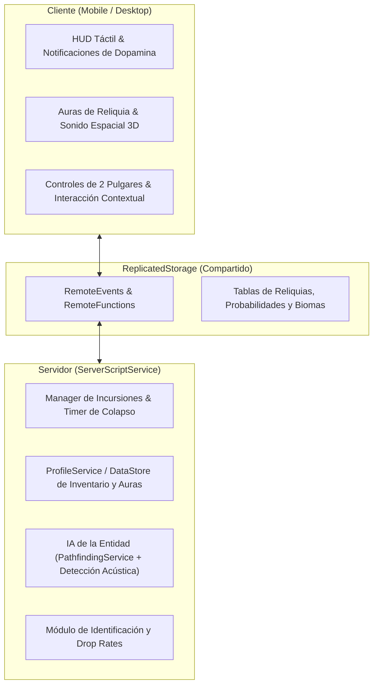

## 1. Resumen Ejecutivo
**Anomaly Extraction** es un juego cooperativo de supervivencia y extracción para Roblox diseñado específicamente bajo la psicología del jugador (los 5 pilares de dopamina) y optimizado para la experiencia móvil (+70% del tráfico de Roblox).

Equipos de 2 a 4 jugadores realizan incursiones cronometradas de 3 a 5 minutos en instalaciones subterráneas anómalas generadas de forma procedural. El objetivo es extraer reliquias antes del colapso del sector o la llegada de la "Entidad Acústica", para luego regresar al **Lobby Social** donde identificar las reliquias en una máquina pública con animaciones y efectos gacha (probabilidades de 1 en 10 hasta 1 en 1.000.000). Las reliquias equipadas otorgan auras de partículas masivas, títulos flotantes y multiplicadores de extracción.

---

## 2. Alineación con los 5 Pilares Psicológicos de Roblox

| Pilar | Mecánica Central en Anomaly Extraction |
|---|---|
| **1. Progreso Constante** | Desbloqueo de mochilas de mayor capacidad, baterías de linterna más duraderas y barras de maestría por bioma cada 2 partidas. |
| **2. Presumir y Estatus** | Reliquias equipadas en la espalda con shaders PBR luminiscentes, partículas visibles a 50 studs y podio central en el Spawn con los mejores extractores del día. |
| **3. FOMO y Urgencia** | "Colapsos Anómalos": Eventos de servidor cada 20 minutos con acceso a la Cripta Mítica durante solo 8 minutos. Rachas diarias acumulativas de extracción. |
| **4. Sentirse Inteligente** | Entidades reactivas al sonido y la luz. Los jugadores experimentados descubren rutas de sigilo, cebos sónicos y sinergias entre herramientas. |
| **5. Comunidad y Social** | Puzzles de extracción que requieren 2 jugadores simultáneos, chat de voz posicional y bonificación de +20% de valor por jugar con amigos. |

---

## 3. Arquitectura Técnica (Luau)



---

## 4. Estructura de Datos (DataStore Schema)

```lua
-- Esquema canónico para ProfileService / DataStoreService
local PlayerDataTemplate = {
    Stats = {
        Level = 1,
        TotalExtractions = 0,
        Reputation = 0,
        Coins = 100,
    },
    Inventory = {
        EquippedAura = "Resonancia_Comun",
        EquippedBackpack = "Mochila_Lona", -- Capacidad 3
        Auras = { "Resonancia_Comun" },
        Relics = {},
    },
    Settings = {
        MuteMusic = false,
        ReducedParticles = false, -- Modo rendimiento móvil
    },
    Streak = {
        Days = 1,
        LastLoginTimestamp = 0,
    }
}
```

---

## 5. Hoja de Ruta de Implementación en Roblox Studio

1. **Fase 1 (Core Loop & Onboarding en 60s)**:
   - Configuración de estructura de carpetas en `ReplicatedStorage` y `ServerScriptService`.
   - Script de generación del Lobby social y podio de spawn.
   - Prototipo del minijuego de extracción (ProximityPrompt + Hold Interaction).
2. **Fase 2 (IA Acústica & Entidad de Tensión)**:
   - `PathfindingService` con radio de detección de pasos (WalkSpeed > 16 emite señales de ruido).
3. **Fase 3 (Gacha de Reliquias & Auras de Estatus)**:
   - Estación de apertura de reliquias con efectos de partículas y broadcast en el chat del servidor para rarezas superiores a 1 en 10.000.

