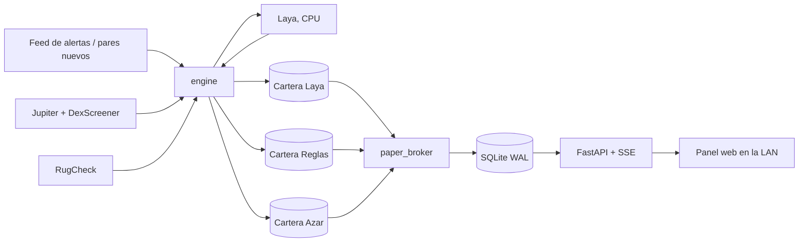

# Scalper Memecoins

> [!riesgo] Abandonado el 2026-10-22
> Haytham lo abandona y lo sustituye por [[01_Projects/Laya Trader]] (réplica del patrón `jev-trader` con Laya, sobre BTC/ETH/SOL). No corre nada en el servidor. Se conserva por las medidas: Laya sin entrenar tuvo AUC 0,31-0,39 en «¿estafa?» sobre 3.000 monedas reales y no se relacionó con el retorno a 10 min. No se reabre sin un criterio nuevo por escrito.

> [!resumen]
> Bot de **scalping de memecoins en papel** (cartera virtual con precios y costes reales) que corre entero en el servidor Zorin y se ve en un **panel web en vivo** (ganancias, posiciones y cada decisión del bot). **Laya** (`NandhaKishorM/laya`, clasificador de texto) decide estafa / entrar / mantener o vender. Es un **experimento con criterio de cierre fijado antes de medir** (Gate 1), no una promesa de rentabilidad. Proyecto personal de Haytham, no de NeoZeler.

## Documentos (flujo de 6, todos aprobados 2026-10-21)
1. [[01_Projects/Scalper Memecoins/1 - PRD|PRD]] · 2. [[01_Projects/Scalper Memecoins/2 - TRD|TRD]] · 3. [[01_Projects/Scalper Memecoins/3 - UI-UX Design|UI/UX]] · 4. [[01_Projects/Scalper Memecoins/4 - AppFlow|AppFlow]] · 5. [[01_Projects/Scalper Memecoins/5 - Backend Schema|Backend Schema]] · 6. [[01_Projects/Scalper Memecoins/6 - Plan de Implementacion|Plan de Implementación]]

## Arquitectura

Tres carteras en sombra reciben las mismas señales: **Laya**, **Reglas** (umbrales fijos) y **Azar** (entradas aleatorias con el mismo stop). El Gate 1 compara las tres.

## Criterio de cierre (Gate 1, no se cambia tras medir)
Se necesitan ≥ 300 operaciones y ≥ 5 días. **Pasa** solo si el límite inferior del IC90 de la media neta por operación es > 0 en las dos mitades temporales y también sin las 3 mejores operaciones. Si no, **el proyecto se cierra**. Mientras no haya n suficiente, el panel dice "NO CONCLUYENTE".

## Por qué es un experimento y no una promesa
Cuatro proyectos previos no encontraron ventaja neta tras costes: [[04_Archive/Memecoin-LSTM/17 - Resultado Fase 1 y decision|Memecoin-LSTM]] (Gate 1 fallido, cerrado 2026-10-06), [[04_Archive/goat-trading]], [[04_Archive/Crypto-Copy-Bot/crypto-copy-bot-spec|crypto-copy-bot]] y `pine-cripto-5m`. Scalping multiplica el coste por operación (~4,5 puntos de ida y vuelta en el ejemplo del esquema). Laya es un clasificador de texto, no un modelo de precios; la cartera `azar` lo pone a prueba.

## Hardware y rendimiento medido
Servidor: HP ProDesk 400 G5, 6 núcleos, 7,6 GiB de RAM, sin GPU, Python 3.12.3, 148 GB libres. Medido el 2026-10-21 (T-02, `sandbox/medir_laya.py`, torch 2.14.1+cpu, `laya` 0.4.12, checkpoint `typed-decisions`):
| Medida | Resultado | Límite del TRD |
|---|---|---|
| RAM con el checkpoint cargado | **2.036 MB** (antes 222 MB) | ≤ 3,8 GB |
| Carga + primera respuesta (con descarga) | 14,3 s | — |
| Latencia, 3 preguntas a la vez | **p50 595 ms · p95 617 ms** | ≤ 2 s |
| Latencia, 1 pregunta | p50 ~255 ms | — |
| `venv` en disco | 1,3 GB (+ ~0,8 GB de checkpoint en caché) | — |
Formato real: `answers[pregunta]` con `noul` (probabilidad de "sí"), `choice` + `probabilities`, `confidence` y `answer_confidence`. `laya.calibrate` existe (`fit_temperature_map`, `fit_abstention_thresholds`, `records_from_labeled`). Código revisado antes de ejecutarlo: sin ejecución de comandos externos ni carga de código remoto.

> [!riesgo] Señal de alarma en la primera prueba (4 casos sintéticos, no concluyente)
> Sin entrenar, Laya dio la puntuación de estafa **más baja** (0,38) y la mayor de "comprar" (0,67) a una moneda con todas las señales de rug (88 % en 10 tenedores, mint sin revocar, 6 SOL de liquidez). Confianza interna casi nula (0,04). Hace falta medirlo con datos etiquetados reales (T-04) antes de fiarle ninguna decisión.

## Estado de construcción
- [x] Flujo de 6 documentos aprobado; `trace_lint` en OK
- [x] T-01 repo y entorno en el servidor (commit `d107c4a`)
- [x] T-02 sandbox de Laya (commit `e946578`): cabe en RAM y en latencia; **punto de decisión abierto** por la primera prueba de discriminación (ver arriba)
- [x] T-04 Laya contra datos reales (commit `531ebe8`): **LAYA NO APORTA** (criterio fijado antes de medir)
- [ ] Decidir el papel de Laya y revisar la etiqueta "muerta a 30 min" antes de construir la estrategia
- [ ] Fases 1 a 5 del Plan

## Resultado T-04 (2026-10-21)
3.000 candidatas del observador (5-6 oct, vistas con liquidez > 0 a ≤ 3,5 min), 25,6 % muertas a 30-60 min. Laya puntuó cada una con el estado de entrada en texto (565 ms de media).
| Prueba | Resultado | Criterio |
|---|---|---|
| AUC de "¿estafa?" contra muerta, mitad 1 / mitad 2 | **0,39** [0,36-0,42] / **0,31** [0,29-0,34] | límite inferior > 0,55 en ambas: **no** |
| AUC de Laya contra regresión logística (mitad 2) | 0,31 frente a **0,93** | diferencia [−0,65, −0,58]: **no** |
| Mejor regla de una sola variable (cuota de compras) | **0,88** | — |
| Spearman "comprar" contra retorno a 10 min | −0,02 [−0,07, +0,02] | límite inferior > 0: **no** |
| Muertas en el 20 % que Laya prefiere / el 20 % que menos | **43 % / 11 %** | Laya elige al revés |
Laya va **al revés** de forma estable: lee "muchas compras, casi sin ventas" como señal sana, y esas monedas son las que mueren. Su entrada no tiene relación con el retorno.

### Verificación de la etiqueta (T-04b, mismo día)
Sospecha: que el 0,93 de las reglas fuera un artefacto de cobertura del observador o de la "graduación" de pump.fun (pool viejo con liquidez 0).
- **Cobertura**: 0 de 3.000 monedas sin fotos entre 28 y 60 min; el observador fotografía todo sin filtrar hasta los 65 min. No es artefacto de cobertura.
- **Graduación**: 1.610 de 3.000 tienen otro pool del mismo token. Re-etiquetado a nivel de **token** (vivo si cualquier pool tiene liquidez a 28-60 min): muertas 21,1 % (antes 25,6 %), solo 135 casos cambian. Resultado casi idéntico: Laya AUC 0,39 / 0,33 (al revés), regresión logística 0,92, cuota de compras 0,85. **Veredicto confirmado: LAYA NO APORTA.**
- **La regla antifraude es real**: la cuota de compras separa bien (monedas con 90 %+ de compras casi sin ventas mueren el 70 %). Pero **no da beneficio**: filtrando las muertas (cuartiles bajos de cuota) el retorno a 10 min es −9 % y −1 % de media, mediana 0 %, y sin las 3 mejores sigue negativo (−24 % y −7 %); un 24-25 % cae más de un 50 %. Es el mismo resultado de Memecoin-LSTM: evitar estafas no crea ventaja.

## Guía operativa
- Código: `~/Proyectos/scalper-memecoins/` en el servidor (`ssh@192.168.0.100`), `venv/` propio, `pytest`/`ruff`/`mypy` en verde. Secretos solo en `.env` (`chmod 600`); `.env.example` sin valores.
- Panel (cuando exista): `http://192.168.0.100:8060`, solo en la LAN; escritura con token.
- Modo dinero real: **fuera de la v1**; el broker lanza excepción si se intenta.

## Relacionado
[[00_Meta/Sesiones/2026-10-21 - Scalper Memecoins, arranque del flujo de software]] · [[04_Archive/Memecoin-LSTM/17 - Resultado Fase 1 y decision|Memecoin-LSTM (cierre)]]

