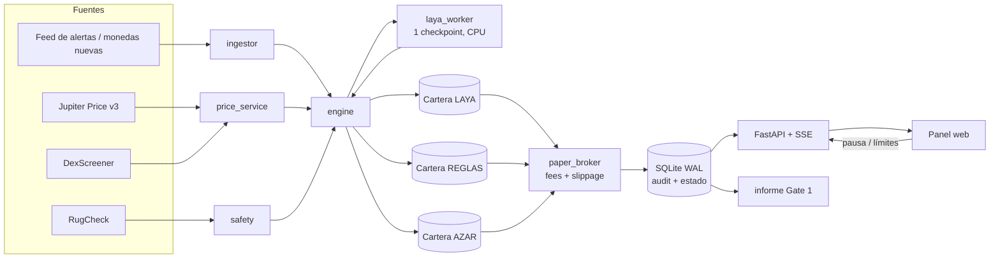

# 2 · TRD — Technical Requirements Document

> [!resumen]
> **Cómo** se construye lo que pide el [[1 - PRD]]. Todo en Python dentro del servidor Zorin (sin Node ni Docker). Laya decide; **tres carteras en sombra** (azar, reglas, Laya) sobre las mismas señales hacen que el Gate 1 compare con una línea base real.

## 1. Stack elegido
| Capa | Elección | Alternativa descartada | Por qué |
|---|---|---|---|
| Lenguaje | Python 3.12.3 (ya en el servidor) | Node/TypeScript | El servidor **no tiene Node**; Laya y los scripts previos son Python; un solo lenguaje. |
| Decisor | `laya` 0.4.12 (checkpoint `laya-typed-decisions`, CPU) | Entrenar un LSTM/XGBoost propio | Es lo que pidió Haytham; los modelos propios ya fallaron en 3 proyectos. Se mide contra azar y reglas. |
| Backend / API | FastAPI 0.156.8 + uvicorn, eventos en vivo por **SSE** | Flask / WebSockets | FastAPI y uvicorn ya son extras de `laya[serve]`; SSE basta para un flujo servidor→navegador y reconecta solo. |
| Base de datos | **SQLite en modo WAL** (stdlib) | Postgres/Supabase en Docker | Cero servicios nuevos, probado en Memecoin-LSTM; un solo proceso escribe. Docker de Supabase queda parado. |
| Frontend | HTML + JS sin framework, servido por FastAPI; `lightweight-charts` 5.2.1 | React/Next.js | Sin Node no hay build; el panel son 3 vistas. |
| Auth | Token compartido en `.env` (cookie) para escritura (pausa); lectura solo en LAN | Usuarios y roles | Un único operador. |
| Hosting / despliegue | `systemd` de usuario en el servidor, venv propio en `~/Proyectos/scalper-memecoins/` | Contenedor Docker | Menos RAM, reinicio automático, logs en `journalctl`. |

### 1.1 Ficha por librería (verificada, no de memoria)
| Librería | Versión | Último release | Mantenimiento | Peso | Licencia | Python 3.12 | Fuente | Trampas conocidas |
|---|---|---|---|---|---|---|---|---|
| laya | 0.4.12 | 2026-10-19 | Activo, **muy reciente (2 días)** | ~2,3 GB de checkpoints | Apache-2.0 | Sí (≥3.10) | PyPI + README | Pide `torch>=2.0`, `transformers>=4.48`, `safetensors`, `huggingface_hub`, `numpy`; checkpoints **sobreconfiados**: calibrar; sin GPU: 146-453 ms/llamada (README). `max_loaded=2` por defecto: bajar a 1. |
| fastapi | 0.156.8 | PyPI (verificado hoy) | Activo | pequeño | MIT | Sí | PyPI | Versión cero-ver: fijar exacta en `requirements.txt`. |
| lightweight-charts | 5.2.1 | 2026-08-12 | Activo | ~3 MB sin comprimir | Apache-2.0 | n/a (navegador) | npm | Se vendoriza el `.js` en `static/` (no hay Node en el servidor); respetar el aviso de atribución de TradingView. |
| torch (CPU) | a fijar en sandbox | — | Activo | **a medir** | BSD | Sí | PyPI (`--index-url …/whl/cpu`) | La rueda por defecto trae CUDA y pesa varios GB; instalar la de CPU. |
| SQLite (stdlib) | del sistema | — | — | 0 | dominio público | Sí | stdlib | Un solo escritor; usar WAL y `busy_timeout`. |

> [!riesgo] Pendiente de verificar en sandbox (antes de fijar nada)
> Peso real de torch CPU + checkpoint, RAM en reposo de `laya-typed-decisions`, latencia real en este equipo (6 núcleos, sin GPU) y el formato exacto de `Router.predict` (el README no lo documenta entero). `laya.calibrate` **no está documentada** en el README: se confirma leyendo el código del paquete.

### 1.2 Presupuesto de dependencias
| Límite | Máximo | Previsto |
|---|---|---|
| Motores de animación | 1 | 0 (CSS) |
| Librerías de UI base | 1 + registries | 0 (CSS propio + lightweight-charts) |
| JS inicial (kB gzip) | 200 | ~60 (charts + código propio) |
| Dependencias directas (Python) | 25 | ~10: laya, torch, fastapi, uvicorn, httpx, websockets, pydantic, numpy, pandas, pytest |

## 2. Arquitectura

- **Un proceso `bot`** (ingesta, motor, broker) y **un proceso `api`** (panel). Laya corre en un **hilo/worker dedicado** para no bloquear el bucle de precios.
- **Tres carteras en sombra** reciben las mismas señales: `laya` (decide Laya), `reglas` (umbral fijo de liquidez/edad/momento) y `azar` (entrada aleatoria con el mismo stop y franja horaria). El Gate 1 compara las tres.
- **Preguntas tipadas a Laya** (texto compacto del estado de la moneda: edad, liquidez, cambios 1/5/15 min, volumen, concentración de tenedores, avisos de RugCheck, y si hay posición: PnL y tiempo): `estafa` (`noul`, sí/no), `entrada` (`choice`: comprar/saltar) y, con posición abierta, `salida` (`choice`: mantener/vender). Umbrales de confianza calibrados con datos propios.

## 3. Integraciones y servicios externos
| Servicio | Para qué | Coste | Límites / cuotas | Plan B |
|---|---|---|---|---|
| Jupiter Price v3 (`lite-api.jup.ag/price/v3`) | Precio por lotes (Solana) | Gratis, sin clave | Omite tokens que no conoce: ausencia = "sin dato", no 0 | DexScreener |
| DexScreener (`/latest/dex/tokens/{addr}`) | Liquidez, volumen, edad del par | Gratis, sin clave | Precio de monedas poco líquidas cambia ~1 vez/40 s; tarda 30-75 s en notar un vaciado; el lote devolvió 3 de 5: **consultar de uno en uno** | Reservas on-chain |
| FomoAPI (`wss://api.fomoapi.io/ws/alerts`) | Alertas de compra/venta de carteras (señal de interés) | Plan gratis 1000 peticiones/mes | Sin precio en el feed; con clave llega con ~5,4 s de retraso; omitir `replay:true` | Descubrimiento por DexScreener (pares nuevos) |
| RugCheck v2/v3 | Avisos de estafa (mint/freeze authority, concentración) | Gratis | Rechaza ~53 % de señales no-Solana | Lectura on-chain (`getAccountInfo`) |
| Helius (RPC Solana) | Liquidez real de pools y tenedores | Cupo gratis ~1 M créditos/mes | Tope **por hora**, no por día (sesgo horario ya sufrido) | RPC público con límite |
| Hugging Face Hub | Descarga única de checkpoints de Laya | Gratis | ~2,3 GB; descargar una vez y fijar revisión | — |

## 4. Seguridad y datos
- **Roles** (PRD §2): Operador (lectura + pausa/límites) y Bot (proceso). Escritura del panel solo con el token compartido (`SCALPER_TOKEN`, `.env`, `chmod 600`).
- **Sin datos personales.** Sin clave de wallet en v1: el broker es simulado y el modo live **lanza excepción** (lección del copy-bot: fallar fuerte, no devolver éxito falso).
- **Red**: panel en la LAN (`192.168.0.100`), puerto alto, sin abrir nada al exterior; comprobar `ufw`.
- **Secretos**: `FOMOAPI_KEY`, `HELIUS_RPC_URL`, `SCALPER_TOKEN` solo en `.env` del servidor; `.env.example` sin valores; `.gitignore` antes del primer commit.
- Ningún filtro de seguridad "simulado": si RugCheck no responde, la moneda se **salta** y se registra.

## 5. Rendimiento y escalado
- **RAM**: servidor 7,6 GiB; tope duro del bot 3,8 GB (límite `MemoryMax` en systemd). Laya con **un** checkpoint (`max_loaded=1`).
- **Carga**: ≤ 200 monedas vigiladas a la vez, ≤ ~1 decisión de Laya por segundo (150-450 ms cada una en CPU). Si la cola crece, se descartan las más antiguas y se anota.
- **Persistencia**: SQLite WAL en disco (148 GB libres); estado contable en snapshot atómico propio, el log es solo auditoría.
- Cierre ordenado: el estado sobrevive a un reinicio (probado en el ciclo del PRD §9).

## 6. Entornos y CI
- **Sandbox primero** (regla global): `~/Proyectos/scalper-memecoins/sandbox/` en el servidor para medir Laya (RAM, latencia, calibración) antes de integrarlo.
- Un solo entorno (servidor). Desarrollo y pruebas con `pytest` + datos grabados (fixtures reales); sin red en los tests.
- Antes de cada commit: `pytest` limpio, `ruff` y `mypy` sin errores. Git desde el primer commit.

## 7. Trazabilidad PRD → técnica
| Requisito PRD | Solución técnica |
|---|---|
| RF-01 ingesta | `ingestor` + `price_service` (Jupiter → DexScreener) |
| RF-02 Laya | `laya_worker` + preguntas `noul`/`choice`; `calibrate` con datos propios |
| RF-03 motor de papel | `paper_broker` (FIFO, fee 0,65 %, slippage `1 % + 20 × tamaño/liquidez`, a sustituir por costes medidos) |
| RF-04 riesgo | `risk` aplicado en `engine` (máx. posiciones, exposición, corte diario, tamaño ≤ 3 %) |
| RF-05 panel | FastAPI + SSE + `lightweight-charts` |
| RF-06 auditoría | tabla `audit` append-only con entrada y respuesta de Laya |
| RF-07 Gate 1 | `scripts/gate1.py` (IC90 por bootstrap, mitades, sin top 3, vs azar) |

## 8. Riesgos técnicos
> [!riesgo]
> - **Laya sin ventaja sobre texto numérico**: entrenado para clasificar lenguaje, no series de precios. La cartera `azar` lo detecta; si empata con el azar, el resultado es "Laya no aporta" y se cierra.
> - **Paquete de 2 días de antigüedad** (0.4.12): fijar versión exacta y revisión del checkpoint; leer el código antes de ejecutar (corre con todos los permisos).
> - **Memoria**: torch + checkpoint + bot en 7,6 GiB; límite en systemd y vigilar swap (llegó a 1,5 GiB).
> - **Retraso de datos**: DexScreener tarda 30-75 s en ver un vaciado; los stops van con retraso y el broker lo simula con precio retrasado.
> - **Costes supuestos**: hasta medir, el Gate no es concluyente; se sustituyen por cotizaciones reales de Jupiter (a verificar).
> - **Sesgo de supervivencia**: medir siempre "muerta = −100 %", no solo con precio.

---
Anterior: [[1 - PRD]] · Siguiente: [[3 - UI-UX Design]]

