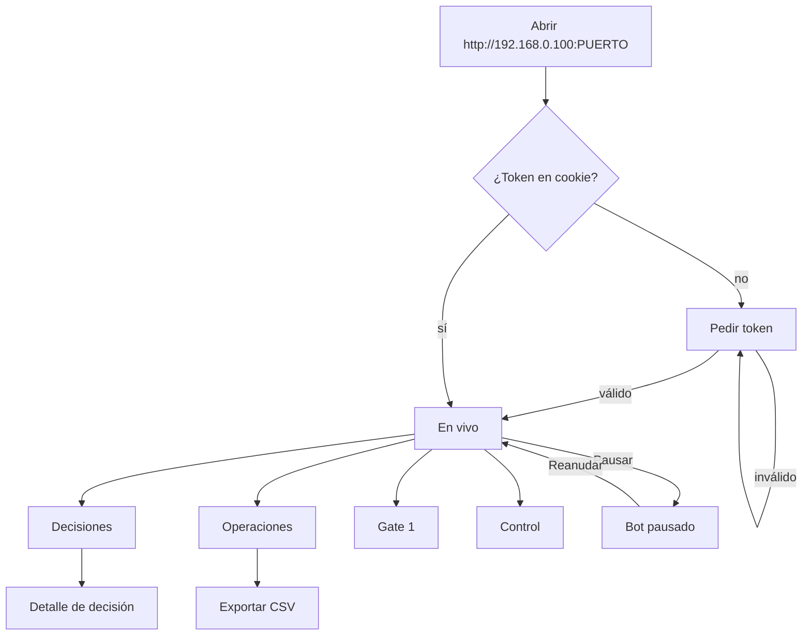
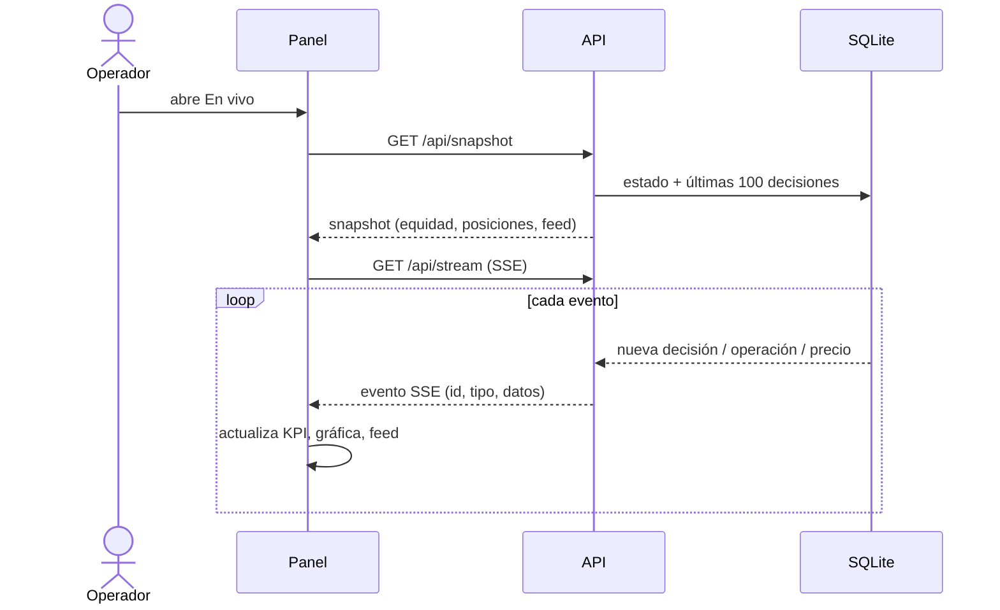
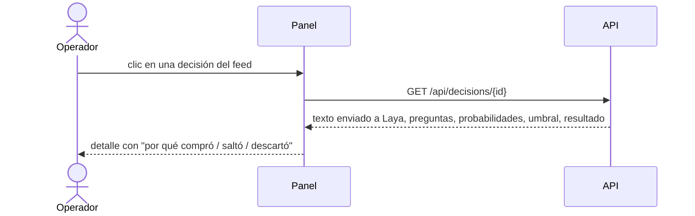
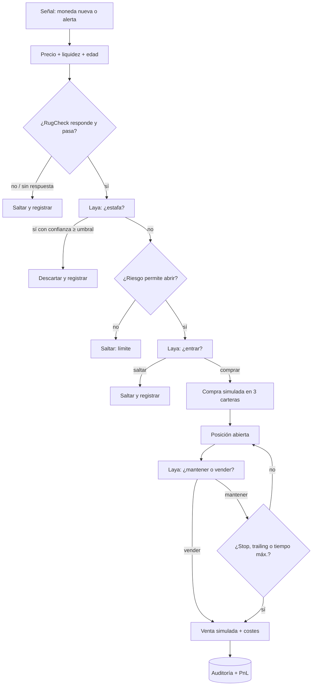

# 4 · AppFlow

> [!resumen]
> Cómo se mueve el Operador entre las pantallas de [[3 - UI-UX Design]] y qué hace el bot por detrás. Contrato entre UI, API y motor. Un solo rol humano (Operador) más el proceso Bot.

## 1. Mapa de navegación

- Lectura sin token solo en la LAN; **toda escritura** (pausar, reanudar, límites) exige token. El token no va en la URL, solo en cookie `HttpOnly`.

## 2. Flujos principales
### Flujo 1 — Ver la cartera en vivo (US-01, US-03)

- Camino feliz: el snapshot pinta la pantalla en < 1 s y los eventos llegan en ≤ 2 s.
- Alternativas: **SSE se corta** → punto "reconectando", reintento con `Last-Event-ID` y recarga de snapshot si hay hueco; **bot caído** → banner "Bot detenido" y última marca de tiempo; **sin datos** → ilustración vacía.

### Flujo 2 — Entender una decisión (US-02, US-04)

- Alternativas: decisión borrada por retención → mensaje "Registro no disponible"; filtro sin resultados → estado vacío.

### Flujo 3 — Pausar y límites (US-06)
```mermaid
sequenceDiagram
  actor O as Operador
  participant W as Panel
  participant A as API
  participant B as Bot
  O->>W: Pausar
  W->>A: POST /api/control/pause (cookie)
  A->>B: bandera "pausado" en BD
  B-->>A: confirma y deja de abrir posiciones
  A-->>W: estado pausado
  W-->>O: banner "Pausado: no abre nuevas; las abiertas siguen con su stop"
```
- Pausar **no cierra** posiciones abiertas: siguen con su stop y su tiempo máximo. Botón aparte "Cerrar todo a mercado" (confirmación) en Control.
- Corte automático por pérdida diaria: el bot se pausa solo y lo muestra con motivo.
- Errores: token inválido → 401 y vuelve a pedirlo; límites fuera de rango → validación con mensaje.

### Flujo 4 — Qué hace el bot por cada moneda (US-05, RF-01 a RF-04)

- La cartera `reglas` y la `azar` reciben **la misma señal** con su propia regla de entrada; las tres usan el mismo broker y los mismos costes.
- Si Laya tarda más de 2 s o la cola crece, la señal se descarta con motivo `laya_lenta` (no se compra a ciegas).

### Flujo 5 — Leer el veredicto del Gate 1 (US-07)
- Operador → Gate 1 → ve n, días y veredicto: **NO CONCLUYENTE** (n < 300 o < 5 días), **NO PASA** o **PASA**; pestañas con mitades, sin top 3 y contra azar.

### Flujo 6 — Exportar operaciones (US-08)
- Operador → Operaciones → **Exportar CSV** → `GET /api/trades.csv` → descarga del historial de operaciones cerradas (UTF-8, `;`).
- Alternativas: sin operaciones cerradas → mensaje "Aún no hay operaciones cerradas" y el botón queda desactivado; rango de fechas inválido → 400 con mensaje.

## 3. Permisos por rol
| Pantalla / acción | Operador (con token) | Operador (sin token, LAN) | Fuera de la LAN |
|---|---|---|---|
| En vivo, Decisiones, Operaciones, Gate 1 (lectura) | Sí | Sí | No (puerto cerrado) |
| Exportar CSV | Sí | Sí | No |
| Pausar / reanudar / cerrar todo | Sí | No | No |
| Cambiar límites | Sí | No | No |

## 4. Estados globales
- **Carga inicial**: esqueletos en tiles, gráfica y tablas (sin parpadeo).
- **Feed caído**: punto ámbar "reconectando" y última marca de tiempo; no se muestran cifras como "en vivo" si pasan > 10 s.
- **Bot pausado / detenido / en corte diario**: banner fijo con el motivo.
- **Vacío**: ilustraciones del UI/UX §5.
- **Error 500**: mensaje corto con identificador de petición y enlace a Control.
- **Token caducado**: la lectura sigue; la acción de escritura vuelve a pedir token sin perder la pantalla.

## 5. Cliente simulado
Un solo rol humano. Se lanzó un agente independiente con el prompt base y solo estas dos notas + el UI/UX.
- Prompt base: "Eres Operador (Haytham: dueño de agencia de IA, nivel técnico medio-alto, no programa trading, usa escritorio y móvil). Recorre los flujos 1 a 5 solo con lo que dicen las notas y se vería en pantalla. Di en cada paso qué esperas, qué te confunde y dónde abandonarías."
| Rol simulado | Flujo | Atascos detectados | Cambio aplicado |
|---|---|---|---|
| Operador | 1 En vivo | No sabe qué son las 3 carteras ni su capital inicial; tiles sin n ni periodo; "reconectando" sin saber si el bot opera; feed tras la gráfica en móvil | Definir carteras y capital en el PRD y en un cuadro "Qué estoy viendo"; n y periodo en cada tile; estado del bot separado del estado del feed; en móvil el feed sube bajo los KPI |
| Operador | 2 Decisión | Texto a Laya y probabilidades ilegibles; lee "confianza 0,9" como 90 % de acierto | Resumen de una frase arriba ("Saltó: liquidez 4.000 $ < mínimo"); la confianza se muestra como "puntuación de Laya, no probabilidad de acierto" y sin porcentaje hasta calibrar |
| Operador | 3 Pausar | Cree que Pausar cierra todo; "Cerrar todo" lejos de Pausar | El banner de pausa lleva el enlace "Cerrar posiciones abiertas"; "Cerrar todo" pide escribir CERRAR y muestra nº de posiciones y coste estimado |
| Operador | 3 Reanudar | Podría anular un corte por pérdida diaria | Tras un corte, Reanudar exige confirmación con el motivo; no reinicia el contador del día |
| Operador | 4 Bot por moneda | No ve cuántas señales se descartan ni por qué | Embudo de descartes por motivo (RugCheck, estafa, límite, `laya_lenta`, Laya "saltar") en En vivo |
| Operador | 5 Gate 1 | No entiende IC90 ni qué falta | Frase en lenguaje llano + progreso "n/300 · día X/5"; glosario con tooltips |
| Operador | General | Términos técnicos sin explicar; falta salud del bot y calidad del dato | Glosario enlazado junto a cada cifra; tarjeta de salud (RAM, swap, cola, antigüedad del precio, latencia de Laya) |

> [!resumen] Hallazgos descartados o matizados
> - "100 operaciones/día" y "300 en 5 días" **no se contradicen**: el primero es el ritmo esperado (500 en 5 días); el segundo, el mínimo para el veredicto. Se aclara en el PRD.
> - Lectura sin token por HTTP en la LAN: se mantiene (solo datos de papel). El token de escritura va en cookie `HttpOnly; SameSite=Strict`, con caducidad corta; el riesgo de sesión robable en la LAN se acepta en v1 y se anota en el TRD.
> - Mejor/peor operación y dependencia de las 3 mejores: pasan a "Could" en Operaciones.

## 6. Ciclo completo a validar
- [ ] Abrir panel → ver estado → pausar → refrescar (sigue pausado) → reanudar → refrescar
- [ ] Reiniciar el servicio del bot → refrescar (equidad y posiciones intactas)
- [ ] Abrir posición simulada → refrescar → cerrar → refrescar (PnL y auditoría coinciden)
- [ ] Cortar la red del feed → el panel avisa → volver → se recupera sin duplicar eventos

---
Anterior: [[3 - UI-UX Design]] · Siguiente: [[5 - Backend Schema]]

