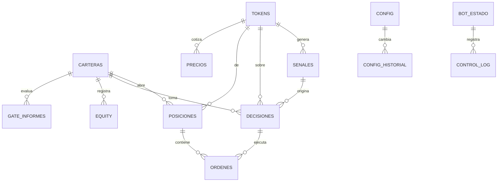

# 5 · Backend Schema

> [!resumen]
> Modelo de datos (**SQLite en modo WAL**, decisión del [[2 - TRD]]) y API que sostienen los flujos de [[4 - AppFlow]]. BD nueva en el servidor, sin datos previos: no hay esquema remoto que verificar. Tiempos en **milisegundos UTC** (`integer`); importes en **SOL** (`real`). Hay que ejecutar `PRAGMA foreign_keys = ON` en cada conexión.

## 1. Diagrama entidad-relación


## 2. SQL ejecutable
Los bloques ```` ```sql ```` se concatenan en la migración y los ```` ```sql seed ```` en la semilla con `schema_to_migration.py`. Toda FK lleva `ON DELETE`. **Borrar una cartera borra en cascada** sus decisiones, posiciones, órdenes, equity e informes (es el "reiniciar experimento"); borrar un token borra sus señales, precios, decisiones y posiciones. La aplicación **no borra** de forma normal; solo la retención (§5) y el reinicio explícito.
```sql
pragma foreign_keys = on;

create table carteras (
  id text primary key check (id in ('laya', 'reglas', 'azar')),
  nombre text not null,
  descripcion text not null,
  capital_inicial_sol real not null check (capital_inicial_sol > 0),
  capital_sol real not null,
  creada_en integer not null
);

create table tokens (
  mint text primary key,
  simbolo text,
  nombre text,
  descripcion text,
  cadena text not null default 'solana',
  creador text,
  visto_en integer not null,
  creado_en_cadena integer
);

create table senales (
  id text primary key,
  mint text not null references tokens(mint) on delete cascade,
  origen text not null check (origen in ('alerta', 'par_nuevo', 'dexscreener')),
  recibida_en integer not null,
  precio_sol real,
  liquidez_sol real,
  edad_s integer,
  payload_json text
);
create index idx_senales_mint_ts on senales(mint, recibida_en);

create table decisiones (
  id text primary key,
  ts integer not null,
  cartera_id text not null references carteras(id) on delete cascade,
  mint text not null references tokens(mint) on delete cascade,
  senal_id text references senales(id) on delete set null,
  tipo text not null check (tipo in ('estafa', 'entrada', 'salida')),
  accion text not null check (accion in ('comprar', 'saltar', 'mantener', 'vender', 'descartar')),
  motivo text not null,
  resumen text not null,
  texto_laya text,
  respuesta_json text,
  puntuacion real,
  nivel_confianza text check (nivel_confianza in ('alta', 'media', 'baja')),
  umbral real,
  laya_ms integer
);
create index idx_decisiones_ts on decisiones(ts desc);
create index idx_decisiones_cartera_ts on decisiones(cartera_id, ts desc);
create index idx_decisiones_mint on decisiones(mint);

create table posiciones (
  id text primary key,
  cartera_id text not null references carteras(id) on delete cascade,
  mint text not null references tokens(mint) on delete cascade,
  estado text not null check (estado in ('abierta', 'cerrada')),
  abierta_en integer not null,
  cerrada_en integer,
  tamano_sol real not null check (tamano_sol > 0),
  cantidad real not null check (cantidad > 0),
  precio_entrada_sol real not null,
  precio_salida_sol real,
  stop_pct real not null,
  trailing_pct real not null,
  max_tenencia_min integer not null,
  precio_max_sol real not null,
  motivo_salida text check (motivo_salida in ('stop', 'trailing', 'tiempo', 'laya', 'cerrar_todo', 'liquidez_muerta')),
  comision_sol real not null default 0,
  deslizamiento_sol real not null default 0,
  pnl_sol real,
  pnl_pct real
);
create index idx_posiciones_cartera_estado on posiciones(cartera_id, estado);
create index idx_posiciones_cerrada on posiciones(cerrada_en);

create table ordenes (
  id text primary key,
  posicion_id text not null references posiciones(id) on delete cascade,
  decision_id text references decisiones(id) on delete set null,
  lado text not null check (lado in ('compra', 'venta')),
  ts integer not null,
  precio_ref_sol real not null,
  precio_ejec_sol real not null,
  tamano_sol real not null,
  comision_sol real not null,
  deslizamiento_sol real not null,
  liquidez_sol real
);
create index idx_ordenes_posicion on ordenes(posicion_id);

create table equity (
  cartera_id text not null references carteras(id) on delete cascade,
  ts integer not null,
  equity_sol real not null,
  abiertas integer not null default 0,
  primary key (cartera_id, ts)
);

create table precios (
  mint text not null references tokens(mint) on delete cascade,
  ts integer not null,
  precio_sol real not null,
  liquidez_sol real,
  fuente text not null check (fuente in ('jupiter', 'dexscreener', 'onchain')),
  primary key (mint, ts)
);

create table config (
  clave text primary key,
  valor text not null,
  minimo real,
  maximo real,
  actualizada_en integer not null
);

create table config_historial (
  id integer primary key autoincrement,
  clave text not null references config(clave) on delete cascade,
  valor_anterior text,
  valor_nuevo text not null,
  ts integer not null,
  origen text not null check (origen in ('panel', 'bot', 'semilla'))
);

create table bot_estado (
  id integer primary key check (id = 1),
  estado text not null check (estado in ('en_marcha', 'pausado', 'corte_diario', 'detenido')),
  motivo text,
  actualizado_en integer not null,
  latido_en integer not null,
  feed_ok integer not null default 0,
  feed_ultimo_evento_en integer,
  rss_mb integer,
  swap_mb integer,
  cola_senales integer not null default 0,
  laya_ms_p50 integer,
  laya_ms_p95 integer,
  antiguedad_precio_s integer
);

create table control_log (
  id integer primary key autoincrement,
  ts integer not null,
  accion text not null check (accion in ('pausar', 'reanudar', 'cerrar_todo', 'cambiar_limites', 'login', 'corte_diario')),
  detalle_json text,
  bot_estado_id integer not null default 1 references bot_estado(id) on delete cascade
);

create table eventos (
  id integer primary key autoincrement,
  ts integer not null,
  tipo text not null check (tipo in ('decision', 'orden', 'posicion', 'equity', 'estado', 'descarte')),
  cartera_id text references carteras(id) on delete cascade,
  payload_json text not null
);
create index idx_eventos_ts on eventos(ts);

create table descartes (
  id integer primary key autoincrement,
  ts integer not null,
  mint text not null references tokens(mint) on delete cascade,
  motivo text not null check (motivo in ('rugcheck', 'estafa_laya', 'limite_riesgo', 'laya_lenta', 'laya_saltar', 'sin_precio', 'sin_liquidez'))
);
create index idx_descartes_ts on descartes(ts);

create table gate_informes (
  id integer primary key autoincrement,
  generado_en integer not null,
  cartera_id text not null references carteras(id) on delete cascade,
  n integer not null,
  dias real not null,
  media_neta_pct real,
  mediana_neta_pct real,
  ic90_inf real,
  ic90_sup real,
  ic90_inf_sin_top3 real,
  ic90_inf_mitad1 real,
  ic90_inf_mitad2 real,
  coste_pct_del_bruto real,
  veredicto text not null check (veredicto in ('no_concluyente', 'no_pasa', 'pasa'))
);
create index idx_gate_cartera on gate_informes(cartera_id, generado_en desc);

create view v_embudo_hoy as
select motivo, count(*) as total
from descartes
where ts >= (cast(strftime('%s', 'now', 'start of day') as integer) * 1000)
group by motivo;

create view v_operaciones_cerradas as
select p.id, p.cartera_id, t.simbolo, t.mint, p.abierta_en, p.cerrada_en, p.tamano_sol,
       p.precio_entrada_sol, p.precio_salida_sol, p.motivo_salida,
       p.comision_sol, p.deslizamiento_sol, p.pnl_sol, p.pnl_pct
from posiciones p join tokens t on t.mint = p.mint
where p.estado = 'cerrada';
```
```sql seed
insert into carteras (id, nombre, descripcion, capital_inicial_sol, capital_sol, creada_en) values
  ('laya',   'Laya',   'Decide Laya: estafa, entrada y salida',                     10, 10, cast(strftime('%s','now') as integer) * 1000),
  ('reglas', 'Reglas', 'Umbrales fijos de liquidez, edad y momento (sin IA)',        10, 10, cast(strftime('%s','now') as integer) * 1000),
  ('azar',   'Azar',   'Entrada aleatoria con el mismo stop y franja horaria',       10, 10, cast(strftime('%s','now') as integer) * 1000);

insert into config (clave, valor, minimo, maximo, actualizada_en) values
  ('tamano_pct',            '3',    0.5, 3,   cast(strftime('%s','now') as integer) * 1000),
  ('max_posiciones',        '8',    1,   8,   cast(strftime('%s','now') as integer) * 1000),
  ('exposicion_max_pct',    '24',   3,   24,  cast(strftime('%s','now') as integer) * 1000),
  ('corte_diario_pct',      '-20',  -20, -3,  cast(strftime('%s','now') as integer) * 1000),
  ('stop_pct',              '15',   5,   30,  cast(strftime('%s','now') as integer) * 1000),
  ('trailing_pct',          '10',   3,   30,  cast(strftime('%s','now') as integer) * 1000),
  ('max_tenencia_min',      '20',   1,   120, cast(strftime('%s','now') as integer) * 1000),
  ('comision_pct',          '0.65', 0,   5,   cast(strftime('%s','now') as integer) * 1000),
  ('deslizamiento_base_pct','1',    0,   10,  cast(strftime('%s','now') as integer) * 1000),
  ('deslizamiento_k',       '2',    0,   20,  cast(strftime('%s','now') as integer) * 1000),
  ('liquidez_min_sol',      '50',   1,   100000, cast(strftime('%s','now') as integer) * 1000),
  ('laya_max_ms',           '2000', 100, 10000, cast(strftime('%s','now') as integer) * 1000);

insert into bot_estado (id, estado, motivo, actualizado_en, latido_en, feed_ok, cola_senales)
values (1, 'detenido', 'sin arrancar', cast(strftime('%s','now') as integer) * 1000, 0, 0, 0);
```
Generar: `python3 ~/Proyectos/flujo-software/tools/schema_to_migration.py "<este archivo>" <proyecto>/db`

## 2.1 Documentación de tablas
| Tabla | Para qué | Quién escribe |
|---|---|---|
| `carteras` | Las tres carteras en sombra y su capital | semilla; `bot` actualiza `capital_sol` |
| `tokens`, `senales`, `precios` | Monedas vistas, señales recibidas y serie de precios | `ingestor`, `price_service` |
| `decisiones` | **Auditoría** de cada decisión: resumen de una frase, texto enviado a Laya, respuesta, puntuación, umbral, latencia | `engine` |
| `posiciones`, `ordenes` | Posiciones abiertas/cerradas y sus compras/ventas con comisión y deslizamiento | `paper_broker` |
| `equity` | Curva de equidad por cartera (una fila por minuto y cartera) | `engine` |
| `config`, `config_historial` | Límites y parámetros, con rangos duros e historial | `api` (panel) y semilla |
| `bot_estado`, `control_log` | Estado, salud y registro de acciones del operador | `bot` / `api` |
| `eventos` | Cola ordenada para SSE: el `id` es el `Last-Event-ID` | `engine` |
| `descartes` | Señales descartadas por motivo (alimenta el embudo) | `engine` |
| `gate_informes` | Informe del Gate 1 por cartera | `scripts/gate1.py` |

- **Claves foráneas**: `CASCADE` para todo lo que depende de una cartera, un token o una posición (reinicio limpio del experimento sin botones bloqueados); `SET NULL` en `decisiones.senal_id`, `ordenes.decision_id` (se conserva el registro aunque caduque la señal).
- **Índices**: por tiempo descendente en decisiones y eventos, por `(cartera, estado)` en posiciones, por `(mint, ts)` en señales y precios.
- **Rangos duros**: `config.minimo`/`maximo` los valida `api` (y también el bot al cargar); el valor guardado fuera de rango se rechaza.

## 3. Seguridad de datos
- Sin RLS (SQLite, un operador). Traza a permisos del AppFlow: **lectura** libre en la LAN, **escritura** (pausa, reanudar, cerrar todo, límites) solo con el token (`SCALPER_TOKEN`, cookie `HttpOnly; SameSite=Strict`, caducidad corta).
- El proceso `api` abre la BD **solo lectura** salvo en los endpoints de control; el proceso `bot` es el único escritor de decisiones, posiciones y equity.
- Archivo de BD con permisos `600`, copia diaria a otro directorio del servidor (misma máquina: no es copia externa). Sin ficheros subidos por usuarios.
- Ningún secreto en la BD: las claves (`FOMOAPI_KEY`, RPC, token) solo viven en `.env`.

## 4. API / endpoints
| Método | Ruta | Rol | Entrada | Salida | Errores |
|---|---|---|---|---|---|
| POST | `/api/login` | Operador | `{token}` | cookie de sesión | 401 token inválido |
| POST | `/api/logout` | Operador | — | 204 | — |
| GET | `/api/snapshot` | Lectura | — | equidad por cartera, posiciones, últimas 100 decisiones, KPI, estado del bot | 503 bot sin datos |
| GET | `/api/stream` | Lectura | `Last-Event-ID` | SSE (`decision`, `orden`, `posicion`, `equity`, `estado`, `descarte`) | reconexión del cliente |
| GET | `/api/decisions` | Lectura | `cartera`, `accion`, `q`, `limit`, `before` | lista paginada | 400 filtro inválido |
| GET | `/api/decisions/{id}` | Lectura | — | detalle con texto a Laya, respuesta, umbral, orden asociada | 404 |
| GET | `/api/trades` | Lectura | `cartera`, `desde`, `hasta` | operaciones cerradas | 400 |
| GET | `/api/trades.csv` | Lectura | igual | CSV (UTF-8, `;`) | 400 |
| GET | `/api/gate` | Lectura | — | último informe por cartera + progreso `n/300 · día X/5` | 404 sin informes |
| GET | `/api/health` | Lectura | — | salud del bot (RAM, swap, cola, latencias, antigüedad del precio) | — |
| GET | `/api/glossary` | Lectura | — | términos y definiciones de una línea | — |
| PUT | `/api/config` | Operador | `{clave, valor}` | config actualizada | 401, 422 fuera de rango |
| POST | `/api/control/pause` | Operador | — | estado `pausado` | 401 |
| POST | `/api/control/resume` | Operador | `{confirmar:true}` (obligatorio tras corte diario) | estado `en_marcha` | 401, 409 corte activo sin confirmar |
| POST | `/api/control/close-all` | Operador | `{confirmar:"CERRAR"}` | nº de posiciones cerradas y coste | 401, 422 confirmación incorrecta |

## 5. Migraciones
- Una sola migración `init` generada por el script; semilla con las 3 carteras, la configuración por defecto y el estado `detenido`. Reversible borrando el fichero de BD (no hay datos a conservar en la primera versión). Cambios futuros: migraciones numeradas con `alter`/recreación, siempre con copia previa.
- **Retención** (tarea diaria del bot): `precios` 7 días, `senales` 14 días, `eventos` 3 días, `descartes` 30 días. `decisiones`, `posiciones`, `ordenes`, `equity` y `gate_informes` **no se borran** (auditoría y Gate).
- Antes de borrar nada por retención: `PRAGMA foreign_keys = ON` y comprobación del número de filas afectadas en el log.

## 6. Cálculos y reglas de negocio
Parámetros de prueba (no optimizados) en `config`; **se sustituyen por costes medidos** de cotizaciones reales cuando existan.
- Tamaño: `tamano_sol = tamano_pct/100 × capital_sol` (rango 0,5-3 %).
- Deslizamiento (fracción): `desliz = deslizamiento_base_pct/100 + deslizamiento_k × tamano_sol / liquidez_sol` (con `k = 2`: aproximación de impacto en un pool de producto constante, donde solo la mitad de la liquidez total está en el lado SOL). Es un supuesto, no un dato medido.
- Compra: `precio_ejec = precio_ref × (1 + desliz)`; `comision = tamano_sol × comision_pct/100`; `cantidad = (tamano_sol − comision) / precio_ejec`.
- Venta: `precio_ejec = precio_ref × (1 − desliz)`; `ingresos = cantidad × precio_ejec × (1 − comision_pct/100)`; `pnl_sol = ingresos − tamano_sol`; `pnl_pct = pnl_sol / tamano_sol`.
- **Ejemplo** (capital 10 SOL, tamaño 3 % → 0,30 SOL; liquidez 100 SOL; precio_ref 1,0e-5 SOL): `desliz = 0,01 + 2 × 0,30/100 = 1,6 %`; `comision = 0,00195`; `precio_ejec = 1,016e-5`; `cantidad = 0,29805 / 1,016e-5 ≈ 29.335`. Si el precio sube un 10 % (1,1e-5) y se vende: `precio_ejec = 1,0824e-5`, bruto `≈ 0,31752`, tras comisión `≈ 0,31546`, **pnl ≈ +0,01546 SOL (+5,2 %)**. Un movimiento de +10 % del precio deja ~+5 % neto: el viaje redondo cuesta ~4,5 puntos. Con liquidez de 20 SOL el coste sube a ~9 puntos.
- Salida: stop fijo `stop_pct` (15 %) desde la entrada, trailing `trailing_pct` (10 %) desde `precio_max_sol`, tiempo máximo `max_tenencia_min` (20 min), o venta por decisión de Laya. Una moneda sin liquidez ni precio se cierra como `liquidez_muerta` con pérdida del 100 % (regla "muerta = −100 %").
- **Corte diario**: si `equity_total_cartera / equity_al_inicio_del_día − 1 ≤ corte_diario_pct/100` (por defecto −20 %), el bot pasa a `corte_diario`, no abre nuevas posiciones y las abiertas siguen con sus salidas. Reanudar exige `confirmar:true` y no reinicia el contador del día.
- **Gate 1** (por cartera): `n` = operaciones cerradas; `dias` = días con actividad; IC90 de la media de `pnl_pct` por bootstrap percentil (10.000 remuestreos, percentiles 5 y 95). `sin_top3` = quitando las 3 mejores. Mitades = operaciones ordenadas por `cerrada_en` y cortadas en la mediana. Veredicto: `no_concluyente` si `n < 300` o `dias < 5`; `pasa` si `ic90_inf`, `ic90_inf_sin_top3`, `ic90_inf_mitad1` e `ic90_inf_mitad2` son todos `> 0`; si no, `no_pasa`. Se informa además la diferencia Laya − Azar con su IC90.

---
Anterior: [[4 - AppFlow]] · Siguiente: [[6 - Plan de Implementacion]]

