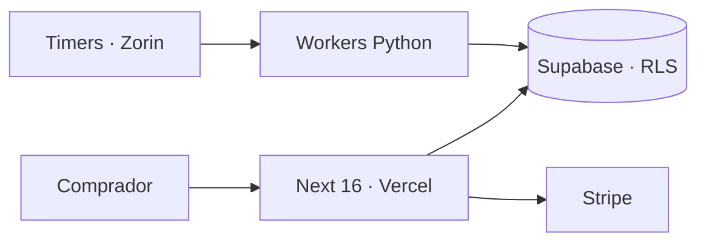

# Scraper Infoproductores

> [!resumen] En cristiano
> Web de suscripción donde agencias de lanzamientos, closers y editores de vídeo buscan **infoproductores** (gente que vende cursos online) en una base ya reunida: redes, facturación estimada, lanzamientos, anuncios y contacto. Cada búsqueda y cada contacto desbloqueado gastan créditos; hay plan gratis con pocos y planes de pago con más. Estado: los 6 documentos están aprobados; falta validar demanda (5-10 entrevistas y una preventa) antes de construir más que la demo.

## Documentos
[[1 - PRD]] · [[Ficha de Investigacion]] · [[2 - TRD]] · [[3 - UI-UX Design]] · [[Paleta de Componentes]] · [[4 - AppFlow]] · [[5 - Backend Schema]] · [[6 - Plan de Implementacion]] · [[Guia - Skills y reglas por fase]]

## Resumen técnico
- **Vía**: micro SaaS con intención de monetizar. Kill: 60-90 días sin 5 clientes de pago.
- **Stack**: `starter-saas` lite (Next 16, Supabase con RLS, Stripe) + workers Python con Scrapling en Zorin.
- **Créditos**: libro de movimientos (`credit_ledger`) y dos funciones atómicas (`ejecutar_busqueda`, `desbloquear_contacto`) con claves de idempotencia; verificadas en PGlite (21/21).
- **Identidad**: «libro mayor» (papel hueso, verde botella, Hanken Grotesk + JetBrains Mono), solo CSS, nivel 1.
- **Clasificación**: reglas de código (decidido 2026-11-01); Laya (IA) solo como prueba de v2.

## Puertas abiertas
1. **Paso 0**: 5-10 entrevistas y preventa.
2. **Fuentes de v1**: oficiales (YouTube, Meta Ad Library) recomendado; Instagram/Hotmart/Digistore tras revisión legal.
3. **Antes de cobrar**: [[Checklist pre-cobro (micro SaaS)]] y revisión legal humana (RGPD).
4. Cantidades de créditos y precios de planes; hosting Vercel; verificar versiones con npm/context7 al crear el repo.

## Guía operativa
Repo: `~/Proyectos/scraper-infoproductores/` (git iniciado, sin código). Siguiente paso tras las puertas: tarea T-01 del plan (scaffold desde `starter-saas` lite con Node 22).
