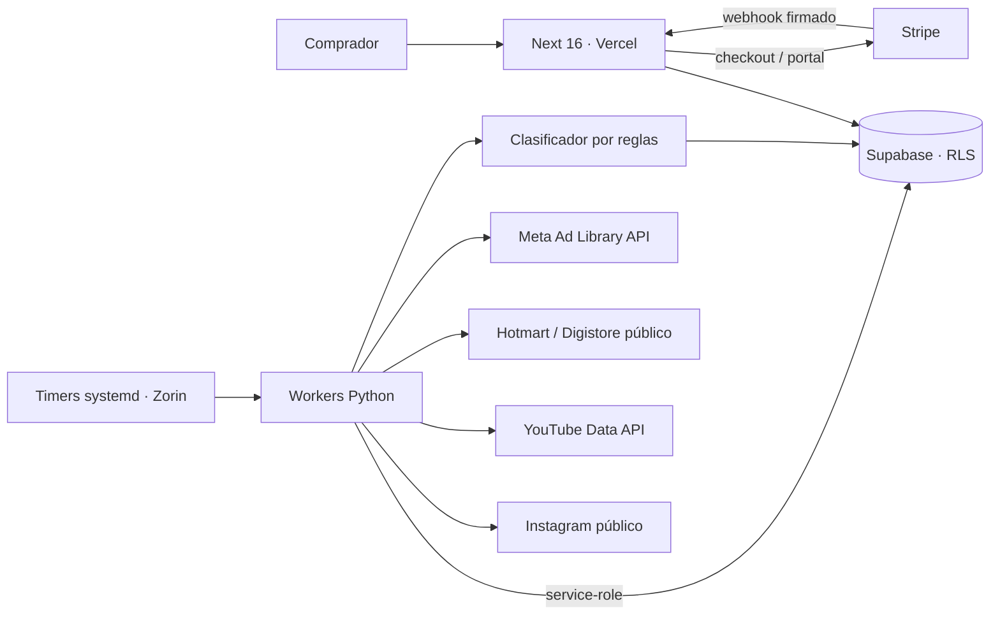

# 2 · TRD — Technical Requirements Document

> [!resumen] En cristiano
> La web es la plantilla `starter-saas` (login, datos por usuario y cobro ya hechos). Aparte, unos programas en el servidor Zorin recogen datos públicos cada cierto tiempo y los guardan en la misma base de datos. Los créditos se llevan como un libro de movimientos (cada gasto es una línea), así nada se pierde ni se duplica. La clasificación es con reglas de código. Lo más delicado no es técnico sino legal: qué datos de personas se guardan.

> Vía micro SaaS: TRD corto. Resto de documentos (3 UI-UX sí; 4 AppFlow y 5 Backend Schema en versión mínima) según el Plan.

## 1. Stack elegido
| Capa | Elección | Alternativa descartada | Por qué |
|---|---|---|---|
| Frontend | Next 16.4.1 + React 19.3 + Tailwind 4 (de `starter-saas` lite) | Astro | Ya hecho y probado; hace falta sesión y panel |
| Backend / API | Route Handlers de Next (login, créditos, desbloqueos, webhook de Stripe) | Servidor aparte | Menos piezas para una persona |
| Recogida de datos (workers) | Python en Zorin con Scrapling (venv existente) + timers de systemd, reutilizando lo de Laya Leads | Todo en TypeScript/Bun | Scrapling ya instalado y probado con anti-bot; el worker no es web |
| Base de datos | Supabase Postgres con RLS | SQLite en Zorin | Web y workers comparten datos y el starter ya trae RLS |
| Auth | Supabase Auth: Google (OAuth) + enlace mágico (`@supabase/ssr`) | Clerk | Enlace mágico viene en el starter; Google es un proveedor más de Supabase |
| Pagos | Stripe Checkout + portal + webhook, modo prueba hasta la checklist | Lemon Squeezy | Viene en el starter |
| Hosting | Web en Vercel (por confirmar con Haytham: coste); workers en Zorin | Todo en Zorin | Disponibilidad de la web sin depender de casa |

### 1.1 Ficha por librería (verificada, no de memoria)
Versiones leídas de `~/Proyectos/starter-saas/package.json` (instaladas y probadas). **No contrastadas con npm ni context7 en esta sesión**: se hace al crear el repo (`npm view <lib> version time.modified license`).
| Librería | Versión | Último release | Mantenimiento | Peso (kB gzip) | Licencia | Node 22 / React 19 | Fuente | Trampas conocidas |
|---|---|---|---|---|---|---|---|---|
| next | 16.4.1 | por verificar | por verificar | por medir | MIT (por verificar) | Sí / Sí | starter-saas | `cacheComponents`: envolver `cookies()` en Suspense; se desactivó en el starter |
| @supabase/ssr + supabase-js | ^0.12.7 / ^2.118.0 | por verificar | por verificar | por medir | MIT (por verificar) | Sí | starter-saas | `auth.getClaims()` en el proxy; no usar `auth-helpers-nextjs` |
| stripe | ^23.0.1 | por verificar | por verificar | solo servidor | MIT (por verificar) | Sí | starter-saas | `current_period_end` en `SubscriptionItem`; firma con cuerpo en bruto |
| zod | ^4.6.7 | por verificar | por verificar | por medir | MIT (por verificar) | Sí | starter-saas | — |
| Scrapling (Python) | 0.4.15 | — | — | n/a | BSD-3 (por verificar) | n/a | `skills-frecuentes.md` | Faltan libs del sistema para Chromium; ejecutar con `python -I` |

### 1.2 Presupuesto de dependencias
| Límite | Máximo | Previsto |
|---|---|---|
| Motores de animación | 1 | 0-1 (decide la identidad) |
| Imágenes | — | SVG y WebP; sin generación de imagen en el producto |
| Librerías de UI base | 1 + registries | shadcn + registries por sección |
| JS inicial (kB gzip) | 200 | ≤ 150 (por medir) |
| Dependencias directas | 25 | 7 del starter + gráficas y tablas (~10) |

## 2. Arquitectura

## 3. Integraciones y servicios externos
| Servicio | Para qué | Coste | Límites / cuotas | Plan B |
|---|---|---|---|---|
| Meta Ad Library API | Anuncios activos | Gratis (verificar acceso) | Límite de peticiones y acceso por país (por verificar) | Consulta manual de muestra |
| YouTube Data API v3 | Canales y vídeos | Gratis con cuota diaria | Cuota por proyecto | Reducir frecuencia |
| Instagram / Hotmart / Digistore | Perfil público, ofertas | Gratis | Bloqueos y términos de uso | **Decisión del TRD abierta** (ver §8): empezar solo con fuentes oficiales y listados públicos |
| Supabase | BD y login | Plan gratis al inicio | 500 MB / correo ~2 por hora | Plan de pago |
| Stripe | Cobro | % por cobro | — | — |
| Zorin | Workers | Luz | Un PC en casa | Segundo equipo |

## 4. Seguridad y datos
- **Autenticación y roles**: comprador (acceso por RLS a sus listas, créditos y desbloqueos) y admin (salud de fuentes, tabla de bajas). Trazan al PRD §2.
- **Créditos**: tabla `credit_ledger` (solo inserciones; saldo = suma). Dos gastos: **búsqueda** (función `ejecutar_busqueda`, cobra y devuelve la página de resultados sin contacto) y **desbloqueo** (función `desbloquear_contacto`, cobra y guarda el contacto en `listas_contactos` del usuario). Ambas en una transacción atómica que comprueba saldo, con clave de idempotencia. Un contacto ya desbloqueado no se vuelve a cobrar (clave única usuario + infoproductor). Paginar resultados de la misma búsqueda no cobra otra vez (se cobra por `busqueda_id`).
- **Plan gratis**: al verificar el correo, un asiento de `credit_ledger` con los créditos iniciales (una sola vez por usuario; límites contra cuentas falsas). Planes de pago: el webhook de Stripe `invoice.paid` añade los créditos del mes. Cantidades y precios: se fijan en el Backend Schema tras la preventa.
- **Contactos**: email/teléfono en tabla aparte `infoproductor_contactos`; sin política de lectura directa para compradores. Solo se ven a través de `listas_contactos` (tras desbloquear).
- **Datos personales / RGPD**: guardar solo datos públicos, con fecha y fuente de captura; no guardar datos sensibles; base legal (interés legítimo) documentada; aviso a la persona afectada; canal de baja (US-08) con borrado en cascada y lista de exclusión para que el worker no vuelva a recogerla; registro de tratamientos. Revisión legal humana antes de cobrar.
- **Secretos**: `.env` fuera del repo; `service_role` solo en servidor y workers; `.env.example` con `!.env.example` en `.gitignore`.

## 5. Rendimiento y escalado
- Carga esperada: decenas de compradores, ~1.000-5.000 fichas. Búsqueda con índices Postgres (texto + filtros); sin motor de búsqueda aparte.
- Persistencia solo en Supabase; nada de memoria volátil en serverless.
- Workers: educados (robots.txt, 1 s de espera, RAM baja como Laya Leads), una fuente por timer, con reintentos y salud registrada.

## 6. Entornos y CI
- Local (PGlite para probar RLS y créditos, como el starter), producción (Vercel + Supabase). Staging: no en micro SaaS.
- `tsc --noEmit`, lint y `vitest` antes de cada commit; revisión de solo lectura (`revisor-codigo`) antes de cada release; merge humano.

## 7. Trazabilidad PRD → técnica
| Requisito PRD | Solución técnica |
|---|---|
| RF-01 | Workers Python por fuente + timers; solo datos públicos y APIs oficiales |
| RF-02 | Módulo de reglas (nicho por palabras clave, nivel por señales) en el worker |
| RF-03 | Columna `facturacion_estimada` + `metodo_estimacion`; la UI siempre dice "estimada" |
| RF-04 | `credit_ledger` + `ejecutar_busqueda` + `desbloquear_contacto` + créditos gratis al registrarse + asignación mensual por webhook |
| RF-07 | Supabase Auth: Google y enlace mágico |
| RF-08 | `listas_contactos` por usuario (RLS) + exportación CSV |
| RF-05 | Stripe Checkout, portal y webhook idempotente (del starter) |
| RF-06 | Formulario de baja → cola de bajas → borrado en cascada + lista de exclusión |
| US-01/02 | Tablas `infoproductores`, `lanzamientos`, `anuncios` + búsqueda indexada |
| US-03 | `desbloquear_contacto` (ver §4) |
| US-09 | Registro con Google/enlace + asiento de créditos iniciales |
| US-05 | Listas por usuario + exportación CSV sin coste extra (PRD RF-08; ya se pagó al desbloquear) |
| US-07 | Tabla `fuentes_estado` + panel admin |

## 8. Riesgos técnicos
> [!riesgo]
> - **Instagram y Hotmart/Digistore**: sin API oficial para esto; el scraping puede violar términos y romperse a diario. Propuesta: v1 con fuentes oficiales y listados públicos; ampliar solo si la demanda lo justifica y tras revisión legal.
> - **Facturación estimada**: sin fuente real, es una suposición. Definir el método en el Backend Schema y mostrarlo al usuario.
> - **Filtro por ciudad**: la ubicación sale de bios y perfiles; habrá fichas sin ciudad. Guardar `ubicacion` y `ubicacion_confianza`.
> - **Abuso del plan gratis**: correo verificado obligatorio, un asiento inicial por usuario, límite de búsquedas por hora.
> - **Doble gasto de créditos** por reintentos del webhook o doble clic: resolver con idempotencia y pruebas.
> - **Zorin como punto único de fallo** para la recogida: aceptable en v1 (los datos viejos siguen visibles con su fecha).

---
Anterior: [[1 - PRD]] · Siguiente: [[3 - UI-UX Design]]
