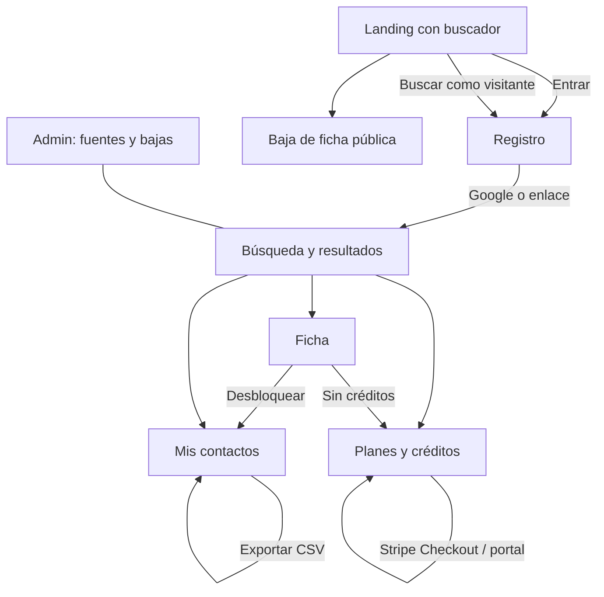
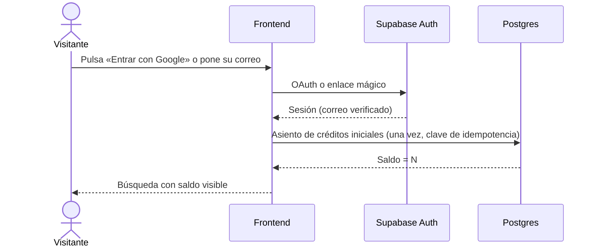
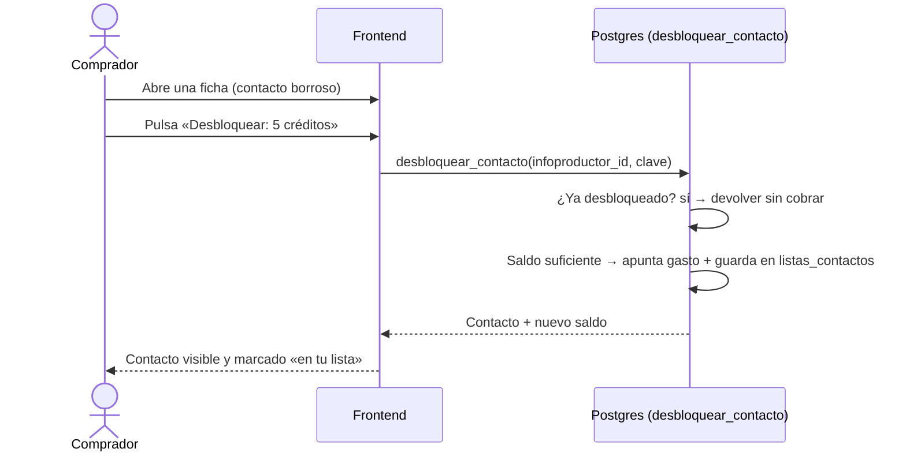
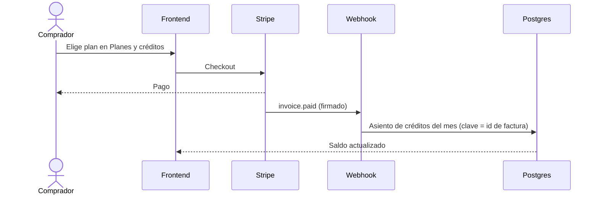
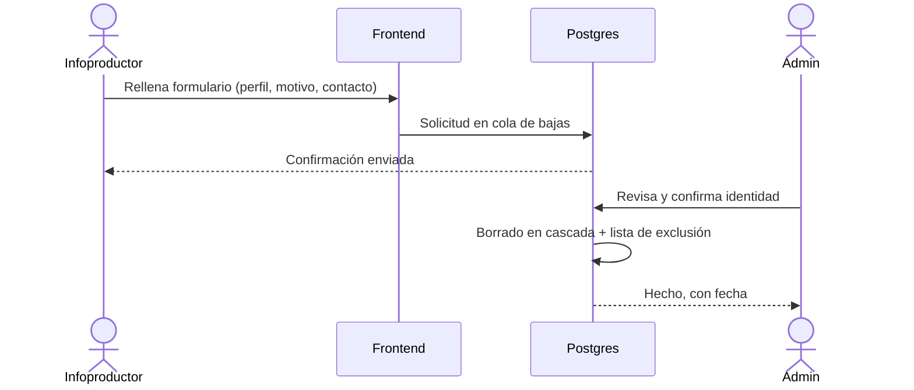

# 4 · AppFlow

> [!resumen] En cristiano
> Cómo se mueve cada persona por la web, paso a paso, y qué pasa cuando algo falla. Lo importante: **el coste se ve antes de gastar**, **un contacto desbloqueado no se cobra dos veces** y **sin créditos nunca hay un muro mudo**. Versión mínima (vía micro SaaS): 5 flujos, los que mueven dinero o datos personales.

## 1. Mapa de navegación

Cabecera común con el saldo visible en toda pantalla autenticada. El visitante ve la landing con ejemplos reales (sin contacto) y, al lanzar su propia búsqueda, se le pide registro.

## 2. Flujos principales

### Flujo 1 — Registro y créditos gratis (US-09)

- Camino feliz: el usuario llega a la búsqueda con el saldo del plan gratis.
- Alternativas y errores:
  - Enlace caducado o ya usado → «Este enlace ya no vale. Pide otro» con botón.
  - Correo sin verificar → no hay asiento de créditos hasta verificar.
  - Segundo intento de asiento (recarga, doble clic) → la clave de idempotencia lo ignora: nunca hay créditos gratis dobles.
  - Google cancelado → vuelve al registro sin error técnico.

### Flujo 2 — Buscar gastando créditos (US-01)
```mermaid
sequenceDiagram
  actor U as Comprador
  participant F as Frontend
  participant D as Postgres (ejecutar_busqueda)
  U->>F: Escribe consulta y filtros; ve «Búsqueda: 2 créditos»
  U->>F: Pulsa Buscar
  F->>D: ejecutar_busqueda(consulta, filtros, clave)
  D->>D: ¿Saldo ≥ coste? Apunta gasto con busqueda_id
  D-->>F: Página 1 de resultados (sin contacto) + nuevo saldo
  F-->>U: Fichas entran en fila; saldo baja con «tic»
  U->>F: Página siguiente
  F->>D: Misma busqueda_id (sin cobro)
```
- Camino feliz: se cobra una vez por `busqueda_id`; paginar es gratis.
- Alternativas y errores:
  - Sin créditos → mensaje en línea «Te faltan 1 crédito. Ver planes» (no se ejecuta nada).
  - Doble clic o reintento → misma clave, un solo cobro.
  - Cero resultados → no es un error; se cobró la búsqueda, lo dice el mensaje y sugiere quitar un filtro.
  - Fallo de red tras cobrar → al reintentar con la misma clave se devuelven los resultados sin volver a cobrar.
  - Filtro por ciudad → se avisa de cuántas fichas no tienen ubicación.

### Flujo 3 — Ver ficha y desbloquear contacto (US-02, US-03)

- Camino feliz: el contacto queda guardado en la lista del usuario; volver a la ficha no cuesta nada.
- Alternativas y errores:
  - Sin créditos → modal con el paso siguiente (planes), sin gastar.
  - Ya desbloqueado antes → se muestra directamente, sin cobro.
  - Dos pestañas a la vez → la restricción única usuario + infoproductor impide el doble cobro.
  - Ficha dada de baja entre medias → «Esta ficha ya no está disponible» y no se cobra.

### Flujo 4 — Pasar a plan de pago (US-04)

- Camino feliz: tras pagar, el saldo sube y el libro de movimientos muestra el apunte.
- Alternativas y errores:
  - Pago fallido o impago → estado «impago» en Planes, sin créditos nuevos; el saldo existente se conserva.
  - Webhook repetido → misma clave de factura, un solo asiento.
  - Webhook tarda → pantalla «Estamos confirmando tu pago» con recarga automática breve.
  - Baja desde el portal de Stripe → el plan baja a gratis al acabar el periodo; los créditos ya dados no se quitan.

### Flujo 5 — Baja de ficha por un infoproductor (US-08)

- Camino feliz: la ficha desaparece de búsquedas y de las listas de los compradores, y el worker no la vuelve a recoger.
- Alternativas y errores:
  - Solicitud sin forma de verificar → el admin pide confirmación antes de borrar.
  - Corrección en vez de borrado → el admin edita y deja constancia.
  - Contacto ya desbloqueado por compradores → se borra también de sus listas (cascada).
  - Cada baja queda registrada con fecha (registro de tratamientos).

### Flujo 6 — Mis contactos y CSV (US-05)
El comprador abre «Mis contactos» (`mis_contactos`), ve solo lo que desbloqueó y pulsa «Exportar CSV». No cuesta créditos: ya se pagó al desbloquear. Lista vacía → «Aún no has desbloqueado ninguno». Sesión caducada → vuelve al registro y el CSV no se genera.

### Fuera de v1 (US-06)
Alertas de nuevos lanzamientos (Could): sin flujo ni pantalla en v1.

### Flujo admin (US-07)
Entra a «Admin: fuentes y bajas», ve el mapa de calor de recogidas por fuente y día, abre una fuente con fallos, pulsa «Reintentar» (el timer de Zorin la recoge en su próxima pasada) y gestiona la cola de bajas.

## 3. Permisos por rol
| Pantalla / acción | Comprador | Admin | Anónimo |
|---|---|---|---|
| Landing con ejemplos reales (sin contacto) | Sí | Sí | Sí |
| Registro / entrada | n/a | n/a | Sí |
| Buscar (gasta créditos) | Sí | Sí | No: pide registro |
| Ver ficha (sin contacto) | Sí | Sí | No |
| Desbloquear contacto | Sí (con créditos) | No (no compra) | No |
| Mis contactos y CSV | Solo los suyos | No | No |
| Planes y créditos | Sí | Ver | No |
| Baja de ficha (formulario) | Sí | Sí | Sí |
| Admin: fuentes y bajas | No | Sí | No |

## 4. Estados globales
- **Carga inicial**: esqueleto de rejilla de libro mayor, sin parpadeos.
- **Sesión caducada**: vuelve al registro conservando la búsqueda en curso; no se cobra al reintentar (misma clave).
- **Offline**: banda «Sin conexión»; se bloquean acciones que cuestan créditos.
- **Vacío**: cada pantalla dice qué falta y qué hacer (tabla de UI-UX §4).
- **Error 500**: mensaje claro, «No se ha cobrado nada» o «Se cobró y puedes reintentar sin coste», según el caso, con el saldo real visible.
- **Sin créditos**: nunca muro mudo; siempre plan o espera como paso siguiente.

## 5. Cliente simulado
Antes de aprobar, un agente por rol recorre cada flujo. Pendiente de lanzar tras tu visto bueno al borrador (se hace en un solo agente por rol, solo lectura).
| Rol simulado | Flujo | Atascos detectados | Cambio aplicado |
|---|---|---|---|
| Closer de 30 años, nivel digital medio, móvil | 1, 2, 3 | pendiente | pendiente |
| Agencia de lanzamientos, escritorio | 2, 3, 4 | pendiente | pendiente |
| Infoproductor que pide su baja | 5 | pendiente | pendiente |

## 6. Ciclo completo a validar
- [ ] Registro → créditos gratis una sola vez → refrescar → buscar → refrescar (saldo correcto) → desbloquear → refrescar (sigue desbloqueado, sin cobro) → baja de la ficha → refrescar (desaparece también de «Mis contactos»)
- [ ] Pago → saldo sube → repetir webhook → saldo igual

---
Anterior: [[3 - UI-UX Design]] · Siguiente: [[5 - Backend Schema]]
