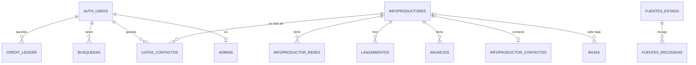

# 5 · Backend Schema

> [!resumen] En cristiano
> La base de datos guarda tres cosas: **los infoproductores** (lo que recogen los programas de Zorin), **el libro de créditos** de cada usuario (cada gasto o ingreso es una línea; el saldo es la suma) y **las listas de contactos desbloqueados**. El cobro de créditos vive dentro de la base de datos, en dos funciones que hacen todo de golpe o nada, para que un doble clic o un reintento nunca cobre dos veces. Los emails y teléfonos están en una tabla cerrada: solo salen a través del desbloqueo. Las cantidades de créditos son **provisionales** hasta la preventa y están en una tabla de configuración, no escritas en el código.

Parte de las tablas `profiles` y `subscriptions` del starter (`0001_base.sql`); aquí solo se añade lo propio del producto. Esquema real de la BD remota: **aún no existe** (repo sin crear); al crear el proyecto se comprueba con `list_tables` antes de aplicar.

## 1. Diagrama entidad-relación


## 2. SQL ejecutable
Los bloques ```` ```sql ```` se concatenan en la migración y los ```` ```sql seed ```` en la semilla con `schema_to_migration.py`. Toda FK lleva `ON DELETE`.

Tablas de datos recogidos (las escribe solo `service_role`, el worker de Zorin):
```sql
create table public.infoproductores (
  id uuid primary key default gen_random_uuid(),
  slug text not null unique,
  nombre_publico text not null,
  bio text,
  nicho text,
  plataforma_principal text,
  ubicacion text,
  ubicacion_confianza text not null default 'ninguna'
    check (ubicacion_confianza in ('ninguna', 'baja', 'media', 'alta')),
  facturacion_estimada numeric(12,2),
  metodo_estimacion text,
  demo boolean not null default false,
  activo boolean not null default true,
  captured_at timestamptz not null default now(),
  texto_busqueda tsvector generated always as (
    to_tsvector('spanish'::regconfig,
      coalesce(nombre_publico, '') || ' ' || coalesce(nicho, '') || ' ' || coalesce(bio, ''))
  ) stored,
  check ((facturacion_estimada is null) = (metodo_estimacion is null))
);
create index infoproductores_texto_idx on public.infoproductores using gin (texto_busqueda);
create index infoproductores_nicho_idx on public.infoproductores (nicho) where activo;
create index infoproductores_ubicacion_idx on public.infoproductores (lower(ubicacion)) where activo;

create table public.infoproductor_redes (
  id uuid primary key default gen_random_uuid(),
  infoproductor_id uuid not null references public.infoproductores (id) on delete cascade,
  red text not null check (red in ('instagram', 'youtube', 'hotmart', 'digistore', 'web', 'otra')),
  url text not null,
  seguidores integer check (seguidores >= 0),
  captured_at timestamptz not null default now(),
  unique (infoproductor_id, red, url)
);
create index infoproductor_redes_ip_idx on public.infoproductor_redes (infoproductor_id);

create table public.lanzamientos (
  id uuid primary key default gen_random_uuid(),
  infoproductor_id uuid not null references public.infoproductores (id) on delete cascade,
  nombre text not null,
  fecha date not null,
  plataforma text,
  precio_oferta numeric(10,2),
  alumnos_publicos integer check (alumnos_publicos >= 0),
  fuente text not null,
  captured_at timestamptz not null default now(),
  unique (infoproductor_id, nombre, fecha)
);
create index lanzamientos_ip_fecha_idx on public.lanzamientos (infoproductor_id, fecha desc);

create table public.anuncios (
  id uuid primary key default gen_random_uuid(),
  infoproductor_id uuid not null references public.infoproductores (id) on delete cascade,
  ad_id text not null,
  activo boolean not null default true,
  primera_vista date not null,
  ultima_vista date not null,
  fuente text not null default 'meta_ad_library',
  unique (infoproductor_id, ad_id)
);
create index anuncios_ip_idx on public.anuncios (infoproductor_id) where activo;

-- Datos personales: sin política de lectura para nadie salvo service_role.
create table public.infoproductor_contactos (
  infoproductor_id uuid primary key references public.infoproductores (id) on delete cascade,
  email text,
  telefono text,
  fuente text not null,
  captured_at timestamptz not null default now(),
  check (email is not null or telefono is not null)
);

create table public.fuentes_estado (
  fuente text primary key,
  ultimo_ok timestamptz,
  ultimo_error timestamptz,
  mensaje text,
  reintentar boolean not null default false,
  updated_at timestamptz not null default now()
);

create table public.fuentes_recogidas (
  id uuid primary key default gen_random_uuid(),
  fuente text not null references public.fuentes_estado (fuente) on delete cascade,
  dia date not null,
  items integer not null default 0 check (items >= 0),
  errores integer not null default 0 check (errores >= 0),
  unique (fuente, dia)
);
```

Tablas de usuario, créditos y bajas:
```sql
create table public.admins (
  user_id uuid primary key references auth.users (id) on delete cascade
);

-- Cantidades provisionales: se fijan tras la preventa, sin tocar el código.
create table public.config (
  clave text primary key,
  valor integer not null check (valor >= 0)
);

-- Libro mayor: solo inserciones. Saldo = suma de delta.
create table public.credit_ledger (
  id bigint generated always as identity primary key,
  user_id uuid not null references auth.users (id) on delete cascade,
  delta integer not null check (delta <> 0),
  motivo text not null check (motivo in ('inicial', 'plan_mensual', 'busqueda', 'desbloqueo', 'ajuste')),
  ref_id text,
  clave text not null unique,
  created_at timestamptz not null default now()
);
create index credit_ledger_user_idx on public.credit_ledger (user_id, created_at desc);

create table public.busquedas (
  id uuid primary key default gen_random_uuid(),
  user_id uuid not null references auth.users (id) on delete cascade,
  clave text not null,
  filtros jsonb not null,
  coste integer not null check (coste >= 0),
  created_at timestamptz not null default now(),
  unique (user_id, clave)
);

create table public.listas_contactos (
  user_id uuid not null references auth.users (id) on delete cascade,
  infoproductor_id uuid not null references public.infoproductores (id) on delete cascade,
  created_at timestamptz not null default now(),
  primary key (user_id, infoproductor_id)
);

create table public.lista_exclusion (
  huella text primary key,
  created_at timestamptz not null default now()
);

create table public.bajas (
  id uuid primary key default gen_random_uuid(),
  infoproductor_id uuid references public.infoproductores (id) on delete set null,
  perfil_url text not null check (length(perfil_url) between 8 and 500),
  motivo text check (length(motivo) <= 2000),
  contacto_email text not null check (contacto_email ~* '^[^@\s]+@[^@\s]+\.[^@\s]+$'),
  estado text not null default 'pendiente' check (estado in ('pendiente', 'procesada', 'rechazada')),
  created_at timestamptz not null default now(),
  resuelta_at timestamptz
);
```

Funciones. Todas con `security definer` y `search_path` vacío; el saldo se calcula bajo un candado por usuario para que dos peticiones simultáneas no gasten más de lo que hay:
```sql
create function public.es_admin() returns boolean
language sql stable security definer set search_path = '' as $$
  select exists (select 1 from public.admins a where a.user_id = (select auth.uid()))
$$;

create function public.mi_saldo() returns integer
language sql stable security definer set search_path = '' as $$
  select coalesce(sum(l.delta), 0)::integer
  from public.credit_ledger l where l.user_id = (select auth.uid())
$$;

-- Créditos iniciales: una sola vez por usuario con correo verificado.
create function public.conceder_creditos_iniciales() returns integer
language plpgsql security definer set search_path = '' as $$
declare
  v_uid uuid := auth.uid();
  v_cant integer;
begin
  if v_uid is null then raise exception 'no_autenticado'; end if;
  if not exists (select 1 from auth.users u where u.id = v_uid and u.email_confirmed_at is not null) then
    raise exception 'correo_sin_verificar';
  end if;
  select c.valor into v_cant from public.config c where c.clave = 'creditos_iniciales';
  insert into public.credit_ledger (user_id, delta, motivo, clave)
  values (v_uid, v_cant, 'inicial', 'inicial:' || v_uid)
  on conflict (clave) do nothing;
  return public.mi_saldo();
end $$;

-- Créditos del mes por factura pagada. Solo service_role (webhook de Stripe).
create function public.conceder_creditos_plan(p_user uuid, p_creditos integer, p_factura text)
returns void language sql security definer set search_path = '' as $$
  insert into public.credit_ledger (user_id, delta, motivo, ref_id, clave)
  values (p_user, p_creditos, 'plan_mensual', p_factura, 'factura:' || p_factura)
  on conflict (clave) do nothing
$$;

-- Cobra una búsqueda. Misma clave = mismo resultado y sin segundo cobro.
create function public.ejecutar_busqueda(p_filtros jsonb, p_clave text)
returns table (busqueda_id uuid, saldo integer)
language plpgsql security definer set search_path = '' as $$
declare
  v_uid uuid := auth.uid();
  v_id uuid;
  v_coste integer;
  v_saldo integer;
begin
  if v_uid is null then raise exception 'no_autenticado'; end if;
  if p_clave is null or length(p_clave) < 8 then raise exception 'clave_invalida'; end if;
  if jsonb_typeof(p_filtros) is distinct from 'object' then raise exception 'filtros_invalidos'; end if;
  perform pg_advisory_xact_lock(hashtextextended(v_uid::text, 0));

  select b.id into v_id from public.busquedas b where b.user_id = v_uid and b.clave = p_clave;
  if v_id is null then
    select c.valor into v_coste from public.config c where c.clave = 'coste_busqueda';
    select coalesce(sum(l.delta), 0)::integer into v_saldo
      from public.credit_ledger l where l.user_id = v_uid;
    if v_saldo < v_coste then raise exception 'sin_creditos'; end if;
    insert into public.busquedas (user_id, clave, filtros, coste)
      values (v_uid, p_clave, p_filtros, v_coste) returning id into v_id;
    insert into public.credit_ledger (user_id, delta, motivo, ref_id, clave)
      values (v_uid, -v_coste, 'busqueda', v_id::text, 'busqueda:' || v_id);
  end if;

  select coalesce(sum(l.delta), 0)::integer into v_saldo
    from public.credit_ledger l where l.user_id = v_uid;
  return query select v_id, v_saldo;
end $$;

-- Una página de resultados de una búsqueda ya cobrada. No cobra ni expone contacto.
create function public.resultados_busqueda(p_busqueda_id uuid, p_pagina integer default 1, p_tam integer default 20)
returns table (
  id uuid, slug text, nombre_publico text, nicho text, plataforma_principal text,
  ubicacion text, facturacion_estimada numeric, metodo_estimacion text,
  captured_at timestamptz, lanzamientos_12m integer, desbloqueado boolean
)
language sql stable security definer set search_path = '' as $$
  select i.id, i.slug, i.nombre_publico, i.nicho, i.plataforma_principal,
         i.ubicacion, i.facturacion_estimada, i.metodo_estimacion, i.captured_at,
         (select count(*)::integer from public.lanzamientos z
           where z.infoproductor_id = i.id and z.fecha >= current_date - 365),
         exists (select 1 from public.listas_contactos lc
                  where lc.user_id = b.user_id and lc.infoproductor_id = i.id)
  from public.busquedas b
  join public.infoproductores i on i.activo
  where b.id = p_busqueda_id and b.user_id = (select auth.uid())
    and (b.filtros->>'q' is null or i.texto_busqueda @@ plainto_tsquery('spanish'::regconfig, b.filtros->>'q'))
    and (b.filtros->>'nicho' is null or i.nicho = b.filtros->>'nicho')
    and (b.filtros->>'ubicacion' is null or lower(i.ubicacion) = lower(b.filtros->>'ubicacion'))
    and (b.filtros->>'plataforma' is null or i.plataforma_principal = b.filtros->>'plataforma')
    and (b.filtros->>'fact_min' is null or i.facturacion_estimada >= (b.filtros->>'fact_min')::numeric)
  order by i.facturacion_estimada desc nulls last, i.id
  limit least(greatest(p_tam, 1), 50)
  offset (greatest(p_pagina, 1) - 1) * least(greatest(p_tam, 1), 50)
$$;

-- Desbloquea un contacto: si ya está en la lista, lo devuelve sin cobrar.
create function public.desbloquear_contacto(p_infoproductor uuid)
returns table (email text, telefono text, saldo integer)
language plpgsql security definer set search_path = '' as $$
declare
  v_uid uuid := auth.uid();
  v_coste integer;
  v_saldo integer;
begin
  if v_uid is null then raise exception 'no_autenticado'; end if;
  perform pg_advisory_xact_lock(hashtextextended(v_uid::text, 0));

  if not exists (select 1 from public.listas_contactos lc
                  where lc.user_id = v_uid and lc.infoproductor_id = p_infoproductor) then
    if not exists (select 1 from public.infoproductores i where i.id = p_infoproductor and i.activo)
       or not exists (select 1 from public.infoproductor_contactos c where c.infoproductor_id = p_infoproductor) then
      raise exception 'ficha_no_disponible';
    end if;
    select c.valor into v_coste from public.config c where c.clave = 'coste_desbloqueo';
    select coalesce(sum(l.delta), 0)::integer into v_saldo
      from public.credit_ledger l where l.user_id = v_uid;
    if v_saldo < v_coste then raise exception 'sin_creditos'; end if;
    insert into public.credit_ledger (user_id, delta, motivo, ref_id, clave)
      values (v_uid, -v_coste, 'desbloqueo', p_infoproductor::text, 'desbloqueo:' || v_uid || ':' || p_infoproductor);
    insert into public.listas_contactos (user_id, infoproductor_id) values (v_uid, p_infoproductor);
  end if;

  select coalesce(sum(l.delta), 0)::integer into v_saldo
    from public.credit_ledger l where l.user_id = v_uid;
  return query
    select c.email, c.telefono, v_saldo
    from public.infoproductor_contactos c where c.infoproductor_id = p_infoproductor;
end $$;

-- Lista personal para pantalla y CSV (no cobra: ya se pagó al desbloquear).
create function public.mis_contactos()
returns table (infoproductor_id uuid, nombre_publico text, email text, telefono text, desbloqueado_en timestamptz)
language sql stable security definer set search_path = '' as $$
  select lc.infoproductor_id, i.nombre_publico, c.email, c.telefono, lc.created_at
  from public.listas_contactos lc
  join public.infoproductores i on i.id = lc.infoproductor_id
  join public.infoproductor_contactos c on c.infoproductor_id = lc.infoproductor_id
  where lc.user_id = (select auth.uid())
  order by lc.created_at desc
$$;

-- Baja: huella en la lista de exclusión, borrado en cascada y cierre de la solicitud.
create function public.procesar_baja(p_baja uuid) returns void
language plpgsql security definer set search_path = '' as $$
declare
  v_baja public.bajas%rowtype;
begin
  if not public.es_admin() then raise exception 'no_autorizado'; end if;
  select * into v_baja from public.bajas b where b.id = p_baja and b.estado = 'pendiente' for update;
  if not found then raise exception 'baja_no_pendiente'; end if;
  insert into public.lista_exclusion (huella)
    values (encode(sha256(convert_to(lower(v_baja.perfil_url), 'UTF8')), 'hex'))
    on conflict do nothing;
  if v_baja.infoproductor_id is not null then
    delete from public.infoproductores i where i.id = v_baja.infoproductor_id;
  end if;
  update public.bajas b set estado = 'procesada', resuelta_at = now() where b.id = p_baja;
end $$;
```

Seguridad (RLS) y permisos de ejecución:
```sql
alter table public.infoproductores enable row level security;
alter table public.infoproductor_redes enable row level security;
alter table public.lanzamientos enable row level security;
alter table public.anuncios enable row level security;
alter table public.infoproductor_contactos enable row level security;
alter table public.fuentes_estado enable row level security;
alter table public.fuentes_recogidas enable row level security;
alter table public.admins enable row level security;
alter table public.config enable row level security;
alter table public.credit_ledger enable row level security;
alter table public.busquedas enable row level security;
alter table public.listas_contactos enable row level security;
alter table public.lista_exclusion enable row level security;
alter table public.bajas enable row level security;

-- Datos públicos: el visitante solo ve las fichas de demostración; el usuario, todas las activas.
create policy infoproductores_anon on public.infoproductores
  for select to anon using (activo and demo);
create policy infoproductores_auth on public.infoproductores
  for select to authenticated using (activo);
create policy redes_ver on public.infoproductor_redes
  for select to anon, authenticated using (exists (
    select 1 from public.infoproductores i where i.id = infoproductor_id and i.activo and (i.demo or (select auth.uid()) is not null)));
create policy lanzamientos_ver on public.lanzamientos
  for select to anon, authenticated using (exists (
    select 1 from public.infoproductores i where i.id = infoproductor_id and i.activo and (i.demo or (select auth.uid()) is not null)));
create policy anuncios_ver on public.anuncios
  for select to anon, authenticated using (exists (
    select 1 from public.infoproductores i where i.id = infoproductor_id and i.activo and (i.demo or (select auth.uid()) is not null)));

-- infoproductor_contactos, lista_exclusion, config, admins: sin política = cerradas.
create policy ledger_propio on public.credit_ledger
  for select to authenticated using (user_id = (select auth.uid()));
create policy busquedas_propias on public.busquedas
  for select to authenticated using (user_id = (select auth.uid()));
create policy listas_propias on public.listas_contactos
  for select to authenticated using (user_id = (select auth.uid()));

create policy bajas_crear on public.bajas
  for insert to anon, authenticated with check (estado = 'pendiente' and infoproductor_id is null and resuelta_at is null);
create policy bajas_admin_ver on public.bajas
  for select to authenticated using (public.es_admin());
create policy fuentes_admin_ver on public.fuentes_estado
  for select to authenticated using (public.es_admin());
create policy recogidas_admin_ver on public.fuentes_recogidas
  for select to authenticated using (public.es_admin());

-- Los usuarios no escriben nada directamente: todo pasa por funciones.
revoke insert, update, delete on
  public.infoproductores, public.infoproductor_redes, public.lanzamientos, public.anuncios,
  public.infoproductor_contactos, public.fuentes_estado, public.fuentes_recogidas, public.admins,
  public.config, public.credit_ledger, public.busquedas, public.listas_contactos,
  public.lista_exclusion
  from anon, authenticated;
revoke update, delete on public.bajas from anon, authenticated;
revoke select, insert, update, delete on public.infoproductor_contactos, public.lista_exclusion,
  public.config, public.admins from anon, authenticated;
revoke select on public.bajas from anon;

revoke execute on all functions in schema public from public, anon, authenticated;
grant execute on function public.es_admin(), public.mi_saldo(), public.conceder_creditos_iniciales(),
  public.ejecutar_busqueda(jsonb, text), public.resultados_busqueda(uuid, integer, integer),
  public.desbloquear_contacto(uuid), public.mis_contactos(), public.procesar_baja(uuid)
  to authenticated;
grant execute on all functions in schema public to service_role;
```

Semilla de prueba (datos ficticios; los reales llegan del worker):
```sql seed
insert into public.config (clave, valor) values
  ('creditos_iniciales', 10), ('coste_busqueda', 2), ('coste_desbloqueo', 5)
on conflict (clave) do nothing;

insert into public.infoproductores (slug, nombre_publico, nicho, plataforma_principal, ubicacion, ubicacion_confianza, facturacion_estimada, metodo_estimacion, demo) values
  ('ana-ejemplo', 'Ana Ejemplo', 'fitness', 'instagram', 'Málaga', 'alta', 59640.00, 'alumnos_publicos', true),
  ('luis-prueba', 'Luis Prueba', 'inversión', 'youtube', 'Madrid', 'media', null, null, true),
  ('marta-demo', 'Marta Demo', 'marketing', 'hotmart', null, 'ninguna', 24850.00, 'alumnos_publicos', false);
```

## 2.1 Documentación de tablas
| Tabla | Para qué | Escribe | Lee |
|---|---|---|---|
| `infoproductores` (+ `_redes`, `lanzamientos`, `anuncios`) | Fichas públicas recogidas | worker (`service_role`) | visitante (solo `demo`), usuario (activas) |
| `infoproductor_contactos` | Email y teléfono | worker | nadie directo; solo vía `desbloquear_contacto` y `mis_contactos` |
| `credit_ledger` | Libro de créditos, solo inserciones | funciones | su dueño |
| `busquedas` | Búsquedas cobradas (filtros y coste) | `ejecutar_busqueda` | su dueño |
| `listas_contactos` | Contactos desbloqueados por usuario | `desbloquear_contacto` | su dueño |
| `config` | Créditos iniciales y costes | admin por SQL | solo funciones |
| `bajas`, `lista_exclusion` | Solicitudes RGPD y huellas de exclusión | formulario público / `procesar_baja` | admin |
| `fuentes_estado`, `fuentes_recogidas` | Salud de las fuentes | worker | admin |
| `admins` | Quién es admin | a mano | solo funciones |

- **Claves foráneas**: todo lo que cuelga de un usuario o de una ficha lleva `ON DELETE CASCADE` (borrar usuario o ficha limpia sus listas y contactos: es el borrado de la baja). `bajas.infoproductor_id` usa `SET NULL` para conservar el registro de la solicitud tras borrar la ficha (registro de tratamientos).
- **Índices**: texto completo (GIN), nicho, ubicación en minúsculas, fecha de lanzamientos por ficha, apuntes por usuario.
- **Pendiente de revisión humana**: guardar la huella de la URL (no el dato) en `lista_exclusion` es una decisión de minimización; confirmar con revisión legal.

## 3. Seguridad de datos
- **RLS por rol** (traza a los permisos del [[4 - AppFlow]]): anónimo ve fichas `demo` y puede crear una baja; comprador ve fichas activas, su libro, sus búsquedas y su lista; admin ve bajas y fuentes. Nadie escribe tablas directamente: todo cambio pasa por función o por `service_role`.
- **Contactos**: tabla sin política de lectura; el email solo sale tras desbloquear (o desde `mis_contactos`).
- **Funciones**: `security definer` con `search_path` vacío; `execute` retirado a todos y concedido solo a `authenticated` (y a `service_role` para el webhook y el worker). `conceder_creditos_plan` NO se concede a `authenticated`.
- **Candado por usuario** (`pg_advisory_xact_lock`) en ambos cobros: dos pestañas a la vez no pueden pasarse del saldo.
- **Storage**: no se usan ficheros en v1; el CSV se genera al vuelo.
- **Plan gratis**: `conceder_creditos_iniciales` exige correo verificado y es idempotente (`inicial:<uid>`).
- **Fuera del esquema**: límite de búsquedas por hora y antispam del formulario de baja (en la API, con tope por IP).

## 4. API / endpoints
| Método | Ruta | Rol | Entrada | Salida | Errores |
|---|---|---|---|---|---|
| RPC | `conceder_creditos_iniciales` | comprador | — | saldo | `correo_sin_verificar`, `no_autenticado` |
| RPC | `ejecutar_busqueda` | comprador | filtros, clave | `busqueda_id`, saldo | `sin_creditos`, `clave_invalida`, `filtros_invalidos` |
| RPC | `resultados_busqueda` | comprador | `busqueda_id`, página | fichas sin contacto | vacío si la búsqueda no es suya |
| RPC | `desbloquear_contacto` | comprador | `infoproductor_id` | email, teléfono, saldo | `sin_creditos`, `ficha_no_disponible` |
| RPC | `mis_contactos` | comprador | — | lista | — |
| RPC | `mi_saldo` | comprador | — | saldo | — |
| GET | `/api/contactos.csv` | comprador | — | CSV de `mis_contactos` (sin coste) | 401 |
| POST | `/api/baja` | anónimo | url, motivo, correo | confirmación | 400, 429 |
| RPC | `procesar_baja` | admin | `baja_id` | — | `no_autorizado`, `baja_no_pendiente` |
| POST | `/api/stripe/webhook` | Stripe | evento firmado | 200 | 400 (firma) |
| (service) | `conceder_creditos_plan` | webhook | usuario, créditos, factura | — | — |

## 5. Migraciones
- Orden: `0001_base.sql` y `0002_org.sql` del starter (solo la lite, sin org) → `<fecha>_init.sql` de este documento.
- Semilla solo en local y pruebas; `config` en producción se rellena con los valores definitivos.
- Reversibilidad: migración nueva que borra funciones y tablas en orden inverso; antes, copia de la BD.
- Verificación: pruebas en PGlite con `set role` y `reset role` en `finally` (créditos iniciales una vez, búsqueda idempotente, desbloqueo sin segundo cobro, contactos ilegibles, baja en cascada).

## 6. Cálculos y reglas de negocio
**Saldo** = suma de `delta` del usuario. **Búsqueda**: −`coste_busqueda` una vez por `busqueda_id`; paginar no cobra. **Desbloqueo**: −`coste_desbloqueo` una vez por usuario e infoproductor.

Ejemplo con valores provisionales (10 iniciales, búsqueda 2, desbloqueo 5): registro → 10; buscar → 8; paginar → 8; desbloquear a Ana → 3; volver a abrir a Ana → 3; buscar de nuevo → 1; desbloquear a otra → error `sin_creditos`, saldo 1.

**Facturación estimada**: solo si el lanzamiento trae `precio_oferta` y `alumnos_publicos`. `facturacion_estimada` = suma, sobre los lanzamientos de los últimos 12 meses con ambos datos, de `precio_oferta × alumnos_publicos`; `metodo_estimacion = 'alumnos_publicos'`. Ejemplo: 120 alumnos × 497 € = 59.640 €. Si falta alguno de los dos datos, **no se estima** (queda `null`) en vez de inventar una cifra; la UI muestra «Sin estimación».

**Pendiente**: las cantidades de créditos y los precios de los planes se fijan tras la preventa.

---
Anterior: [[4 - AppFlow]] · Siguiente: [[6 - Plan de Implementacion]]
