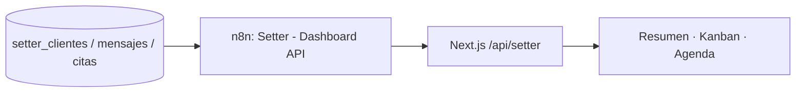

# Setter Dashboard

> [!resumen] En cristiano
> Un panel oscuro y limpio para ver cómo trabaja Mila (el Setter de WhatsApp): cuántas conversaciones y citas hay, en qué punto está cada lead (tablero tipo Kanban) y qué auditorías hay en la agenda. Lee los datos reales de n8n; un interruptor Real/Demo permite ver el diseño con datos de ejemplo. Solo lee, no cambia nada.

## Resumen ejecutivo
- Next.js 15 + Tailwind v4 + shadcn/ui + motion + recharts, en `~/Proyectos/setter-dashboard/` (puerto 3300 en desarrollo).
- Tres pantallas: Resumen (KPIs y gráficos), Kanban (5 etapas calculadas de los datos), Agenda (semana L-V 9-19 h).
- Enlace con el Setter: workflow n8n nuevo `Setter - Dashboard API` (id `kOpuEvLWSbtURpsY`, activo), webhook GET con token que devuelve las 3 tablas. El token solo está en `.env.local` y en el nodo «Validar token».

## Arquitectura

## Módulos y guía
- Lógica de datos: `src/lib/derive.ts` (etapas, KPIs, series), `demo.ts` (datos de ejemplo con semilla fija).
- Arranque: `cp .env.example .env.local`, `npm install`, `npm run dev -- -p 3300`. Detalle en el README del repo.
- Verificado: tipos, lint y `next build` limpios; las tres pantallas probadas en modo Real y Demo; móvil 375 px sin desbordamiento.
- Mejora de UI/UX (2026-11-21, segunda pasada):
  - Esqueletos de carga en las tres pantallas.
  - La ficha del lead se abre desde la actividad, el Kanban y la Agenda.
  - Tendencia frente a los 7 días anteriores en «Conversaciones».
  - Navegación por semanas en la Agenda con botones shadcn y el botón «Hoy».
  - Buscador del Kanban con botón para borrar.
  - Pulsación táctil en tarjetas y botones.
  - Verificado a 375, 768 y 1280 px.

## Rediseño UI (2026-11-22)
Resumen (4 KPI con tendencia, «Requiere atención», color con sentido), Kanban (5 columnas sin scroll, barra de reparto, orden por interés) y Agenda (columna de hoy, cita con negocio, próximas agrupadas por día). Verificado solo en Demo y sin axe/Lighthouse. Regla de color en `DESIGN.md` del repo.
Componentes añadidos: Magic UI `number-ticker` (cifras de los KPI), `magic-card` (KPI destacado y tarjetas del Kanban), `blur-fade` (entrada) y shadcn `calendar` (mini-mes en la Agenda; pulsar un día salta a su semana). No aplicados a propósito: kanban/calendarios de 21st, NumberFlow, Aceternity, dnd-kit (exigiría escribir en n8n) y animated-list.

## Pendiente
- Decidir dónde vive: local, Zorin o detrás de Tailscale (no tiene login; no publicar abierto).
- Probar con más datos reales (hoy 2 clientes, 34 mensajes, 0 citas) y revisar el rendimiento del workflow con miles de filas.
- Kanban de solo lectura: decidir si hace falta mover tarjetas (exigiría escribir en n8n).
- Pasar el flujo de 6 documentos si el panel crece; hoy PRODUCT.md/DESIGN.md del repo hacen de PRD y diseño.
- Ejecutar axe y Lighthouse antes de dar por cerrado.

Relacionado: [[01_Projects/Setter NeoZeler]]
