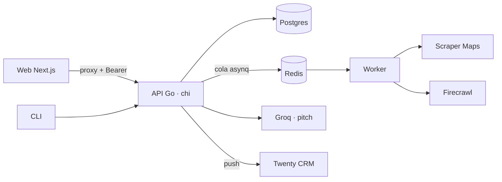

# Spyder

> [!resumen] En cristiano
> Spyder busca negocios (por ejemplo dentistas de Valencia), les pone una nota de 0 a 100 según lo mal que usan hoy internet y la IA, y te redacta un mensaje de venta para cada uno. Tiene dos usos: **Radar** (busca muchos de golpe y los guarda) y **Lookup** (le das un nombre y una ciudad en la calle y te da la ficha en unos 40 s). Los buenos se mandan al CRM Twenty. Hecho en Go, con una web propia. Estado: 8 fases hechas y probadas; faltan las claves reales de Firecrawl y Groq para ver la nota completa y el pitch.

## Resumen técnico
- **Binario único** `spyder` (cobra): `serve`, `worker`, `migrate`, `radar`, `lookup`, `leads list|push`. Go 1.22, chi, pgx v5, goose, sqlc, asynq + Redis, slog.
- **Fuentes**: scraper de Google Maps (gosom), enriquecimiento con Firecrawl, redacción con Groq (`openai/gpt-oss-120b`), envío a Twenty CRM.
- **Score**: señales con puntos y motivo (`scoring`, cobertura 100 % exigida en `make cover`). Sin clave de Firecrawl el máximo es 50.
- **API** (Bearer): `POST /radar/jobs`, `GET /radar/jobs/{id}`, `GET /leads`, `PATCH /leads/{id}/status`, `POST /leads/{id}/push`, `POST /lookup`.
- **Web** (`web/`): Next.js 16, React 19, Tailwind v4, shadcn/ui, Magic UI (`BlurFade`, `NumberTicker`), motion. Identidad heredada del Conversor MP3 (carbón + esmeralda). Un proxy en el servidor añade la clave; el navegador nunca la ve.
- **CI**: `.github/workflows/ci.yml` (lint, tests, cobertura, y build de la web). Sin remoto, nunca ejecutado.

## Fases
1-8 hechas: base, scoring, scraper, enriquecimiento, pitch, push a Twenty, README + CI (`08bfad7`), web (`8cdb576`).

## Medido (2026-11-20)
| Prueba | Resultado |
|---|---|
| Clonar y primer lookup, en Zorin | 28 s, imágenes ya en caché |
| Lookup real desde la web | ficha de «Clínica Dental Pérez» |
| Radar real, dentistas Valencia, límite 3 | 3 leads (~3 min por trabajo) |
| axe a 375, 768 y 1280 px | 0 violaciones, sin desbordes |
| Lighthouse escritorio | Rendimiento 100 · Accesibilidad 100 · Buenas prácticas 100 |
| Lighthouse móvil | Rendimiento 71 · Accesibilidad 100 · Buenas prácticas 100 |
| SEO | 60 a propósito: la página lleva `noindex` |

El 71 móvil es el tiempo de bloqueo (TBT 1,0 s) con CPU 4× más lenta: casi todo es el entorno de React y Next (257 KiB en total). No se tocó.

## Guía operativa
- Levantar: ver «Inicio rápido» del `README.md` del repo (Docker para Postgres, Redis y scraper; `make migrate`; `spyder serve` y `spyder worker`).
- Web: `cd web && cp .env.example .env.local && npm install && npm run dev -- -p 3100`. **No exponerla a internet sin login**: el proxy da acceso a toda la API.
- RGPD/LSSI: los datos de contacto son para prospección interna; revisar siempre el pitch antes de enviarlo.

## Pendiente
- Probar con claves reales de Firecrawl y Groq (nota completa y pitch en la UI) y el push a una instancia real de Twenty desde la web.
- Rotar las claves de Firecrawl, Groq y Twenty que se pegaron en el chat.
- Ejecutar el CI cuando haya remoto.
- Decidir si el radar necesita porcentaje de avance (el scraper no lo informa).

## Relacionado
[[01_Projects/Laya Leads]] · [[01_Projects/Conversor MP3 Facil]] · [[03_Resources/Registro de Identidades Visuales]]
