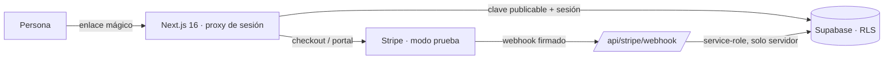

> [!resumen] En cristiano
> Es la plantilla de la que saldrá cada micro SaaS, SaaS o startup nuevo. Ya trae inicio de sesión por correo, datos separados para que nadie vea los de otro (probado), cobro por suscripción con Stripe solo en modo prueba y la lista de comprobaciones antes de cobrar, con un script que revisa lo que se puede revisar solo. Tiene dos vías: **lite** (una persona con sus datos, para micro SaaS) y **org** (equipos con roles, para SaaS y startup). Se elige con una variable. **Todavía no se ha probado contra un Supabase y un Stripe reales**: faltan las claves.

## Qué es y de dónde sale
Primer kit real de [[Starter Kits NeoZeler]]. Aplica las vías de [[01 - Tipos de producto (Micro SaaS, SaaS, Startup)]], la [[Checklist pre-cobro (micro SaaS)]] y los informes [[Claude Code para micro SaaS y startups]] y [[Claude Code para SaaS y startups - Config completa]]. Especificación en `SPEC.md` del repositorio.

## Arquitectura

- **Vía lite**: `items` y `subscriptions` por usuario (`0001_base.sql`).
- **Vía org**: `organizations`, `org_members`, `org_invites`, `org_items`, `org_subscriptions` con roles owner / admin / member (`0002_org.sql`).
- Las escrituras sensibles (suscripciones, eventos de Stripe, miembros, invitaciones) solo las hacen `service_role` o funciones que validan quién llama.
- El estado de la suscripción solo cambia por webhooks verificados, de forma idempotente y a prueba de desorden.

## Verificación hecha (2026-10-28)
- `typecheck`, `lint`, `build` en las dos vías.
- **62 pruebas**: 36 de RLS en PGlite (sin Docker, imitando roles y privilegios de Supabase), 26 de facturación, entorno y redirecciones.
- Mutaciones a mano de las migraciones: cada una hace fallar alguna prueba (una sobrevivía y se añadió la prueba de privilegios).
- Fallos reales hallados por las pruebas: `remove_member` delataba quién era propietario a un ajeno; la propietaria no podía borrar su organización por un `revoke` de más.
- `npm run precobro`: 13/13 automáticas en verde, 8 manuales pendientes (lista visible, no se dan por hechas).
- Humo HTTP sobre el servidor de producción: webhook 400 sin firma o con firma falsa, checkout 403 con origen ajeno, `/app` sin sesión a `/login`, redirección externa no seguida.

## Pendiente
- Probar contra el **Supabase real de desarrollo** (RLS con anon y dos usuarios) y un **Stripe real en modo prueba** con un evento reenviado (checklist 1.6 y 2.5).
- Generar tipos de Supabase (`supabase gen types`) cuando haya proyecto.
- Primer commit (los archivos están preparados, sin confirmar) y remoto en GitHub.
- Pruebas de interfaz en navegador y de extremo a extremo.

## Guía operativa
Puesta en marcha, comandos y estructura: `README.md` del repositorio. Antes de cobrar: `docs/CHECKLIST-PRE-COBRO.md`.
