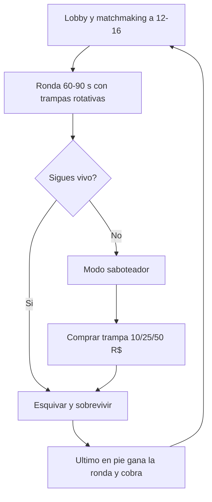

# Último en Pie: Sabotaje — Ficha de proyecto

> [!resumen]
> Arena eliminatoria para Roblox (12-16 jugadores, rondas de 60-90 s) donde el jugador eliminado pasa a ser **saboteador** y compra trampas (10-50 R$) para fastidiar a los vivos. Convierte el tiempo muerto en el momento de mayor compra. Elegida el 2026-10-14 tras descartar Abisal Drill, minería con mascotas, pesca, terror cooperativo y criaturas con votación. **Veredicto del validador: GO CONDICIONADO a un test barato de 3 semanas.** No está construido: no hay código ni repositorio.

## 1. Requisitos de Haytham
- Dificultad técnica baja, arte bajo, muchas compras pequeñas, viralidad media-alta.
- Objetivo: ~15.000 R$/día (≈ 52-57 $/día, tasa DevEx de terceros ~0,0035-0,0038 $/R$, no verificada oficialmente).
- Descartada cualquier mecánica de "steal".

## 2. Core loop

## 3. Monetización
| Producto | Tipo | Notas |
|---|---|---|
| Sabotajes (10 / 25 / 50 R$) | Developer product consumible | Efecto espectacular, no muerte garantizada; caen en zonas, no sobre un jugador por nombre |
| Estelas, explosiones de eliminación, efectos de nombre | Cosmético (partículas) | Poco arte; ojo al ruido visual con 16 jugadores |
| Pase de temporada | Pase | Fase posterior |
| Escudo, segunda vida, doble salto | Consumible | **Fuera del MVP**: riesgo pay-to-win |
| Gamepass de salto de ronda | Gamepass | **Fuera del MVP**: rompe la sensación de justicia |

Reglas: sin azar de pago (así no se exige mostrar probabilidades); los vivos no ven quién pagó; tiempo de espera entre usos.

## 4. Arquitectura técnica
- Servidor autoritativo: rondas, trampas y compras. `ProcessReceipt` idempotente, guardando antes de conceder.
- Límite de uso por jugador y por ronda en las trampas de pago.
- Matchmaking que agrupe jugadores y **bots de relleno** si el servidor queda a medias.
- Riesgo: física nativa con 16 jugadores y trampas de pago puede desincronizar. Dificultad real: **media**, no baja.

## 5. Números (todo estimación del validador)
- Base: 3 % de pagadores × 40 R$ ≈ 1,2 R$/DAU → ~12.500 DAU para 15.000 R$/día. Rango 7.500-30.000.
- El sabotaje podría añadir 0,3-0,8 R$/DAU (hipótesis).

## 6. MVP y umbrales (2-3 semanas)
1. Semana 1: arena, 4-5 trampas, rondas, eliminación, espectador, sin pagos.
2. Semana 2: 3 sabotajes (10/25/50 R$), 1 cosmético, `ProcessReceipt` robusto, telemetría.
3. Semana 3: clips para TikTok, anuncios Roblox con presupuesto pequeño, bots de relleno.

Seguir solo si: retención D1 ≥ 20 %, sesión ≥ 8 min, ≥ 3 % de pagadores entre eliminados y ARPDAU ≥ 0,8 R$ con 200 DAU. Si ARPDAU < 0,3 R$, parar.

## 7. Riesgos principales
- **Descubrimiento (n.º 1):** la mediana de creadores gana ~1.500 $ en 12 meses; sin tráfico externo no hay 10k DAU.
- Rechazo por "pagar para molestar" y pay-to-win; revisar Community Standards de acoso antes de lanzar.
- Menores: compras impulsivas; respetar el flujo nativo de Roblox.
- No se encontró ningún juego que venda sabotaje a eliminados, lo que puede ser hueco o falta de conversión.

## 8. Pendiente antes de construir
- Verificar a mano Wipeout Obby Simulator y otros competidores en rowatcher.com.
- Revisar normas de acoso y monetización de Roblox.
- Si se arranca: spec-kit en `~/Proyectos/ultimo-en-pie/`, `git init` y `README.md` (regla 8 del vault).

## 9. Estado de construcción (2026-10-14)
- Repo: `~/Proyectos/ultimo-en-pie/` (Rojo 7.7.1, spec en `specs/001-arena-sabotaje/`). Semana 1 escrita y verificada en Studio con **1 jugador**: scripts sin errores, ciclo de ronda completo, 4 trampas, eliminación por caída y paso a espectador.
- **Sin verificar:** partidas con 2 o más jugadores, HUD en pantalla, sensación del empuje, análisis estático de Luau.
- El código de Studio (Place1) coincide byte a byte con el repo, pero Place1 **no está guardado** en disco desde Studio.
- Siguiente: probar con 2 jugadores y ajustar `Config`; después spec 002 (sabotajes de pago) con `ProcessReceipt` idempotente. Los developer products hay que crearlos en Creator Hub.

## Enlaces
- Informes y comparativa: [[01_Projects/Ultimo en Pie - Sabotaje/Validacion y comparativa]]
- Idea previa en pausa: [[01_Projects/Abisal Drill/Idea en pausa - Simulador de mineria]]
- Ficha original anterior: [[01_Projects/Abisal Drill]]

