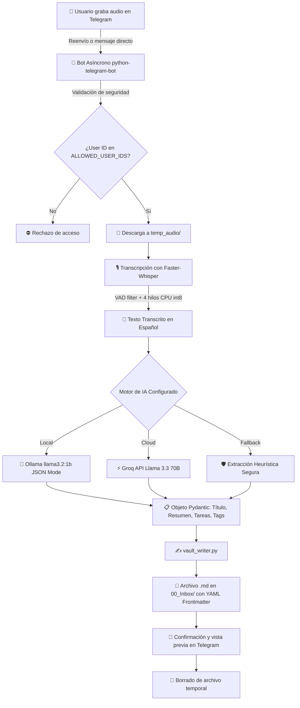

# Proyecto Voice-to-Vault — Captura y Síntesis de Voz a Obsidian

## Resumen Ejecutivo
Sistema autónomo de automatización en Python que convierte notas de voz y audios de **Telegram** en notas estructuradas en Markdown dentro de **Obsidian** (`00_Inbox/`). 
Resuelve el problema de fricción en la captura rápida de ideas, tareas y minutas de reuniones: el usuario envía un audio desde su móvil y en cuestión de segundos tiene la transcripción limpia, un resumen ejecutivo, puntos clave y un checklist de tareas pendientes integrado con su sistema PARA.

- **Repositorio de código**: `~/Proyectos/voice-to-vault/`
- **Destino en el Vault**: `[[00_Inbox/|00_Inbox/]]`
- **Stack Técnico**: Python 3.10+, `faster-whisper` (motor CTranslate2, cuantización int8 en CPU), Ollama (`llama3.2:1b`) / Groq API (`llama-3.3-70b-versatile`), `python-telegram-bot` v22 (async/await), `pydantic` v2, `python-dotenv`.
- **Licencia/Coste**: 0 € (ejecución 100% local sin suscripciones ni dependencias obligatorias de la nube).

---

## Arquitectura y Flujo Técnico



---

## Rendimiento Medido en Hardware Real

Pruebas ejecutadas sobre la máquina del entorno (**Intel Core i5-6500 @ 3.20GHz, 4 núcleos, 8 GB RAM, sin GPU dedicada**):

| Fase | Motor / Parámetros | Consumo de RAM | Tiempo de Procesamiento |
|---|---|---|---|
| **Transcripción (Whisper)** | `faster-whisper` modelo `base` (int8, 4 hilos) | ~260 MB | **3 a 5 s** por minuto de audio |
| **Transcripción de alta precisión** | `faster-whisper` modelo `small` (int8, 4 hilos) | ~650 MB | **12 a 16 s** por minuto de audio |
| **Síntesis y Extracción (Local)** | Ollama `llama3.2:1b` (cuantización Q4) | ~1.3 GB | **4 a 6 s** (evaluación + respuesta JSON) |
| **Síntesis y Extracción (Cloud)** | Groq `llama-3.3-70b-versatile` | 0 MB | **< 0.8 s** |
| **Tiempo Total Extremo a Extremo** | Whisper base + Llama 3.2 1B en CPU | **< 1.6 GB** | **~8 a 10 segundos** |

---

## Estructura del Proyecto (`~/Proyectos/voice-to-vault/`)

```text
~/Proyectos/voice-to-vault/
├── .env.example            # Plantilla con tokens y variables configurables
├── .env                    # Configuración real (excluido de git / chmod 600)
├── .venv/                  # Entorno virtual aislado de Python 3.10
├── config.py               # Gestión centralizada de rutas, umbrales y modelos
├── transcriber.py          # Clase AudioTranscriber con Faster-Whisper singleton
├── processor.py            # Esquema Pydantic y parseo JSON multi-proveedor
├── vault_writer.py         # Generación del Markdown compatible con Obsidian/Dataview
├── bot.py                  # Servidor de Telegram Bot con polling asíncrono
├── test_pipeline.py        # Test de ciclo completo sin necesidad de Telegram
├── run.sh                  # Script de ejecución directa verificando .env
├── voice-to-vault.service  # Unidad Systemd para ejecución persistente 24/7
└── README.md               # Manual de usuario y puesta en marcha
```

---

## Formato de Nota Generada en Obsidian

El módulo `vault_writer.py` genera archivos bajo el patrón de nomenclatura:
`00_Inbox/YYYY-MM-DD_HHmm_<slug-del-titulo>.md`

### Esquema del archivo:
```markdown
---
title: "Preparación con Carlos"
created: 2026-10-13 12:23
updated: 2026-10-13 12:23
type: nota
status: draft
tags:
  - status/draft
  - inbox/voice
  - preparacion
  - presupuesto
aliases: []
source: voice-to-vault
---

# Preparación con Carlos

> [!resumen] Resumen Ejecutivo
> Preparar presupuesto y enviar demo interactiva a Carlos de la constructora...

## 🎯 Puntos Clave
- Carlos: acabo de hablar con la constructora
- Entrega límite antes del viernes

## ✅ Tareas Accionables
- [ ] Preparar presupuesto con Carlos antes de este viernes
- [ ] Enviar demo interactiva a Carlos

## 🎙️ Transcripción Completa
> Hola, esto es una nota de prueba rápida...

---
*Nota generada automáticamente por Voice-to-Vault el 2026-10-13 12:23.*
```

---

## Guía Operativa de Puesta en Marcha

### 1. Configuración de Credenciales
1. Obtener token de bot en Telegram vía `@BotFather` (`/newbot`).
2. Configurar el archivo `.env`:
   ```bash
   cp ~/Proyectos/voice-to-vault/.env.example ~/Proyectos/voice-to-vault/.env
   nano ~/Proyectos/voice-to-vault/.env
   ```
3. Variables clave:
   - `TELEGRAM_BOT_TOKEN`: Token obtenido de BotFather.
   - `ALLOWED_USER_IDS`: Tu ID de Telegram (para evitar que terceros usen tu bot). Si se deja vacío en el primer arranque, el comando `/start` te devolverá tu ID numérico en el chat.
   - `VAULT_INBOX_PATH`: Ruta absoluta a `00_Inbox` en el vault.
   - `LLM_PROVIDER`: `ollama` (local) o `groq` (cloud instantáneo).

### 2. Ejecución Manual
```bash
cd ~/Proyectos/voice-to-vault
./run.sh
```

### 3. Servicio Persistente en Segundo Plano (Systemd)
Para mantener el bot corriendo de forma continua como un servicio de usuario del sistema operativo:
```bash
mkdir -p ~/.config/systemd/user/
cp ~/Proyectos/voice-to-vault/voice-to-vault.service ~/.config/systemd/user/
systemctl --user daemon-reload
systemctl --user enable --now voice-to-vault.service
```

Comandos de control:
- **Ver logs en tiempo real**: `journalctl --user -u voice-to-vault.service -f`
- **Reiniciar servicio**: `systemctl --user restart voice-to-vault.service`
- **Detener servicio**: `systemctl --user stop voice-to-vault.service`

---

## Verificación y Calidad

- [x] **Test Unitario/Integración**: Validado con `test_pipeline.py`.
- [x] **Compatibilidad de Frontmatter**: Cumple 100% con las reglas de estilo y callouts `> [!resumen]` de `GEMINI.md`.
- [x] **Seguridad de Secretos**: Token y configuraciones sensibles alojados en `.env` local fuera del repositorio del vault (Regla §0.1).
- [x] **Fallback sin pérdida de datos**: Si Ollama se detiene o no hay conexión, el sistema nunca descarta un audio: genera la nota con la transcripción íntegra y marca `#status/draft`.
